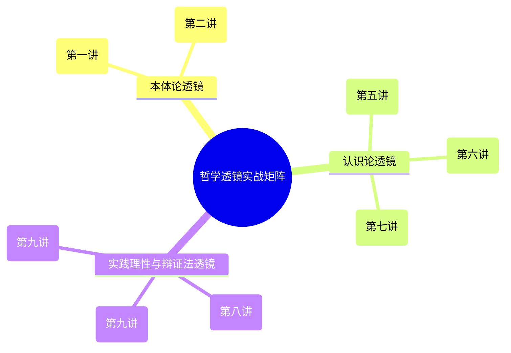

# 哲学透镜：复杂现实与商业战略的哲学实战工坊

> **模块导读**：  
> “未经审视的人生是不值得过的，未经哲学审视的战略是不堪一击的。”  
> 本模块是《西方哲学的思想历程》（特别是前九讲：从自然哲学本原说到黑格尔辩证法）走向**现实实践与商业/组织决策落地**的核心应用入口。通过将形而上学始基追问、认识论批判与历史辩证法提炼为实战思维工具，打破浮于表象的经验主义归纳，直击商业变革、技术颠覆与组织博弈的本质机理。

---

## 快速导航与实践图谱

| 文档类型 | 入口链接 | 核心内容提要 |
| :--- | :--- | :--- |
| **通用分析范式** | [哲学透镜_通用分析范式.md](./哲学透镜/哲学透镜_通用分析范式.md) | 沉淀六维解构工作流（始基溯源、前提怀疑、归纳破壁、认知立法、目的审视、辩证扬弃），配备实战清单与 Prompt 脚手架。 |
| **首期实战打样** | [01_诺基亚与移动终端范式革命.md](./哲学透镜/01_诺基亚与移动终端范式革命.md) | 深度复盘智能手机交替时刻：休谟归纳陷阱与物理按键的火鸡悖论、康德哥白尼革命（人机立法）、黑格尔实体即主体的生态演进。 |
| **思辨实录·01** | [01_实录_诺基亚与移动终端思辨对话.md](./教学设计/01_实录_诺基亚与移动终端思辨对话.md) | 苏格拉底产婆术教学实战记录：学习者自主推导康德哥白尼革命、休谟因果批判、绝对命令与黑格尔异化辩证法。 |
| **思辨实录·02** | [02_实录_AI与主体性危机思辨对话.md](./教学设计/02_实录_AI与主体性危机思辨对话.md) | 科技与主体性危机实战记录：学习者自主推导图灵测试局限、意向性与感受质、康德人格尊严与尼采生命艺术。 |

---

## 理论母体讲次对照索引

本实战工坊的哲学工具深度植根于知识库已有讲次：

- [第一讲·探究世界本原的方式：自然哲学](./第一讲_结构化深度探究.md) $\to$ **始基（Arche）透镜**
- [第二讲·追问存在本身的规定性：存在论和生成](./第二讲_结构化深度探究.md) $\to$ **存在与流变透镜**
- [第三讲·终极关怀问题的提出：斯多葛学派的人生哲学](./第三讲_结构化深度探究.md) $\to$ **控制二分法与战略韧性透镜**
- [第五讲·近代理性主义的开端：笛卡尔的主体性原则](./第五讲_结构化深度探究.md) $\to$ **普遍怀疑与主体性透镜**
- [第六讲·休谟的两大难题及其当代意义](./第六讲_结构化深度探究.md) $\to$ **归纳难题与反因果幻觉透镜**
- [第七讲·康德的第一批判及其哥白尼革命](./第七讲_结构化深度探究.md) $\to$ **认知立法与主客体重构透镜**
- [第八讲·康德的第二批判：理性主义的道德哲学](./第八讲_结构化深度探究.md) $\to$ **绝对命令与人是目的透镜**
- [第九讲·真理是一个过程·实体即主体](./第九讲_结构化深度探究.md) $\to$ **历史辩证法与实体即主体透镜**

---

*知识库规范与协作指引详见：[AGENTS.md](./AGENTS.md)*
