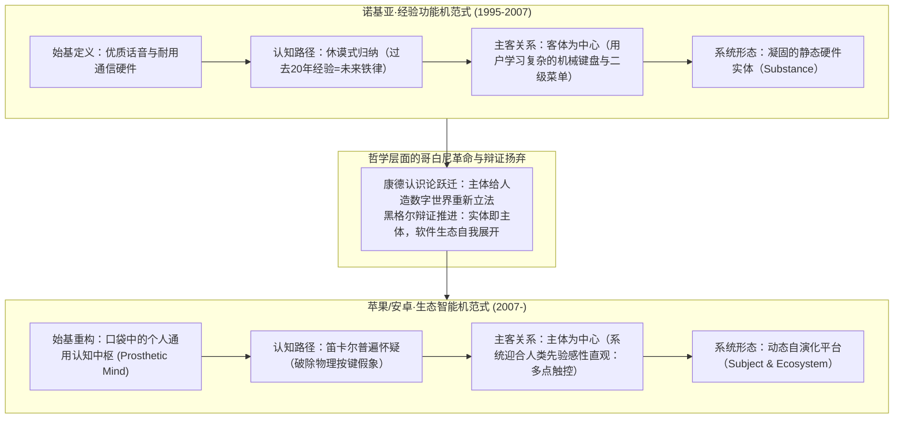
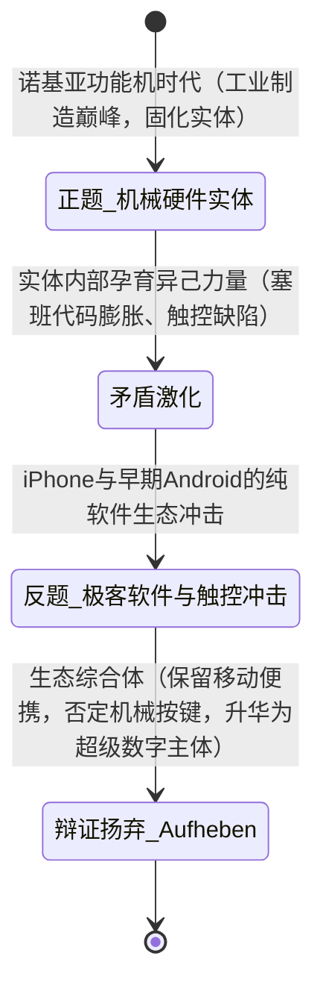

# 哲学透镜实战·01：诺基亚与移动终端范式革命

> **案例导语**：  
> 2007 年，诺基亚雄踞全球手机市场 40% 以上的份额，被誉为不可动摇的芬兰巨人；仅仅五年之后，其手机业务便迅速崩塌并走向被收购的边缘。主流商学院常将此归咎于“塞班系统臃肿”、“管理层迟钝”或“供应链傲慢”。  
> 然而，若将这一历史性剧变置于《西方哲学的思想历程》的理论天平上，我们会发现：这不仅是一场商业竞争的胜负，更是一场**古希腊始基追问的错置、休谟归纳教条的破产、康德式认识论“哥白尼革命”以及黑格尔历史辩证法内生自否定的宏大推演**。

---

## 导航索引与关联讲次
- 理论方法论来源：[哲学透镜_通用分析范式.md](./哲学透镜_通用分析范式.md)
- 苏格拉底思辨对话实录版：[01_实录_诺基亚与移动终端思辨对话.md](../教学设计/01_实录_诺基亚与移动终端思辨对话.md)
- 对应哲学讲次深度链接：
  - [第一讲·探究世界本原的方式：自然哲学](../第一讲_结构化深度探究.md)（始基与现象之辨）
  - [第五讲·近代理性主义的开端：笛卡尔的主体性原则](../第五讲_结构化深度探究.md)（普遍怀疑与理性反思）
  - [第六讲·休谟的两大难题及其当代意义](../第六讲_结构化深度探究.md)（归纳问题与因果心理联想）
  - [第七讲·康德的第一批判及其哥白尼革命](../第七讲_结构化深度探究.md)（人给自然立法与先验感性直观）
  - [第八讲·康德的第二批判：理性主义的道德哲学](../第八讲_结构化深度探究.md)（人是目的而非手段）
  - [第九讲·真理是一个过程·实体即主体](../第九讲_结构化深度探究.md)（黑格尔辩证法与扬弃）

---

## 一、 案例背景：文明级终端的交替时刻

2007 年 1 月 9 日，旧金山 Macworld 舞台上，史蒂夫·乔布斯宣布推出“三合一”设备：一台宽屏触控 iPod、一部革命性的手机、一个突破性的互联网通讯器。彼时，诺基亚全球出货量破 4 亿部，其王牌产品 Nokia N95 被誉为多媒体电脑顶峰。

当时的诺基亚管理层与华尔街分析师以经验主义眼光做出了判断：“iPhone 没有物理键盘，摔落易碎，且不支持 3G 网络和可拆卸电池，根本无法撼动诺基亚在通信工程领域的深厚护城河。”

然而，五年之内，天翻地覆。历史在此完成了一次哲学校准。



---

## 二、 核心哲学透镜解构

### 透镜 1：始基（$\text{Arche}$）与现象之辨——到底什么是“手机”？

古希腊米利都学派与爱利亚学派的核心工作，就是剥离瞬息万变、光怪陆离的感官表象，追问背后支撑万物的那个不变的“本原与根据（$\dot{\alpha}\rho\chi\acute{\eta}$）”。

- **诺基亚的始基迷思（错把载体当本原）**：
  诺基亚将手机的始基规定为“**通信话音设备（Tele-phone）**”。在这一本质规定性下，所有的研发资源与战略决策均被锚定在：抗跌落性能、天线射频信号优化、待机时长、外壳可更换性。诺基亚管理层误将古希腊自然哲学中的“质料（如塑料外壳与按键硬件）”当作了事物的“形式与隐德来希（目的）”。
- **苹果的始基重塑（从电话到认知外挂）**：
  乔布斯在本质上重新界定了这一事物的本体论承诺：它绝非传统意义上的“电话机”，而是**人类智能与感官向数字维度的延伸中枢（Universal Handheld Computer & Cognitive Interface）**。“打电话”不过是这一广袤数字世界中碰巧附带的一个普通应用（App）而已。

> **哲学启示**：当一个行业陷入内卷时，往往是因为既有巨头将某种历史阶段性的“物理实现手段”误认为了永恒的“本体始基”。

---

### 透镜 2：休谟归纳难题的商业投射——“火鸡悖论”与因果错觉

在[第六讲·休谟的两大难题](../第六讲_结构化深度探究.md)中，休谟以无情的怀疑论摧毁了经验主义的坚固幻觉：**我们在经验中观察到的只是“恒常伴随（Constant Conjunction）”，并不包含任何客观必然的“因果联系”；基于有限过去经验的归纳，永远无法推导出未来无限情况的必然性。**

```mermaid
flowchart LR
    A["过去1000次观察：<br>按键手感好 + 机身耐摔 = 销量冠军"] -->|心理习惯投射 (Habit)| B["形成伪信念：<br>'按键与耐用'是手机成功的必然原因"]
    B -->|黑天鹅来临 (2007 iPhone)| C["归纳断裂：<br>原有的因果模型瞬间失效"]
    style C fill:#f96,stroke:#333,stroke-width:2px
```

- **诺基亚的休谟式盲目**：
  诺基亚拥有全球最顶尖的市场调研与历史数据分析体系。在过去 15 年间，他们见证了无数次“键盘手感更好、信号更强、续航更长”的产品击败对手。长期的经验重复使得管理层在心理机制上形成了休谟所谓的**心理习惯（Psychological Habit）**与信念投射，把“物理机械键盘”和“商业成功”绑定为一条钢铁般的必然规律。
- **因果错觉的破灭**：
  罗素著名的“火鸡悖论”在此重演：农场里的火鸡每天早晨 9 点都被喂食，经过数百天的归纳，火鸡确信“9点等于早餐的必然真理”，直到感恩节那天早晨，屠刀落在了它的颈上。诺基亚在 2007 年依靠功能机赚取了创纪录的利润，但这一刻恰恰是归纳有效性的断崖边缘。

---

### 透镜 3：康德认识论的“哥白尼革命”——从客体适应到主体立法

在[第七讲·康德的第一批判](../第七讲_结构化深度探究.md)中，康德完成了哲学史上最著名的反转：
> 过去人们假设我们的认识必须符合对象；康德则宣布，**必须颠倒过来，对象必须符合我们的认识形式**。人类的先验感性形式（时间、空间）与知性纯概念（12范畴）主动为人造现象界立法。

这一哲学革命在人机交互界演化为一场天翻地覆的范式跃迁：

| 维度 | 传统诺基亚范式（前康德·客体中心论） | 苹果 iOS 范式（康德式·哥白尼革命） |
| :--- | :--- | :--- |
| **交互认知假设** | **人去适应机器客体**：用户必须在脑海中建立复杂的层级树状结构，记忆九宫格按键的特定连击码（按三次7打出字母R）。 | **机器顺应人类先验直觉**：人类不需要学习任何抽象编码，手指的物理滑动、捏合缩放（Pinch-to-zoom）直接映射大脑先验感性。 |
| **空间与感性形式** | 离散的机械点阵，界面空间是生硬割裂的页面跳转。 | **先验感性时空重构**：带有惯性滑动阻尼、拟物化物理回弹的数字现象世界，与人类在物理世界积累的感官时空完全同构。 |
| **认识论本质** | 朴素实在论：机器是一组客观存在的功能集合，人是被动的操作者。 | **人给数字自然立法**：界面就是一块白板，通过多点触控与直接操作，人类意识将自身的知性形式直接投射于屏幕之上。 |

iPhone 屏幕上的“滑动解锁”与“弹性回弹”，本质上不是软件工程的巧思，而是一次**先验感性直观对冰冷工具理性的彻底胜利**。乔布斯深刻参透了：不是让人去理解塞班操作系统的文件系统，而是由人类身体先验的直觉，为这个发光的方块“立法”。

---

### 透镜 4：康德伦理学审计——“人是目的而非手段”的生态反思

在[第八讲·康德的第二批判](../第八讲_结构化深度探究.md)中，康德提出了定言命令（绝对命令）的第二公式：
$$\text{Act in such a way that you treat humanity, whether in your own person or in the person of any other, never merely as a means to an end, but always at the same time as an end.}$$
（你的行动要把人不论在你自己的人格中还是在任何其他人的人格中，都始终看作目的，决不只看作手段。）

- **塞班与运营商同盟的“手段化异化”**：
  在诺基亚的黄金时代，其手机定制主要取悦于 Vodafone、AT&T、中国移动等电信运营商。用户被视为“话费流量消耗单位（ARPU值贡献工具）”，开发者被视为主机厂边缘的“代工码农”。诺基亚和运营商在系统里植入各种不可卸载的扣费应用，将用户的主体性降格为商业榨取的手段。
- **App Store 生态的“主体性赋能”**：
  苹果虽然在商业抽成上饱受争议，但其底层制度设计确立了极高纯度的用户体验尊严：严格的隐私沙盒、杜绝运营商恶意预装、开发者平等的全球分发权。开发者与用户的创造力与体验本身，在这个封闭而纯粹的自律体系中获得了前所未有的“目的性地位”。

---

### 透镜 5：黑格尔历史辩证法——“实体即主体”与内在矛盾扬弃

在[第九讲·真理是一个过程·实体即主体](../第九讲_结构化深度探究.md)中，黑格尔指出：
> 真实的事物绝不是一个僵死的客观实体（Substance），而是自我发展、自我分化、在克服自身内在矛盾中不断前行的主体（Subject）。历史的发展不是外部强加的，而是正题自身孕育着反题，并在自我否定中实现向更高阶段的“扬弃（$\text{Aufheben}$）”。



1. **正题（Thesis）：作为凝固实体的诺基亚**  
   诺基亚代表了工业文明时代硬件制造的绝对顶峰。它是典型的黑格尔意义上的“实体（Substance）”——坚固、耐摔、结构严密、分工明确。然而，它缺少了自我反思与演化的“主体性（Subjectivity）”。它的操作系统（塞班）由数千万行互不兼容的 C++ 代码硬性拼接，无法自我更新。
2. **反题（Antithesis）：否定性力量的内生孵化**  
   诺基亚并非没有看见触控未来。早在 2004 年，其研发中心就制作出了带触控屏的智能原型机。然而，正题内部强大的既有利益集团（功能机事业部）压制了否定性萌芽。诺基亚内部 Symbian 派系与 MeeGo 派系的残酷政治内耗，正是黑格尔所言的“事物内部包含着否定自身的种子”。
3. **合题与扬弃（Synthesis / $\text{Aufheben}$）**  
   智能手机的最终胜利，并非抹杀移动通信（保留了其便携通话的有用成分），而是**否定并抛弃了**阻碍人机交互的物理按键与封闭固件，将设备升华为一个开放的、由亿万开发者共同驱动其生长的“动态自演化主体”。现代智能手机真正实现了黑格尔的预言：**实体完全转化为了主体，真理成为了一个持续迭代的生态过程。**

---

## 三、 实战复盘决策清单（哲学透镜复盘矩阵）

如果我们将这套哲学透镜沉淀为一份战略决策反思清单，任何处于转型期的团队均可用其自测：

```text
[ ] 始基检视：我们是否把实现某种需求的特定工具（如网页、APP、门店），误当成了业务不可变更的本质（Arche）？
[ ] 怀疑演练：如果公司赖以发家的那条“核心经验”被彻底证明是错的，我们是否有从“我思（第一原则）”重新出发的勇气？
[ ] 休谟排雷：我们当前的季度战略规划，究竟是建筑在必然的逻辑因果上，还是仅仅建筑在“过去一直很顺利”的心理习惯归纳上？
[ ] 康德审问：我们是在逼迫用户去学习、适应复杂的后台逻辑，还是我们为用户先验的直觉与习惯重构了产品？
[ ] 伦理自律：在当前增长模型中，我们是将生态伙伴和用户当成了指标的垫脚石（手段），还是在赋能他们成为目的本身？
[ ] 辩证洞察：团队内部最强大、最赚钱的核心部门，是否正在成为扼杀下一代“反题创新”的结构性阻力？
```

---

## 四、 结语与当代意义：大模型（AI）时代的镜像呼应

今天，当生成式人工智能（LLM、Agentic Workflow）席卷全球时，历史的钟摆再次晃回了同一座哲学殿堂：

- **当下的始基迷思**：许多传统软件厂商依然执着于将产品定义为“菜单、按钮、数据表单”（正如当年的诺基亚执着于按键），却未意识到大模型交互正在掀起下一场**人给计算系统重新立法的哥白尼革命**——自然语言与意图（Intent）直接成为了知性范畴；
- **当下的休谟归纳陷阱**：过去依靠“增加代码行数与规则穷举”的软件工程方法论正在失效，基于概率分布的生成范式正在击穿传统的工程确定性幻觉；
- **历史辩证法的再上演**：传统 SaaS 软件作为工业软件时代的坚固“实体”，正不可逆转地被自我进化的智能体“主体”所扬弃。

**学哲学的终极意义，正在于让你在新的历史剧变来临时，不再做一个懵懂的受害者，而成为一个洞悉历史理性展开的清醒见证者与创造者。**
