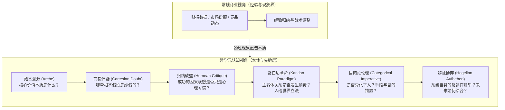
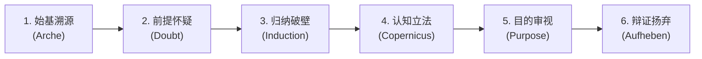

# 哲学透镜：复杂现实与商业战略的六维解构范式

> **“未经审视的生活是不值得过的，未经哲学审视的战略是不堪一击的。”**  
> 商业决策、组织博弈与技术革命的表象背后，无一不是形而上学假设、认识论偏见与历史辩证运动的具体具象。本范式旨在将《西方哲学的思想历程》（尤其是前九讲：从自然哲学到黑格尔辩证法）提炼为一套穿透现象、直击事物底层机理的“元认知脚手架”。

---

## 导航索引与关联讲次
- 溯源理论底座：
  - [第一讲·探究世界本原：自然哲学](../第一讲_结构化深度探究.md)
  - [第二讲·存在论与生成](../第二讲_结构化深度探究.md)
  - [第三讲·斯多葛学派的人生哲学](../第三讲_结构化深度探究.md)
  - [第五讲·笛卡尔的主体性原则](../第五讲_结构化深度探究.md)
  - [第六讲·休谟的两大难题及其当代意义](../第六讲_结构化深度探究.md)
  - [第七讲·康德第一批判与哥白尼革命](../第七讲_结构化深度探究.md)
  - [第八讲·康德第二批判与道德哲学](../第八讲_结构化深度探究.md)
  - [第九讲·实体即主体与真理的过程性](../第九讲_结构化深度探究.md)
- 实战打样案例：
  - [01_诺基亚与移动终端范式革命](./01_诺基亚与移动终端范式革命.md)

---

## 一、 为什么商业与战略分析需要“哲学透镜”？

在常规商业分析中，人们习惯使用 SWOT、PEST、五力模型等经验工具。然而，这些工具往往存在三大致命盲区：
1. **预设框架的教条性**：将现实裁剪以适应框架，忽视了定义框架本身的深层前提；
2. **休谟式归纳依赖**：将过去的“成功经验”和行业共识默认当成未来的客观规律；
3. **主客体混淆**：只见“产品/技术”（客体），未见“使用者的先验认知与欲望结构”（主体）。

哲学透镜不提供廉价的经验预测，而是提供**底层的批判力与穿透力**——它迫使战略制定者剥离表层泡沫，追问：*这件事情的真实始基是什么？我们的认知边界在哪里？颠覆这套体系的内在矛盾从何而来？*

---

## 二、 哲学思想历程映射矩阵（理论内核 $\to$ 现实隐喻）

| 讲次 | 核心哲学家与命题 | 核心哲学内涵 | 商业与战略现实隐喻 | 典型误区与盲区 |
| :--- | :--- | :--- | :--- | :--- |
| **第 1 讲** | 泰勒斯、阿那克西曼德等 **始基说 ($\text{Arche}$)** | 追问多变万物背后的统一本原；定性与无定（Apeiron） | **第一性原理与底层价值交付**：企业最终贩卖的本质是什么？（如：是胶卷，还是捕捉回忆？） | 把“实现手段/产品形态”误当成底层价值始基。 |
| **第 2 讲** | 巴门尼德 vs 赫拉克利特 **存在与流变** | 存在者存在、不动不变 vs 万物流变、人不能两次踏进同一条河流 | **护城河静态幻觉 vs 动态竞争生成**：核心优势是固化资产还是持续生成的演化能力？ | 以为筑起护城河便可高枕无忧，忽视了河流自身流速与河道的改变。 |
| **第 3 讲** | 斯多葛学派 **控制二分法与顺应自然** | 分辨“我能控制的”与“我不能控制的”；理性宁静与终极关怀 | **战略定力与周期韧性**：区分宏观周期/不可抗力与组织内功，戒除宏大叙事焦虑。 | 在外部风暴中怨天尤人，妄图控制不可控之物，耗竭组织精力。 |
| **第 5 讲** | 笛卡尔 **普遍怀疑与我思故我在** | 剥离一切感官成见与传统教条；确立理性认知的第一基石 | **零基思考与前提爆破**：对行业行规、“理所当然”的前提进行彻底质疑，重立根基。 | 路径依赖，将行业惯性误当成不可更改的物理定律。 |
| **第 6 讲** | 休谟 **归纳难题与因果错觉** | 过去经验不等于未来必然；因果性是心理联想与习惯投射 | **反“成功学”与黑天鹅警惕**：过去一万次成功的归纳，无法证明第一万零一次不会暴毙。 | 把商业上的“因果关联”误当成“必然规律”，死于黑天鹅事件。 |
| **第 7 讲** | 康德 **第一批判与哥白尼革命** | 人给自然立法；先验感性与知性形式构筑现象世界；物自体不可知 | **用户主观认知视界的重构**：不是用户去迎合产品，而是产品为用户直觉与欲望重新立法。 | 傲慢的工程思维：以为功能多就是真理，忽视了用户知性框架的重塑。 |
| **第 8 讲** | 康德 **第二批判与绝对命令** | 人是目的，而不是手段；道德自律高于经验功利算计 | **组织与用户的非异化**：企业长期价值在于对人的成就，而非数据榨取与工具化驱使。 | 极端KPI导向导致手段与目的颠倒；把员工和用户视作待收割的数据肥料。 |
| **第 9 讲** | 黑格尔 **实体即主体·真理是过程** | 实体不是凝固客体，而是自我展开的主体；正-反-合的辩证扬弃（Aufheben） | **内生颠覆与生态演进**：企业的成熟形态已孕育其毁灭的反题；颠覆不来自外部，来自矛盾展开。 | 幻想要有终局，视商业为静态博弈，抵抗否定力量而非主动扬弃。 |

---

## 三、 六步实战解构工作流（Workflow Checklist）

当面临重大商业转型、行业危机或战略推演时，依序启动以下六个维度的审问：

### 步骤 1：始基溯源（Arche Deconstruction）
- **追问**：
  1. 剥离目前的具体形态（APP、硬件、服务），用户在此处交付的最根本欲望/始基是什么？
  2. 我们当前的商业模式是在守护“始基”，还是在守护包装“始基”的容器？
- **产出**：一句话定义业务的本体论承诺（Ontological Commitment）。

### 步骤 2：前提怀疑（Cartesian Radical Doubt）
- **追问**：
  1. 当前业务赖以生存的 3~5 个核心假设是什么？（例如：“客户必须去实体店”、“屏幕尺寸不能超过3.5寸”）
  2. 如果像笛卡尔那样引入“恶魔假设”——假设这些前提全都是错的，系统会崩溃还是会诞生全新形态？
- **产出**：破除虚妄信念的“未证假设清单”。

### 步骤 3：归纳破壁（Humean Induction Check）
- **追问**：
  1. 我们引以为傲的“核心竞争力”，究竟是客观的必然联系，还是长期幸存带来的“心理习惯”？
  2. 行业里公认的“不可侵犯之铁律”，是否仅仅因为“过去一直如此”？火鸡喂养理论何时失效？
- **产出**：识别“经验依赖型脆弱点”。

### 步骤 4：认知立法（Kantian Paradigm Shift）
- **追问**：
  1. 本次行业重塑是否发生了一场“哥白尼革命”？（即：从“客体中心主义”转向“主体构建主义”？）
  2. 新进入者是在对旧客体做改良，还是提供了一套全新的知性范畴（重新定义了“交互形式”或“时间空间体验”）？
- **产出**：主体认知重构图谱。

### 步骤 5：伦理与目的审视（Categorical Imperative Audit）
- **追问**：
  1. 在此商业模式中，用户、员工、生态伙伴是被视为了达成增长的“纯粹手段”，还是被当成了“目的本身”？
  2. 如果将我们的商业准则普遍化为行业公理（绝对命令准则），该系统是否会导致自我矛盾并毁灭？
- **产出**：组织长期生命力与伦理防线评估。

### 步骤 6：辩证扬弃与演进判断（Hegelian Aufheben Forecast）
- **追问**：
  1. 当前最强盛的优势（正题）内部，正在自我催生怎样的对立力量（反题）？
  2. 未来的终局不是简单的“杀死前者”，而是何种维度的“扬弃（保留其核心力量，否定其外在形态，升华到更高层级）”？
- **产出**：正-反-合动态演进路线图。

---

## 四、 哲学透镜实战思维脚手架（Prompt 模板）

当你需要让 AI 或自我对某一特定事件、企业决策或行业现象进行哲学深度剖析时，可直接套用以下提示工程模板：

> **【哲学透镜分析指令模板】**
> 
> 请使用《西方哲学的思想历程》前九讲的理论工具，对【待分析的事件/商业策略/行业变革】进行深度的本体论、认识论与辩证法解构。
> 请严格遵循以下结构推进：
> 1. **始基与存在溯源（前苏格拉底/巴门尼德）**：解构该事件底层被掩盖的真实需求始基与静态护城河假象；
> 2. **认知反思与归纳破壁（笛卡尔/休谟）**：指出当事主体所深陷的未审视前提，以及将“心理习惯误认为客观必然”的归纳盲区；
> 3. **主客体哥白尼革命（康德第一批判）**：分析该事件中人与客体（产品/系统）的关系是如何被重构的，谁在为世界重新立法；
> 4. **目的与手段伦理审计（康德第二批判）**：审视系统中人的异化程度与绝对命令准则；
> 5. **矛盾演化与辩证扬弃（黑格尔）**：梳理“正题-反题-合题”的发展动能，给出超越经验表象的历史性结论。

---

## 五、 总结与结语

哲学不是空中楼阁的书斋游戏，而是人类在数千年认知进化中磨砺出的最锋利的理性手术刀。通过本范式，任何纷繁复杂的现实变局，都将化为清晰的思想切片，助你在喧嚣中勘破虚妄，于剧变中把握本质。
