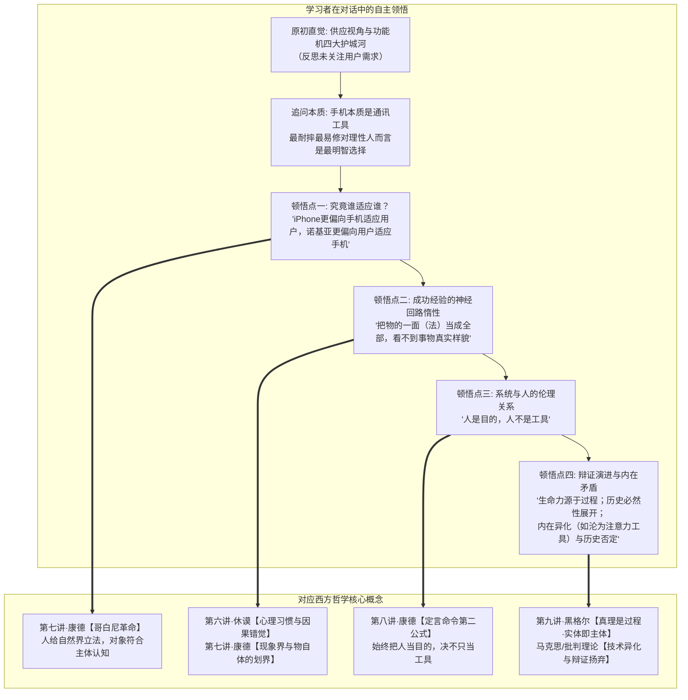

# 教学实录·01：诺基亚与移动终端范式革命的苏格拉底式思辨对话

> **实录说明**：  
> 本文档真实记录了一场以**“认知学徒制”**与**“苏格拉底产婆术”**为指导的哲学探究对话。引导者不预设、不灌输任何哲学结论，仅通过两难困境与反例追问制造认知失调；学习者从最初的商业直觉出发，自主推导并领悟出**康德哥白尼革命、休谟归纳难题、康德绝对命令、黑格尔实体即主体及异化理论**的完整哲学阶梯。

---

## 导航与理论关联
- 教学法指导规范：[对话式哲学探究教学设计指南.md](./对话式哲学探究教学设计指南.md)
- 进阶实录联动：[02_实录_AI与主体性危机思辨对话.md](./02_实录_AI与主体性危机思辨对话.md)
- 对应商业分析报告：[01_诺基亚与移动终端范式革命.md](../哲学透镜/01_诺基亚与移动终端范式革命.md)
- 关联哲学母体：
  - [第六讲·休谟归纳难题与当代意义](../第六讲_结构化深度探究.md)
  - [第七讲·康德第一批判与哥白尼革命](../第七讲_结构化深度探究.md)
  - [第八讲·康德第二批判与道德哲学](../第八讲_结构化深度探究.md)
  - [第九讲·真理是一个过程·实体即主体](../第九讲_结构化深度探究.md)

---

## 一、 思辨阶梯总览与顿悟映射

---

## 二、 对话全程实录与教学法拆解

### 第一幕：锚定原初直觉与护城河迷思

> **【教学意图】**：通过第一人称代入（2007 年诺基亚高管），激活学习者的既有经验图式（Schema），暴露潜意识中的前设。

**引导者（提问）**：  
现在，让我们一起将时钟拨回到 2007 年 1 月。你正坐在芬兰埃斯波诺基亚总部的战略高管会议室里，手握全球 40% 的手机市场份额。大屏幕上正在播放史蒂夫·乔布斯发布初代 iPhone 的切片：没有实体物理按键，整面是易摔碎的玻璃触控屏，电池不可拆卸，不支持 3G 网络，售价高达 499 美元。  
作为诺基亚最高决策者，结合过去十几年打造爆款的亲身经验，你的第一直觉是什么？哪几条理由让你觉得它很难构成实质威胁？

**学习者（作答）**：  
> 如果我只思考护城河：  
> 1 - 绝对的市场份额  
> 2 - 稳定的强大设计团队  
> 3 - 用户可以自行拆解与更换的手机，DIY 属性高  
> 4 - iPhone 易损坏，而诺基亚手机几乎摔不坏  
> 5 - ……  
> **此时的我并没有分析 iPhone 用户的需求。**

---

### 第二幕：剥离表象，逼出本体论承诺（定义权）

> **【教学意图】**：制造初级认知冲突，追问经验自信的来源究竟是“逻辑必然”还是“历史偶然”；迫使学习者显性化其对事物的底层定义。

**引导者（提问）**：  
你敏锐抓出了“未分析需求”。请仔细端详你列出的护城河：你之所以如此笃定它们构成了不可动摇的壁垒，究竟是因为“一部手机在本质上理应如此、必然如此”，还是仅仅因为“在过去的几千个日子里，市场每次都碰巧这样回报了你”？这两者之间有区别吗？

**学习者（作答）**：  
> 我是手机行业的领导者，**我以为我有对手机的绝对的定义权，一个单独的供应视角**。过去几千个日子，市场碰巧回报我的思维角度则是另一个角度，把手机能不能卖出去，强调了供需理论中的需求方视角，有利于我整合供需关系。

**引导者（递进追问）**：  
既然你当时深信自己拥有对手机的“绝对定义权”，在你的脑海里，你给一部合格手机下的根本定义是什么？它本质上是一个用来干什么的机器？为什么耐摔、按键和可拆换电池在此定义下不可撼动？

**学习者（作答）**：  
> **手机本质是通讯工具**，最耐摔最容易维修（间接降低持有成本），从几个因素触发，对手机使用者而言，是最明智的选择。

---

### 第三幕：顿悟一·康德哥白尼革命（谁适应谁？）

> **【教学意图】**：抛出顽固事实反例，打破“理性通讯工具”旧图式。引导关注人机交互中的主客体关系倒置。

**引导者（提问）**：  
如果手机本质是通讯工具，耐摔、易修、低成本是理性人最明智的选择，那为什么全球消费者宁愿排队几天几夜，忍受一摔就碎的玻璃、一天充两次电，也要疯狂买 iPhone？这群人追逐的核心难道不是通讯吗？如果不是，那到底是什么？

**学习者（作答）**：  
> 用户发掘了新需求（原来手机还可以这样用）：**交互方式更灵活**，相比于传统按键移动光标的方式，触屏可以实现直接点击按钮，丰富的手势；**丰富的应用集成于一体**：应用开发者不需要适配各种键盘，屏幕也十分标准，iPhone 更容易开发出标准程序，开发成本低，应用就能更丰富。

**引导者（脚手架提问）**：  
聚焦交互方式：在传统的诺基亚按键上，人要学习九宫格编码与层级菜单；在 iPhone 上，一个不识字的三岁小孩本能地用手指去捏合缩放图片。这种“究竟谁围绕谁转”的彻底颠倒，在深层次上发生了一种怎样的关系转变？

**学习者（顿悟爆发）**：  
> **两者其实用户都要学习规则（我们不能否认快速的操作就不是学习），但可以肯定，直观地说，iPhone 更偏向于手机适应用户，诺基亚更偏向于用户适应手机。**

💡 **【理论结晶】**：  
学习者自主推导出**康德《纯粹理性批判》的“哥白尼革命”**：不是人的认知去被动符合客观事物，而是客体必须顺应主体先天的感性直观与认识形式；乔布斯将屏幕打造成顺应人类先验身体直觉的延伸，“人给数字自然界立法”。

---

### 第四幕：顿悟二·休谟归纳难题与康德物自体划界

> **【教学意图】**：追问诺基亚为何在已造出触控原型机的情况下依然扼杀项目；逼问成功经验对心智模式的蒙蔽机理。

**引导者（提问）**：  
诺基亚早在 2004 年就做出了触控原型机，却亲手扼杀并全力押注物理按键。为什么过去 15 年一张张辉煌的财报和销量，不仅没帮他们看清未来，反而像白内障遮蔽了双眼？“过去的成功经验”，究竟在人类的心智模式里动了什么手脚？

**学习者（跨学科深度作答）**：  
> **从神经细胞学角度看**：总是成功的经验的神经通路更发达，结合大脑的惰性，大脑不会对其他弱路径产生感觉，使得大脑出现了障碍。另一角度，人有证成自我预言的倾向，人会陷入能力陷阱中（即面对需求时，人总是想到自己有什么工具，而不是思考我需要什么工具，有什么工具可以快速获取）；  
> **从哲学角度看**：人给自然界立法，但法仅是物的一面，我们容易把物的一面（法）当成物的全部，从而对自己看不到事物真实样貌的无意识（未看见未校验的隐藏假设）。

💡 **【理论结晶】**：  
1. **休谟归纳难题（第六讲）**：神经强通路所固化的“因果必然性”，本质上只是有限经验重复刺激后形成的“心理联想与习惯投射”，永远不能当成未来的客观铁律（火鸡悖论）。  
2. **康德现象界与物自体（第七讲）**：人所立之法仅属于“现象界”；把某一阶段的法则当成“物的全部（物自体）”，必然堕入理性的独断与失明。

---

### 第五幕：顿悟三·康德道德哲学的绝对命令

> **【教学意图】**：从交互与认识论，推进到生态组织与人际伦理，审视“人与商业系统”的定位。

**引导者（提问）**：  
在诺基亚与运营商时代，手机出厂功能被焊死，运营商后台预装大量吸费软件收割用户，开发者为适配几十种按键机型痛苦不堪；而 App Store 让普通程序员写出好应用即可直面全球用户。从伦理与组织视角看，这两套系统分别把“用户”和“开发者”当成了什么？

**学习者（瞬间秒答）**：  
> **人是目的，人不是工具。**

💡 **【理论结晶】**：  
学习者直接道出了**康德第二批判绝对命令的核心公式（第八讲）**：旧商业帝国落入了工具理性的极端异化，将人作为达成季度利润的手段；真正具备文明级生命力的生态，其根基在于确立了“人作为创造力与主体目的”的尊严。

---

### 第六幕：顿悟四·黑格尔辩证法、历史理性与异化之网

> **【教学意图】**：冲顶黑格尔辩证法最高峰，追问事物本质究竟是静态实体还是演化过程。

**引导者（提问）**：  
诺基亚手机买回家的第一天是生命力最巅峰的一天，往后只有折旧老化；而智能手机刚开箱近乎白纸，却在随后数年随着全球代码推送和你的使用，每天在生长变异。这件工具，从一个“被动制造出来的冰冷硬件客体”，变成了一个怎样的存在？它的本质真理是凝固在出厂那一刻，还是展现在怎样的历程中？

**学习者（宏大辩证总结）**：  
> **手机的生命力来源于源源不断的上层应用（从生态角度讲，手机充当了生态的生产者，应用和用户充当了消费者）。**  
> **历史的必然性（即，人不断丰富的需求），促成必然有一种能满足更优质需求的设备的出现与发展。**  
> **当然，手机也会在未来发展中遭到否定，甚至可能其内在也具有矛盾（比如手机服务于人，但有时候人反倒成了注意力消耗工具），有一些其他内在矛盾，人们暂时没有发掘，但必然在历史进程中走向毁灭。**

💡 **【理论结晶】**：  
1. **实体即主体，真理是一个过程（第九讲·黑格尔）**：硬件不是僵死的实体，而是作为生命体持续展开的主体过程；  
2. **世界历史的理性展开（第九讲·黑格尔）**：历史必然性借由人类不断丰富的精神欲望作为杠杆向前推进；  
3. **技术异化（马克思/法兰克福学派）**：敏锐洞察到当代智能手机最核心的内在矛盾——人创造出用于解放自身的工具，最终反转为消耗和奴役人注意力的异化枷锁；  
4. **否定之否定与扬弃（$\text{Aufheben}$）**：任何事物在其强盛之时便包含着自身灭亡的反题种子，终将在历史螺旋中走向更高形态的升华。

---

## 三、 本次教学实验的核心收获

1. **认知通道的打通**：  
   从神经元可塑性（生物脑）$\to$ 习惯归纳与知性立法（认知心）$\to$ 历史异化与扬弃（世界灵），学习者完成了完整的跨学科概念建构。
2. **拒绝知识灌输的纯粹性**：  
   全篇没有一处“先给定义再让学生做题”的传统教学套路，所有关键结论均由学习者在认知失衡后主动顺应并清晰表达（Articulation）。
3. **可复用的思辨模板**：  
   证明了将《西方哲学的思想历程》前九讲作为“元认知透镜”应用于现实商业、科技与决策分析的巨大解释力与实操可行性。
