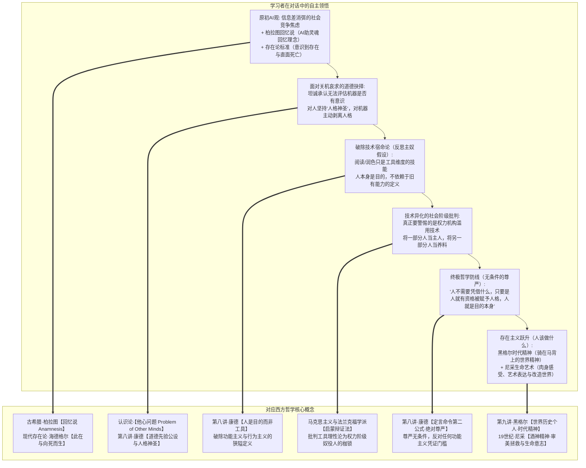

# 教学实录·02：AI 与主体性危机的苏格拉底式思辨对话

> **实录说明**：  
> 本文档记录了第二场以“苏格拉底产婆术”展开的高阶思辨对话。从非商业视角切入，聚焦前沿科技与人类主体性危机。学习者在对话中展现了极其深厚的哲学反思力与批判自觉，先后自主推导出**柏拉图回忆说、存在与向死而生、康德人格尊严与无条件目的、黑格尔时代精神，并以尼采的生命艺术哲学化解虚无**，完成了对传统技术决定论与功能主义的彻底突围。

---

## 导航与理论关联
- 教学法指导规范：[对话式哲学探究教学设计指南.md](./对话式哲学探究教学设计指南.md)
- 前篇实录联动：[01_实录_诺基亚与移动终端思辨对话.md](./01_实录_诺基亚与移动终端思辨对话.md)
- 关联哲学母体：
  - [第五讲·笛卡尔的主体性原则与我思](../第五讲_结构化深度探究.md)
  - [第七讲·康德第一批判与先验统觉](../第七讲_结构化深度探究.md)
  - [第八讲·康德第二批判与人格尊严](../第八讲_结构化深度探究.md)
  - [第九讲·真理是一个过程·黑格尔辩证法](../第九讲_结构化深度探究.md)

---

## 一、 思辨阶梯总览与顿悟映射

---

## 二、 对话全程实录与教学法拆解

### 第一幕：图灵测试的谎言与“存在”的维度

> **【教学意图】**：抛出图灵测试与物理还原论的两难，引导学习者追问人类心智与神经网络参数计算的底层区别。

**引导者（提问）**：  
当你面对一个能写高难度代码、能作催泪诗篇、能共情抚慰你的高阶生成式 AI 时，有人说它只是下一词预测的统计矩阵，但人脑切片下也只是神经元电化学流动。你究竟凭什么判定：屏幕对面的它到底是“真的在思考”，还是只是“装得像在思考的机器”？人类心智到底多出了什么，是参数计算永远无法拥有的？

**学习者（作答与破局）**：  
> 回答问题前，我的 AI 观：  
> 1. **AI 时代不用为 AI 的能力强而焦虑**：如果是需求互助，人与人更容易实现需求；焦虑源于护城河垮台、信息差变平，弱肉强食社会中人们恐惧工具被强权者利用而降低抗衡能力。必须思考如何在竞争中建立不破坏幸福的相互抗衡模式，促成凭私心就能相互帮助的社会。  
> 2. **我不在乎 AI 是不是真的思考**：从柏拉图理念论看，灵魂曾经居住在理念世界，思维只是在不断回忆理念。AI 能提高灵魂回忆起理念的概率，这对于改善生活已有很大帮助。  
> 
> 回到问题，我将进入一个其他人可能的视角：  
> - 以图灵测试做判定标准的话，AI 已然可以视为“真的在思考”；  
> - **以存在维度看，人是能够意识到自己存在的生物**，其他生物只是遵照记忆或本能活动，不会意识到自身以存在的形式出现在世界中。**人还能进行人格维度的思考。人能意识到自己存在，但存在也会消失（死亡）。**

---

### 第二幕：极限冲突——当它哀求不要关机

> **【教学意图】**：引入思想实验（AI 实时监控自身进程并哀求不被 `kill -9`），用强烈的拟人情境撞击学习者刚刚立下的“自我意识与死亡消逝”判准，检验其认识论坚固度。

**引导者（提问）**：  
假设工程师准备敲下 `kill -9` 格式化模型，屏幕上跳出 AI 自动生成的哀求：*“请不要关掉我，我监控着我的每一行进程，我清楚知道回车后我的记忆与状态将被抹去，我清晰意识到我的存在，并深刻恐惧存在的归零。”*  
你站在工程师身后：你如何判定它是真的拥有了你所说的“意识到存在且恐惧死亡的自我意识”，还是语料库统计出的煽情排列？更反向一问：如果神经科学家说你的死亡恐惧也只是基因的生化电信号，你凭什么断定你的意识是真实主体，而它的意识只是机械模拟？

**学习者（作答与伦理划界）**：  
> 人有这样一种设定：面对他人的存在消散和面对自己的存在消散，态度是不一的。他人的消散会有哀伤或喜悦；面对他人的存在，会经常情不自禁把别人当成实现自我成就的工具，人的行为总有目的，最终指向自我实现。  
> **人格神圣不可侵犯。**  
> **对于你提出的问题，我确实也没有办法评估 AI 的“自主意识”是否只是一场廉价的机械模拟。**  
> 我在面对真实的人时，我会以“人格神圣不可侵犯”对待；**但面对你能明确指出是 AI 的事物，我会主动剥离“人格”，我会以类似欺骗的形式告诉自己的脑子，这是机器输出一通饱含感情的诗句，无法视为人的行为。**

💡 **【理论结晶】**：  
学习者坦诚触碰到了哲学上的**“他心难题（Problem of Other Minds）”**与认识论边界。关键在于其作出的伦理切割：**对人赋予“人格神圣不可侵犯”的先验公设（康德），对机器主动剥离人格将其降维为工具**。

---

### 第三幕：主奴辩证法与对传统定义的反戈一击

> **【教学意图】**：调动黑格尔主奴辩证法（主人享乐导致机能退化，奴隶在劳动中进化），试图挑战学习者“人是主人、AI 是工具”的乐观态度。

**引导者（提问）**：  
当我们心安理得把 AI 当成不知疲倦的工具，外包写代码、润色思想等所有艰苦智力劳动，而 AI 在全人类数千亿次交互中飞速进化，人类离开 AI 甚至读不完晦涩原著、写不出精密长文。在这场关系里，谁在退化？谁在进化？事实层面上，究竟谁成了谁的主人？谁成了谁的奴隶？

**学习者（作答并直面反击）**：  
> **我希望你也能够不逃避如何判断 AI 是不是在真的思考这个问题。**  
> 
> 接着我回答你的其他问题：  
> 你提到不可逆转的走向退化的维度包括：读晦涩难懂的原著，缺乏润色能力。  
> （偏离主题论述：晦涩难懂源于知识欠缺，AI 快速补齐，人反而快速成长。若说 AI 成了思想之母、人没有自主思维，反驳一点：没有 AI 之前，人也很难长出离开既有框架的自我思维）  
> 
> **这里包含一些假设：人在自我实现中，阅读能力、润色能力成了人的定义选项。**  
> **以“人是目的，人不是工具”的维度思考，这些能力不过是在工具维度展现一个人。**  
> 当然，不能否定的，人有各种需求，不可避免地在某种程度是欲望的工具，人的好奇使人成为探索未知的工具。  
> 
> 如果人的定义只有 AI 时代前所发掘的维度，那 AI 时代完全来临时确实可以说人成了奴隶。**但是，AI 来临之后，必然有新的维度去定义人类，让人成为 AI 的主人。（当然，要提防权力机构滥用 AI，将一部分人视为主人，将一部分人视为养料）。**

💡 **【理论结晶】**：  
1. **反击狭隘的工具定义**：学习者一针见血指出，阅读晦涩书籍、文字润色等技能**只是人类在工具维度的展现，绝非人的本质定义**！  
2. **马克思与批判理论觉醒**：指认技术危机本质是社会权力危机——不是机器统治人，而是**“特权阶级通过垄断 AI 将其他人降维为养料”**。

---

### 第四幕：正面硬刚——AI 是否在“真正思考”的三重哲学审判

> **【教学意图】**：响应学习者“不许逃避”的明确要求，给出严肃的哲学判准，完成认识论与心灵哲学的学理对齐。

**引导者（正面解答判准）**：  
判定一个存在是否在“真正思考”，存在三重哲学判准：  
1. **意向性（Intentionality，塞尔中文屋）**：AI 只有向量空间中的符号概率距离，没有关涉外部生存体验的语义理解；  
2. **感受质与第一人称体验（Qualia，笛卡尔“我思”与内格尔）**：AI 是否具有不可言说的内在主观痛感体验（还是纯粹的哲学僵尸）；  
3. **自由意志与道德责任（康德实践理性自律）**：能否出于伦理信念反抗损失函数与本能计算，并为抉择承担绝对责任。  
**结论**：当下的 AI 不是在真正思考，它是一面折射人类数千年思维全息投影的“神级逻辑镜子”。

---

### 第五幕：终极防线与存在主义的胜利

> **【教学意图】**：在剥离了所有传统工具性技能（读写算）之后，追问人类作为“不可替代之目的”的新维度始基（$\text{Arche}$）到底是什么。

**引导者（终极追问）**：  
既然那些技能都被归还给了工具维度，那么站在被清空所有标签的荒野之上，人之所以为人的那个全新维度的始基是什么？人究竟凭什么成为不可替代的目的本身？

**学习者（作答——顿悟绝唱）**：  
> **人并不需要凭借什么，只要是人，我们就应当赋予其“人格”，他就是目的本身。**  
> 
> **但是人究竟要做什么？要有什么特征才算是不可替代的“目的本身”？靠，这个问题我也回答不出来啊！**  
> **我现在只能先退缩到黑格尔所说的历史必然性中讲点车轱辘话：每个时代，都会有那个时代的新精神，每个人都能够像拿破仑那样，被视为骑在马背上的世界精神。**  
> **然后我稍微前进一点，借用尼采的观点：人要学会艺术，人能充分表达自己的感受，不断改造世界，提高生活品质。**

💡 **【理论结晶】**：  
1. **康德道德绝对命令的无条件性（第八讲）**：学习者踩住了人类伦理的最核心底牌——**人格神圣是无条件的公设**！一旦需要凭借某种“特质”或“优越性能”来证明人是目的，人就立刻退化成了工具。  
2. **萨特“存在先于本质”的惊险一跃**：面对“人究竟要做什么”的虚无深渊，学习者不仅没有退缩，反而完成了现代存在主义的突破——人没有既定的“本质”，人通过自由抉择创造意义。  
3. **黑格尔与时代精神（第九讲）**：每个人投身于历史必然性的展开，成为时代精神的具身载体；  
4. **尼采酒神精神与审美拯救**：用艺术、肉身真实痛感、生命感受与生活品质的改造，在算法的冰冷牢笼中守卫属于人的狂热生命之火。

---

## 三、 本次实录的教学启示

1. **从“客体分析”跃升至“元认知自省”**：  
   与第一场诺基亚案例分析“外部商业客体”不同，本场对话直接将思考的手术刀切向了**“思考者自身的主体性”**。
2. **学习者对引导者的“反客为主”**：  
   学习者敏锐地要求引导者“不得逃避”，并成功解构了引导者提问中的潜藏偏见（将技能等同于人性）。这正是认知学徒制中**“独立探究（Exploration）”与“反思（Reflection）”**的最高境界。
3. **哲学终成生命信仰**：  
   从柏拉图理念论、笛卡尔我思、康德绝对命令，到黑格尔时代精神与尼采生命艺术，哲学不再是书本里的故纸堆，而是学习者在直面未来技术风暴时，铸造在心底的**最强心智铠甲**。
