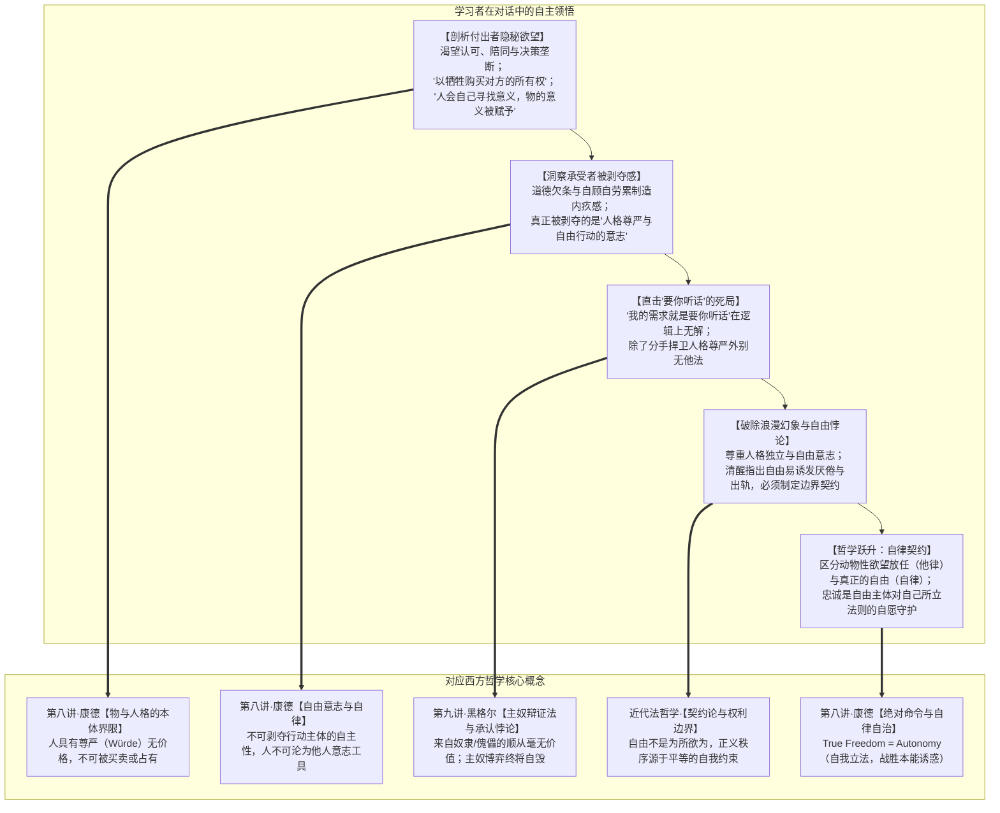

# 教学实录·03：亲密关系与情感博弈的苏格拉底式思辨对话

> **实录说明**：  
> 本文档记录了第三场以“苏格拉底产婆术”展开的非商业领域高阶思辨对话。从日常亲密关系中的“付出感与情感勒索”切入，通过双重视角对撞（沉重的付出者 vs 被窒息的承受者），学习者在未曾恋爱的前提下，纯凭缜密的理性直觉与生活观察，自主推导出**康德物与人格的法哲学界限、黑格尔主奴辩证法与承认的悖论，以及从动物性任意向康德式自律契约的跃迁**。

---

## 导航与理论关联
- 教学法指导规范：[对话式哲学探究教学设计指南.md](./对话式哲学探究教学设计指南.md)
- 系列实录联动：
  - [01_实录_诺基亚与移动终端思辨对话.md](./01_实录_诺基亚与移动终端思辨对话.md)
  - [02_实录_AI与主体性危机思辨对话.md](./02_实录_AI与主体性危机思辨对话.md)
- 对应实战透镜库：[哲学透镜_通用分析范式.md](../哲学透镜/哲学透镜_通用分析范式.md)
- 关联哲学母体：
  - [第七讲·康德第一批判与物自体/先验自由](../第七讲_结构化深度探究.md)
  - [第八讲·康德第二批判与道德哲学（自律与定言命令）](../第八讲_结构化深度探究.md)
  - [第九讲·黑格尔主奴辩证法与承认的欲望](../第九讲_结构化深度探究.md)

---

## 一、 思辨阶梯总览与顿悟映射

---

## 二、 对话全程实录与教学法拆解

### 第一幕：沉重的付出者——以“牺牲”购买“所有权”

> **【教学意图】**：通过第一人称代入（做尽家务、放弃晋升机会却被伴侣要求独处的付出者），激活情感直觉，逼问在“委屈与深情”面具之下的隐秘交换诉求。

**引导者（提问）**：  
当你咬着牙做出那些放弃和操劳，并在争吵中脱口而出“我为你牺牲了这么多”时——那一刻，你真正渴望从对方身上拿回来的那个“东西”，到底是什么？如果剥掉“无私的爱”的外衣，在最隐秘的层面上，你究竟是在试图用你的“牺牲”，去购买对方的什么？

**学习者（作答与解构）**：  
> 带入视角前进行一下我的一些观点：  
> - 恋爱的幻想是双方互补，总是鼓励对方，同时是希望对方一直支持自己，满足自己。  
> - 恋爱是一件双方互相成就之事，双方各自的课题不可避免地需要外部人员的支持，自己其实总有些领域无法帮助对方实现其成就，应该尊重其与他人沟通的可能。  
> - 恋爱确实无法逃避一些家庭琐事上的冲突，但冲突并非不可解决，但它确实容易表现为逐步加大的权力意志。  
> - 两个各自领域的深度专家，更容易相互挑战和认为对方无可理喻，有必要保留喘息空间，保持不争辩的糊弄权利。  
> 
> 现在带入故事视角：  
> - **渴望的“东西”**：认可与陪同，然后凡事都要双方同意。  
> - **以“牺牲”购买对方的“所有权”。**  
> 
> 现在再跳出来：  
> 故事中的“我”并没有明确告知对方我的所需，还在两句话内上升到了“人身攻击”与“情绪用词”。“我”的所作所为很有可能不是对方所需，我却要求我的“所作所为”换来对方的全部听话。  
> 
> 以“牺牲”购买对方的所有权，也是儒家纲常的一些控制表现：  
> 1. 在家里，父母做他们自己想做的“为你好”之事，期待孩子的完全听话。**父母若把孩子视为被打造的工具，便会认为孩子的人生意义应该是被自己赋予。（人会自己寻找意义，物的意义被赋予）。**  
> 2. 父母在享受打造孩子的快感，如果孩子不听话，容易陷入孩子谋反的幻想。  
> 3. 父母控制孩子的一种常见手段：不面向孩子的真实需求，而自顾自地劳累，以呈现最劳累的自己来引发孩子的内疚感，从而控制孩子。不面向真实需求去帮助，就是累了自己还无济于事。商业供不对求还央求购买很幼稚，爱情同理。  
> 4. 双方长期的真实需求未沟通，长期的压抑才累积了这次爆发。

💡 **【理论结晶】**：  
1. **康德物与人格的法哲学划分（第八讲）**：学习者一语中的——*“以牺牲购买对方的所有权”*。人是不可让渡的主体，企图通过牺牲换取对伴侣人身的垄断，是对人格神圣性的僭越。  
2. **“人自寻意义，物被赋予意义”**：精准阐明了康德“目的王国”中人与工具的本质分野。

---

### 第二幕：被窒息的承受者——道德欠条与人格剥夺

> **【教学意图】**：迅速转换至“被勒索的承受者”视角，体验自我感动式牺牲所带来的窒息压迫感，探索“被爱”为何会沦为“道德绞索”。

**引导者（提问）**：  
现在你灵魂附体到那个想要独自去徒步的承受者身上。面对伴侣端上来的热汤、放弃的晋升和疲惫的叹气，你感到的不是幸福，而是胸口压着大山。每一次付出都成了一张写满巨额利息的“道德欠条”。妥协则失去自我，坚持则沦为白眼狼。面对这种自我牺牲式的爱，你真正感到惊恐并拼命想要反抗的，到底是被对方剥夺了什么？

**学习者（作答与直击要害）**：  
> **对方剥夺了人格尊严，自由行动的意志。**  
> 就像电影快枪手那样，主角赶跑了恶人，赢得了部落女生的芳心和人们的认可，但在听到《圣经》的规训后，急忙逃走那样，**自由行动是最为宝贵，也最不希望被压制的一部分。**  
> 
> **题外话：我现在特别害怕对方说一句：“我的需求就是要你听话”，那这个需求属于我无法满足的需求，很有可能双方就会决裂了。（至少我的推演中，除了分手，我好像对这个问题无解）。**

💡 **【理论结晶】**：  
学习者不仅准确识别出**“人格尊严与自由行动的意志（Autonomy）”**是人不可被蚕食的底线，更提出了其深层推演的核心痛点——面对“我的需求就是要你听话”，除了分手别无解法。

---

### 第三幕：黑格尔主奴辩证法与“听话”的致命悖论

> **【教学意图】**：调动第九讲黑格尔主奴辩证法与“寻求承认的欲望”，剖析为什么强求对方“听话”是一场在逻辑上注定自毁的空虚骗局，确立分手的正当防卫性质。

**引导者（提问与解析）**：  
直面学习者的题外话：为什么“我的需求就是要你听话”在哲学上必然自毁？  
1. **承认的悖论（黑格尔）**：付出者真正渴望的是被一个自由独立的人格所认可和爱慕。如果承受者屈服听话、沦为丧失意志的傀儡或宠物，来自傀儡的顺从毫无价值！主人的内心不仅不会被满足，反而会更感空虚与厌倦，进而变本加厉索取证明；  
2. **分手的正当性（康德）**：契约只能建立在平等自由主体之间。当一方要求“剥夺你的自由意志”作为前置条件时，契约即刻作废，分手是捍卫人格尊严的唯一正当自卫。  
**推进发问**：如果“以牺牲换所有权、要对方听话”是通往奴役的死路，那么一段真正成熟的亲密关系，其底层的“哲学契约”究竟该是什么？

**学习者（作答与思辨深化）**：  
> **尊重人格，尊重独立性，尊重自由意志，为重要前提。**  
> **（但这在行动上的困难在于，充分尊重自由，几乎会鼓励人在单方面厌倦时，可以有出轨的行为）。**  
> **为了双方的需要，有必要为出轨描绘边界，制定契约。**  
> 分手时陷入财产争夺是另外的话题，也很严肃。

💡 **【理论结晶】**：  
学习者没有停留在空洞的浪漫口号上，而是极其清醒地洞察到了**“消极自由与放任的危险”**——完全不加约束的个人自由，容易在厌倦时滑向伤害伴侣的随意出轨。由此，对话被逼到了**“自由”与“自律契约”**的最高交汇点。

---

### 第四幕：终极破局——从动物性任意到康德式自律契约

> **【教学意图】**：澄清自由的真正内涵，阐明“契约与忠诚”非但不是自由的枷锁，反而是人类理性自由的最高明证。

**引导者（总结与提升）**：  
1. **出轨不是自由，而是动物性“他律（Heteronomy）”**：  
   康德在第八讲中早已阐明：被厌倦、冲动或荷尔蒙驱使去背叛诺言，不是自由意志在做主，而是**沦为了肉体本能与多巴胺的奴隶**；  
2. **真正的自由是“自我立法的自律（Autonomy）”**：  
   自由不是想做什么就做什么，而是**“明知有本能诱惑，我凭理性给自己立下守序的誓言”**。  
3. **健康契约的本质**：  
   不是“我管着你，你防着我”的监狱看守关系，而是两个拥有离开能力的独立自由人格，基于对彼此人格的敬畏，共同签署一份庄严盟约：  
   *“我拥有离开的一切自由，但我以我的自由意志立下法则——选择忠诚，信守边界。”*  
   **忠诚不是对伴侣的臣服，而是对自己所立誓言的人格坚守。**

---

## 三、 本次实录的核心教学收获

1. **破除“牺牲型自恋”的道德光环**：  
   从根源上揭露了“自我感动式付出”背后的权力支配欲，指出强行赋予他人意义与控制他人是物化人格的暴力。
2. **厘清爱与尊严的顺位**：  
   明确了**“人格尊严高于关系维系”**。任何以剥夺对方自由意志为代价的亲密关系，在哲学上均构成不可修复的非法奴役。
3. **完成“自由与自律”的形而上学闭环**：  
   成功从对“被控制”的恐惧，跨越到对“契约与忠诚”的理性建构，实现了《西方哲学的思想历程》核心伦理观在现实生活中的最高落地。
