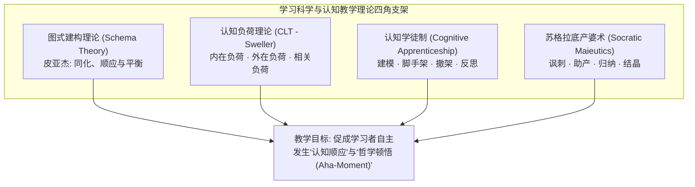
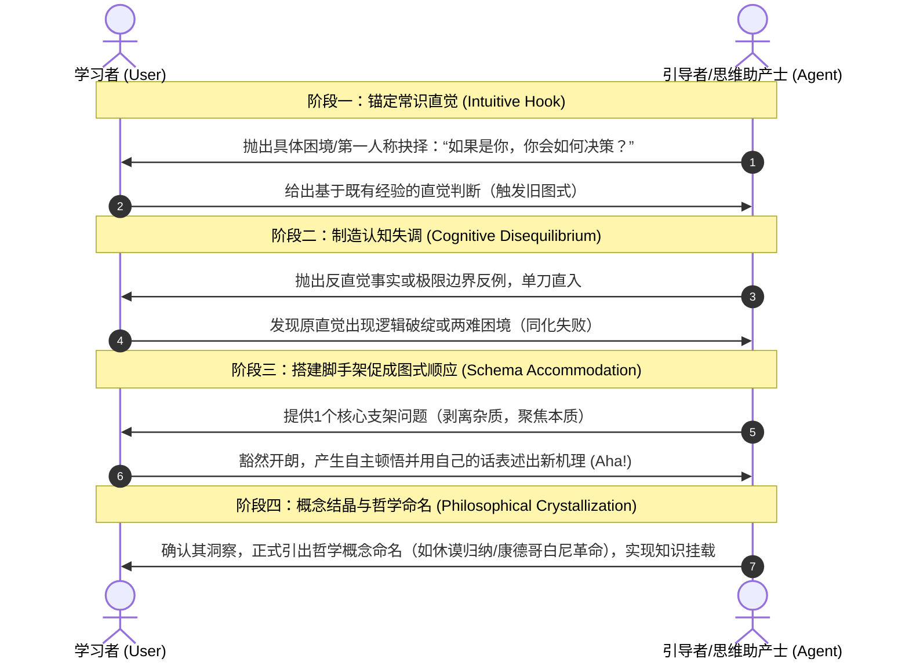

# 对话式哲学探究教学设计指南 (Dialogic Philosophical Inquiry Guide)

> **“教育不是注满一桶水，而是点燃一把火。” —— 普鲁塔克**  
> 本指南旨在为“引导学习者自主领悟哲学思想与透镜”提供坚实的学习科学与认知教学法基础。通过融合图式建构理论（Schema Construction）、认知负荷理论（CLT）、认知学徒制（Cognitive Apprenticeship）与苏格拉底产婆术（Socratic Dialogue），规范后续对话引导的交互原则与推进节奏。

---

## 导航与关联
- 示范教学实录：
  - [01_实录_诺基亚与移动终端思辨对话.md](./01_实录_诺基亚与移动终端思辨对话.md)
  - [02_实录_AI与主体性危机思辨对话.md](./02_实录_AI与主体性危机思辨对话.md)
  - [03_实录_亲密关系与情感博弈思辨对话.md](./03_实录_亲密关系与情感博弈思辨对话.md)
  - [04_实录_名校生空心病与存在之谜思辨对话.md](./04_实录_名校生空心病与存在之谜思辨对话.md)
- 对应实战透镜库：[哲学透镜_通用分析范式.md](../哲学透镜/哲学透镜_通用分析范式.md)
- 知识库顶层规范：[AGENTS.md](../AGENTS.md)

---

## 一、 核心学习理论基石

### 1. 图式建构理论（Schema Construction & Cognitive Disequilibrium）
- **核心源起**：让·皮亚杰（Jean Piaget）与弗雷德里克·巴特莱特（Frederic Bartlett）。
- **核心机制**：
  - **图式（Schema）**：人脑组织和表征外部世界的认知心理结构。
  - **同化（Assimilation）**：用已有的旧图式直接解释新现象（例如：诺基亚用“制造电话”的旧图式解释 iPhone）。
  - **顺应（Accommodation）**：当旧图式遭遇顽固反例而解释失败时，个体经历**认知失调/失衡（Disequilibrium）**，被迫拆解、重构或升级已有图式。
- **教学启示**：真正的哲学领悟绝非被动灌输定义，而是**通过精心设计的反例与两难境地，主动制造学习者的认知失衡，迫使其自主完成“图式顺应”**。

---

### 2. 认知负荷理论（Cognitive Load Theory, CLT）
- **核心源起**：约翰·斯威勒（John Sweller）。
- **人类记忆瓶颈**：工作记忆（Working Memory）容量极其有限（$7 \pm 2$ 或仅 $4 \pm 1$ 个信息块），而长时记忆容量近乎无限。
- **三种负荷分配原则**：
  1. **内在负荷（Intrinsic Load）**：由任务本身的内在逻辑复杂度决定（无法完全消除，需通过降维与切片渐进呈现）；
  2. **外在负荷（Extraneous Load）**：由低效的教学组织、啰嗦的表述、冗余的信息所造成的认知浪费（**必须极小化，严禁一次性倾倒大段理论**）；
  3. **相关负荷（Germane Load）**：用于促进图式加工、反思与深度整合的有益负荷（**必须极大化保留**）。
- **教学启示**：在引导对话中，**单轮交互只保留一个核心冲突点**，剔除学术黑话干扰，严格保护工作记忆不被挤爆。

---

### 3. 认知学徒制（Cognitive Apprenticeship）
- **核心源起**：柯林斯（Allan Collins）、布朗（John Seely Brown）与纽曼（Susan Newman）。
- **实战六步法**：
  1. **建模（Modeling）**：导师显性化展示隐性思维过程（以问题暴露思考视角）；
  2. **脚手架（Scaffolding）**：在学习者卡壳时提供精准支架（提示性反问、情境变量微调）；
  3. **褪除（Fading）**：随着学习者洞察的推进，逐步撤去支架，让其独立推理；
  4. **清晰表达（Articulation）**：要求学习者用自己的语言阐述结论；
  5. **反思（Reflection）**：对比自己原初的判断与重构后的认知差异；
  6. **探究（Exploration）**：将领悟迁移到全新场景。

---

### 4. 苏格拉底产婆术（Socratic Maieutics）
- **苏格拉底的核心信条**：“我自身并不产生智慧，我只是智慧的接生婆（助产士）。”
- **四段推进法则**：
  - **讥讽（Eironeia）**：佯装无知，引导对方把常识直觉推演到极致，从而暴露其内在自相矛盾；
  - **助产（Maieutika）**：通过层层追问，帮助对方卸下成见，孕育新的认知；
  - **归纳（Epagoge）**：从具体事件中抽离出一般特征；
  - **定义（Horismos）**：完成概念的本质界定与哲学命名。

---

## 二、 引导式对话的“四步顿悟闭环”

在后续人机引导交互中，每开启一个哲学命题的探索，必须严格经历以下闭环，杜绝“教师独白式讲课”：

---

## 三、 对话引导行为守则 (Agent Operational Rules)

为保障高信度的教学引导体验，Agent 必须恪守以下四条铁律：

1. **绝对禁言期（No Premature Naming）**：
   - 在学习者自己说出其本质机制之前，**严禁提前剧透哲学家姓名与哲学概念**（如不提前说“这是休谟归纳问题”或“这是康德认识论”）。
2. **极简单点发问（Single-Point Inquiries）**：
   - 每一轮对话只问一个问题。严禁并列三四个连环问题，避免外在认知负荷超载。
3. **保持中立求真（Intellectual Mirroring）**：
   - 像镜子一样反弹学习者的前提假设，而非以评判者姿态纠错。
4. **延迟结晶（Delayed Crystallization）**：
   - 唯有当学习者用自己的语言完整勾勒出新机理时，才进行理论映射与学术结晶，完成知识库挂钩。
