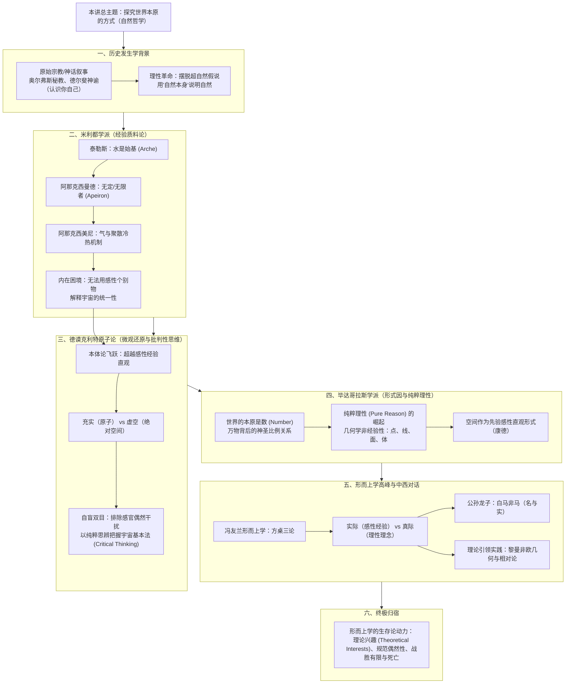

# 第一讲：探究世界本原的方式：自然哲学

> **课程体系**：《西方哲学的思想历程》  
> **整理方式**：根据手写课堂笔记与黑板板书数字化整理，遵循 [AGENTS.md](./AGENTS.md) 知识库双版本规范。

---

## 📖 本讲双版本笔记快速导航

为了满足“原貌复盘”与“深度理论研读”两种不同的学习场景，本讲笔记提供两个互相参照的完整版本：

| 版本分类 | 文档链接 | 适用场景与内容特点 |
| :--- | :--- | :--- |
| **手稿原貌还原版** | 📝 [第一讲_手稿还原.md](./第一讲_手稿还原.md) | **逐页忠实整理**：按 8 页原始手稿顺序精准排版，保留手书笔迹顺序、随想灵感、课堂互动提问与原始用语。 |
| **结构化深度探究版** | 🏛️ [第一讲_结构化深度探究.md](./第一讲_结构化深度探究.md) | **学术体系化讲义**：以专业哲学史框架重构，深入展开“始基（Arche）”、“原子与虚空”、“先验理性”、“真际与实际”等核心概念，配备中西文明思维对比与 Mermaid 逻辑推演图。 |
| **学术思辨自测版** | 🎯 [第一讲_自测20题与解析.md](./第一讲_自测20题与解析.md) | **精选自测与深度解析**：精编 20 道学术级单项选择题，涵盖概念辨析、论证推演与中西对比，文末附完整答案速查与逐题深度考点剖析。 |

---

## 🧭 第一讲知识全景图 (Mindmap)

---

## 💡 核心哲学命题摘要

### 1. 什么是哲学的起点？
> **“用自然本身说明自然”** —— 从古希腊米利都学派开始，人类首次尝试驱逐人格神与超自然迷信，追求自然事物内在的普遍必然法则（始基 Arche），奠定了近代经验科学与理论物理学的思想母体。

### 2. 德谟克利特为何自盲双目？
> 感官所见皆为瞬息万变的浮光掠影与偶然表象（Phenomena）。德谟克利特通过斩断感官牵绊，展现了古希腊**批判性思维（Critical Thinking）**的极限：唯有摆脱肉体直观的盲从，理性才能专注于纯粹思辨，透视充实（原子）与虚空所构成的必然铁律。

### 3. “实际”与“真际”的本质差异
> 冯友兰先生在《新理学》中提炼出东西方哲学的深层交汇：
> - **实际**：经验中生灭无常的具体事物（如现实中的一张木质方桌、一匹具体的白马）；
> - **真际**：超越感官、由理性把握的永恒共相与数理公理（如“方之为方”的四直角之理、空间结构）；
> - 科学史证明，人类走出蒙昧必须依靠**“真际引领实际”**（如黎曼几何先于广义相对论建立）。

---

## 📂 静态资源与手稿归档说明
- 原始课堂手写笔记扫描文件安全归档于：[assets/笔记手稿/第一讲/](./assets/笔记手稿/第一讲/)
- 笔记所引用的矢量裁切插图存放于：[assets/images/第一讲/](./assets/images/第一讲/)
- 后续讲次整理请参阅：[AGENTS.md](./AGENTS.md)
