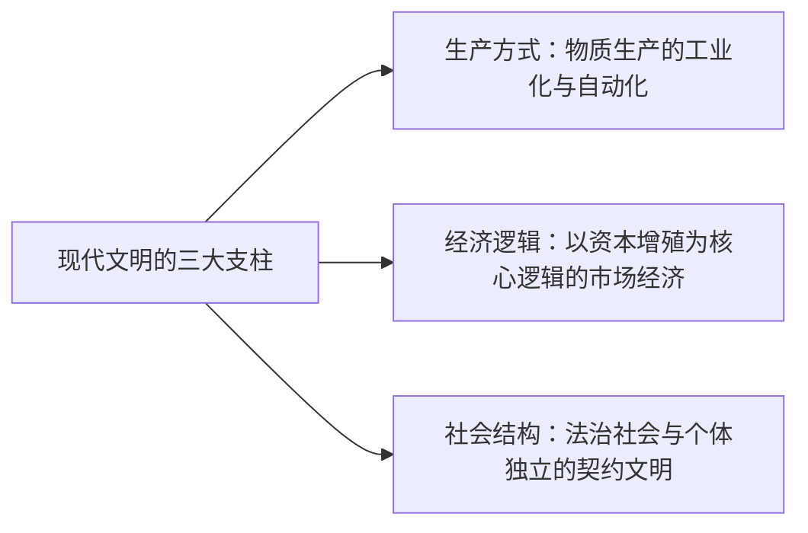
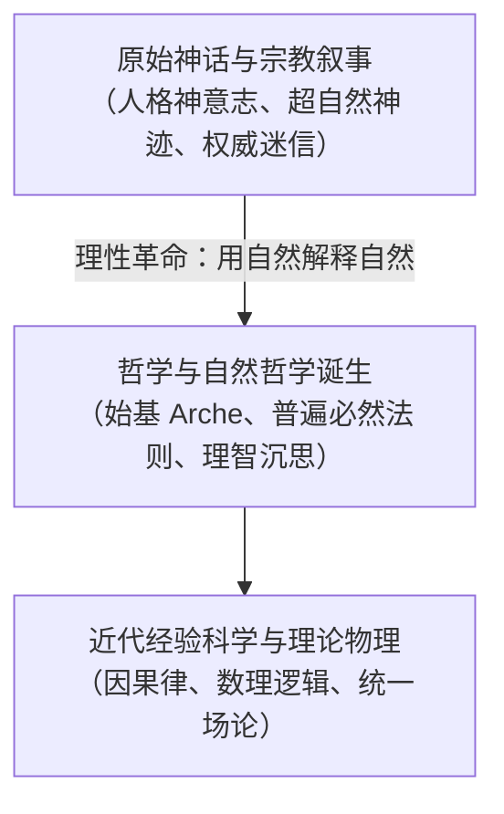
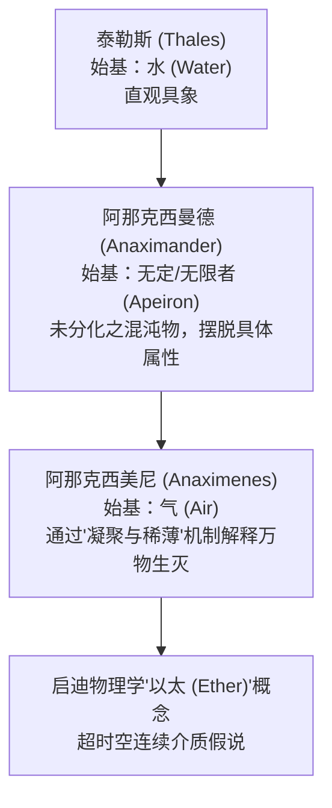
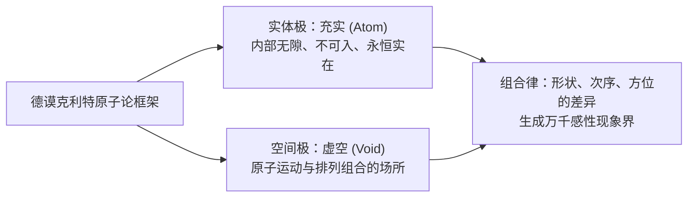
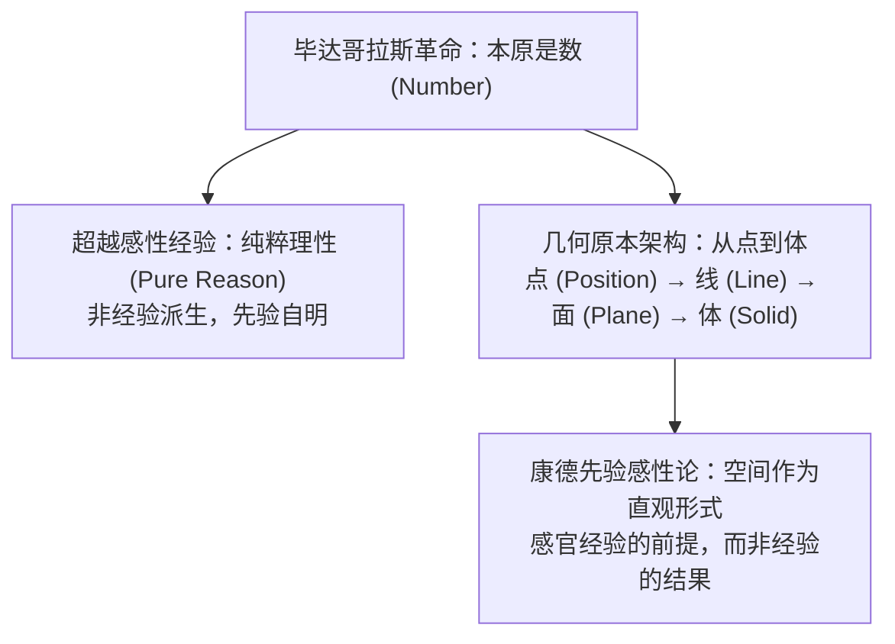
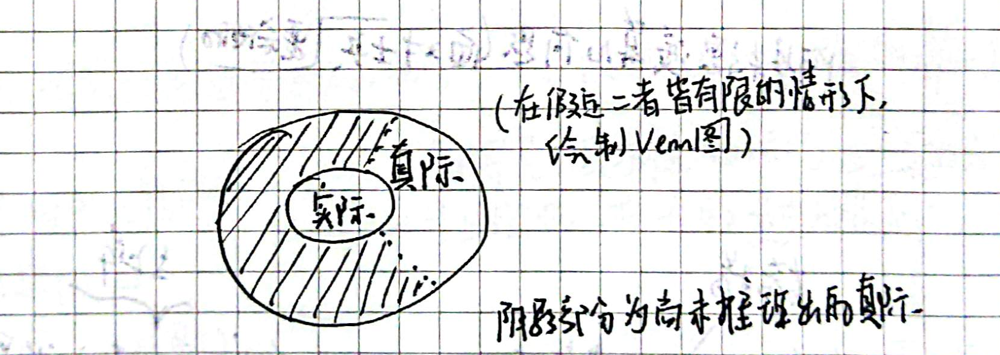
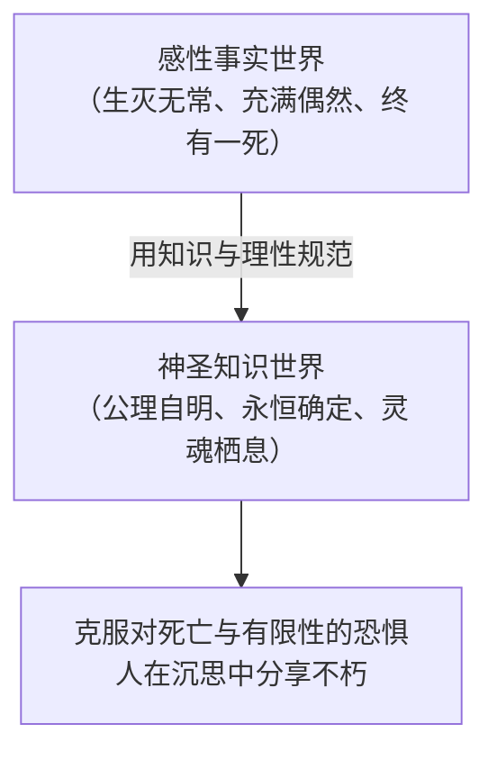

# 第一讲：探究世界本原的方式：自然哲学（结构化深度探究版）

> **导读与互链**：本篇为《西方哲学的思想历程》第一讲的体系化深度讲义。笔记立足课堂手稿的核心命题，系统性梳理从古希腊自然哲学到形而上学本体论的演进逻辑，深入辨析中西哲学思维的根本分殊，并附有严谨的概念考证与理论图解。
> - 手稿原貌还原对照，请参阅：[《第一讲：探究世界本原的方式：自然哲学（手稿还原版）》](./第一讲_手稿还原.md)
> - 本讲总览索引与导航，请参阅：[《第一讲：导读与索引》](./第一讲.md)

---

## 目录
- [一、 现代性困境与思想史溯源](#一-现代性困境与思想史溯源)
- [二、 哲学的发生：从神话叙事到自然本体](#二-哲学的发生从神话叙事到自然本体)
- [三、 米利都学派：经验质料阶段的本原探寻与其内在悖论](#三-米利都学派经验质料阶段的本原探寻与其内在悖论)
- [四、 本体论的第一次伟大跃迁：德谟克利特的原子论与批判性思维](#四-本体论的第一次伟大跃迁德谟克利特的原子论与批判性思维)
- [五、 先验形式与理性自明：毕达哥拉斯学派与几何学起源](#五-先验形式与理性自明毕达哥拉斯学派与几何学起源)
- [六、 两个世界的建构：冯友兰“真际与实际”形而上学解析](#六-两个世界的建构冯友兰真际与实际形而上学解析)
- [七、 形而上学的终极冲动：理论兴趣与超越生死有限性](#七-形而上学的终极冲动理论兴趣与超越生死有限性)

---

## 一、 现代性困境与思想史溯源

现代化的本质是一场由西方文明孕育、后席卷全球的文明形态重塑。理解西方哲学思想的演进历程，其根本动力并非书斋式的概念考辨，而是为了回应非西方社会在现代性转型中的深层困惑。

### 1. 现代化的三大支柱
手稿开篇精准提炼出现代化的基本内涵：


### 2. 两个历史性发问
1. **经济维度**：为什么中国传统文明高度繁荣，却未能内生出“以资本增殖为逻辑”的纯粹市场经济体制？
2. **人权与伦理维度**：为什么中国思想传统中普遍缺乏对“人作为绝对独立个体”的本体论论证？

### 3. 思想基因的考察
手稿指出，现代文明的内核并非偶然的技术发明，而是植根于**希腊（理性与逻辑）**与**犹太-基督教（信仰与超越）**的双螺旋基因之中。西方思想正是通过对“发展（develop：由隐蔽到显现、由潜能到现实）”的执着追问，开辟了自然科学与法治制度的形而上学地基。

---

## 二、 哲学的发生：从神话叙事到自然本体

哲学（Philosophy，希腊语 $\varphi\iota\lambda o\sigma o\varphi\acute{\iota}\alpha$，爱智慧）并非人类最初的解释框架。在哲学诞生之前，人类面对浩瀚宇宙与生命无常，依赖的是神话与原始宗教。

### 1. 原始宗教与神话意识的界限
- **奥尔弗斯秘教（Orphism）**：提出了灵魂转世与净化观念，其德尔斐神庙铭刻着最高诫命——**“认识你自己”（$\gamma\nu\tilde{\omega}\theta\iota\ \sigma\epsilon\alpha\upsilon\tau\acute{o}\nu$）**。
- **神话思维的特征**：创世与宇宙秩序被归因于具有人格特征的神祇或超自然奇迹，如柏拉图所描述的早期诗人状态——“神借我的嘴说话”。
- **局限**：对世界的解释依赖于拟人化的权威，理性始终无法从巫术与迷狂中独立。

### 2. 哲学的诞生：思维方式的根本革命
哲学的起步标志着人类思维的一次哥白尼式转向：
> **核心原则**：摆脱超自然假说，用**自然本身**来说明**自然**。

人类不再把打雷归于宙斯的愤怒，也不把海啸归于波塞冬的意志，而是寻求自然界内部普遍有效、常驻不变的第一原则——**始基（$\dot{\alpha}\rho\chi\acute{\eta}$ / Arche，又译本原）**。这与近代爱因斯坦穷其后半生渴望完成“统一场论”的驱动力如出一辙：寻找统摄繁复自然现象的唯一终极法则。



---

## 三、 米利都学派：经验质料阶段的本原探寻与其内在悖论

古希腊自然哲学的第一个学派发端于小亚细亚西海岸的伊奥尼亚商业城邦——米利都（Miletus）。他们首次系统性地尝试从经验世界寻找始基。



### 1. 泰勒斯（Thales）：水作为第一原则
- **命题**：水是万物的始基（Arche）。
- **学术注记**：
  - 亚里士多德在《形而上学》中评述泰勒斯的依据：万物的滋养皆含水分，种子具有潮湿的本性，水是湿润性质的源头；生命离不开水分。
  - 黑格尔在《哲学史讲演录》中指出：人类文明皆发源于河流流域，水具有流动性、可塑性与无定形性，水最易于呈现为不同物态（固、液、气），泰勒斯以此作为万物统一性的标志，是理性破晓的第一声啼鸣。

### 2. 阿那克西曼德与阿那克西美尼的层进
- **阿那克西曼德**觉察到：水本身具有特定的性质（湿冷），无法解释其对立面（火之干热）。因此他提出始基是**“无定/无限者”（Apeiron）**，即一种未被分化的原初混沌实体。
- **阿那克西美尼**进一步追问这种物质如何转化为具体事物，提出**“气”**为始基，并首创了动力机制：气通过**“稀薄化（变为火）”**与**“凝聚化（变为风、云、水、土、石）”**的运动，实现万象生成。

### 3. 中西自然观对比：古希腊“元素质料” vs 中国“气化五行”
手稿特别指出：中国传统哲学亦有“金木水火土”与“元气论”，但二者的思维模型有着根本分野：
- **中国五行**不是近代物理学意义上的元素微粒，而是五种**“气化运转状态”与功能属性**的抽象归纳（如肝属木、肾属水），追求的是系统内的相生相克、感通调和，具有**感性非超越性**。
- **希腊始基**则是实体性的、对象化的，旨在从客体对象本身剖析出最基本的构件与终极定律。

### 4. 米利都学派的内在困境
米利都学派遭遇了不可克服的认识论悖论：
- **逻辑困境**：我们怎么能用**感性具体的事物**（无论是水、气还是火）来解释整个世界的**终极统一性**？
- 感性经验中的一切事物皆是流动的、相对的、彼此排斥的（“自他的世界”），经验材料本身无法承载绝对必然的理性普遍性。

---

## 四、 本体论的第一次伟大跃迁：德谟克利特的原子论与批判性思维

为了摆脱感性质料的局限，希腊哲学开启了由具象观察向纯粹理性抽象的巨大跃迁，其巅峰即是德谟克利特（Democritus）的唯物主义原子论。

### 1. 超越感性的双基石：充实与虚空
德谟克利特与勒基珀断定，世界在本质上由两部分构成：
1. **充实（Fullness）—— 原子（$\text{Atom}$，希腊语 $\dot{\alpha}\tau o\mu o\varsigma$，不可分割物）**：
   - 内部绝对紧密、毫无空隙，是永恒不变的物质实体。
   - 原子不可感知，只能通过**理智思辨（Pure Thought）**来把握。
2. **虚空（Void）—— 绝对空间（Non-being）**：
   - 非存在不仅不是无，反而是原子运动与组合必不可少的客观舞台。



### 2. 科学直觉：组合几何与现代还原论先驱
德谟克利特指出：原子在本质属性上没有质量或颜色的区别，唯有**几何特征与空间排列**的不同：
- **形状（Shape）**：如球形（构成灵魂与火）、钩状、凹凸状；
- **次序（Order）**：如字母 A 与 B 的次序；
- **方位（Position）**：如字母 N 与 Z 的旋转。
> **启迪**：这种凭借微观纯几何构件的排列组合解释宏观多样性的范式，正是现代分子生物学、化学晶体结构与遗传密码论（DNA 碱基排列）的远古思维母体。

### 3. 中外古代微粒观的微妙对比
- **佛教哲学**：《金刚经》提出了“微尘”与“一合相”，指出世界碎为微尘，但微尘亦非实相，旨在破除对外境的执着。
- **先秦名家**：《庄子·天下篇》引惠施“一尺之棰，日取其半，万世不竭”，揭示了数学连续体的无限可分性。
- **德谟克利特**：断定物质必须存在最小且不可分的不可入限度（原子），以此拯救世界在本体论上的客观实在性。

### 4. 德谟克利特为何自盲双目？—— 批判性思维（Critical Thinking）的决绝宣告
手稿中记载了一个震撼人心的思想史典故：德谟克利特晚年弄瞎了自己的双眼。
- **为何如此？**
  感官（视、听、触）带来的只能是浮光掠影的现象（Phenomena）与偶然幻象，盲从肉眼只会让心灵沦为感官的奴隶。
- **自白的核心意涵**：
  > “我不需要肉眼看东西，我在思辨！思辨这个世界背后的第一定律（基本法）。”
- 这正是 **Critical Thinking（批判性思维 / 审度性反思）** 的最纯粹起源：敢于悬置、怀疑所有感官经验材料，回归理智主体自身，向深层的本质必然性挺进！

---

## 五、 先验形式与理性自明：毕达哥拉斯学派与几何学起源

如果说德谟克利特是将物质抽象为微粒，那么毕达哥拉斯学派（Pythagoreanism）则完成了一次更为纯粹的形而上学革命：**从寻找事物的“质料因”彻底转向了“形式因”**。



### 1. 世界的本原是“数”（Number）
- **中西对比**：在中国传统中，数（河图、洛书、九章算术）主要被作为度量实物、推演吉凶或辅助治理的实用工具；而在毕达哥拉斯眼中：
  1. 数不仅仅是工具，**数就是世界的本原与骨架**；
  2. 万物之间和谐的比例关系（如乐律中的八度音阶之弦长比 $1:2, 2:3, 3:4$），构成了宇宙神圣秩序（Cosmos）的本质。
- **数的神圣性**：数指向感性事物，但**数本身超越感性**。你可以看到两只羊、三块石头，但你从未在物理世界上直接踩到过纯粹的“$2$”或“$3$”。

### 2. 几何学的非经验性与纯粹理性（Pure Reason）
手稿精辟指出：**几何学绝不建立在感官观察与测量实验之上！**
- 现实经验中绝对找不到两根永不相交的无限延伸平行线；
- 现实中任何墨水画出的线都有宽度，任何实物都不存在纯粹几何学定义的“三角形”。
- **先验真理**：
  > 并非世界上存在三角形的事物，我们才抽象出三角形；恰恰是因为人类理性先验地拥有了三角形的概念范畴，我们才能把自然界中近似的物象判定为“三角形”。

### 3. 纯粹几何维度的逻辑推导
欧几里得几何的基本概念完全基于纯粹定义：
- **点（Point）**：*A pure position* —— 没有长度、没有面积、没有体积，仅仅表示一个位置。在经验实在中绝无此物，唯有纯粹理性能够把握。
- **线（Line）**：点的连续移动轨迹（具有一维长度，无宽度与面积）。
- **面（Surface）**：线的平行或交织移动（具有二维面积，无厚度）。
- **体（Solid）**：面的空间位移（具有三维体积）。

### 4. 康德的呼应：空间作为先验感性直观形式
在《纯粹理性批判》中，康德进一步确证了毕达哥拉斯以来的传统：
- 空间并不是外界客观物体的某种经验属性被我们“看到”了；
- 相反，**空间是人类感性先验具备的认知直观框架**。如同新生婴儿去抓眼前的红球，若无内置的先验空间形式，感官接收到的只是一团杂乱无章的光影斑块，根本无法将其综合为一个位于特定空间距离上的客观实体。

---

## 六、 两个世界的建构：冯友兰“真际与实际”形而上学解析

西方理性主义与中国哲学的最高对话，在现代哲学家冯友兰先生的《新理学》中得到了极深刻的提炼：**“实际”与“真际”的双重世界划分**。

### 1. 冯友兰的“方桌三论”推演
在手稿第6页与第7页中，冯友兰著名的“方桌三论”被作为剖析“理”与“事”的经典模型：
1. **第一命题**：“这是一个方桌。”（经验直观，指称一个有形有质的具体时空存在物）
2. **第二命题**：“凡方的事物，必有4直角。”（共相层面的定义，普遍有效的逻辑属性）
3. **第三命题**：“方桌之所以为方，在于其有4直角，符合方之为方之理。”（形而上学洞见：具体事物的存在依据，依赖于超越具体事物的永恒共相与原则）

### 2. “实际”与“真际”的概念界定
| 维度 | 实际（Actual World） | 真际（Real/Rational World） |
| :--- | :--- | :--- |
| **本体范畴** | 感性世界、现象界、经验事实 | 理念世界、本体界、理性公理 |
| **时空属性** | 有生有灭、流转变迁、受时空约束 | 超越时空、永恒常住、不生不灭 |
| **认知路径** | 肉体感官（眼耳鼻舌身）、科学实验 | 纯粹理性直观、思辨推演、公理体系 |
| **举例** | 眼前的木制方桌、具体的白马、物理天体 | “方之为方”的共相、“马之所以为马”之理、非欧空间几何结构 |

### 3. Venn 图的数学模型与尚未推导之真际
手稿中记录了一幅精彩绝伦的手绘 Venn 图分析：在假设二者范畴皆有限的情形下，展示了人类认识的演进轨迹。

```
       ┌────────────────────────────────────────────────────────┐
       │                       真 际 (Real)                      │
       │                                                        │
       │       ░░░░░░░░░░░░░░░░░░░░░░░░░░░░░░░░░░░░░░░░░        │
       │       ░░░░░   ┌───────────────────────┐   ░░░░        │
       │       ░░░░░   │                       │   ░░░░        │
       │       ░░░░░   │      实 际 (Actual)    │   ░░░░        │
       │       ░░░░░   │   （已知/已验证的具体事物）│   ░░░░        │
       │       ░░░░░   │                       │   ░░░░        │
       │       ░░░░░   └───────────────────────┘   ░░░░        │
       │       ░░░░░░░░░░░░░░░░░░░░░░░░░░░░░░░░░░░░░░░░░        │
       │                                                        │
       │       阴影区域 ░░░ ：已由纯粹理性构建、尚未被经验实际推导证实的世界  │
       └────────────────────────────────────────────────────────┘
```

#### 原手稿手绘图对照
手稿第 7 页的原始构图已按知识库规范留存并嵌入如下：



- **核心洞见**：
  - **内圈（实际）**：已经被人类经验实践、肉眼观测或技术制造出来的现实事物。在实际中必包含真际（任何实际存在的桌子都必体现桌之理）。
  - **外圈（真际）**：包含所有符合自明性逻辑与纯粹理性的可能形式。
  - **阴影部分（尚未推导出的真际）**：理论上必然存在、但尚未在感性经验世界中被观测或证实的理性天地！

### 4. 经验摸索与理论支撑的胜负手
> “单有经验积累起来的那些东西，没有理论的支撑，只是长黑暗中的摸索（知其然，而不知其所以然）。”

手稿举出的历史铁证即是**非欧几里得几何学**：
- 19世纪中叶，黎曼（Riemann）和罗巴切夫斯基（Lobachevsky）纯粹从公理体系出发，打破欧式平行公理，推演出了弯曲空间中的非欧几何。在当时的人们看来，这纯粹是毫无现实意义的“纸上游戏”（处于阴影部分的真际）；
- 然而几十年后，爱因斯坦建立广义相对论时发现，描述大尺度宇宙真实时空弯曲的工具，正是黎曼几何！麦克斯韦用一组偏微分方程推导出电磁波的存在与光速恒定，随后赫兹才在实验室捕捉到电磁波。
- **结论**：西方科学之所以能爆发指数级飞跃，正是因为其走的是**“真际引领实际”**的公理演绎路径，而非单纯依靠工匠式的盲目经验试错。

---

## 四、 先秦名家辨析：公孙龙“白马非马”的哲学反思

为深化两个世界的理解，手稿引入了中国先秦名家的著名公案——**“白马非马”**：
- **公孙龙子**指出：“马者，所以命形也；白者，所以命色也。命色者非命形也，故曰：白马非马。”
- **学术定位**：
  - “白马”属于**实际**的经验范畴（特定的白颜色与马形状相结合的个别实体）；
  - “马”属于**真际**的本质共相（具有马之本质属性的类别共相）。
  - 两者在外延与内涵上绝不相同。先秦名家对“名（概念）”与“实（客体）”的极其敏锐的辨析，是中国哲学史上对“西方二元世界观”罕见的深刻萌芽，可惜在战国后沦为绝响，未能演变为系统的逻辑公理学派。

---

## 七、 形而上学的终极冲动：理论兴趣与超越生死有限性

在笔记的终篇，手稿从知识论上升到了精神哲学与生存论的高度，直击古希腊哲学乃至西方文明最深沉的心理原动力。

### 1. 规范偶然性：抵御荒谬与虚无
- 现象与事实的世界是瞬息万变、充满偶然与混乱的；
- 唯有构建一个由必然真理铸就的**“知识的世界”**，用永恒的本质来规范飘忽不定的偶然，人类的心灵才能真正安顿，摆脱被命运之波逐流的恐惧。



### 2. 理论兴趣（Theoretical Interests）的超凡神圣性
亚里士多德在《形而上学》卷首写道：“求知是人类的本性……纯粹为了摆脱无知，而非追求任何功利实用。”
这种超越吃喝拉撒、超越世俗名利的沉思冲动，即是**“理论兴趣”**。

### 3. 阿基米德之死：理性的圣徒
手稿以阿基米德震撼人心的殉道作为象征：
- 当罗马军团攻破叙拉古城，一名凶残的士兵持剑冲入他的院子时，阿基米德正全神贯注地蹲在地上研究沙盘上的几何图形；
- 面对抵在胸前的屠刀，阿基米德生命的最后一句话不是求饶，而是高呼：
  > **“不要踩坏我的圆！（Do not disturb my circles!）”**
- 这一幕不仅是古希腊精神的绝唱，更是对肉体凡胎与死亡有限性的最高蔑视：**肉体可以被毁灭，但几何圆周背后的永恒真理是不朽的！**

### 4. 两希合流：沉思与永生
西方文明在漫长的中世纪完成了精神整合：
- **希腊哲学**贡献了理性的骨架、公理体系与思辨方法；
- **犹太-基督教**贡献了超越性的终极拯救、创世一神论与灵魂永生；
- 二者熔铸为一，使人类在理性沉思（Theoria）中不仅是在探讨自然，更是在同上帝的神圣心智对话，从而在对必然真理的凝视中，彻底超越了尘世的有限与死亡。
