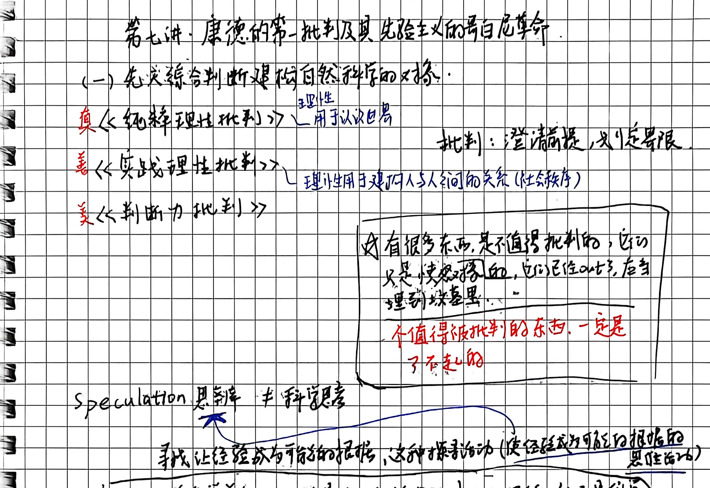
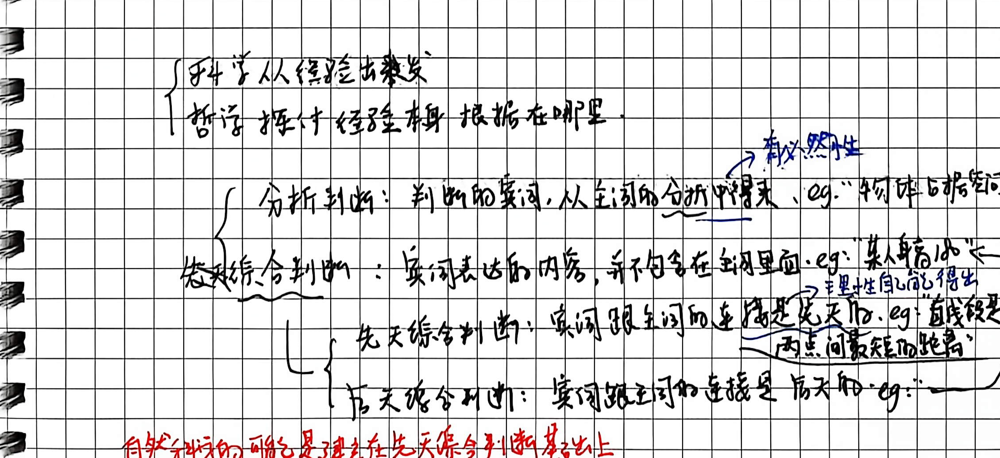
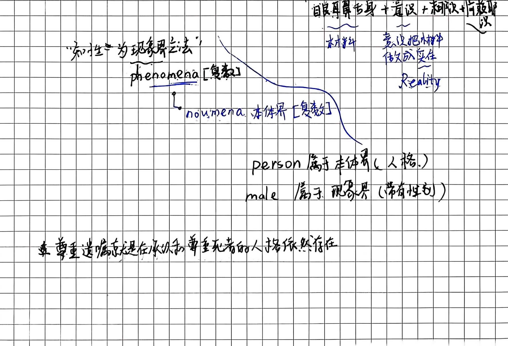
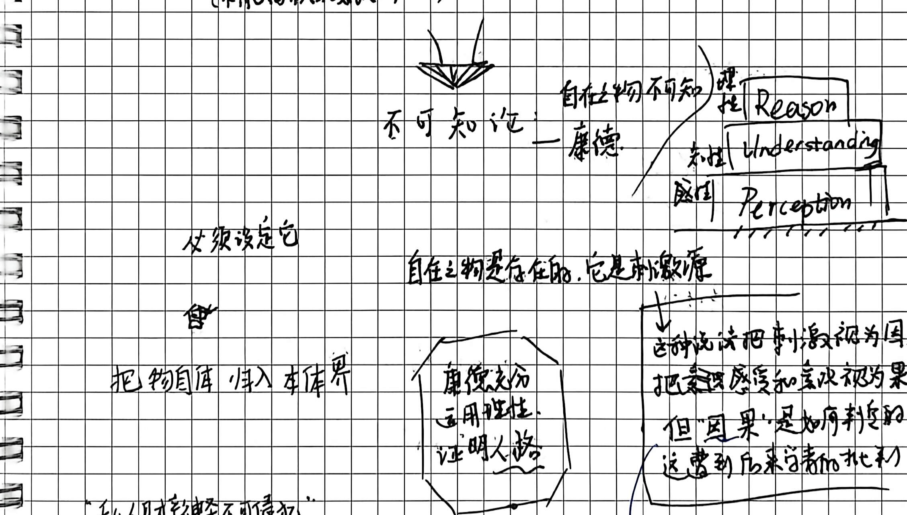

# 第七讲手稿还原：康德的第一批判及其先验主义的哥白尼革命

> **整理说明**：
> 1. 本文档严格依循原手稿 4 页笔记的字句顺序、板书结构图式、圈画批注与随感逐字忠实还原。
> 2. 原文笔误均在正文保留原样并以括号注出正字。
> 3. 手稿中的图解、推演脉络及对应截图标注均严格匹配 `assets/images/第七讲/`。
> 4. 学理辨析与存疑点严格按规范以 `// TODO: [疑问描述]` 予以标注。

---

## 第 1 页：先天综合判断建构自然科学的对象与分析/综合判断分野

### 第七讲：康德的第一批判及其先验主义的哥白尼革命

#### (一) 先天综合判断建构自然科学的对象

- **三大批判对应体系**：
  - **真** $\longleftarrow$ **《纯粹理性批判》** $\longleftarrow$ （理性能用于认识日常）
  - **善** $\longleftarrow$ **《实践理性批判》** $\longleftarrow$ （理性用于建构人与人之间的关系/社会秩序）
  - **美** $\longleftarrow$ **《判断力批判》**

- **何谓“批判”？（右上角板书框）**：
  - **批判：澄清前提，划定界限。**
  - **红笔框选醒目随感**：
    > “有很多东西，是不值得批判的，它们只是快要死掉的，它们已经out了，应当埋到坟墓里…… 
    > **一个值得被批判的东西，一定是个了不起的。**”

- **思辨（Speculation）与科学思考**：
  - **Speculation 思辨 $\neq$ 科学思考**。
  - **寻找让经验成为可能的根据，这种探索活动（使经验成为可能的根据的思辨活动）**。
  - **手稿横线核心论断**：
    > **〈一切经验背后总有非经验的支出。纯粹经验基础之上建立的绝不是科学〉**

- **经验的建构性**：
  - **经验是 Established（建构）起来的，而非感官直接获得。**
  - **案例**：
    - 太阳照热了石头
    - 水结成了冰
  - **经验不是第一性的，是被建构的。**

- **科学与哲学的分工**：
  - $\begin{cases} \text{科学从经验出发} \\ \text{哲学探讨经验本身 根据在哪里} \end{cases}$

- **判断的类型学划分**：
  - **分析判断**：判断的宾词，从主词的分析中得来。
    - eg. “物体占有空间” $\longrightarrow$ **有必然性**。
  - **综合判断**：宾词表达的内容，并不包含在主词里面。
    - eg. “某人身高 $1.8\text{m}$” $\longleftarrow$ 主理性自己能得出。
    - $\begin{cases} \text{\textbf{先天综合判断}} & \text{：宾词跟主词的连接是先天的。eg. “两点之间线段是两点间最短的距离”} \\ \text{\textbf{后天综合判断}} & \text{：宾词跟主词的连接是后天的。eg. ……} \end{cases}$

- **核心底线结论**：
  > **自然科学的可能是建立在先天综合判断基础之上。**

---

## 第 2 页：能数的主体、先验想象力与现象界/本体界划分

- **能数的主体（认识主体的机能）**：
  - ① 把多次不同的感知，统一到一个时间过程里（**感知＋思考**）；
  - ② 每一次感知的差异被扬弃。

- **表象的组合与先验想象力**：
  - 抽开具体事物的对象 $\longrightarrow$ **？先验 先天想象力**
  - 把不同的表象自由组合 $\longrightarrow$ **后天想象**（eg. 路上铺满黄金）

- **感性与思维形式的综合**：
  - $\begin{cases} \text{时间（内感觉）} \\ \text{空间（外感觉）} \end{cases} \longleftarrow$ **以此为基础，用先验想象力，把属于思维的方式加到非思维的感觉材料上去。**

- **中西义理互镜：佛学八识与 Concept**：
  - **Concept（概念）**
  - **佛学八识**：
    - 眼、耳、鼻、舌、身 $+$ 意识 $+$ 末那识 $+$ 阿赖耶识
    - （前五识：**本质料**；后三识：**意识把精神做成实体 Reality**）

- **双界划分图解（现象界与本体界）**：
  - **“知性为现象界立法”**
  - **phenomena【复数】（现象界）**
    - $\downarrow$
  - **noumena【复数】（本体界）**

- **人与人格的双重属性**：
  - **person 属于 本体界（人格）**
  - **male 属于 现象界（带有性别）**

- **底部随笔论断**：
  > **“尊重遗嘱本质是在承认和尊重死者的人格依然存在。”**

---

## 第 3 页：现象界与本体界的区分——物自体不可知论与私有财产神圣

### (二) 现象界与本体界的区分

- **物自体（the thing in itself）与唯物论假定**：
  - 认识某物，先假定它是自身存在的（唯物论）。
  - 一个物不依赖我而自身存在了。

- **主观赋予与客观属性的剥离**：
  - $\begin{cases} \text{感 不是盐的自身属性，它高不可攀} \\ \text{把“纸”视作“钱”也依赖社会会议（议定）} \end{cases}$
  - **若把这些非自身属性都拿掉，物自体就变得不可认知**（不能离开人的会议/议定的符号）。

- **康德不可知论阶梯模型**：
  - **不可知论 —— 康德**：
    $$\begin{array}{c|l}
    \text{理性 Reason} & \text{神学} \\
    \hline
    \text{知性 Understanding} & \text{科学} \\
    \hline
    \text{感性 Perception} & 
    \end{array}$$
  - **自在之物是存在的，它是刺激源**：
    - 这种说法把**刺激源视为因**，把**感官感受和意识视为果**。
    - 但“因果”是如何判定的？这遭到后来学者的批判。
  - 自在之物被后世学者认为是**虚构的假想，是超验的，有违于他的学说先验设定**。

- **必须设定它 $\longrightarrow$ 会把物自体归入本体界**：
  - **八角框板书**：
    $$\begin{array}{|c|}
    \hline
    \text{\textbf{康德充分运用理性，注明出路}} \\
    \hline
    \end{array}$$

- **私有财产神圣不可侵犯的形而上学根据**：
  - **“私有财产神圣不可侵犯”**：
    - 财产，以手机为例，手机作为可感知的物时，并没有什么神圣；
    - 而作为物自体时，**它属于某一个人格，是人格不可侵犯（人格不朽）**。
  - **两种财产观**：
    - **不计较几块钱** $\longrightarrow$ 祝您自己大度，分享给你两块钱很高兴；视财产为身外之物。
    - **计较几块钱** $\longrightarrow$ 视你抢走我的钱为**人格侵犯**（深层涉及美国人与多数的争吵必然）。

---

## 第 4 页：拿破仑与世界精神、物自体不可知的现代意义与工具理性

- **拿破仑与世界精神（黑格尔历史哲学回响）**：
  - **拿破仑：骑在马背上的世界精神。**
  - 苦战与思考，促成欧洲的进步，进入近代社会，**完成民族解放**。
  - 罗马法承认为资产阶级革命，实现了**政治解放**。

- **“物自体不可知”的重要意义：为科学划界线，为信仰留出地盘**：
  - **假若我们认为科学能解决一切问题，我们就会确认为：这个人类社会与自然界的区分了（混淆本体界与现象界）**。
  - **可以崇尚科学，但不能成为科学主义者。**
  - **思想史关联**：丁文江与张君劢之争（科玄论战），梁启超调和。

- **工具理性（Instrumental Reason）**：
  - **工具理性：理性帮助人更好地控制世界。**

---
// TODO: [学理核查] 手稿第 1 页中“批判：澄清前提，划定界限”及“纯粹经验基础之上建立的绝不是科学”，在康德认识论中属于先验批判（Transcendental Critique）的核心旨趣。手稿第 4 页引入黑格尔论拿破仑“马背上的世界精神”与二十年代中国“科玄论战”，深化了康德物自体不可知论在现代性批判（抵制科学主义越界）中的重大思想史坐标。
