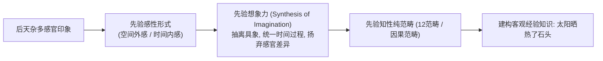
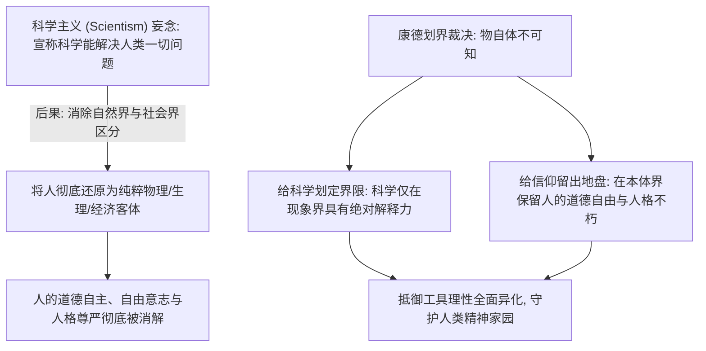

# 第七讲 结构化深度探究：康德的第一批判及其先验主义的哥白尼革命——先天综合判断、双界划分与物自体的现代省察

---

## 导言：西方认识论的“哥白尼式革命”

在近代哲学的演进中，经验论（Empiricism）最终滑向了休谟的怀疑主义深渊，唯理论（Rationalism）则陷入了莱布尼茨-沃尔夫式的独断论死胡同。面对西方知识大厦可能全面坍塌的危机，德国哲学家**伊曼努尔·康德（Immanuel Kant, 1724–1804）**在1781年出版了划时代的巨著《纯粹理性批判》（*Kritik der reinen Vernunft*）。

康德发动了一场认识论上的**“哥白尼式革命”**：
> 以往人们都假定，我们的认识必须符合客观对象；但这一假定导致所有确立普遍必然知识的尝试归于失败。因此，我们必须反其道而行之——**假定对象必须符合我们主体的认识形式**！

康德以先验哲学为手术刀，不仅终结了休谟对自然科学客观必然性的怀疑，更为人类的道德自主与宗教信仰开辟了超验的尊严空间。

```mermaid
flowchart TD
    subgraph 康德批判的核心问题
        A["认识论危机: 经验论走向怀疑主义 (休谟) + 唯理论走向独断论 (沃尔夫)"]
        A --> B["康德哥白尼革命: 人为自然界立法 (客体符合主体)"]
    end

    subgraph 认识的三重阶梯
        C["感性 (Perception / Sinnlichkeit)"] -->|提供先天感性形式: 时间 (内) 与空间 (外)| D["直观材料初步组织"]
        D --> E["知性 (Understanding / Verstand)"]
        E -->|运用12对纯知性范畴 (因果、实体等) 进行先验综合| F["科学经验知识 (先天综合判断)"]
        F --> G["理性 (Reason / Vernunft)"]
        G -->|追求无条件的绝对统辖: 灵魂、世界、上帝| H["产生先验幻相 (不能认识物自体)"]
    end

    subgraph 宇宙的双重秩序 (双界划分)
        I["现象界 (Phenomena)"] -->|受自然因果律支配| J["自然科学的合法领地 (可知)"]
        K["本体界 (Noumena / 物自体)"] -->|超验自由与人格尊严| L["实践理性与道德信仰的领地 (不可知但可思)"]
    end
```

---

## 一、 批判的真谛与“先天综合判断”的奠基

### 1. 何谓“批判”？（Clarifying Premises & Setting Limits）
手稿在开篇给出了极其精准而厚重的哲学定义：
> **“批判：澄清前提，划定界限。”**
> **“有很多东西是不值得批判的，它们只是快要死掉的……一个值得被批判的东西，一定是个了不起的！”**

- **批判不是吹毛求疵的否定**：在古希腊语中，*Kritik*（源自 $\kappa\rho\acute{\iota}\nu\omega$）意为审查、甄别与裁决。
- **纯粹理性批判的目标**：不是否定人类理性，而是让纯粹理性坐上最高法庭的被告席，审查理性自身的能力、范围与合法边界，防止理性跨过经验界限去妄谈本体，从而陷入“独断论”的谵妄。

### 2. 分析判断 vs 综合判断与“先天综合判断”的提出
近代哲学对于知识形态的划分一直存在两难：

| 判断类型 | 判定标准 | 知识特征 | 典型范例 | 哲学困境 |
| :--- | :--- | :--- | :--- | :--- |
| **分析判断** (*Analytic*) | 宾词本就蕴含在主词之中（逻辑同一律） | 具有**普遍必然性**，但**不扩展新知识** | “一切物体皆占有空间” | 无法为人类带来拓展性的经验科学知识 |
| **后天综合判断** (*Aposteriori Synthetic*) | 宾词通过后天经验联结到主词上 | **扩展新知识**，但**缺乏必然性**（属偶然） | “某人身高 $1.8\text{m}$”、“这块石头发热” | 无法抵抗休谟的怀疑论，不能作为严密科学的基础 |
| **先天综合判断** (*Apriori Synthetic*) | **既先于经验（具有普遍必然性），又能实质性扩展新知识** | **自然科学与数学的真正基石** | “两点之间线段最短”、“$7+5=12$”、“一切变化皆有原因” | **休谟未曾发现的秘密通道** |

手稿明确断言：**“自然科学的可能，正是建立在先天综合判断的基础之上。”**
没有先验纯粹形式在背后的“无形成本支出”，仅凭盲目的经验材料汇总，绝不可能诞生严密的近代科学。

---

## 二、 能数的主体、先验想象力与范畴综合

手稿第二页深入到了康德《纯粹理性批判》中最晦涩也最精妙的“先验演绎（Transcendental Deduction）”机制：



### 1. “能数的主体”与先验统觉
手稿揭示：一个主体之所以能数数（$1, 2, 3\dots$）或构建连续的经验，必须具备两个认识论先决条件：
1. **统一时间过程**：把不同瞬间所获得的离散知觉，连续地统摄在一个单一的时间流动中；
2. **扬弃感知差异**：在每次感知的微观差异中，提炼出同一的纯粹形式。

这正是康德所谓的**“先验统觉的本源综合统一（Transcendental Unity of Apperception）”**——所有的“我感知”必须能够伴随着一个恒常统一的“我思”。

### 2. 佛学八识与 Concept（概念构造）的融通
手稿在此进行了极具启发性的跨文化哲学对照：
- **前五识（眼耳鼻舌身）** $\longleftrightarrow$ **感性杂多质料（Sensory Data）**；
- **第六意识、第七末那识、第八阿赖耶识** $\longleftrightarrow$ **思维范畴与先验主体构造（Concept / Reality）**。
手稿随笔敏锐地指出：“意识把精神做成实体（Reality）”——我们眼中所看到的“客观现实”，并非外在纯然无构的实相，而是主体内在认知机能层层变现、统辖与构造出来的经验现象。

---

## 三、 现象界与本体界的区分：物自体不可知论

### 1. 现象界（Phenomena）与本体界（Noumena / 物自体）
康德哲学最著名的分水岭，即是严密划定了“两界”的鸿沟：
- **现象界（Phenomena）**：经过主体的先天感性形式（时空）与知性范畴（因果律、实体等）整理加工后呈现给我们的经验世界。**凡现象皆可知，凡现象皆受自然因果必然律的铁血支配**。
- **本体界 / 物自体（The Thing in Itself / Ding an sich）**：完全独立于人类主观时空形式和知性范畴之外的客观实在本身。

### 2. 剥离“非自身属性”：物自体的不可知必然性
手稿记录了极具生活洞察力的论证：
- **“咸”是盐的自身属性吗？** 不是！若没有人类舌尖味蕾的生理受体，“咸”根本不存在；
- **“价值”是纸币的自身属性吗？** 不是！纸不过是植物纤维，若没有人类社会的契约、信任与法律议定，“钱”的概念毫无依托。
- **结论**：若把人类主体所赋予的一切感官形式、社会契约与概念外壳全部剥离，剥落之后的“物自体本身”，**在认识论上必然是不可感、不可知、不可表象的**。

### 3. 私有财产神圣不可侵犯的形而上学根基
手稿第三页展开了关于“财产”极其精辟的法哲学辩证：
> **“一部手机作为可感知的物时，没有任何神圣性；但作为‘物自体’时，它属于某一个人格（Person），是人格不可侵犯。”**

- **动物世界的占有**：一只狗护食，是生物本能的占有，无所谓“合法”或“神圣”；
- **人类社会的私有产权**：不仅是物理意义上的占有，而是**自由意志与人格在外在物上的对象化凝结**。侵犯财产本质上是对背后不可侵害的“本体界人格”的践踏。
- 由此解释了手稿末尾的深刻对比：为什么有人因几块钱被夺而怒不可遏？因为那不是在计较物质利益的多寡，而是在抗争**自身人格遭到的非法蔑视与霸凌**！

---

## 四、 现代性省察：“为科学划界，为信仰留出地盘”

手稿第四页深刻揭示了康德批判哲学的时代灵魂及其对现代科学主义狂妄的防御：



### 1. 抵御科学主义霸权：二十年代“科玄论战”的历史呼应
手稿特别提及了中国近代思想史上的**“丁文江与张君劢之争（科玄论战），梁启超调和”**：
- **丁文江（科学派）**：主张科学万能，“科学方法可以支配人生观”；
- **张君劢（玄学派）**：搬出康德哲学，坚决捍卫人生观与心灵自由的超验独立性；
- **康德哲学的当代警钟**：**“我们可以崇尚科学，但绝不能沦为盲目的科学主义者！”**
  如果取消了现象界与本体界的区分，把人的一切精神信仰、道德情感全部简化为神经递质与物理运动，人类文明将堕入彻底虚无与冷酷的机械决定论深渊。

### 2. 工具理性（Instrumental Reason）的双刃剑
手稿最后总结：**“工具理性：理性帮助人更好地控制世界。”**
工具理性使人类战胜了饥荒与疾病，推动了现代工业文明的崛起；但如果缺乏价值理性（实践理性）的规约，工具理性便会蜕化为全面控制人、奴役人、把人商品化的冷血绞肉机。

因此，康德在第一批判中对理性认识能力的限缩，不是理性的悲歌，而恰恰是人类自由意志与人格尊严最坚固的护城河！
