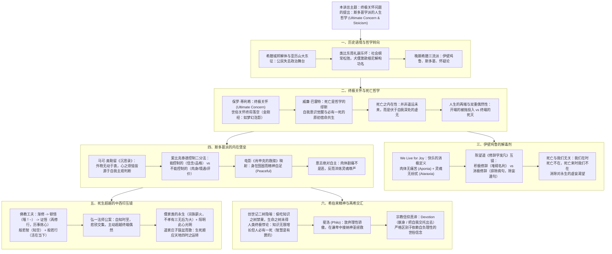

# 第三讲：终极关怀问题的提出：斯多葛学派的人生哲学

> **课程体系**：《西方哲学的思想历程》  
> **整理方式**：根据手写课堂笔记与黑板板书数字化整理，遵循 [AGENTS.md](./AGENTS.md) 知识库双版本规范。

---

## 📖 本讲双版本笔记快速导航

为了满足“原貌复盘”与“深度理论研读”两种不同的学习场景，本讲笔记提供两个互相参照的完整版本：

| 版本分类 | 文档链接 | 适用场景与内容特点 |
| :--- | :--- | :--- |
| **手稿原貌还原版** | 📝 [第三讲_手稿还原.md](./第三讲_手稿还原.md) | **7 页逐页忠实整理**：按原始手稿顺序精准排版，保留手书笔迹顺序、思维跳跃、公案随记、修辞学与佛道互镜随笔，嵌入 6 幅局部高清手绘切图。 |
| **结构化深度探究版** | 🏛️ [第三讲_结构化深度探究.md](./第三讲_结构化深度探究.md) | **学术体系化讲义**：以专业哲学史框架重构，系统展开“城邦解体与生存论转向”、“终极关怀与死亡的内在性”、“伊壁鸠鲁消极快乐论”、“斯多葛内在堡垒与控制二分法”、“中西印死生超越互镜”、“希伯来理性谦卑与信仰献身”等六大核心论题，配备丰富 Mermaid 矢量推演图。 |
| **学术思辨自测版** | 🎯 [第三讲_自测20题与解析.md](./第三讲_自测20题与解析.md) | **精选自测与深度解析**：精编 20 道学术级单项选择题，考点覆盖晚期希腊三流派、死亡生存论、控制二分法、中西印死生超越及希伯来信仰献身；严格执行选项均匀分布规范，附全卷答案速查表与逐题深度学理剖析。 |

---

## 🧭 第三讲知识全景图 (Mindmap)

---

## 💡 核心哲学命题摘要

### 1. 古希腊哲学为何在城邦解体后发生由“城邦政治”向“人生终极关怀”的深刻转向？
> 古典希腊时期，个人作为城邦公民（Polis Citizen），其德性与价值实现高度依托于城邦政治共同体。马其顿帝国崛起与亚历山大东征后，城邦主权丧失，帝国版图无限扩张，古典城邦秩序如同中国先秦东周时期的“礼崩乐坏”，普遍的社会纲常与伦理共识彻底瓦解。公民失去政治参与感，沦为庞大帝国中孤立漂泊的“世界公民”。面对世态炎凉与动荡时局，哲学被迫放弃建构理想国或探问宇宙始基的宏大叙事，转向探求个体如何在现实乱世中安顿灵魂、直面苦难与死亡的生存之术。

### 2. 为什么说“死亡是哲学的缪斯”，死亡为何潜伏于自我内部而非遥远的未来？
> 动物仅受生存本能驱动，从未对生命的意义提出过疑问；唯有人拥有反思性的自我意识。当“我”意识到自身是一个独一无二、他人绝无法替代的主体时，也必然在同一时刻意识到这个独一无二的自我终将彻底归于消亡。威廉·巴雷特指出，正是直面死亡的虚无深渊，才激发出人类追求崇高意义与哲学思辨的灵感（缪斯）。常人误以为死亡是遥远未来铁轨上的意外终点，但哲学洞察揭示：**死亡从一开始就作为虚无的深渊内伏于自我世界之中**。人在开端（被抛投出生）与终端（猝然降临的死灭）上皆受制于绝对的冷酷偶然，唯有正视这份内在的虚无，才能激发生命追问终极意义的自觉。

### 3. 伊壁鸠鲁学派的“快乐”为何本质上是一种“消极修辞”？
> 常人常将伊壁鸠鲁误读为纵欲享乐主义，但伊壁鸠鲁所界定的快乐（Hedone）本质上是一种**消极定义**：即“肉体的无痛苦（Aponia）”与“灵魂的无纷扰（Ataraxia）”。正如陈望道《修辞学发凡》中将修辞分为“积极修辞”（铺陈比喻、雕琢华饰）与“消极修辞”（消灭语病、文从字顺），世人追逐财富、权力与名声如同无休止的“积极修辞”，反而招致无穷焦虑；伊壁鸠鲁的主张则是对人生的“消极修辞”——剔除虚荣贪欲的病句，平息迷信与恐慌。其著名的死亡解毒剂指出：**“我们在时，死亡不在；死亡来时，我们已不在。”**死与感知主体绝不相交，消除对永生不死的虚妄贪恋，方能获得当下的澄澈与安宁。

### 4. 爱比克泰德的“控制二分法”如何构筑斯多葛学派的“内在堡垒”？
> 斯多葛宗师爱比克泰德将世间事物严格划分为两类：**我们能够控制的**（我们的信念、欲望、价值判断与道德意志）与**我们不能控制的**（我们的肉身健康、出身财富、他人评价、时局命运）。人类的一切精神痛苦，皆源于“试图控制不能控制之外物，却放弃主宰能够控制之内在判断”。马可·奥勒留指出，外物客观中立、无动于衷，真正扰动人心的唯有我们加诸外物的臆断。即便身陷绝境（如电影《肖申克的救赎》中的高墙囹圄，或遭受严刑拷打的肉体剧痛），只要守住理性的判断力，深知疼痛不能贬损人格尊严，意志便享有不可侵犯的自由（Peaceful）。

### 5. 希伯来圣经的“原罪”与斐洛的“Devotion（献身）”如何反拨了古希腊理性的自负？
> 古希腊哲学崇尚理性自足，而地中海东岸的希伯来精神则指出了人类理性的先天局限与原罪。《创世记》中人类祖先偷吃“知善恶树”的禁果，使知识具备了无限增长的潜能，但未食“生命之树”，故难逃必死之躯，由此构成了“知识无限而寿命有限”的生存论绝境。犹太神学断言“智慧是有罪的”，警惕有限受造物自以为能够主宰宇宙的理性狂妄。亚历山大里亚的斐洛融合希腊与希伯来哲学，指出人类唯有放弃理性的骄傲，在谦卑中承认自身的渺小，才能开启通往神圣救赎的大门。宗教信仰的真谛非凡夫自负的“信念（Confidence）”，而是**“献身（Devotion）”**——将有限的自我彻底交托于超越至高者，在神圣的故事叙事中获得灵魂的终极慰藉。

---

## 📂 静态资源与手稿归档说明
- 原始课堂手写笔记扫描文件安全归档于：[assets/笔记手稿/第三讲/](./assets/笔记手稿/第三讲/)
- 笔记所引用的关键板书高清切图存放于：[assets/images/第三讲/](./assets/images/第三讲/)
  - `assets/images/第三讲/自我内部世界与虚无之死.png`
  - `assets/images/第三讲/人生的两端与偶然性.png`
  - `assets/images/第三讲/沉思录_灵魂内在充盈.png`
  - `assets/images/第三讲/控制二分法与肖申克的救赎.png`
  - `assets/images/第三讲/创世记二树与原罪结构.png`
  - `assets/images/第三讲/斐洛与宗教信仰献身结构.png`
