# 第三讲：终极关怀问题的提出：斯多葛学派的人生哲学（结构化深度探究版）

> **课程体系**：《西方哲学的思想历程》  
> **整理说明**：本篇讲义立足于手稿原貌（见 [《第三讲_手稿还原.md》](./第三讲_手稿还原.md) 与原始扫描件 [assets/笔记手稿/第三讲/](./assets/笔记手稿/第三讲/)），严格遵照 [AGENTS.md](./AGENTS.md) 学术级规范进行体系化深度重构。  
> **内容特色**：系统展开希腊城邦解体后古希腊晚期三大流派的“人生哲学转向”，深入剖析死亡意识的生存论奠基、伊壁鸠鲁消极快乐论、斯多葛学派的内在堡垒（控制二分法与判断力操守），并开辟专章展开中西印（希腊、希伯来、佛教、儒道）多维死生超越思想互镜，文末附理论脉络推演图。

---

## 目录

- [一、 历史语境：希腊城邦解体与哲学的生存论转向](#一-历史语境希腊城邦解体与哲学的生存论转向)
  - [1. 城邦文明的瓦解与世界公民的诞生](#1-城邦文明的瓦解与世界公民的诞生)
  - [2. “末期如东周”：普遍伦理秩序的崩解](#2-末期如东周普遍伦理秩序的崩解)
  - [3. 晚期希腊三大学派的思想谱系](#3-晚期希腊三大学派的思想谱系)
- [二、 终极关怀与死亡的生存论奠基](#二-终极关怀与死亡的生存论奠基)
  - [1. 保罗·蒂利希的“终极关怀 (Ultimate Concern)”](#1-保罗蒂利希的终极关怀-ultimate-concern)
  - [2. 死亡是哲学的缪斯：自我意识与必死性](#2-死亡是哲学的缪斯自我意识与必死性)
  - [3. 死亡的内在性：深植于自我内部的虚无](#3-死亡的内在性深植于自我内部的虚无)
  - [4. 人生的两端与双重偶然性](#4-人生的两端与双重偶然性)
- [三、 伊壁鸠鲁学派：快乐主义与死亡消解论](#三-伊壁鸠鲁学派快乐主义与死亡消解论)
  - [1. 快乐的消极定义：肉体无痛苦与灵魂无纷扰](#1-快乐的消极定义肉体无痛苦与灵魂无纷扰)
  - [2. 修辞学视阈：积极修饰与消极修辞](#2-修辞学视阈积极修饰与消极修辞)
  - [3. “死亡与我们无关”：消除对永生的虚妄渴望](#3-死亡与我们无关消除对永生的虚妄渴望)
- [四、 斯多葛学派的人性理想与内在堡垒](#四-斯多葛学派的人性理想与内在堡垒)
  - [1. 哲学的根本追问：如何在面对荒谬时保持理性？](#1-哲学的根本追问如何在面对荒谬时保持理性)
  - [2. 马可·奥勒留与内在堡垒：灵魂的自足与判断力](#2-马可奥勒留与内在堡垒灵魂的自足与判断力)
  - [3. 爱比克泰德的“控制二分法 (Dichotomy of Control)”](#3-爱比克泰德的控制二分法-dichotomy-of-control)
  - [4. 意志的绝对自主与对肉体痛苦的蔑视](#4-意志的绝对自主与对肉体痛苦的蔑视)
- [五、 死生超越的中西印多维互镜](#五-死生超越的中西印多维互镜)
  - [1. 佛家工夫论：渐修、顿悟与再修行](#1-佛家工夫论渐修顿悟与再修行)
  - [2. 般若智与般若行：将虚无活在当下](#2-般若智与般若行将虚无活在当下)
  - [3. 儒道死生观：宗法血脉绵延与天地齐物](#3-儒道死生观宗法血脉绵延与天地齐物)
  - [4. 弘一法师公案：对终端偶然的主动超越](#4-弘一法师公案对终端偶然的主动超越)
- [六、 希伯来精神与两希交汇：理性谦卑与信仰献身](#六-希伯来精神与两希交汇理性谦卑与信仰献身)
  - [1. 伊甸园神话：知识之树与人类理性的原罪](#1-伊甸园神话知识之树与人类理性的原罪)
  - [2. 斐洛的犹太-希腊综合：理性的界限与上帝救赎](#2-斐洛的犹太-希腊综合理性的界限与上帝救赎)
  - [3. 宗教信仰的本质：从“信念”到“献身 (Devotion)”](#3-宗教信仰的本质从信念到献身-devotion)
- [七、 晚期希腊哲学体系与死生超越总览](#七-晚期希腊哲学体系与死生超越总览)

---

## 一、 历史语境：希腊城邦解体与哲学的生存论转向

### 1. 城邦文明的瓦解与世界公民的诞生

在古希腊古典盛期（以苏格拉底、柏拉图、亚里士多德为代表），哲学探究与城邦政治生活（$\pi\acute{o}\lambda\iota\varsigma$ / Polis）密不可分。亚里士多德断言：“人是天生的城邦动物（政治动物）。”公民唯有身处紧密、自主的城邦共同体中，其理性与德性方能实现。

然而，随着伯罗奔尼撒战争的内耗，北方马其顿王国崛起：
- **马其顿王腓力二世（Philip II）**击溃希腊联军，剥夺了各城邦的主权；
- 其子**亚历山大大帝（Alexander the Great）**展开东征，建立地跨欧亚非的庞大帝国，开启了**希腊化时代（Hellenistic Period）**。

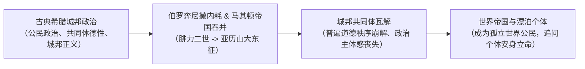

这一历史剧变给希腊知识阶层带来了空前的精神断裂：
- 作为亚历山大之师的**亚里士多德**，其试图以城邦正义培养明君的政治理想彻底破灭；
- 希腊文化扩散至地中海世界，并逐渐过渡到拉丁语境（罗马帝国）；
- 公民失去了直接参与城邦民主决议的政治舞台，沦为广袤帝国中孤立无援的个体。

### 2. “末期如东周”：普遍伦理秩序的崩解

手稿深刻指出：希腊城邦末期的精神困局，恰如中国先秦东周时期的“礼崩乐坏”：
- **公序良俗崩溃**：维系人际信任与生活意义的社会纲常整体松弛，传统的城邦神祇信仰与城邦自豪感荡然无存；
- **犬儒学派的极端解构**：第欧根尼（Diogenes）居于木桶之中，当亚历山大大帝亲临并问他需要何种恩赐时，他仅淡漠回应：“请不要挡住我的阳光。”这种对帝国权力、功名利禄的嘲弄，反映了个体在公共秩序坍塌后对外部建制的极度疏离。

### 3. 晚期希腊三大学派的思想谱系

在此历史废墟上，哲学的首要任务不再是建构庞大的形而上学体系或设计理想国，而是**如何在动荡险恶的乱世中安顿个体的灵魂**。晚期希腊哲学由此形成了三大代表性的人生哲学流派：

| 流派名称 | 核心主张 | 终极心理境界 | 求解路径 |
| :--- | :--- | :--- | :--- |
| **伊壁鸠鲁主义 (Epicureanism)** | 快乐主义原子论 | 灵魂无纷扰 (*Ataraxia*) | 消除对神明与死亡的虚妄恐惧，退隐花园，追求消极快乐 |
| **斯多葛学派 (Stoicism)** | 顺应自然与理性自足 | 激情的平息 (*Apatheia*) | 区分能控制与不能控制之事，守住灵魂内在堡垒，顺服普遍宇宙逻各斯 |
| **怀疑论哲学 (Skepticism)** | 悬搁判断 (*Epoche*) | 不动心 (*Ataraxia*) | 对一切独断理论保持怀疑与不置可否，由此摆脱争端与执迷 |

---

## 二、 终极关怀与死亡的生存论奠基

### 1. 保罗·蒂利希的“终极关怀 (Ultimate Concern)”

手稿引入了当代存在主义神学家**保罗·蒂利希（Paul Tillich）**的核心范畴——**“终极关怀 (Ultimate Concern)”**：

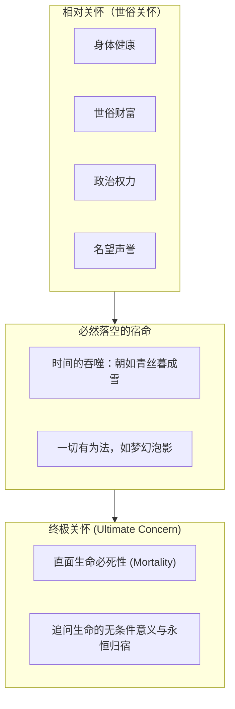

- **世俗关怀的虚妄性**：世俗生活中人类汲汲以求的一切对象（财富、健康、权力、声望），终将在时间的洪流中归于虚无。李白诗云“君不见高堂明镜悲白发，朝如青丝暮成雪”；佛陀在《金刚经》中棒喝：“一切有为法，如梦幻泡影，如露亦如电，应作如是观。”
- **终极关怀的本质**：终极关怀要求人超越有限的、有条件的世俗利益，追问生命本身无条件的意义。它要求主体不被暂时的欲望所束缚，在直面终极毁灭的深渊时，找到灵魂能够真正安立的磐石。

### 2. 死亡是哲学的缪斯：自我意识与必死性

手稿引述了美国存在主义哲学家**威廉·巴雷特（William Barrett）**在《非理性的人》（*Irrational Man*）中的名言：
> **“如果人无需面对死亡，他也就不需展开哲学思辨了。”**

- **缪斯 (Muses)**：希腊神话中司掌文艺、音乐与智慧的灵感源泉。死亡正是催生人类全部精神创造与哲学探究的至高之“缪斯”；
- **自我意识与必死性的共生**：
  - 动物只有生物学层面的生存本能，它从未对自己的生命提出过意义追问；
  - 唯有人拥有清晰的自我意识。**当一个人拥有“我”的自我意识的那一刻，他也同时获得了“必有一死”的原初宿命觉知**；
  - 死亡意味着：一个独一无二、他人绝无法替代的自我，将彻底从世界中归于永恒的消失。
- **面对他人的死亡 vs 面对自己的死亡**：
  - 海德格尔（Martin Heidegger）在《存在与时间》中揭示：目睹他人的死亡，常被常人视作一个日常的统计学事件（“人终归是要死的，但现在轮不到我”）；
  - 唯有在直面**自己的死亡**（本真的“向死而生” *Sein-zum-Tode*）时，死亡的虚无性才如深渊般将个体从平庸沉沦的日常状态中彻底唤醒。

### 3. 死亡的内在性：深植于自我内部的虚无

手稿中记录了一幅震撼的哲学结构图：

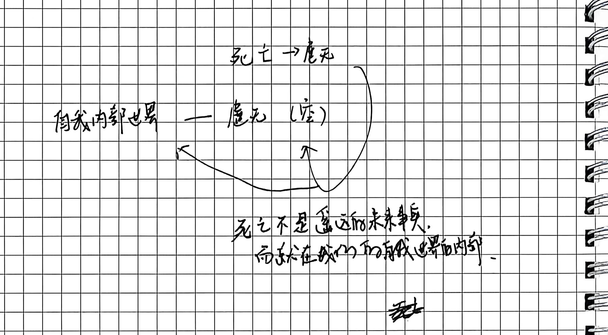

这一洞见彻底打破了常识上的“外在死亡观”：
- **常识的误区**：常人总以为死亡是一列在遥远的未来铁轨上向我们缓缓开来的列车，只要列车尚未抵达，生命就是充满实体的。
- **哲学的深渊**：**死亡绝不是遥远的未来事物，它时时刻刻就潜伏在自我世界的内在深处。**
  $$\text{自我内部世界} \longleftrightarrow \text{虚无（空）} \longleftarrow \text{死亡}$$
- 自我的充盈感时刻悬在虚无的深渊之上。一旦我们反思到自身生命的有限性，那份潜伏的虚无感便瞬间穿透世俗的繁华，显露生命的悬空本质。

### 4. 人生的两端与双重偶然性

手稿进一步以坐标轴解析了人生存在的根本悖论：

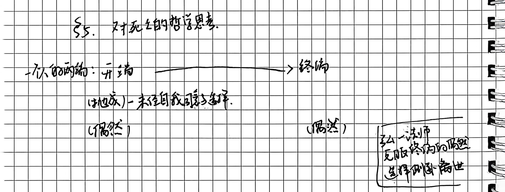

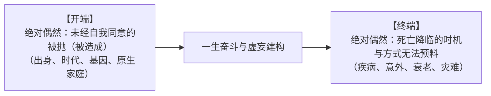

1. **开端的偶然性**：海德格尔称之为“被抛状态（Geworfenheit）”。我们未曾经过自己的同意就被抛掷到了这个世界上，无法选择自己的父母、时代、肤色与初始肉身；
2. **终端的偶然性**：生命的终点同样充满了冷酷的随机性与不可捉摸性；
3. **主体的绝境**：两端皆由冰冷的偶然性所主宰，置身于这两端中间的短暂人生，又如何能够确立起坚实不拔的必然意义？这正是终极关怀问题的根本由来。

---

## 三、 伊壁鸠鲁学派：快乐主义与死亡消解论

### 1. 快乐的消极定义：肉体无痛苦与灵魂无纷扰

在希腊化乱世中，伊壁鸠鲁（Epicurus）提出了著名的命题：*We live for joy*（我们为了快乐而生活）。然而，在西方思想史上，伊壁鸠鲁常被后世庸俗化为贪图口腹之欲与感官狂欢的纵欲主义。手稿特别指明：**伊壁鸠鲁的快乐论本质上是一种“消极定义 (Negative Definition)”**：

$$\text{真快乐 (Hedone)} \iff \begin{cases} \text{肉体的无痛苦} \; (Aponia) \\ \text{灵魂的无纷扰} \; (Ataraxia) \end{cases}$$

- **无痛苦 (Aponia)**：身体免于疾病、饥寒与过剩欲望的折磨；
- **无纷扰 (Ataraxia)**：内心免于迷信、恐惧、焦虑与野心的侵扰；
- 伊壁鸠鲁强调：快乐并非无休止地向欲望之杯注水，而是**彻底拿走那只漏水的杯子**。过度追逐世俗快感（如豪饮、权势、盛宴）只会诱发更大的焦虑与病痛，唯有极简与自制，才能获得永恒持久的平静。

### 2. 修辞学视阈：积极修饰与消极修辞

手稿以中国著名语言学家**陈望道《修辞学发凡》**中的理论作了绝妙的思想互镜：

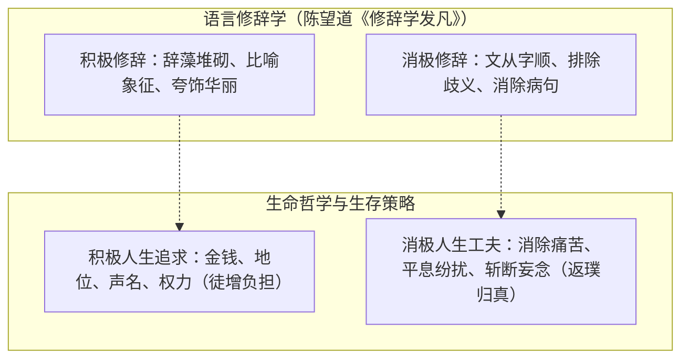

- **积极修饰**：世俗常人的人生正如“积极修辞”，不断给生命添加外在的点缀与荣耀（名表、豪宅、官位、政绩），误以为这些繁复的修饰能增加生命的价值；
- **消极修辞**：消极修辞的最高境界是“除妄遁句”，让语句通顺、没有任何语病。伊壁鸠鲁的智慧正是**人生的“消极修辞”**：剔除欲望带来的病句，让生命回归到本真自足的清白与宁静。

### 3. “死亡与我们无关”：消除对永生的虚妄渴望

针对人类心头最沉重的巨石——对死亡的惊恐，伊壁鸠鲁基于原子唯物论提出了哲学史上著名的解毒剂：

> “要习惯于相信：**死亡与我们无关**，因为一切好与坏都在感觉之中，而死亡是感觉的剥夺。  
> 只要正确地认识到死亡与我们无关，我们就能甚至享受生命的有限的这一面。  
> 这不是依靠给自己的寿命添加无尽的时间，**而是依靠消除对于永生不死的渴望**。”

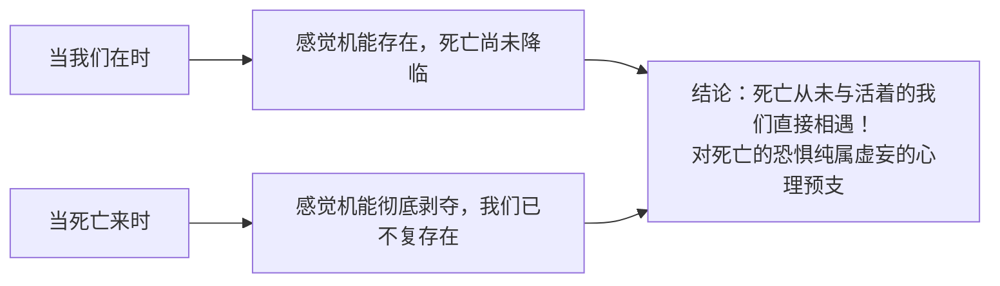

- **存在性的不相交**：死与生是互相排斥的范畴。痛苦需要有感受的主体；当死亡真正发生时，原子离散，感知主体已经消解，故死亡带来的并非痛苦，而是感觉的彻底终结；
- **消除永生渴望**：无限的时间并不能使快乐增加分毫。正如一场精彩的戏剧，其价值在于演出的精湛与圆满，而不在于剧目拖延得多久。**生命的崇高，恰恰在于彻底破除对肉身永生的虚妄执念后，全然安住于当下有限而清明的时光。**

---

## 四、 斯多葛学派的人性理想与内在堡垒

### 1. 哲学的根本追问：如何在面对荒谬时保持理性？

手稿开篇便指出了哲学与宗教在面对人生虚无时的分野：
- **宗教的路径**：承认荒谬，甚至宣称“正因其荒谬，我才信仰”（*Credo quia absurdum* / 德尔图良），倡导“信仰而后理解”（*Credo ut intelligam* / 安瑟尔谟）；
- **哲学的路径**：拒绝荒谬，始终坚守人类理性的自律与清醒；
- **斯多葛学派的独特立足点**：
  > **“怎么看待人生根本上的荒谬？我们如何面对它，仍然保持理性？”**

斯多葛派不寻求天国彼岸的虚妄许诺，他们要在残酷冷硬的人间现实中，依靠理性为自己铸造一座不可攻破的精神要塞。

### 2. 马可·奥勒留与内在堡垒：灵魂的自足与判断力

作为罗马帝国的统治者，罗马皇帝**马可·奥勒留（Marcus Aurelius）**在戎马倥偬与蛮族入侵的行军帐篷中写下了传世经典《沉思录》（*Meditations*）。手稿摘录了其核心手书：

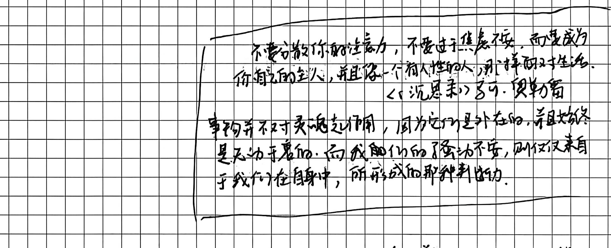

> **《沉思录》核心箴言**：  
> “不要分散你的注意力，不要过于焦急不安，而要成为你自己的主人，并且像一个有理性的人那样面对生活。”  
> “事物并不对灵魂起作用，因为它们是外在的，并且始终是无动于衷的；而我们的骚动不安，则仅仅来自于我们在自身中所形成的那种判断力。”

- **外物的无动于衷**：外界的刀剑、瘟疫、谗言、贫困，本身只是一堆物理现象，它们没有手脚能伸进灵魂内部；
- **心灵的骚动不安源于主观判断**：
  $$\text{外部事件} \neq \text{心灵痛苦} \quad \implies \quad \text{外部事件} \xrightarrow{\mathbf{我们的负面判断与解读}} \text{烦恼与绝望}$$
- **外在附着物与人性价值的彻底剥离**：
  - 常人以为出身显赫、仕途成功、锦衣玉食增加了人性的价值；
  - 斯多葛学派断然否定：这些不过是戏台上借来的戏服。富贵不增添生命本身的价值，贫贱亦丝毫不贬损灵魂的高贵；顺境带来的欢愉只是暂时的水波，唯有内在的德性才是灵魂的终极立足点。

### 3. 爱比克泰德的“控制二分法 (Dichotomy of Control)”

奴隶出身的斯多葛宗师**爱比克泰德（Epictetus）**在其《手卷》（*Enchiridion*）中奠定了名垂千古的**“控制二分法”**：

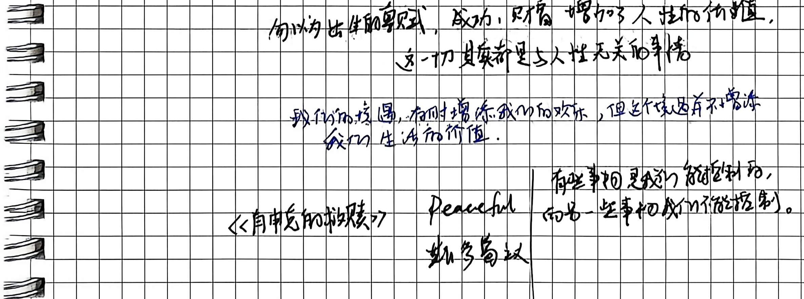

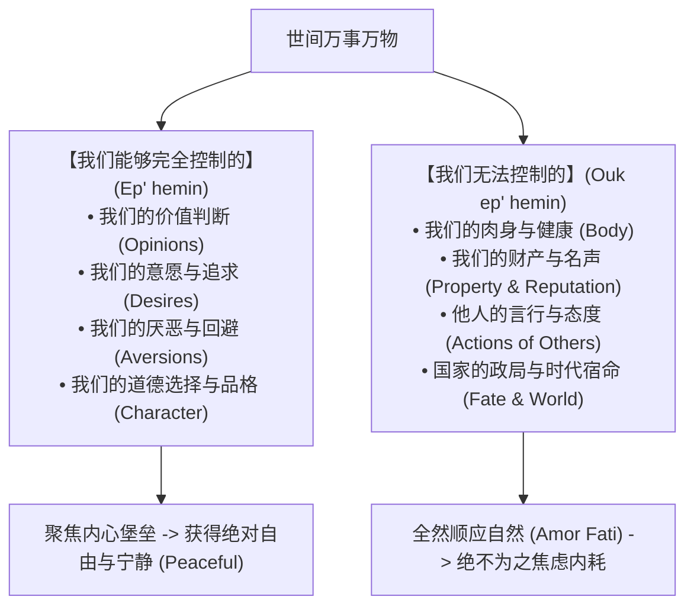

- **痛苦与绝望的终极根源**：人之所以痛苦，恰恰是因为我们**试图控制那些我们根本控制不了的事情**（如他人的认可、时代的顺逆、衰老与死亡），同时却**放弃了控制那些我们完全可以控制的事情**（自己的判断、操守与心态）；
- **电影《肖申克的救赎》的深刻投射**：
  - 斯多葛主义的核心就是**Peaceful（内心的绝对安宁与主权）**；
  - 在《肖申克的救赎》中，安迪身陷冤狱高墙，典狱长与狱警可以剥夺他的自由、财产与衣服，掌控他肉身的生活环境（不能控制的外在境遇）；
  - 但高墙无法锁住他的精神主权。正如安迪在狱中为全监狱播放莫扎特歌剧《费加罗的婚礼》时所言：“在这个世界上，有些东西是石墙关不住的，在人的内心深处，有他们触摸不到、完全属于你自己的东西，那就是希望与音乐。”

### 4. 意志的绝对自主与对肉体痛苦的蔑视

爱比克泰德进一步指出：
> **“使我们烦恼的，并非事情本身，而是我们对事情的看法。”**  
> **“假如你因任何自身外的东西而痛苦，那不是那东西困扰了你，而是你自己对它的判断。”**

- **面对毁誉与攻击时的豁达境界**：
  手稿记载了斯多葛圣者面对恶意中伤时的超然应对：“不要急于为自己辩白，而要这样坦然回答：‘是啊，看来他对我还不够了解，他还不知道我有别的许多缺点呢，否则他就不会只提这区区几个了。’”
- **意志的不可侵犯性（意志不受任何外部客体直接决定）**：
  即便当肉体遭受残酷折磨，斯多葛派学者亦能对痛苦发出傲然的宣示：
  > “疼痛，你尽可以如此厉重地折磨我，我仍然不会承认你是个恶的东西！”
- **痛苦并非“恶”**：斯多葛学派严格界定，唯有丧失道德与德性才是真正的“恶”；肉体的疼痛仅仅是生理机制的反应，是外部自然宿命的一部分。**疼痛丝毫不曾贬损他人格的价值，反而成为熔炉，显明并淬炼了他灵魂坚不可摧的崇高价值！**

---

## 五、 死生超越的中西印多维互镜

第三讲手稿跨越文明边界，在斯多葛主义与东方思想（佛、儒、道）之间展开了极为宏大的互镜：

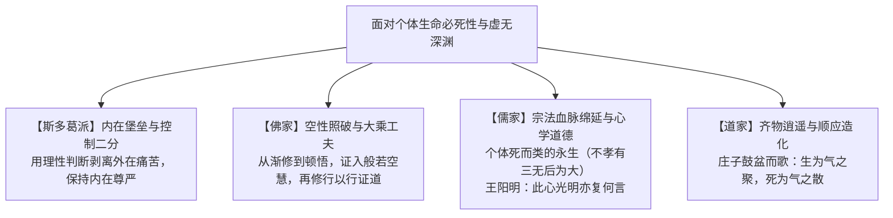

### 1. 佛家工夫论：渐修、顿悟与再修行

手稿对佛教心性修证的三重境界作了精辟提炼：

$$\mathbf{渐修} \xrightarrow{\quad \text{破除尘网} \quad} \mathbf{顿悟} \; (\text{“哦！~”}) \xrightarrow{\quad \text{入世践道} \quad} \mathbf{再修行 / 证悟}$$

1. **渐修（剥离习气）**：凡夫活在世间，被名闻利养、贪嗔痴慢等各种机缘牵扯羁绊。修行者须一步一步从这种纠缠牵绊中超拔出来；
2. **顿悟（豁然破暗）**：某一时刻，般若智慧蓦然显现，行者发出“哦！~”的一声喟叹，当下照破万法空相，斩断无明；
3. **再修行（以出世之心做入世之事）**：顿悟并非遁入虚无或枯坐深山，而是以解脱超然的大境界重新回归人间琐屑。在日常生活的反躬践履中印证真理，即所谓“佛法在世间，不离世间觉”。

### 2. 般若智与般若行：将虚无活在当下

手稿深度揭示了“预演死亡”的工夫秘密：
- **般若智（Prajna-wisdom）**：领会虚无的智慧，领会“缘起性空”的实相；
- **般若行（Prajna-action）**：**不是将死亡推给未来，而是把虚无领会到当下，同时全然活在当下。**
- 当一个人预先在内心经历过死亡的洗礼，知晓世间一切皆如朝露泡影，他就彻底摆脱了患得患失的恐惧；每一口呼吸、每一次与他人的相遇，便都具有了不可思议的本真光芒。

### 3. 儒道死生观：宗法血脉绵延与天地齐物

- **儒家的“类的永生”与心性圆满**：
  - **后代延续的救赎**：“个体的死亡是类的永生。”孟子讲“不孝有三，无后为大”，在宗法血统与宗族香火的薪火相传中，有限的个体融入了华夏文明生生不息的历史长河；
  - **心学终极告白**：王阳明在南安病逝之际，弟子问其遗言，先生微笑道：“此心光明，亦复何言。”将内在道德良知的充盈确立为对抗虚无的终极屏障，与斯多葛灵魂内在自足遥相呼应。
- **道家的造化齐一**：
  - 庄子之妻死，惠子吊之，庄子箕踞“鼓盆而歌”。庄子视生死为天地四时之运转：“察其始而本无生，非徒无生也而本无形，非徒无形也而本无气……今又变而之死，是相与为春秋冬夏四时行也。”将有限生命彻底同化于大化流行之中。

### 4. 弘一法师公案：对终端偶然的主动超越

针对手稿第 4 页中人生的“终端偶然性”，手稿特别标举了**弘一法师（李叔同）**的公案：
- **常人面临终端偶然**：常人总是在猝不及防、满怀留恋与惊恐中被死神突袭带走；
- **弘一法师的超越之道**：法师晚年严持戒律，在病重垂危之际自知时至，主动安排后事，从容圆寂。临终前书下著名的绝笔偈语**“悲欣交集”**：
  - “悲”者，悲众生沉沦苦海、未出轮回；
  - “欣”者，欣自证菩提、摆脱业报肉身。
- 借由精神修养的主动确证，弘一法师在死亡的最后关头，以至高的人格主权克服了终端的盲目偶然，成全了生命的圆满谢幕。

---

## 六、 希伯来精神与两希交汇：理性谦卑与信仰献身

### 1. 伊甸园神话：知识之树与人类理性的原罪

希腊精神崇尚理性探究与人定胜天，而地中海东岸的希伯来-犹太精神则走向了完全不同的维度：

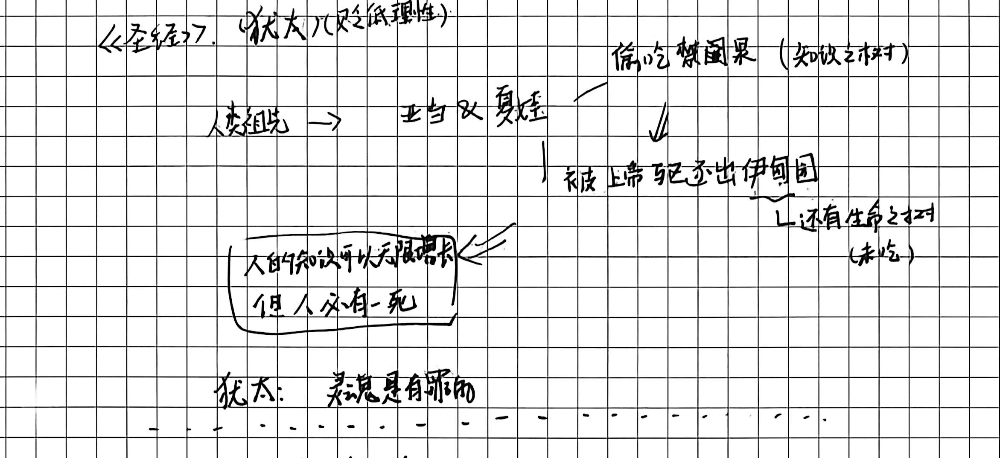

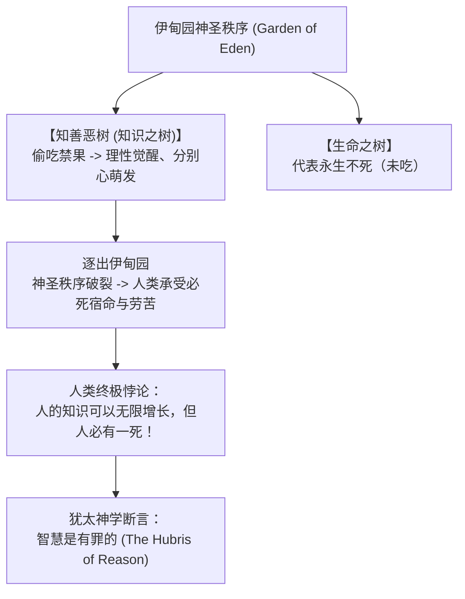

- **人类存在的根本悖论**：人类偷吃了分别善恶的智慧果，使自身知识具备了无限探求的潜能；然而人类未曾吃到生命之果，肉身依旧在时间中绝对必死。
- **“智慧是有罪的”**：希伯来信仰深刻洞悉到，人类理性的狂妄（Hubris）往往自居为世界的终极裁判者，妄图以受造物的有限智力僭越创世主的神圣界限，这正是原罪与受苦的根本渊薮。

### 2. 斐洛的犹太-希腊综合：理性的界限与上帝救赎

在希腊化时期的埃及文化中心亚历山大里亚，犹太哲学家**斐洛（Philo of Alexandria）**架起了希腊理性与希伯来启示之间的桥梁：

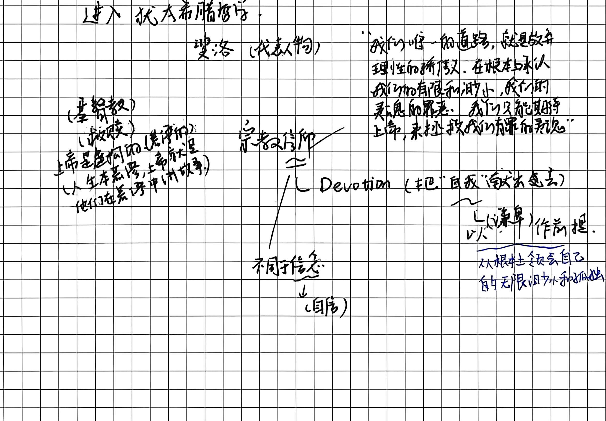

> **斐洛的核心宣言**：  
> “我们唯一的道路，就是放弃理性的骄傲，在根本上承认我们的有限和渺小、我们知觉的界限；我们只能期盼上帝，来拯救我们有罪的灵魂。”

- 斐洛吸收了希腊哲学的**逻各斯（Logos）**范畴，将其阐释为上帝创造世界与向受造物启示的中介；
- 但他坚决捍卫希伯来的敬畏传统：理性必须认识到自身的先天天花板，唯有放弃自负，向上敞开，才能接纳救赎之光。

### 3. 宗教信仰的本质：从“信念”到“献身 (Devotion)”

手稿对“信念 (Belief / Confidence)”与“宗教信仰 (Faith / Devotion)”作了极具学理深度的剖析：

| 范畴维度 | 世俗信念 (Belief / Confidence) | 宗教信仰之献身 (Devotion) |
| :--- | :--- | :--- |
| **心理基石** | **自信**：依赖自我主体的理性确证与意志力量 | **谦卑**：源自对自身绝对有限、渺小与孤独的深切领会 |
| **主体姿态** | 扩张自我、掌控客体、证明自身正确 | **把“自我”交托出去**，舍弃私智，完全顺服于超越者 |
| **面对深渊** | 试图以理论逻辑修补裂隙，容易陷入虚无与自负 | 在对超越者的敬畏与爱中获得神圣慰藉与救赎 |

- **基督教救赎的故事性**：人类人生本苦，而上帝宏大无边。基督教在救赎历史的叙事中，为每一个在现世饱经屈辱与痛苦的有限个体，赋予了通往永恒意义的坚实承诺。

---

## 七、 晚期希腊哲学体系与死生超越总览

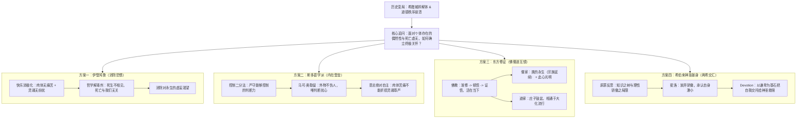

---

### 学术小结

本讲从古典希腊城邦崩溃切入，完整呈现了古希腊晚期哲学由“外向的宇宙/城邦探问”向“内向的生命终极关怀”的深刻转向：
1. **伊壁鸠鲁主义**以极简的原子论破除迷信，以“消极修辞”般的克制界定快乐，将人类从对死亡与神明的虚妄战栗中解放出来；
2. **斯多葛学派**以坚忍的理性堡垒抗衡荒谬命运，借由“控制二分法”筑牢内心的自由疆域，以意志对痛苦的傲然蔑视宣告了精神主权的高贵；
3. **东方智慧与希伯来精神**则为死生超越开辟了更为辽阔的维度——无论是在佛教空性工夫中安顿当下，还是在儒道文明中实现血脉与造化齐一，抑或在希伯来信仰中以谦卑献身领纳救赎，皆展现了人类在直面必死命运时，对于意义、尊严与永恒的不懈跋涉。
