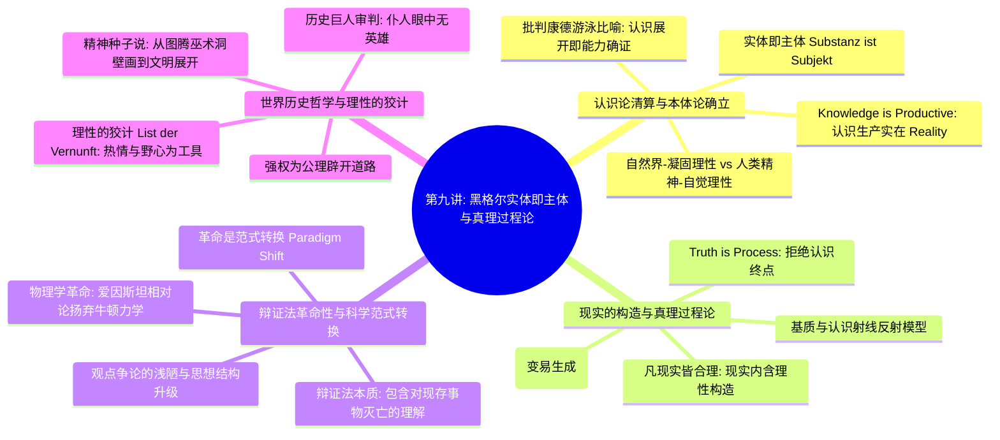

# 第九讲：真理是一个过程·实体即主体

> **本讲核心题旨**：全面探究德国古典哲学集大成者——格奥尔格·威廉·弗里德里希·黑格尔（G. W. F. Hegel）的核心精髓：从“实体即主体（Substanz ist Subjekt）”对康德不可知论的彻底清算，到“认识是生产性的（Knowledge is Productive）”与“凡现实皆合理”的本真洞见；解析辩证法在当代科学革命（范式转换 Paradigm Shift）中的具象展开，并深入其壮阔的历史哲学——剖析“精神种子说”、“理性的狡计（List der Vernunft）”以及“仆人眼中无英雄”的历史人物审判尺度。

---

## 快速导航与知识图谱

| 文档类型 | 入口链接 | 核心内容提要 |
| :--- | :--- | :--- |
| **手稿忠实还原版** | [第九讲_手稿还原.md](./第九讲_手稿还原.md) | 逐页忠实还原 4 页手稿全貌，完整保留康德字典/游泳比喻、认识射线与基质图解、物理学革命图式、理性的狡计与仆人英雄论随笔。 |
| **结构化深度探究版** | [第九讲_结构化深度探究.md](./第九讲_结构化深度探究.md) | 系统阐发实体即主体、认识生产实在、凡现实皆合理学理澄清、辩证法与科学范式转换、精神种子展开、理性的狡计与世界历史个人评判。 |

---

## 本讲核心哲学命题摘要

1. **“实体即主体（Substanz ist Subjekt）”与康德批判哲学的终结**：
   康德试图在认识世界之前先审查认识能力，如同“未学会游泳之前切勿下水”一样荒谬；认识本身就是主客互动、能动生产实在（Reality）的创生过程；世界本体绝非静止客体，而是自我分化、自我运动的生命主体。
2. **“一切现实的东西都是合理的，一切合理的东西都是现实的”**：
   现实（Wirklichkeit）绝非偶然堆积的盲体现存，而是经过人类理性认识与实践能动建构起来的制度与存在；合乎历史必然性的合理性，必将冲破阻碍化为历史现实。
3. **“真理是一个过程（Truth is Process）”与生成辩证法**：
   真理不是一经发现便永远停滞的教条终点；正如“存在”必定包含“无”的概念，“光明白昼”必定伴随“黑暗”，真理在正、反、合的自否定运动与历史扬弃中永恒展开。
4. **辩证法的革命本质与科学“范式转换（Paradigm Shift）”**：
   辩证法在对现存事物的肯定中同时包含对其必然灭亡的清醒理解；科学进步绝非简单的经验线性积累，而是旧范式陷入危机后由新范式实现的包容性“扬弃”（如爱因斯坦相对论将牛顿力学收编为其低速极限特例）。
5. **“理性的狡计（List der Vernunft）”与世界历史进程**：
   世界历史是理性自我实现的合理过程；理性巧妙地隐藏在历史舞台背后，召唤野心家的狂暴激情、征服欲与意志作为驱动历史巨轮前进的“消耗性工具”；强权往往在客观上为公理辟开道路。
6. **历史巨人的评判尺度：“仆人眼中无英雄”**：
   “仆人眼中没有英雄，并非因为英雄不是英雄，而是因为仆人只是个仆人”；不能用琐屑狭隘的世俗日常道德去苛求开启历史新纪元的巨人，必须站在世界历史时代精神展开的宏大尺度上审视其历史必然性。

---

*知识库规范与指引详见：[AGENTS.md](./AGENTS.md)*
