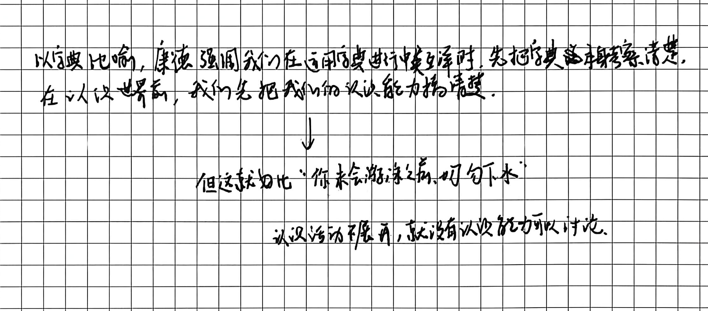
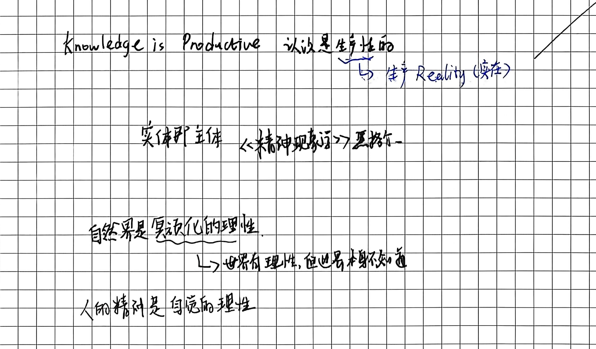
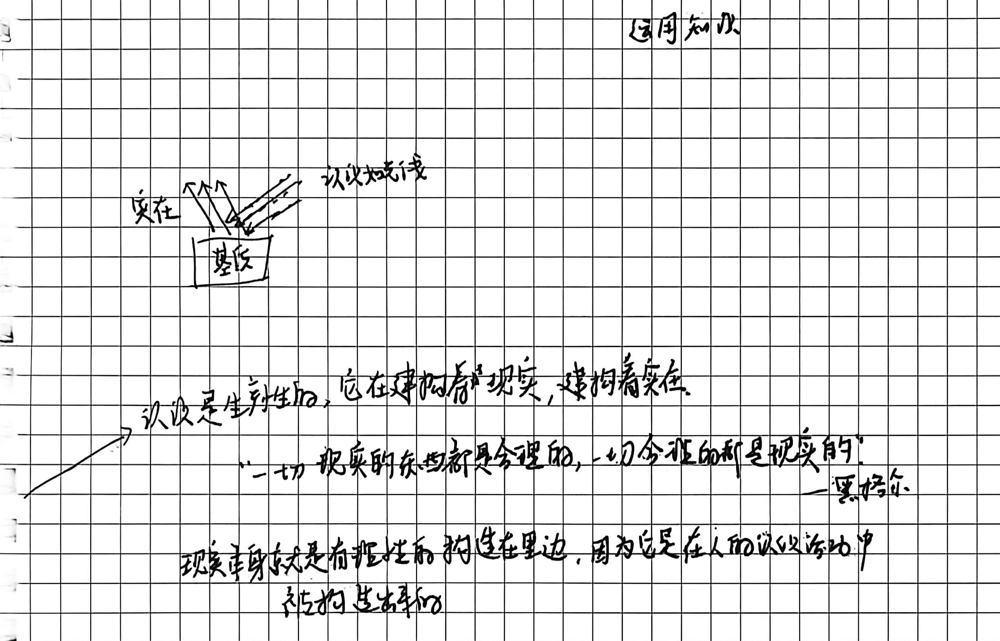
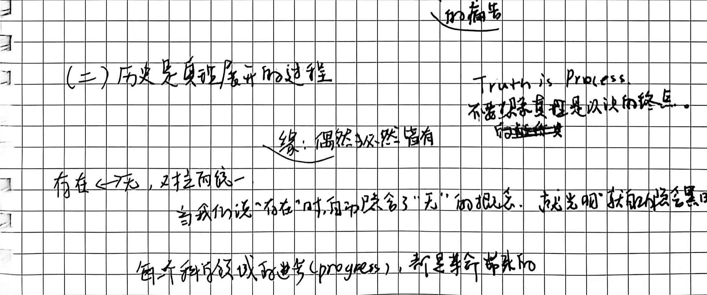
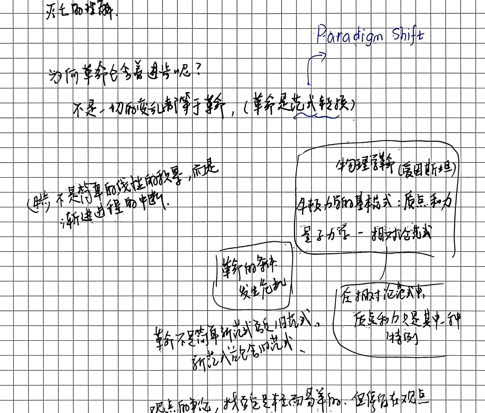
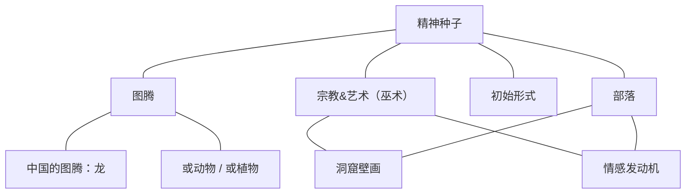
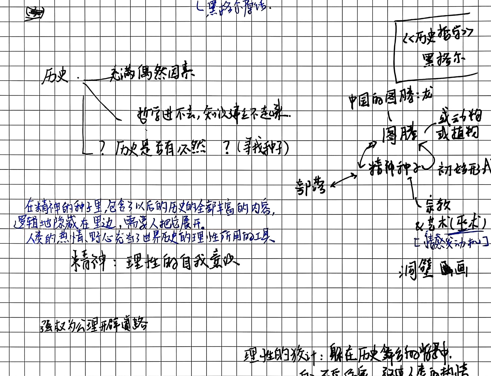
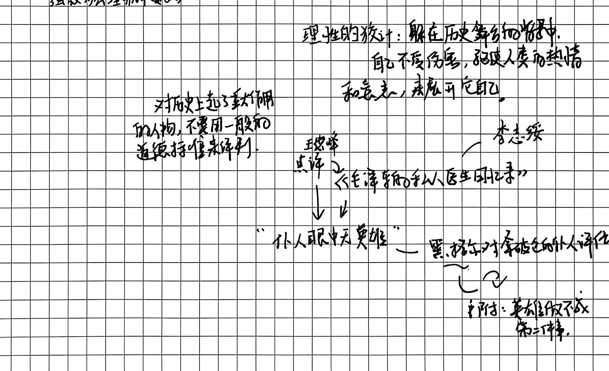

# 第九讲手稿还原：真理是一个过程·实体即主体

> **整理说明**：
> 1. 本文档严格忠实于原手稿 4 页笔记的字句顺序、板书结构图式、圈画批注与随感逐字忠实还原。
> 2. 原文错别字与笔误均在正文保留原样并以括号注出正字。
> 3. 手稿中的图解、推演脉络及对应截图标注均严格匹配 `assets/images/第九讲/`。
> 4. 学理辨析与存疑点严格按规范以 `// TODO: [疑问描述]` 予以标注。

---

## 第 1 页：黑格尔对康德不可知论的批判与“实体即主体”

# 第九讲：真理是一个过程·实体即主体

# (一) 黑格尔对康德不可知论的批判

- 关于康德认识论批判的经典比喻：
  - 以字典比喻，康德强调我们在通向/使用字典进行某种解释时，先把它这本字典翻搞清楚。在认识世界前，我们先把我们的认识能力搞清楚。
    - 但这犹如“你未会游泳之前，切勿下水”。
    - 认识活动不展开，就没有认识能力可以讨论。
  
- 认识的生产性：
  - Knowledge is Productive 认识是生产性的
    - $\longleftrightarrow$ 生产 Reality（实在）。

- 核心命题与著作出处：
  - 实体即主体 $\longleftarrow$ 《精神现象学》黑格尔。

- 自然界与人类精神的理性形态：
  - 自然界是冥顽化的理性：
    - $\longrightarrow$ 世界有理性，但世界本身不知道。
  - 人类精神是自觉的理性。

---

## 第 2 页：基质与实在的构造、凡现实皆合理与历史过程论

- 基质与实在的图解：
  
  - 基质 = 无。
  - 人类社会的自我认识，仍然是理性可以做的事情，做出知识来，这叫绝对知识。
  - 图示：
    - 运用知识
    - 认识射线 $\longrightarrow$ 照向【基质】 $\longrightarrow$ 反射/生成【实在】。
  
- 现实与理性的辩证统一：
  - Knowledge is Productive 认识是生产性的，它在建构着现实，建构着实在。
  - 黑格尔名言（框选引文）：
    > “一切现实的东西都是合理的，一切合理的东西都是现实的。” —— 黑格尔
  - 手稿阐释：
    - 现实本身就是有理性的构造在里边，因为它是在人的认识活动中被构造出来的。

- 对康德道德神学的反思：
  - 道德 $\neq$ 幸福，康德通过构造上帝来保证有德性的人能获得幸福。
  - $\longleftrightarrow$ 类似于佛教让人相信来世，而忍受今世的痛苦。

# (二) 历史是真理展开的过程：

$$\begin{array}{|c|}
\hline
\text{\textbf{Truth is Process}} \\
\text{不要指望真理是认识的终点。} \\
\hline
\end{array}$$

- **缘：偶然与必然皆有**。

- **存在与无的对立统一**：
  - **存在 $\longleftrightarrow$ 无，对立统一**：
    - **当我们说“存在”时，自动包含了“无”的概念，正如光明就自动隐含着黑暗。**
  - **科学进步的本质**：
    - **每个科学领域的进步（progress），都是革命带来的。**

---

## 第 3 页：辩证法的革命本质、范式转换与物理学科学革命

- **辩证法的革命批判性（手稿顶端引文）**：
  > **“辩证法不崇拜任何东西，辩证法在对现存的事物的肯定的理解当中，同时包含着对它的否定的理解，和对它的必然灭亡的理解。”**

- **为何革命包含着进步？**：
  - **不是一切的变乱都等于革命，（革命是范式转换 Paradigm Shift）。**
  - 进步不是简单的线性的积累，而是渐进进程的中断。

- **物理学科学革命图示（框选模型）**：
  $$\begin{array}{|l|}
  \hline
  \text{\textbf{物理学革命（爱因斯坦）}} \\
  \text{牛顿力学的基本模式：质点和力} \\
  \text{量子力学 —— 相对论模式} \\
  \hline
  \end{array}$$
  - 革命的条件：发生危机。
  - 革命不是简单新范式替代旧范式，新范式包含了旧范式。
  - $\longrightarrow$ 在相对论范式中，质点和力只是其中一种特例。
  
- **观点与争辩的反思随笔**：
  
  > “观点的争论，找否定是轻而易举的，但停留在观点的争论上是没有意义的。”

---

# (三) “世界历史是一个合理的过程”：精神种子说

## 第 4 页：精神种子说、理性的狡计与仆人眼中无英雄

世界历史的理性本质：
-  “世界历史是一个合理的过程”（黑格尔原话）
- 荐书：黑格尔《历史哲学》
- 历史
  - 历史充满偶然因素
  - 哲学进不去，知识建立不起来。
  - 历史是否有必然？（寻找种子）

精神种子的展开图式

> “在精神的种子里面，包含了以后的历史的全部丰富的内容，逻辑地隐藏在里边，需要人把它展开。
> 人类的热情、野心充当了世界历史的理性所用的工具。”

精神：理性的自我意识。

- 理性的狡计（Cunning of Reason）与历史人物审判：
  - 强权为公理辟开道路。
  
  - 理性的狡计：
    
    > “躲在历史舞台的背后，自己不受伤害，召唤人类的热情和意志，来展开它自己。”
    
  - 对历史巨变人物的道德评价：
    - “对历史上起了重大作用的人物，不要用一般的道德标准来评判。”
    
    - 王德峰点评李志绥的《毛泽东私人医生回忆录》
      - “仆人眼中无英雄” —— 黑格尔对拿破仑的仆人评价。
      - 附注：英雄做不成第二件事。

---
// TODO: [学理核查] 手稿第 1 页批判康德认识论的“下水游泳”比喻出自黑格尔《小逻辑》导言（第10节）。第 4 页关于“理性的狡计”（List der Vernunft）以及“仆人眼中无英雄”（No man is a hero to his valet）引自黑格尔《历史哲学》与《精神现象学》，手稿结合近现代历史人物回忆录的随笔批判，凸显了黑格尔“世界历史个人（World-Historical Individuals）”超越庸俗世俗道德的客观历史尺度。在结构化深度探究中，应将其与马克思唯物史观及当代历史哲学予以深入辨析。
