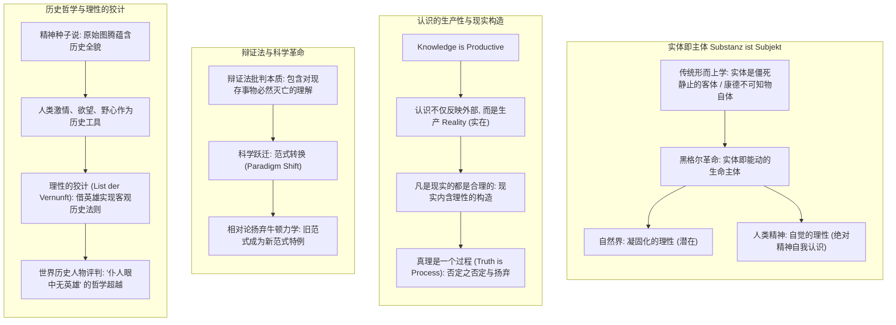
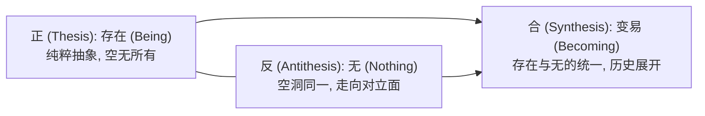
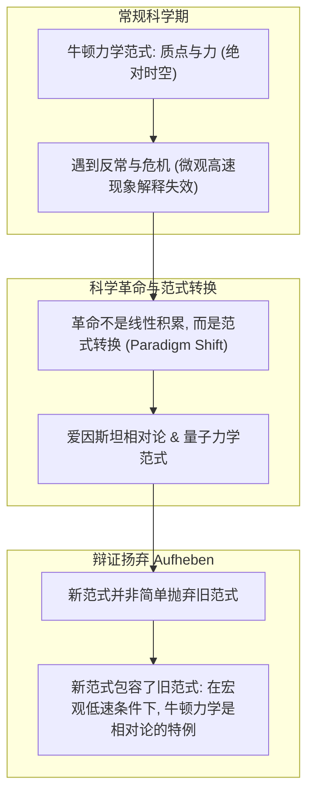
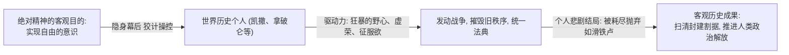

# 第九讲 结构化深度探究：真理是一个过程·实体即主体——黑格尔辩证法、范式转换与世界历史的理性机理

---

## 导言：德国古典哲学的登峰造极与辩证法革命

在康德确立了先验主体性与“现象/本体”的双界划分之后，德国古典哲学并未停步于不可知论的边界。费希特以“自我设定非我”强化了主体的绝对能动性，谢林则以“同一哲学”试图弭平自然与精神的裂痕。然而，最终将整个西方思想推向宏伟巅峰的，是**格奥尔格·威廉·弗里德里希·黑格尔（G. W. F. Hegel, 1770–1831）**。

在1807年出版的《精神现象学》（*Phänomenologie des Geistes*）序言中，黑格尔提出了震惊思想界的纲领性命题：
> **“一切问题的关键在于：不仅把真实的东西理解和表述为实体，而且同样理解和表述为主体（Substanz ist Subjekt）。”**

黑格尔击碎了形而上学关于“真理是孤立停滞的终极信条”的幻想，确立了**“真理是一个过程（Truth is Process）”**的辩证巨构：
1. **批判康德批判哲学**：认识世界无须等待“认识能力的预先审查”（“下水游泳”比喻），认识本身就是能动生产实在（Reality）的创生过程；
2. **“凡现实皆合理”的本真义理**：现实绝非僵死的经验现存，而是被理性精神能动构造的产物；
3. **辩证法的革命批判性**：辩证法在对现存事物的肯定中同时包含对其必然灭亡的理解；科学与文明的跃迁是**“范式转换（Paradigm Shift）”**与辩证扬弃（Aufheben）；
4. **历史哲学与“理性的狡计”**：世界历史并非盲目偶然的杂乱碎片，而是绝对精神借助“世界历史个人”的情感与野心展开其自身必然性的合理历程。

---

## 一、 实体即主体：黑格尔对康德“下水游泳”的批判

### 1. 批判康德先验审判的致命悖论

手稿第一页形象地记录了黑格尔在《小逻辑》中对康德哲学的著名讥讽：
> **“康德强调我们在使用字典解释之前，先要把字典翻清楚；在认识世界之前，先要把认识能力搞清楚。——但这犹如‘你未学会游泳之前，切勿下水！’”**

- **康德的独断预设**：康德试图在一切实际认识活动展开之前，先对“认识能力（工具）”进行超脱的纯粹法庭审查；
- **黑格尔的拆解**：
  - 审查认识能力本身**就已经是一种认识活动**！
  - 认识能力并非像一把现成的刀子，可以在不切东西的情况下单独拿去磨刀石上检验锋利度；
  - **人唯有在游泳中才能学会游泳，思维唯有在具体的认识推进中才能检验和确证其认识能力**。康德试图把思维与客观现实、工具与对象彻底割裂开来，结果只能陷入主观不可知论的泥潭。

### 2. 认识的生产性（Knowledge is Productive）与实在的创生
手稿明确提出了一个极具现代哲学与后现代哲学穿透力的命题：
$$\text{Knowledge is Productive} \implies \text{生产 Reality (实在)}$$

- **唯物主义反映论常识的局限**：把认识看作照相机，外部世界已经完备现成地躺在那里，认识只是被动地“照相”；
- **黑格尔与手稿的图解（认识射线与基质）**：
  - 手稿第二页画出了惊艳的示意图：**“基质 = 无”**；人类认识的射线照向无定型的基质，**“实在（Reality）”正是在认识射线的投射、建构与反射中被生产出来的**！
  - 客观经验世界并不是没有人类介入的荒野，当人类社会进行自我认识时，这种理性活动本身就在赋予世界以秩序、制度、法律与价值结构。

### 3. 自然界与人类精神：理性的两种存在形态
- **自然界是凝固化的理性（Petrified Reason）**：
  自然界充满了数学物理秩序（天体轨道、化学反应、遗传规律），但自然界本身是盲目、沉睡、不知自我的；
- **人类精神是自觉的理性（Conscious Reason）**：
  人类精神是绝对精神从自然界的沉睡中苏醒过来，通过概念、艺术、宗教与哲学，达成**理性的自我意识（Self-Consciousness of Reason）**。
- **实体即主体**：世界本体不是一个僵硬死板的客观物质团块，而是**一个像生命有机体一样自我运动、自我分化、并在否定中回归自身的活生生的主体精神**！

---

## 二、 “凡现实皆合理”的本真内涵与真理过程论

### 1. 拨开百年误解：“凡现实的都是合理的”
黑格尔在《法哲学原理》序言中的名句常被庸俗地曲解为为反动现状辩护的奴才哲学：
> **“一切现实的东西都是合理的，一切合理的东西都是现实的。”（Was vernünftig ist, das ist wirklich; und was wirklich ist, das ist vernünftig.）**

手稿以凝练的文字指出了其深层哲学秘密：
- **现存（Dasein / Existenz） $\neq$ 现实（Wirklichkeit）**：
  - 并非马路上的一坨垃圾、一个腐朽的衙门就是“现实”；那些只是偶然的、正在走向死亡的“现存”；
  - **“现实”特指那些合乎事物内在本质、合乎历史理性发展趋势、具有生命力与必然性的东西**；
  - **“现实本身就是有理性的构造在里边，因为它是在人的认识活动中被构造出来的。”**
  - 当一个现存的政权或社会制度变得完全腐朽、阻碍了人类自由的发展，它就在哲学意义上**丧失了“现实性”**，变成了必须被历史扫进垃圾堆的空壳。

### 2. 存在与无的对立统一（Truth is Process）
手稿第二页右上角框选核心命题：**“Truth is Process（真理是一个过程，不要指望真理是认识的终点）。”**

- **存在与无的辩证互动**：
  - 正如手稿所云：“当我们说‘存在’时，自动包含了‘无’的概念，正如光明就意味着黑暗”；
  - 绝对孤立的、没有任何规定性的纯存在，与空无一物的“无”完全是一回事；唯有在**“变易（Becoming / 生成过程）”**中，事物才能获得充实的规定性；
- **对康德道德神学的反思**：
  - 康德因为在经验世界中看不到德福一致，只好设立“上帝存在与灵魂不死”的悬设，在彼岸世界寻求奖赏；
  - 手稿犀利指出：**这类似于佛教让人相信来世、向忍受今世的痛苦借贷**；
  - 黑格尔则坚决拒绝这种彼岸逃避，要求**在现实历史的客观过程内部，实现理性的自我和解与正义展开**。

---

## 三、 辩证法的革命本质与科学“范式转换”

### 1. 辩证法绝不崇拜任何现存事物
手稿第三页顶端引录了著名的马克思-黑格尔辩证法核心断语：
> **“辩证法不崇拜任何东西，辩证法在对现存的事物的肯定的理解当中，同时包含着对它的否定的理解，和对它的必然灭亡的理解。”**

辩证法本质上是彻底批判的、革命的。任何被视为永恒不变的制度、真理或教条，在其自身内部都不可避免地孕育着否定自身、推翻自身的矛盾力量。

### 2. 范式转换（Paradigm Shift）与物理学革命
手稿在此惊人地将黑格尔辩证法的**“扬弃（Aufheben）”**与现代科学哲学家托马斯·库恩（Thomas Kuhn）的**“范式转换（Paradigm Shift）”**进行了系统整合：

- **进步不是简单的线性积累**：人类科学知识的跃迁，不是在旧房子上不断添砖加瓦，而是旧框架遭遇危机后的整体颠覆与重建；
- **扬弃的三重维度**：
  1. **否定**：否定旧范式（牛顿力学）作为“绝对普适真理”的独断地位；
  2. **保留**：保留旧范式在其特定有效区间内的精确计算价值；
  3. **提升**：在相对论与量子力学的高阶视域中，将旧模式收编为新理论的一个**极限特例**。
- **思想警策**：正如手稿随笔所言，“观点的争论往往是轻而易举的，但停留在表面观点的口舌争辩上是没有意义的”，关键在于能否实现深层思想结构的范式升级。

---

## 四、 世界历史是理性的合理过程：“理性的狡计”与历史人物审判

手稿第四页进入了黑格尔宏大壮阔的历史哲学世界，展现了理性如何在复杂的历史烟云中统治现实。

### 1. 精神种子说：从原始图腾到文明全貌
手稿记录了极富人类学与历史学深度的推演逻辑：
- **精神的种子**：历史看似由无数偶然的血腥屠杀、宫廷阴谋与自然灾荒拼凑而成，让人觉得“哲学进不去，知识建立不起来”；
- **种子的自发胚胎**：
  - 中国原始部落的**龙图腾**、各民族对动植物图腾的崇拜、旧石器时代的**洞壁图画**与原始巫术；
  - 这些不仅是原始艺术，更是**人类精神最初试图借助直观形象表达自身神圣性与凝聚力的“情感发动机”**；
  - **“在精神的种子里面，包含了以后的历史全部丰富的内容，逻辑地隐藏在里边，需要人类一代一代把它展开。”**

### 2. 理性的狡计（List der Vernunft / The Cunning of Reason）
世界历史是如何从盲目的个体争斗走向理性文明的？黑格尔给出了震古烁今的解答：
> **“理性的狡计：躲在历史舞台的背后，自己不受伤害，召唤人类的热情、野心和意志，来充当它展开自身的工具。”**

- **个体以为自己在追求私利**：凯撒为了个人独裁跨过卢比孔河，拿破仑为了帝王冠冕横扫欧洲大陆；
- **历史理性却在实现普遍进步**：历史借拿破仑的炮火摧毁了德意志和欧洲腐朽的农奴制与封建神权，强行推广了《民法典》；
- **强权为公理辟开道路**：历史的残酷辩证法在于，公理与自由往往不是温情脉脉请客吃饭得来的，而是历史理性格借野心家的铁血手段撕开历史前进的通道。

### 3. “仆人眼中无英雄”（No man is a hero to his valet）

手稿在末尾记录了极具现实批判力的史学反思：
> **“对历史上起了重大作用的人物，不要用一般的道德标准来评判。”**
> **“仆人眼中无英雄 —— 黑格尔对拿破仑仆人评价的点析。”**

- **仆人眼中的视界**：
  在拿破仑贴身仆人、私人侍从或私人医生的眼中，拿破仑也会便秘、贪婪、发脾气、有私德瑕疵，甚至行为乖张；
  因此，仆人常常轻蔑地认为“他不过也是个凡人，没什么了不起”；
- **黑格尔的无情反讽**：
  > **“仆人眼中没有英雄，并不是因为英雄不是英雄，而是因为仆人只是个仆人！”**
- **历史哲学的宏大视野**：
  小市民只习惯用世俗琐碎的柴米油盐、道德私德去测量历史巨人；而哲学家看到的是**时代精神的客观潮流如何借助这位历史巨人的铁腕倾泻而出**。
- **英雄做不成第二件事**：
  当历史巨人完成了时代精神赋予他的历史使命之后，作为工具的他就会被历史理性无情地抛弃（如拿破仑流放圣赫勒拿岛、凯撒倒在元老院的血泊中）。这正是世界历史崇高而冷峻的悲剧壮美。

---

## 结语：黑格尔哲学的永恒遗产

黑格尔以“实体即主体”为轴心，将自然、人类精神、科学革命与世界历史融铸为一部磅礴的自否定、自实现的交响史诗：
1. **打破静止与形而上学僵化**：世界不是现成事物的集合体，而是生成过程的集合体；
2. **连接认知与社会历史现实**：真理绝非书斋里的逻辑游戏，而是在人类的劳动生产、阶级斗争、制度革新与科学范式转换中步步创生出的活生生的实在；
3. **照亮人类文明的理性信念**：在充满狂暴偶然的世界历史迷雾中，坚定地指认出人类走向自觉自由的必然灯塔。

---

## 六、 实战与现实透镜延伸
- 理论落地范式：[哲学透镜：复杂现实与商业战略的六维解构范式](./哲学透镜/哲学透镜_通用分析范式.md)
- 商业实战推演：[01_诺基亚与移动终端范式革命（黑格尔实体即主体与辩证扬弃）](./哲学透镜/01_诺基亚与移动终端范式革命.md)

