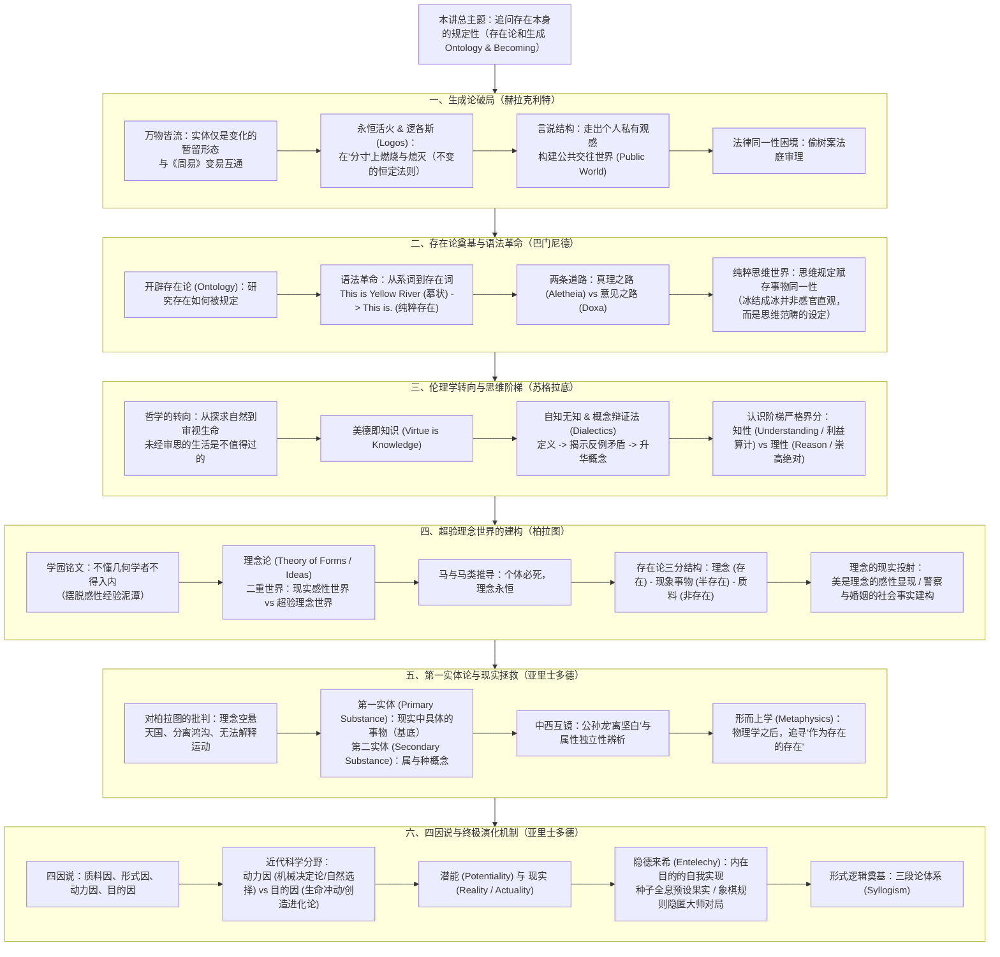

# 第二讲：追问存在本身的规定性：存在论和生成

> **课程体系**：《西方哲学的思想历程》  
> **整理方式**：根据手写课堂笔记与黑板板书数字化整理，遵循 [AGENTS.md](./AGENTS.md) 知识库双版本规范。

---

## 📖 本讲双版本笔记快速导航

为了满足“原貌复盘”与“深度理论研读”两种不同的学习场景，本讲笔记提供两个互相参照的完整版本：

| 版本分类 | 文档链接 | 适用场景与内容特点 |
| :--- | :--- | :--- |
| **手稿原貌还原版** | 📝 [第二讲_手稿还原.md](./第二讲_手稿还原.md) | **14 页逐页忠实整理**：按原始手稿顺序精准排版，保留手书笔迹顺序、随想灵感、法庭公案辨驳、课堂板书图解与原始用语。 |
| **结构化深度探究版** | 🏛️ [第二讲_结构化深度探究.md](./第二讲_结构化深度探究.md) | **学术体系化讲义**：以专业哲学史框架重构，系统展开“生成论（Becoming）”、“存在论奠基（Ontology）”、“美德即知识”、“知性与理性界分”、“柏拉图理念论”、“亚里士多德第一实体与四因说”等七大核心命题，配备中西哲学互镜与 Mermaid 矢量推演图。 |
| **学术思辨自测版** | 🎯 [第二讲_自测20题与解析.md](./第二讲_自测20题与解析.md) | **精选自测与深度解析**：精编 20 道学术级单项选择题，覆盖赫拉克利特逻各斯、巴门尼德系词革命、苏格拉底产婆术、知性与理性、理念论与第三人难局、亚里士多德第一实体与四因说，附全卷答案速查与逐题学理剖析。 |

---

## 🧭 第二讲知识全景图 (Mindmap)

---

## 💡 核心哲学命题摘要

### 1. 为什么“实体不是世界的真相，变化才是”？
> 赫拉克利特打破了追问孤立静止实体的常识偏见，指出生成流变（Becoming）才是世界最原初的生命状态。“世界是一团永恒的活火”，在生生不息的燃烧与熄灭中，万物遵循着永恒不易的“分寸”——即**逻各斯（Logos）**。人通过逻各斯的言说，得以跨越私人封闭的感官幻象，共同栖居于可交流的公共世界（Public World）。

### 2. 印欧语系中的“To Be”如何触发了西方哲学的语法与本体论革命？
> 在西方语言中，动词“To Be”既承担了连接主谓语的**系词（Copula）**功能（如“This is Yellow River”），又承担了断言实体存在的**存在词（Existential Predicate）**功能（如“This is.”）。巴门尼德通过剥离感官摹状词，将人类思维提升至对纯粹“存在”本身的凝视，确立了“思维与存在的同一性”，奠定了两千年西方存在论（Ontology）的基石。

### 3. 康德哲学中“知性（Understanding）”与“理性（Reason）”为何不可混淆？
> - **知性（Verstand / Understanding）**：认识有条件的、有限的世俗事物的能力，专注于因果推演、形式判断与世俗利益得失的精确计算（在这一层面，人与计算工具或动物自保本能无实质高下）；
> - **理性（Vernunft / Reason）**：认识绝对的、无条件的终极价值的能力，统摄着崇高的爱、纯粹的友谊、神圣的责任与自愿为超越理念献身的道德意志；
> - 现代社会“跌倒老人该不该扶”的普遍焦虑，正是将原本属于“纯粹理性”范畴的无条件善意，退化降格为“知性”层面的经济风险算计所引发的现代性伦理病症。

### 4. 柏拉图与亚里士多德在“实体”问题上的根本分水岭是什么？
> - **柏拉图（理念论）**：理念才是最纯粹完满的本体（“马类”永存），现实感性事物不过是理念的分有与拙劣模仿；
> - **亚里士多德（第一实体论）**：坚决将哲学从天国拉回大地，断言“具体的那一个个别事物”（如眼前这个苏格拉底）才是**第一实体**；脱离了具体实体的承载，任何抽象的形式、属种与属性都无所依附。

### 5. 亚里士多德“四因说”与“潜能-现实”如何启迪现代科学与哲学？
> - 近代机械唯物科学过度拔高“动力因”（因果链条、盲目变异），将目的因彻底驱逐，却在解释“生命逆向熵减”与“为何向高度脆弱的高级复杂生命演进”等前沿难题上陷入困境；
> - 伯格森的“创造进化论”与亚里士多德的“隐德来希（Entelechy）”表明，生命内部蕴含着将“潜能”兑现为“现实”的不可遏制的生命冲动；正如一粒微小的种子全息预设了参天大树的命运，古希腊古典哲学的基本范畴也全息性地构成了后世两千年人类思想繁衍展开的基因密码。

---

## 📂 静态资源与手稿归档说明
- 原始课堂手写笔记扫描文件安全归档于：[assets/笔记手稿/第二讲/](./assets/笔记手稿/第二讲/)
- 笔记所引用的关键板书高清切图存放于：[assets/images/第二讲/](./assets/images/第二讲/)
  - `assets/images/第二讲/偷树案法庭审理_辩驳.png`
  - `assets/images/第二讲/系词与存在词_语法结构.png`
  - `assets/images/第二讲/马类与柏拉图存在论三层结构.png`
  - `assets/images/第二讲/亚里士多德四因说结构.png`
- 知识库维护与后续讲次整理规范详见：[AGENTS.md](./AGENTS.md)

---
