# 第二讲：追问存在本身的规定性：存在论和生成（结构化深度探究版）

> **导读与互链**：本篇为《西方哲学的思想历程》第二讲的学术级体系化讲义。笔记紧扣课堂手稿的核心命题，从赫拉克利特的生成流变论与巴门尼德的存在论奠基展开，系统梳理从古希腊自然哲学跃迁至形而上学本体论、再至苏格拉底伦理学转向、柏拉图超验理念论与亚里士多德实体-四因说的完整思想链条；深入辨析康德“知性与理性”的批判哲学分界，并引入《周易》、公孙龙“离坚白”、孟荀人性论等中西哲学互镜。
> - 手稿原貌逐页对照还原，请参阅：[《第二讲：追问存在本身的规定性：存在论和生成（手稿还原版）》](./第二讲_手稿还原.md)
> - 本讲总览导读与全景导图，请参阅：[《第二讲：导读与索引》](./第二讲.md)

---

## 目录
- [一、 生成论破局与逻各斯之维：赫拉克利特的“活火”与变易哲学](#一-生成论破局与逻各斯之维赫拉克利特的活火与变易哲学)
- [二、 存在论的奠基与语法革命：巴门尼德、系词“To Be”与公共世界](#二-存在论的奠基与语法革命巴门尼德系词to-be与公共世界)
- [三、 意见之路与真理之路：思维规定、先验范畴与客体构成](#三-意见之路与真理之路思维规定先验范畴与客体构成)
- [四、 认识论与生存论的合一：苏格拉底“美德即知识”、辩证法与知性/理性之辨](#四-认识论与生存论的合一苏格拉底美德即知识辩证法与知性理性之辨)
- [五、 超验理念世界的建构：柏拉图理念论、存在论三分与社会事实](#五-超验理念世界的建构柏拉图理念论存在论三分与社会事实)
- [六、 现实世界的拯救：亚里士多德第一实体论与对柏拉图的批判](#六-现实世界的拯救亚里士多德第一实体论与对柏拉图的批判)
- [七、 实体生成的终极机制：四因说、目的论演化与潜能现实论](#七-实体生成的终极机制四因说目的论演化与潜能现实论)

---

## 一、 生成论破局与逻各斯之维：赫拉克利特的“活火”与变易哲学

第一讲米利都学派试图从感性经验中寻找固定不变的具象质料（水、气、微粒），但陷入了“无法用个别感性物说明宇宙多样统一性”的内在悖论。爱非斯学派的赫拉克利特（Heraclitus，约前535—前475）彻底打碎了这一僵局，开启了西方哲学史上第一次激进的“本体论转向”：从追问静态的“始基”（Being），转向追问动态的“生成”（Becoming）。

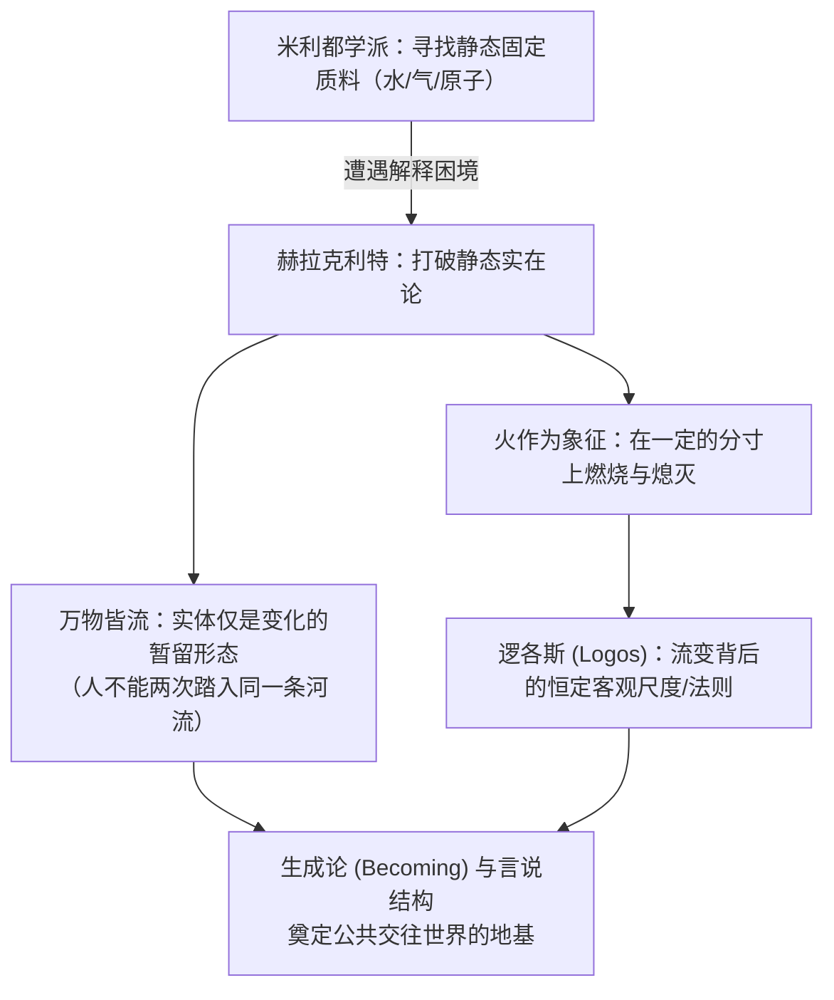

### 1. “万物皆流”与实体的消解
- **经典命题**：“人不能两次踏入同一条河流”（希腊语原意：因为新的水流正不断涌来，河流与入水之人皆在瞬息万变）。
- **本体论革命**：
  - 传统观点将“实体（Substance）”视作永恒坚固的基底，变化仅仅是实体的偶性；
  - 赫拉克利特反其道而行之：**变易本身才是世界的根本真相，孤立静止的实体不过是流变在某一刹那呈现出来的截面形态**。
  - 这与中国古代《周易》的宇宙生成观形成深刻互通：《周易》讲“天地之大德曰生”、“生生之谓易”，同样把“变易（Change & Becoming）”视为宇宙造化的至高本体。

### 2. 永恒的活火与内在的“分寸”
- **残篇原旨**：“这个由相同的元素构成的世界，无论神还是人都未曾创造，它过去是、现在是、将来也将是一团**永恒的活火（Ever-living Fire）**，在一定的分寸上燃烧，在一定的分寸上熄灭。”
- **学术辨析**：
  - 赫拉克利特所言的“火”，并非米利都学派那种物理化学意义上的单一燃烧质料，而是宇宙最纯粹生命力与能量代谢的生动象征；
  - 这里的关键在于**“分寸”（希腊语 $\mu\acute{\epsilon}\tau\rho o\nu$ / Metron）**：
    - “分寸”即是客观规律与内在比例；
    - 所谓“在一定的分寸上”，正是指在看似狂暴生灭的万千烈焰中，蕴含着**永不改变的必然法则**。

### 3. 逻各斯（Logos）：从感性流动到言说结构
- **词源意涵**：$\lambda\acute{o}\gamma o\varsigma$（Logos）源自希腊语动词 $\lambda\acute{\epsilon}\gamma\omega$（Lego，意为采集、挑选、言说），后引申为比例、尺度、规律、理性与言说。
- **公共世界（Public World）的奠基**：
  - 如果万物仅是无常的感性流变，那么每个人的感官知觉就会将人封闭在孤绝的个人状态（Idios Kosmos）中；
  - 正是通过逻各斯（人类共同的言说结构与理性规则），人与人之间才得以架起理解的桥梁，从而进入一个**可交流、可共证的公共世界（Koinos Kosmos）**。
  - 事物的“存在性规定”，绝非源自虚妄的肉眼直观，而是源自逻各斯的言说与界定。

### 4. 纯粹流变论的法权困境：偷树案法庭审理
若彻底贯彻赫拉克利特“唯有变化、绝无不变实体”的观点，人类文明与社会秩序将陷入逻辑崩溃。手稿中记录的古希腊法庭公案直击其要害：

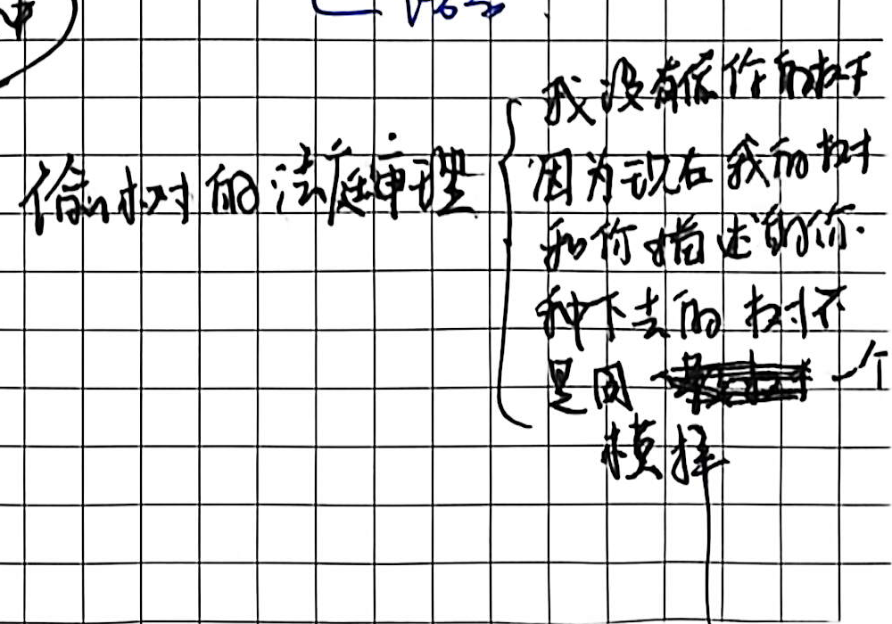

> **法庭辩驳逻辑**：  
> 原告控告被告盗伐其私有树木；被告当庭辩解称：“我并未偷盗你的树木，因为眼前这根木头与你当年亲手栽种的树苗，在每一个原子、尺寸与细胞上都完全不同！倘若世界无时无刻不在流变，那么现在的它根本不是你所声称的那棵树。”

这一公案表明：**若缺乏一种超越时间流变的同一性规定，人类的法律归责、契约信用乃至道德主体都将荡然无存。** 这直接迫使古希腊思想向对立面演进，催生了巴门尼德的不变存在论。

---

## 二、 存在论的奠基与语法革命：巴门尼德、系词“To Be”与公共世界

埃利亚学派的巴门尼德（Parmenides，约前515—前445）在哲学史上完成了空前绝后的断裂与奠基：他宣告了感官经验的彻底破产，在人类历史上首次确立了纯粹思辨的对象——**“存在”（Being）**，从而正式开辟了西方哲学两千余年的核心命脉：**存在论（Ontology）**。

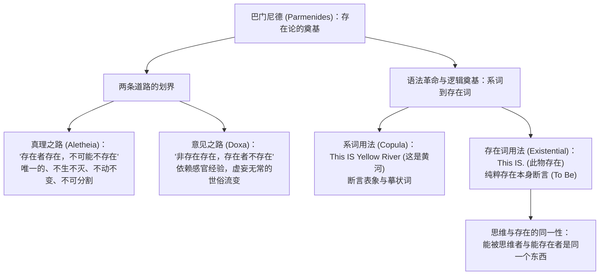

### 1. 存在论（Ontology）的名词与实质
- **希腊语原词**：源自希腊语分词 $\hat{o}\nu$（On，存在者 / Being），属格为 $\hat{o}\nu\tau o\varsigma$（Ontos），复数中性形式为 $\tau\grave{\alpha}\ \hat{o}\nu\tau\alpha$（Onta，诸存在者）。加上 $\lambda o\gamma\acute{\iota}\alpha$（学说），构成 **Ontology**。
- **学术辨正（本体论 vs 存在论）**：
  - 中文语境长期将 Ontology 译为“本体论”，容易误导读者联想到中国古典哲学中实体的“体用”之“体”；
  - 严谨的现代西方哲学研究更倾向于译为**“存在论”**，即：**研究“存在（To Be / Seiend）是如何被赋予规定性”的根本哲学。**

### 2. 语言与存在的同构：印欧语系的“To Be”语法革命
手稿中以极具穿透力的语言学模型，剖析了印欧语言在构筑西方形而上学时的决定性作用：

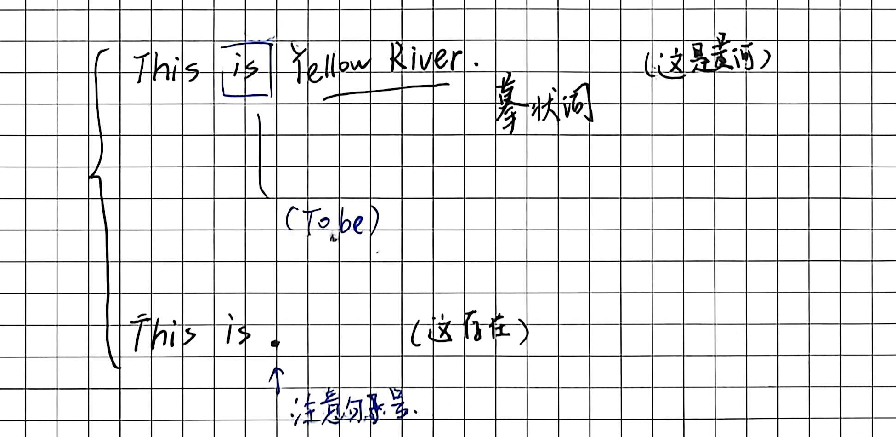

在英语及印欧语系中，动词 **To be（is / are / was）** 兼具两种根本不同的语法与哲学功能：
1. **作为系词（Copula，联结词）**：
   $$\text{This } \mathbf{is} \text{ Yellow River. （这是黄河）}$$
   - 此处“is”仅充当语法中介，连接主词（This）与谓词摹状词（Yellow River）；
   - 它描述的是具体的经验表象与感觉状态，指示着特定时空中的具象物。
2. **作为存在词（Existential Predicate，存在断言）**：
   $$\text{This } \mathbf{is}. \quad \text{（此物存在！）}$$
   - **注意句子后方坚决的句号**：当摹状词被完全剥离，仅仅留下“This is.”时，思维发生了本质跃迁；
   - 此时“is”不再描述事物“是什么样子的”，而是以绝对的必然性断言**“它在、它存在”**。
   - 莎士比亚在《哈姆雷特》中的千古天问——**“To be, or not to be, that is the question”**，其深层哲学母体正源于此：不是在生存与死亡的世俗利害间权衡，而是在“存在还是虚无”的本体论深渊前战栗。

### 3. 海德格尔视域下的“语言是存在的住所”
德国哲学家马丁·海德格尔（Martin Heidegger）在《关于人道主义的书信》中写道：**“语言是存在的住所（Die Sprache ist das Haus des Seins）。”**  
人正是生活在逻各斯所编织的语言言说网络中，我们对客体的一切命名、定义与范畴赋予，才使混沌模糊的世界向我们呈现其存在的确定意义。脱离了语言与思维的规定，事物便沦为不可言说的荒芜流变。

---

## 二、 意见之路与真理之路：思维规定、先验范畴与客体构成

巴门尼德在残篇中严厉地斥责了世俗大众对感官表象的盲目信赖，确立了西方认识论的基本分野：**意见（Opinion / $\delta\acute{o}\xi\alpha$）** 与 **真理（Truth / $\dot{\alpha}\lambda\acute{\eta}\theta\epsilon\iota\alpha$）**。

| 哲学范畴 | 意见（Doxa / Opinion） | 真理（Aletheia / Truth） |
| :--- | :--- | :--- |
| **认知器官** | 肉体感官（眼、耳、鼻、舌、身） | 纯粹理性与思维能力（Nous / Pure Thought） |
| **认识对象** | 瞬息万变、有生有灭的可感世界 | 永恒同一、不生不灭的“存在”本身 |
| **理论特质** | 主观偶然、各执一端、充满矛盾 | 客观普遍、具有绝对逻辑必然性 |
| **巴门尼德断语** | “感官给你的只是虚妄的意见” | “存在者存在，不可能不存在” |

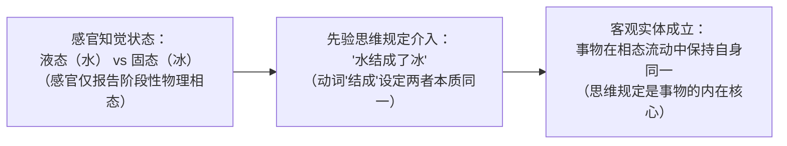

### 1. 经典判例：“冰结成冰”的思维构造
手稿中对“水与冰”的剖析，生动展现了德国唯心论与康德批判哲学的深刻意蕴：
- **感官的忠实报告**：感官从来没有直接“看到”水变成了冰。感官只是先后报告了两种截然不同的知觉状态——先是有流动的、透明的液体，后来有坚硬的、冰冷的固体；
- **理性的内在跃迁**：为什么我们不会断言“原先的水彻底消失了，原地突然凭空冒出了一块冰”？因为人类理智在无意识中施加了**“结成”**这一个概念范畴；
- **黑格尔的核心命题**：
  > **“思维规定是事物的内在核心。”**  
  > 唯有当一个感觉材料被思维的范畴所规整并赋予同一性时，它才摆脱了虚无缥缈的生灭变幻，成其为一个可被认识的“客观事物”。

### 2. 思维与存在的同一性命题
- **巴门尼德残篇第三条**：
  $$\tau\grave{o}\ \gamma\grave{\alpha}\rho\ \alpha\grave{\upsilon}\tau\grave{o}\ \nu o\epsilon\tilde{\iota}\nu\ \dot{\epsilon}\sigma\tau\acute{\iota}\nu\ \tau\epsilon\ \kappa\alpha\grave{\iota}\ \epsilon\tilde{i}\nu\alpha\iota \quad (\text{思维与存在是同一的})$$
- **哲学意涵**：
  - 凡是能够被理性纯粹思维的，必定是能够存在的；
  - 凡是不能被思维所规整的（如不可言说的虚无、矛盾的方圆），在本体论上皆是非存在；
  - 思维不是外在于存在的被动照相，思维的逻辑形式恰恰就是存在者得以成立的内在法则。

### 3. 范畴（Category）与中西认知框架的范式差异
- **亚里士多德的“种加属差”（Genus et Differentia）**：
  - 给具体概念下定义的标准方式：$\text{概念定义} = \text{属概念（Genus）} + \text{种差（Differentia）}$；
  - 例：*人是动物*（属概念），*人是有理性的*（种差），定义即“有理性的动物”。
- **范畴（Category）的超越性**：
  - 范畴（如实体、数量、性质、关系）是人类思维最上位、最普遍的基本构件，其外延其大无外，因此**根本无法被“种加属差”所定义**。
- **中西文化范畴视角的深刻对照**：
  - 手稿深刻指出：中医体系中的“温热、寒凉、虚实、表里”，正是中国古代哲人用于规整生命经验的**核心概念范畴**；
  - 西方传统缺乏这一套先验范畴，因此近代欧洲医学只看到细菌、病毒与生物化学分子，无法体会与重构出中国医者所精准把握的机体证候经验。这充分证明：**范畴并非经验材料的被动汇总，而是经验世界得以组织生成的主动构架。**

---

## 四、 认识论与生存论的合一：苏格拉底“美德即知识”、辩证法与知性/理性之辨

在经历了自然哲学对宇宙始基与存在本体的宏大沉思后，古希腊思想迎来了一场决定性的轴心转折——苏格拉底（Socrates，前470—前399）将哲学从天上召唤回人间。

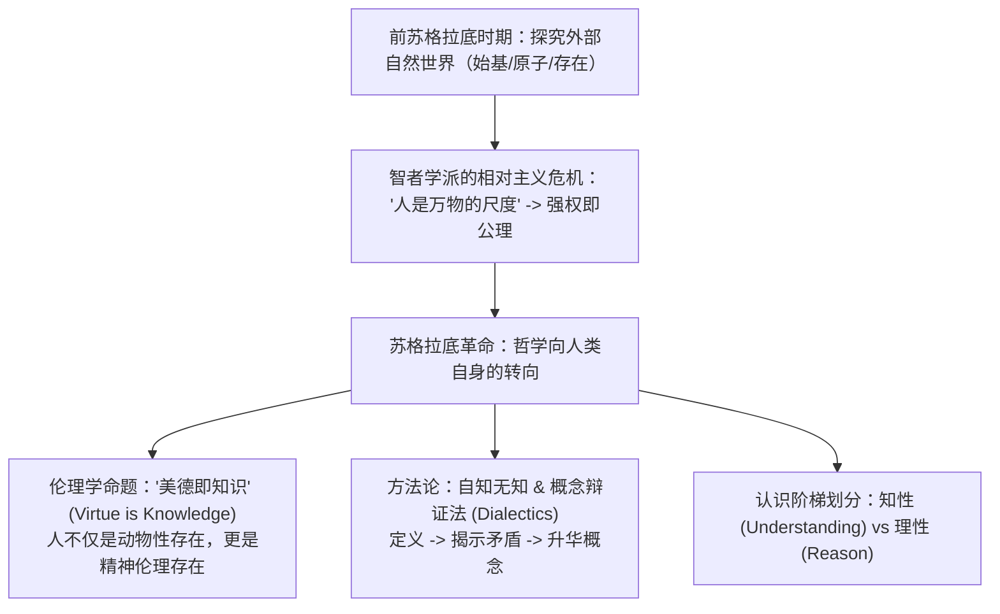

### 1. 哲学的本真命名：爱智慧与生命的自我审视
- **词源学拆解**：德语 *Philosophie* 源自希腊语 $\varphi\iota\lambda\acute{\iota}\alpha$（Philia / 爱、渴望、追求）与 $\sigma o\varphi\acute{\iota}\alpha$（Sophia / 智慧），哲学即“爱智慧”。
- **苏格拉底的誓言**：
  > **“未经审思的生活是不值得过的。”（$\dot{o}\ \delta\grave{\epsilon}\ \dot{\alpha}\nu\epsilon\xi\acute{\epsilon}\tau\alpha\sigma\tau o\varsigma\ \beta\acute{\iota}o\varsigma\ \mathrm{o}\dot{\upsilon}\ \beta\iota\omega\tau\grave{o}\varsigma\ \dot{\alpha}\nu\theta\rho\acute{\omega}\pi\omega$）**
  - 动物完全沉沦于生物性的本能与繁殖之中，对其生命意义从不产生疑问；
  - 人之为人的本质，在于人不仅是肉体动物，更是具有自我意识的**精神存在**。人类的理性能量除了用来丈量宇宙星空，更必须用来拷问人自身的灵魂安顿。

### 2. 智者运动（Sophists）与相对主义的滑铁卢
- **普罗泰哥拉（Protagoras）的名言**：“人是万物的尺度，是存在者存在的尺度，也是不存在者不存在的尺度。”
- **双重效应评析**：
  1. **积极意义**：打破了贵族寡头对真理与神谕的绝对垄断，确立了人的主体地位；
  2. **致命堕落**：将真理的标准彻底降格为个别的生理感官与个人偏见。既然“你觉得冷风就是冷的，我觉得热风就是热的”，那么世界上便不存在普遍的善恶尺度与客观正义；
  3. **历史必然走向**：道德相对主义最终必然在政治实践中堕落为蛮横的丛林法则——**“强权就是公理”（Might is Right）**。

### 3. 苏格拉底的破局：“自知无知”与概念辩证法（Dialectics）
苏格拉底确立了“哲学的第一原则”：**自知自己无知**。这与《老子》第四十八章“为道日损，为学日益，损之又损，以至于无为”遥相呼应——必须不断剥离世俗私欲与偏见经验的累赘，真理之光方能显现。

#### 概念辩证法（Dialectics / 精神助产术）实战推演：正直之问
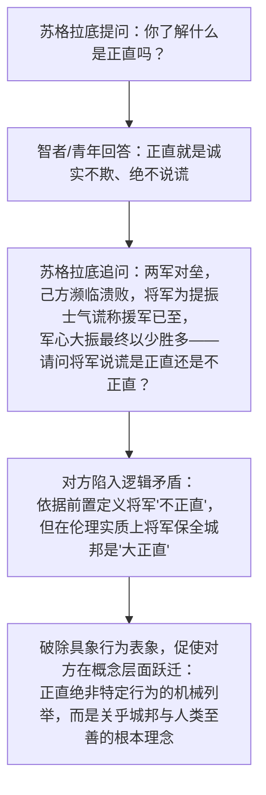

### 4. 关键范畴界分：知性（Understanding） vs 理性（Reason）
手稿在此引入了德国古典哲学（特别是康德与黑格尔）最为核心的概念工具，彻底扫清了日常语言的混淆：

| 认识能力 | 知性（Verstand / Understanding） | 理性（Vernunft / Reason） |
| :--- | :--- | :--- |
| **本质定义** | 认识**有条件的、有限的、相对的**事物的能力 | 认识**绝对的、无条件的、终极的**事物的能力 |
| **运作逻辑** | 概念分析、因果推论、形式判断、功利得失计算 | 理念统摄、自我超越、道德意志、终极价值立法 |
| **人际面向** | 人与人之间没有真友谊，皆是**利益交换与工具性利用** | 纯粹的**真挚友谊（Friendship）**与人格共鸣 |
| **社会建制** | 人力资源管理（HR：将人物化为达成生产的组织构件） | 国家实体精神（黑格尔：个体自愿为超越理念献身） |
| **动物分野** | 在知性与工具算计层面，**人与动物并无实质高下之分** | 理性构成了人类区别于一切禽兽的绝对精神神圣性 |

### 5. 人性论深化：“无人自愿为恶”与现代性伦理困境
- **苏格拉底的论断**：“世界上没有人自愿为恶，作恶皆源于无知。”
  - 无论一个罪犯犯下多么深重的罪孽，当他面对法庭与公众时，他总是竭尽全力寻找“合乎情理”的借口为自己辩护；
  - 这种看似狡辩的举动恰恰反向证明：**罪犯心中同样清晰地明白“善”的尺度存在！** 若他完全没有理性的观念，他便根本不需要进行任何辩护。
- **中西人性论互镜**：
  - **孟子**：性善论，强调“无恻隐之心非人也”，人天然具足良知四端；
  - **荀子**：性恶论，立足感性质料匮乏与物质争夺，强调“化性起伪”；
  - 苏格拉底与孟子殊途同归：皆把善视作人类先验理性/良心的内在规定，而非外在功利算计的产物。
- **当代伦理反思：“老人跌倒扶不扶”**：
  - 手稿切中时弊地指出：当全社会对“跌倒老人该不该扶”产生空前广泛的讨论甚至诉讼时，标志着这个社会的道德地基发生了致命的滑坡——**人类将原本属于“纯粹理性（Reason）”层面上无条件的同情与崇高担当，降格抛进了“知性（Understanding）”层面的利害得失与经济风险精算之中！**

---

## 五、 超验理念世界的建构：柏拉图理念论、存在论三分与社会事实

作为苏格拉底最杰出的门徒，柏拉图（Plato，前427—前347）以无可匹敌的思辨构想，将苏格拉底的“善之知识”升华为涵盖宇宙万有的本体论体系——**理念论（Theory of Forms / Ideas）**。

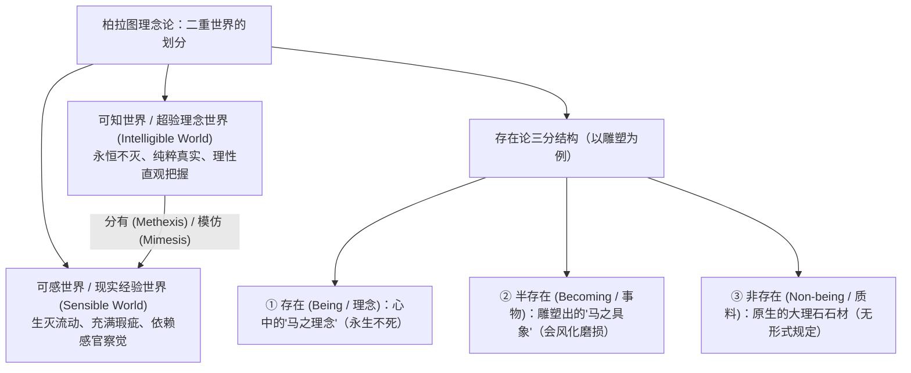

### 1. 柏拉图学园与先验数学形式
- **学园门铭**：“不懂几何学者不得入内（$\dot{\alpha}\gamma\epsilon\omega\mu\acute{\epsilon}\tau\rho\eta\tau o\varsigma\ \mu\eta\delta\epsilon\grave{\iota}\varsigma\ \epsilon\dot{\iota}\sigma\acute{\iota}\tau\omega$）”。
- **思想内核**：几何学中的“完美的圆”与“绝对的直线”，在物理大自然中根本不存在（任何显微镜下的物理圆周都有凹凸瑕疵）。几何学研究的纯然是心灵中先验自明的纯粹形式。不懂几何学的人，灵魂仍深陷在感官肉眼的经验泥潭之中，无法登堂入室领会超验理念的纯洁实在。

### 2. “马”与“马类”的推演：概念自身的实体化
手稿中记录了柏拉图最为经典的本体论反差：

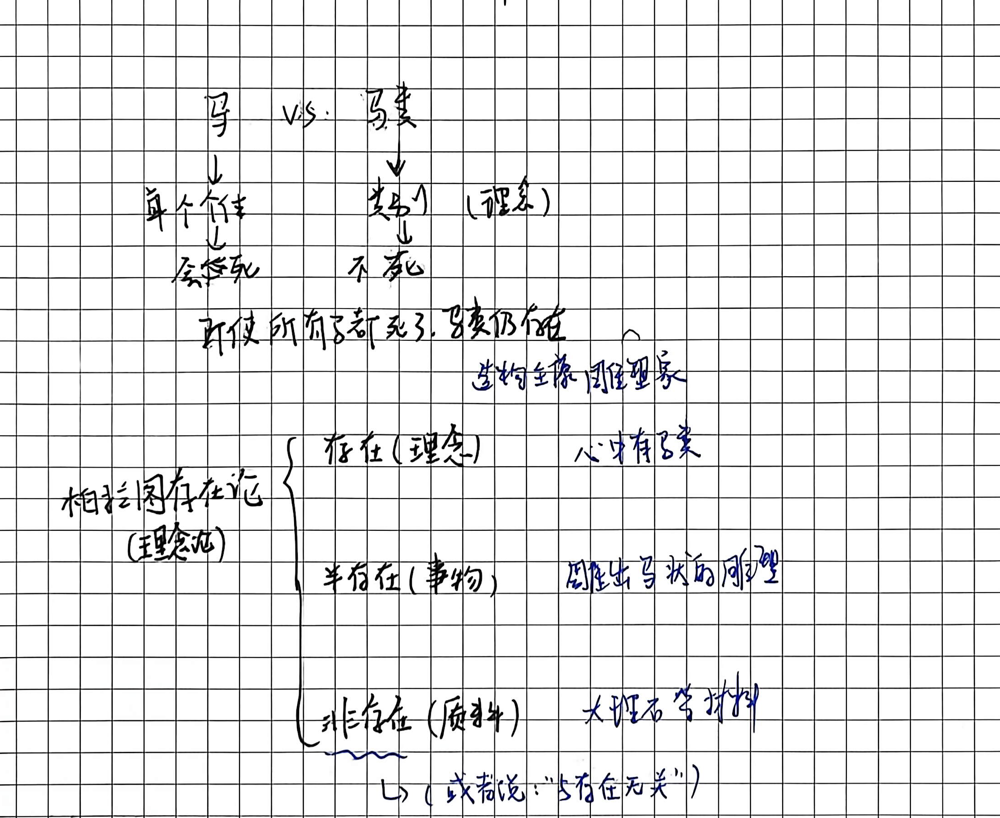

- **个体之马**：现实经验中的白马、黑马、千里马，皆会罹患疾病、逐渐老朽，并最终化为一抔黄土；
- **马之理念（马类）**：即使地球上所有的物理马匹在一场大瘟疫中全部灭绝，“马类”这一先验理念在逻辑空间中依然永恒不灭；
- **中西哲学思维的根本分流**：
  - **中国传统名实之辨**：将概念仅仅视作指称经验事物的符号与标签（“名以定实”），概念依附于事物而存在；
  - **西方柏拉图主义**：**概念自身脱离个别事物，独立自足地构成了一个更为真实、更加永恒的实在世界！**

### 3. 柏拉图存在论（理念论）的三层递降图式
柏拉图在《理想国》与《蒂迈欧篇》中构建了严谨的本体论梯队，手稿以雕塑家的艺术创造将其形象化：
1. **最高层：存在（To On / Being）—— 理念（Idea / Form）**：
   - 雕塑家脑海中完美的、纯粹的“马之理念”；具有神圣的不朽性与绝对完满性。
2. **中间层：半存在（Becoming / 现象事物）—— 感性具象物**：
   - 雕塑家雕凿完成的物理马形雕塑。它既有形式的影迹，又受制于物质的局限，属于生灭无常的“半存在”。
3. **最底层：非存在（Non-being / 质料）—— 原料（Matter）**：
   - 未被赋予形式的大理石石料。它本身没有任何内在规定性，在柏拉图看来与虚无和非存在无异。

### 4. 美学跃迁：美是理念的感性显现
- **黑格尔的继承**：黑格尔在《美学讲演录》中将其凝练为传世名言——**“美就是理念的感性显现（Das Schöne ist das sinnliche Scheinen der Idee）。”**
- **艺术家的使命**：艺术家绝非机械照抄自然的工匠，而是拥有“将超验理念化为具象形式”的神圣天赋。真正的崇高艺术，是将凡人不可见的理念灵魂，灌注凝结在有形的线条、色彩与音符之中。

### 5. 社会事实的理念建构：从生物群落到法治城邦
手稿深刻结合现代社会哲学（如约翰·塞尔的社会事实理论与黑格尔法哲学）：
- **自然物理事实（生物事实）**：一群高级灵长类哺乳动物在特定时空坐标聚集（感官可直接测量记录）；
- **理念建构的社会事实**：
  - 为什么他们是“警察与公民”，而不是“弱肉强食的猴群”？
  - 肉眼根本看不出谁是“警察”、谁是“匪徒”，唯有当人类社会先验地确立了**“法治、宪制与正义”的理念**，社会事实才得以成立；
  - 同样，男女两性的生理接触是自然事实，但“婚姻、出轨、重婚”则是纯粹基于“一夫一妻制理念”才派生出的社会法权事实。人类社会从来不是活在物理荒野中，而是栖居于理念的建构之中。

---

## 六、 现实世界的拯救：亚里士多德第一实体论与对柏拉图的批判

作为古希腊哲学的集大成者，亚里士多德（Aristotle，前384—前322）在柏拉图学园深研二十载后，展开了对老师理念论的决绝清算：**“吾爱吾师，吾更爱真理（Amicus Plato, sed magis amica veritas）。”**

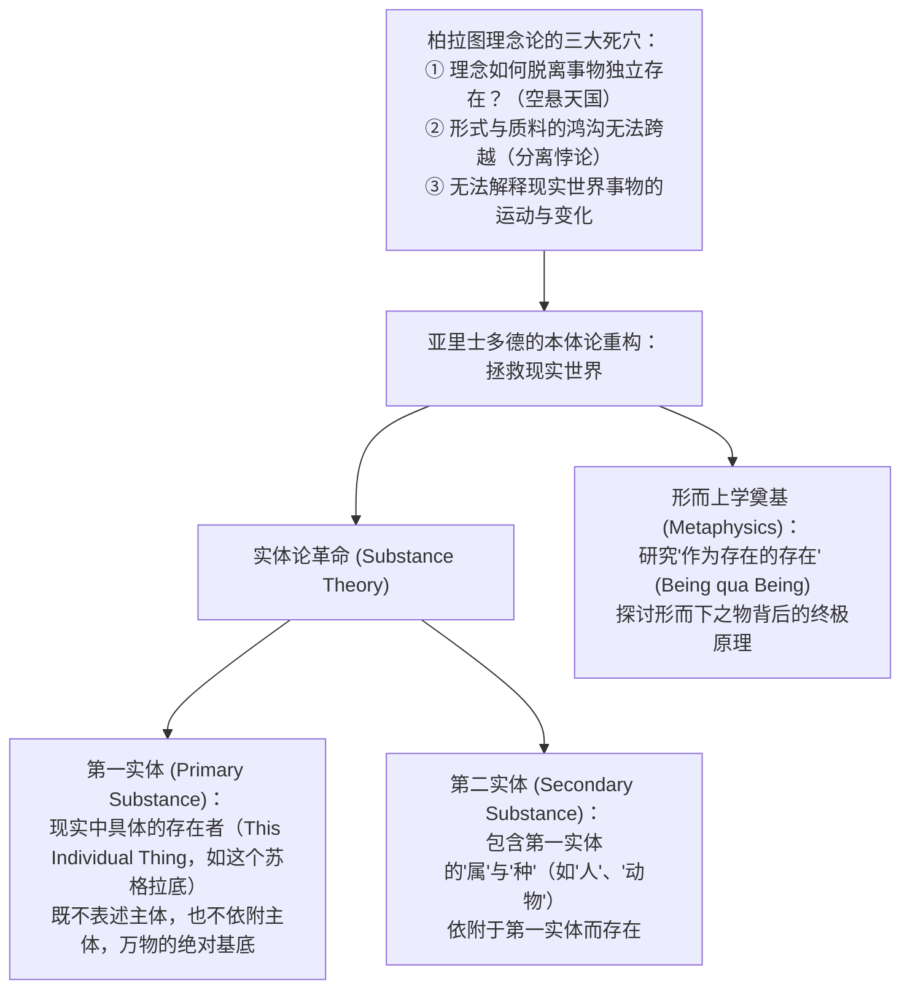

### 1. 柏拉图理念论留下的三大理论死穴
亚里士多德敏锐地洞察到，如果将理念彻底架空在天国之中，将引发致命的哲学危机：
1. **虚构的冗余**：假定每个现实事物背后都有一个理念，不仅没有解释世界，反而在事物之外凭空制造了一倍的“幽灵实体”；
2. **“第三人悖论”（Third Man Argument）**：如果具体的个人与“人的理念”之间需要一个相似点来联结，就必须假定“第三个纯粹的人”来统摄他们，由此导致无限倒退；
3. **无法解释运动与生成**：天国里永恒静止的理念，根本无法为现实世界中种子发芽、风起云涌的运动提供动力与因果解释。

### 2. 中国名家公案：“离坚白”的同构辨析
- **公孙龙《坚白论》**：“视不得其所坚而得其所白者，无坚也；拊不得其所白而得其所坚者，无白也。”
- **哲学意蕴**：公孙龙以眼见与手触的感官分离，论证“坚”与“白”这两种属性可以在概念中彻底从石块本身剥离出来而独立存在。具体的白石终将风化碾碎，而“坚”之理与“白”之理历久不磨。这在思维进路上与柏拉图将属性理念化的企图如出一辙；
- **亚里士多德的强硬回应**：脱离了具体的石头，“坚”与“白”根本无处栖身！**事物首先作为实体存在，然后我们才有资格谈论它的各种属性与范畴。**

### 3. 第一实体与第二实体的颠覆性划界
- **第一实体（Primary Substance / $\pi\rho\acute{\omega}\tau\eta\ o\dot{\upsilon}\sigma\acute{\iota}\alpha$）**：
  - **核心定义**：既不能用来表述一个主体，也不存在于一个主体之中（例如：眼前“这个苏格拉底”、“这匹具体的白马”）；
  - 它是一切属性、范畴、运动的最终承载者。如果第一实体不存在，其他任何概念都将沦为虚无。
- **第二实体（Secondary Substance）**：
  - 指第一实体所属的“种（Species）”与“属（Genus）”（例如“人”与“动物”）；
  - 它们具有普遍性，但它们的存在是派生的，必须依附于第一实体。
- **划时代意义**：亚里士多德将哲学的重心从虚无缥缈的超验天国，重新**拉回到坚实的大地与活生生的具体事物之上**。

### 4. 形而上学（Metaphysics）的学科奠基
- **词源典故**：公元前1世纪，罗得岛的安德罗尼柯（Andronicus of Rhodes）在整理亚里士多德遗稿时，将讨论第一哲学的文稿置于物理学（Physica）著作之后，编目命名为 **$\tau\grave{\alpha}\ \mu\epsilon\tau\grave{\alpha}\ \tau\grave{\alpha}\ \varphi\upsilon\sigma\iota\kappa\acute{\alpha}$（Ta meta ta physika，意为物理学之后诸篇）**；
- **中国古典翻译的神来之笔**：严复等人引证《易经·系辞上》“**形而上者谓之道，形而下者谓之器**”，将其译为“形而上学”；
- **学科使命**：物理学研究的是具有具象形态、处在运动变化中的“形而下者”；而形而上学所追寻的，正是超越一切感官物理形态、探讨**“作为存在的存在”（Being qua Being）**的最高本原与终极原因。

---

## 七、 实体生成的终极机制：四因说、目的论演化与潜能现实论

为了彻底解决赫拉克利特的“流变”与巴门尼德的“不变”之间的巨大断裂，亚里士多德构建了一整套兼顾形式与运动的宏大体系——**四因说**与**潜能-现实演变理论**，这成为此后两千年来解释自然与宇宙演化的核心框架。

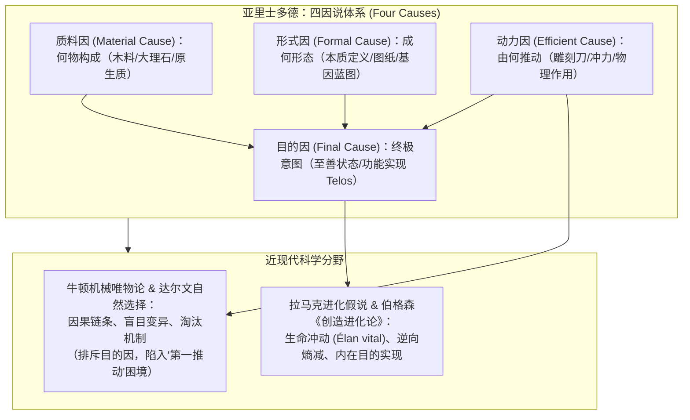

### 1. 四因说（The Four Causes）的动态统一
无论是人造工具还是自然生物，要成就其现实存在，必须在四个维度上协同统一：
1. **质料因（Material Cause）**：事物构成的物理基质（如大理石、青铜、碳水化合物）；
2. **形式因（Formal Cause）**：使质料获得规定性的本质原型与结构（如雕像的原型设计、生物的器官蓝图）；
3. **动力因（Efficient Cause）**：赋予形式的主动推动力（如工匠施锤、把形式加到质料上去的力量）；
4. **目的因（Final Cause）**：运动指向的终极完满目标（希腊语 $\tau\acute{\epsilon}\lambda o\varsigma$ / Telos，如雕像的崇高瞻仰、橡树种子的参天庇荫）。

### 2. 现代自然科学中的因果大分流
手稿在此敏锐地将古希腊目的论与近代物理学、演化生物学的前沿困境贯通对比：

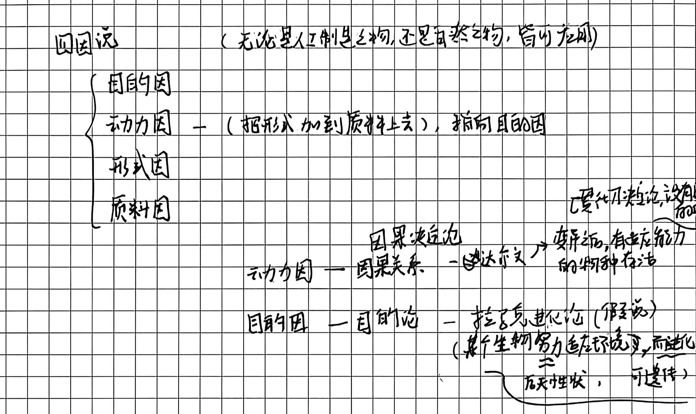

#### (1) 动力因的极致：机械因果决定论
- **达尔文主义**：彻底驱逐了生物学中的目的因，主张遗传变异是完全随机、盲目的，生物仅在动力学式的自然淘汰压力下苟延残喘；
- **拉普拉斯妖（Laplace's Demon）**：法国数学家拉普拉斯断言，只要给出全宇宙在某一刹那的所有力学参数与动力方程，未来的一切细节皆可被分毫不差地推导。
- **理论困境**：连牛顿和达尔文这样的巨擘，在学术晚期皆不可避免地面临终极难题——**最初的宇宙启动力与生命飞跃由何而来？（牛顿不得不诉诸神的第一推动）**。

#### (2) 目的因的复活：生命冲动与熵减之谜
- **钓鱼与鱼竿的因果倒置**：人类绝非因为偶然在路边看到了一根竹竿，才被动萌生钓鱼的念头；而是因为人类内心深处先存在了**“捕食与垂钓的目的”**，才主观创造性地设计发明了鱼竿！
- **伯格森《创造进化论》（L'Évolution créatrice）**：诺奖哲学家亨利·伯格森指出，进化无法被单纯还原为外在物理环境的被动压迫，而必须从生命内部不可遏制的**“生命冲动”（Élan vital）**来解释；
- **当代科学两大未解悖论**：
  1. **熵减之谜**：热力学第二定律断言宇宙万物必然不可逆地走向无序与熵增，唯独生命奇迹般地逆流而上，持续吸纳环境能量维持内部高度有序的“负熵”；
  2. **高级演化悖论**：从单纯适应环境的生存力而言，微小极简的单细胞病毒与细菌远比人类坚韧百倍。生命为何执拗地放弃极致的稳定性，宁愿承担巨大灭绝风险，也要向结构高度脆弱、复杂且更高级的智慧生物演进？这表明**宇宙深处依然隐匿着亚里士多德所凝视的“目的因”幽灵**。

### 3. 潜能（Potentiality）与现实（Reality / Actuality）
这是亚里士多德攻克运动哲学难关的王冠理论：
- **潜能（$\delta\acute{\upsilon}\nu\alpha\mu\iota\varsigma$ / Dynamis）**：事物尚未展现、但内在蕴含的一切发展可能；
- **现实（$\dot{\epsilon}\nu\acute{\epsilon}\rho\gamma\epsilon\iota\alpha$ / Energeia）**：潜能经过动力因的作用，获得完全的形式规定而达成实现；
- **隐德来希（$\dot{\epsilon}\nu\tau\epsilon\lambda\acute{\epsilon}\chi\epsilon\iota\alpha$ / Entelechy）**：
  - 意为“内在目的的自我实现过程”；
  - **“种瓜得瓜，种豆得豆”**：一粒苹果种子（潜能），在其微小的基因结构中，已经全息性地预设并隐匿了一整株繁茂苹果树及其甘甜果实的全部命运；
  - **棋局隐喻**：整部激荡人心的国际象棋大师对局史，早已隐蔽在 32 颗棋子与其空间移动规则的原始潜能之中，棋圣的博弈不过是隐德来希将这种可能性逐步兑现为现实的工具；
  - **哲学史的种子法则**：从泰勒斯、巴门尼德、苏格拉底、柏拉图到亚里士多德，古希腊人在这短短两百年间所播撒下的“存在、逻辑、范畴、理性、目的”等核心术语，正是日后两千年西方哲学全部繁复体系的**原初种子**。后世黑格尔、康德、海德格尔乃至当代科学的伟大展开，皆是这颗古典种子在历史长河中的壮丽现实化！

### 4. 形式逻辑（Formal Logic）的创立：思维推演的必然保障
为了确保人类思维在从潜能迈向现实的推导过程中不犯错误，亚里士多德创立了人类历史上首个严密的形式逻辑系统：
- **形式高于内容**：形式逻辑不负责判定大前提在感性世界上是否绝对真确，而是保证推理过程**在形式结构上的无可辩驳与绝对必然**；
- **三段论（Syllogism）经典架构**：
  $$\begin{cases} \text{大前提（Major Premise）：所有人都是会死的} \\ \text{小前提（Minor Premise）：苏格拉底是人} \\ \hline \text{结论（Conclusion）：苏格拉底必定会死} \end{cases}$$

至此，古希腊哲学完成了从经验感官的自然始基，向超验实体与存在论的跃升，并最终在亚里士多德手中熔铸出融贯形而上学、物理学、目的论演化与形式逻辑于一体的博大知识图景，为整个西方现代文明与理性世界确立了永恒的基石。

---
