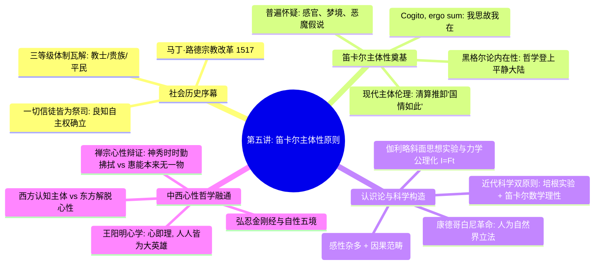

# 第五讲：近代理性主义的开端——笛卡尔的主体性原则

> **本讲核心题旨**：回溯欧洲近代思想史上最激进的哥白尼式转向——从路德宗教改革对封建神圣三等级的打破，到笛卡尔通过普遍怀疑确立“我思故我在（Cogito, ergo sum）”的主体性第一原理；进而深层探究康德先验认识论与近代科学双原则的奠基，并展开与阳明心学“心即理”及禅宗心性公案的跨文明深度会通。

---

## 快速导航与知识图谱

| 文档类型 | 入口链接 | 核心内容提要 |
| :--- | :--- | :--- |
| **手稿忠实还原版** | [第五讲_手稿还原.md](./第五讲_手稿还原.md) | 逐页忠实还原 7 页手稿全貌，完整保留随笔反思、错字校正、板书草图及学理 TODO 标记，链接手写关键切图。 |
| **结构化深度探究版** | [第五讲_结构化深度探究.md](./第五讲_结构化深度探究.md) | 系统阐发宗教主体性破晓、笛卡尔我思哲学、现代公民责任论、康德经验建构图示、科学双原则、禅宗六祖心性公案比较。 |

---

## 本讲核心哲学命题摘要

1. **“一切信徒皆为祭司”与中世纪三等级的神圣解体**：
   马丁·路德打破罗马教会垄断，剥夺教士的神圣中介特权，确立了每个个体直接面向上帝的良知自由，为近代社会主体性的确立撕开了历史缺口。
2. **“我思故我在（Cogito, ergo sum）”的认知本体确证**：
   笛卡尔运用普遍怀疑将感官与常识假定推至悬崖，发现唯一不可怀疑的就是“正在怀疑的主体”。由此确立：存在必须经由内在思维主体的反思与审查才能确证其合法性。
3. **主体性伦理对“国情如此”借口的清算**：
   “国情”不是一个超然在外的客观事实，而是千万个体选择与行为汇聚的结果。主体性要求个体承担起对世界状态的终极责任，拒绝在平庸与冷漠中退缩。
4. **康德的先验综合：人为自然界立法**：
   客观经验知识并非客体的单纯被动印入，而是主体的先天知性范畴（如因果律）对感性后天杂多材料的能动综合构造（“太阳晒热石头”）。
5. **近代科学方法论的双螺旋架构**：
   近代自然科学由“培根的实证归纳实验”与“笛卡尔的数学公理理性”共同构筑；伽利略理想斜面思想实验揭示了理性模型对粗糙经验感官的先验超越。
6. **中西心性哲学的巅峰会通**：
   西方笛卡尔、康德的“认知立法主体”与东方王阳明“心即理”、禅宗惠能“本心自性（何期自性，能生万法）”，共同证明了心灵/精神在世界中的主导与本体地位，同时在认识论与生命解脱论上各呈异彩。

---

*知识库规范与指引详见：[AGENTS.md](./AGENTS.md)*
