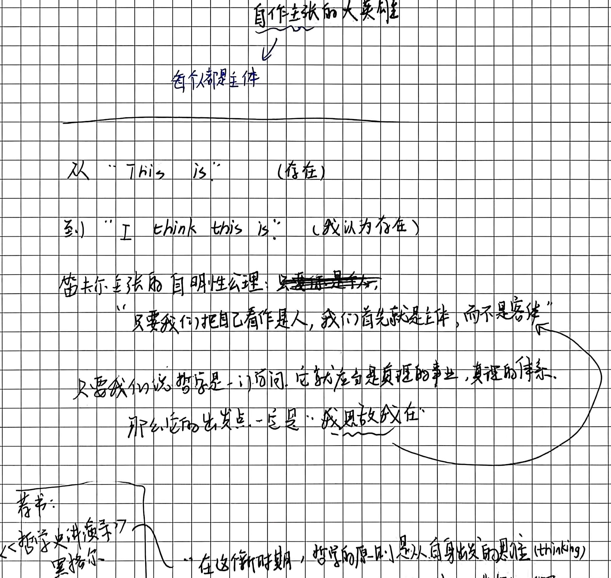
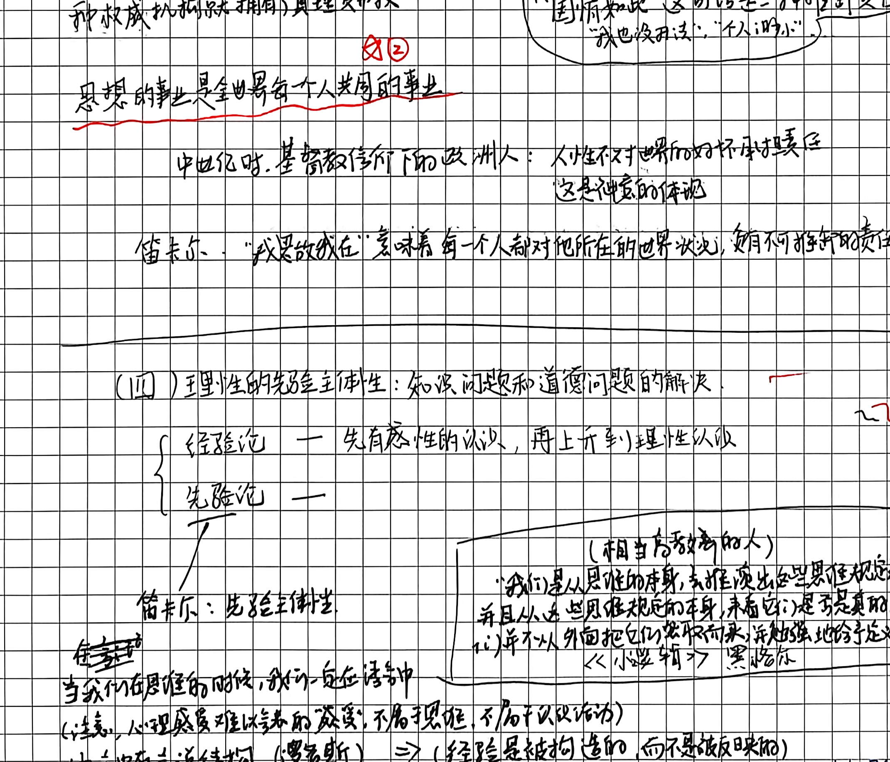
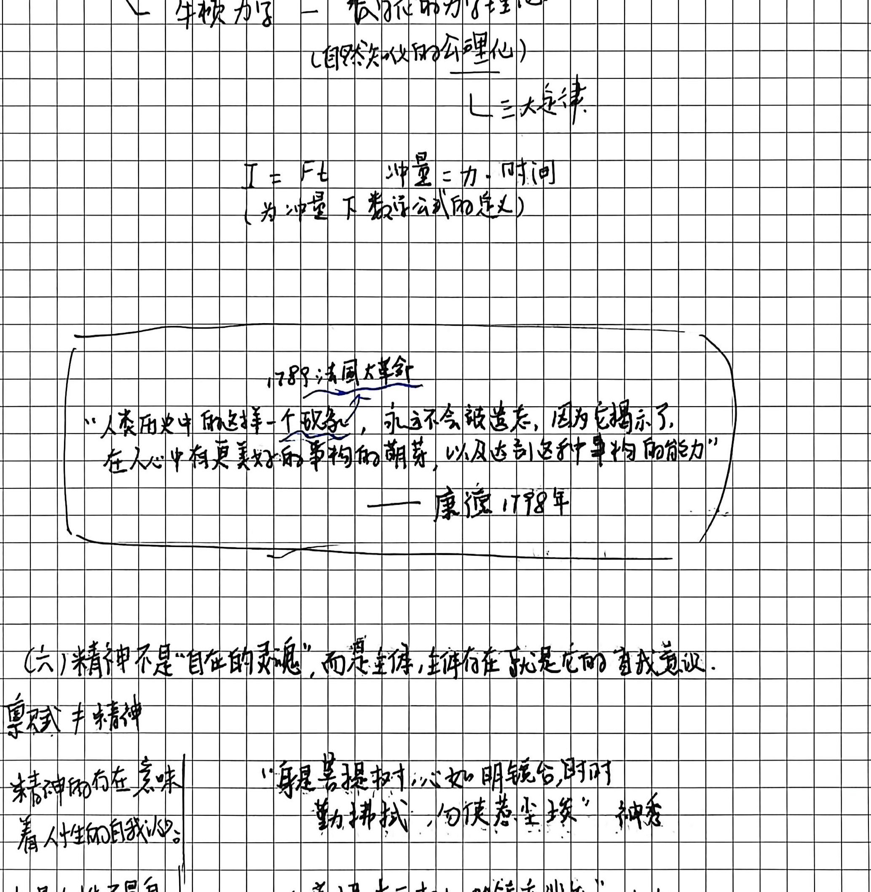

# 第五讲手稿还原：近代理性主义的开端——笛卡尔的主体性原则

> **整理说明**：
> 1. 本文档忠实还原手稿全部 7 页笔记内容，依原稿页码、板块结构、手写随笔及板书顺序逐项整理。
> 2. 原稿笔误已用括号标注正字（如“神秀”、“惠能”）；存疑及学术延伸点注入 `// TODO: [疑问描述]` 批注，供后续审核。
> 3. 关键图解切图已归入 `assets/images/第五讲/`。

---

## 第 1 页：宗教改革与近代主体性的破晓

### 一、 宗教改革（马丁·路德）的革命性意义
- **中世纪三大等级的瓦解**：
  - 传统中世纪天主教社会结构被牢固划分为三个等级：
    1. **教士阶层（第一等级）**：垄断圣经解释权、免税特权、向上帝祈祷代赎；
    2. **贵族阶层（第二等级）**：手握世俗封建武装与统治特权；
    3. **平民/第三等级（农奴、工匠、市民）**：承担繁重劳作与赋税。
  - **马丁·路德的颠覆性宣言**：
    - 宣布“**一切信徒皆为祭司（Universal Priesthood of all Believers）**”。
    - 这一主张彻底击碎了教士对神圣中介权的垄断——基督徒无需经过罗马教廷、主教或购买赎罪券，每个个体凭借内心真实的“因信称义（Sola Fide）”，即可直接在良知深处面对上帝。
  - **历史效应**：打破了第一等级与后两个等级之间不可逾越的神圣鸿沟，使得人人生而平等的近代主体意识得以萌芽。

- **笛卡尔的哲学接力：从宗教主体转向哲学主体**：
  - 如果说马丁·路德是在**信仰领域**确立了个体的良知主体；
  - 那么勒内·笛卡尔（René Descartes）则是在**知识与理性领域**确立了个体的认知主体。
  - **普遍怀疑（Methodological Doubt）**：
    - 怀疑一切感官经验（感官会欺骗我们，如筷子插入水中变折）；
    - 怀疑数学常识与外在世界的存在（可能存在一个全能的“恶魔”在欺骗我）。
  - **不可动摇的原点——“我思故我在”（Cogito, ergo sum）**：
    - 哪怕怀疑到极致，唯一无法被怀疑的，就是“我正在怀疑”这一活动本身！
    - 怀疑即是思想，思想必然要求一个承载思想的实体——**“我”作为一个思维主体的存在，是不可怀疑的第一原理**。

---

## 第 2 页：主体性原则与内在性转向（中西思想共振）

### 二、 笛卡尔主体性原则的实质与中西互镜
- **笛卡尔主体性的本质：唯心主义的内在原则**：
  - 笛卡尔的“Cogito”标志着西方形而上学从“客体性/本体论”转向“**主体性/认识论**”。
  - 存在不再是由外在客观实体来定义，而是**必须经由思维主体的审查与确证**。
  - // TODO: [学理核查] 笛卡尔通过“我思”导出上帝存在，再由上帝的完满不欺骗导出外在广延世界（心物二元论）。此处手稿侧重强调其“思维主体对存在的先在确证”，在讲义中可进一步阐发其二元论张力。

- **王阳明心学与中国主体性的勃兴**：
  - 手稿将笛卡尔与明代心学宗师王阳明并置对照：
    - **王阳明：“人人皆可成圣贤”、“人人皆为大英雄”**。
    - **“心即理”**：破除朱熹“格物致知”向外在草木物理索求天理的繁琐与附庸，断言“心外无物、心外无理、心外无事”。
    - 天理不在外在经典的训诂中，而在人人本具的良知本体之中。

- **黑格尔在《哲学史讲演录》中的赞誉**：
  - 黑格尔评价笛卡尔是**“近代哲学真正的始祖”**；
  - 哲学在流浪漂泊了上千年之后，终于抵达了平静的大陆——人类开始在自己的家园（内在理性与精神主体）中生活。

- **现代社会主体的伦理担当：对“国情如此”的哲学清算**：
  - 手稿在此发出一记振聋发聩的现代公民伦理追问：
    - 世人常以“社会现实就是这样”、“国情如此，我一介草民能怎样”作为放弃道德与逃避责任的借口。
    - **手稿批判**：“国情”不是一个漂浮在虚空中的抽象客观客体，**国情正是千千万万个‘我’的所作所为汇聚而成的总和**！
    - 如果每个个体都推卸责任，国情便沦为平庸之恶的温床；主体性原则要求个体承担起对世界状态的根本责任。

---

## 第 3 页：康德认识论先验综合与经验的构成

### 三、 主体如何建构客观经验世界？
- **康德对笛卡尔主体的深层发展（哥白尼式的革命）**：
  - 客观世界并非现成摆在那里被动等待我们去反映；
  - 认识并非主体去符合客体，而是**客体必须符合主体的认知先天形式**。

- **手稿经典图解：太阳晒热石头**：
  - 经验认知不是单纯由感官直接印入的，它包含两个必不可少的要素：
    1. **后天感性材料（杂多知觉）**：“看见太阳照在石头上”、“用手摸石头感觉发烫”；
    2. **先天知性范畴（因果律 Causality）**：如果仅有感性材料，我们只能说“太阳照着，并且石头热了”（知觉判断）；唯有当主体的理性知性范畴——**“因果范畴（Cause and Effect）”**将二者综合联结起来时，才诞生了普遍必然的科学经验命题：**“太阳晒热了石头”**（经验判断）。

- **结论**：**人为自然界立法**。主体的先验架构（时间、空间感性形式 + 12对知性范畴）是经验世界得以成立的前提。

---

## 第 4 页：近代科学的双重原则与伽利略的思想实验

### 四、 近代实证科学的方法论奠基
- **近代科学的两大基石**：
  1. **培根原则（经验实证）**：实验方法、归纳法、走向自然；
  2. **笛卡尔原则（数学理性）**：普遍数学（Mathesis Universalis）、公理化演绎、清晰明晰的观念。
  - 近代科学的诞生，正是**“培根的实验”与“笛卡尔的数学理性”相结合的产物**。

- **伽利略斜面思想实验（Gedankenexperiment）**：
  - 亚里士多德常识力学认为：力是维持物体运动的原因（“有推力则动，力竭则止”）。
  - **伽利略的先验理性超越**：
    - 伽利略并未局限于当时粗糙、充满摩擦力的日常感性经验；
    - 他在头脑中构造了一个**绝对光滑、无阻力的理想斜面**：小球从斜面滚下，若右侧斜面角度逐步放平直至水平，小球在无阻力状态下将**永远匀速直线运动下去**！

- **牛顿力学的数学公理化表述**：
  - 伽利略的理想思想实验直接导向了**惯性定律（牛顿第一运动定律）**；
  - 进而奠定了经典力学的动量冲量定理公式：
    $$I = F \cdot t = \Delta p = m \cdot \Delta v$$
  - 近代科学不是盲目收集经验，而是**主体先构建理想的数学物理模型，再去命令自然界回答问题**。

---

## 第 5 页：先验主体性与现代性国家制度设计

### 五、 理性主体对政治社会秩序的重构
- **从自然法到现代宪政国家**：
  - 既然理性主体是世界的立法者，那么人类社会的政治秩序也不再来自“君权神授”或传统血缘；
  - **社会契约论（Social Contract）**：国家是自由平等的理性主体为了保障自然权利（生命、财产、自由），通过理性契约共同构建的法人实体。

- **康德对法国大革命的反思**：
  - 尽管法国大革命伴随着狂暴的雅各宾专政与断头台流血；
  - 但康德高度评价大革命在哲学史上的划时代意义：它是**人类历史上第一次自觉尝试按照纯粹理性的宪政原则来重构国家体制**的崇高实践。

---

## 第 6 页：精神自我意识的觉醒与唯灵主义反思

### 六、 精神的自我观照与内在超越
- **自我意识（Self-Consciousness）的反躬自省**：
  - 主体性不仅表现在对外在物理世界的征服与建构，更表现在精神对自身的觉察；
  - 人区别于万物的最高尊严，在于人能以自己的精神为对象进行反思（自我意识）。

- **内在自由与外在必然的抗争**：
  - 面对物理世界的因果机械决定论（自然必然性），主体性在实践理性（道德律令）中确立了超感性的**道德自由（Freedom）**。

---

## 第 7 页：中国禅宗心性论与精神自我反思（终极合流）

### 七、 禅宗公案：从“时时勤拂拭”到“本来无一物”
手稿在最后一页展开了极富东方哲学神韵的心性辩证：

- **神秀上座的偈语（见解第一，渐修路线）**：
  > “身是菩提树，心如明镜台。 
  > 时时勤拂拭，勿使惹尘埃。”
  - **学理批判**：神秀依然将“心”与“物/尘埃”看作两个对立的实体，落入二元对立的执着，是主客未泯的修持路径。

- **惠能行者的顿悟偈（直指本心，顿悟成佛）**：
  > “菩提本无树，明镜亦非台。 
  > 本来无一物，何处惹尘埃？”
  - **手稿深化：五祖弘忍的开示与《金刚经》**：
    - 五祖弘忍夜半为惠能讲授《金刚经》，至**“应无所住而生其心”**，惠能大彻大悟：
    - **“何期自性本自清净，何期自性本不生灭，何期自性本自具足，何期自性本无动摇，何期自性能生万法！”**
    - 弘忍深知惠能已见“本心自性”，遂传衣钵。

- **终极哲学会通**：
  - 西方哲学的“主体性原则”（笛卡尔的我思、康德的先验统觉、黑格尔的精神自我意识）；
  - 与中国东方的“心性本源”（王阳明的致良知、禅宗的本心自性）；
  - 在人类思想的最高峰实现了深沉的呼应：**精神绝非外在客体的附庸，心性本体即是世界的终极源泉与立法者**。

---
// TODO: [学理核查] 手稿第 7 页将禅宗惠能顿悟心性与近代理性主义主体性原则相勾连。在深度讲义中，须明确区分西方“认识论-理性架构的主体（Rational Subiectum）”与东方“心性本体-解脱论的自性（Buddha-nature）”在致思理路与终极旨趣上的异同，防止混淆二者范畴。
