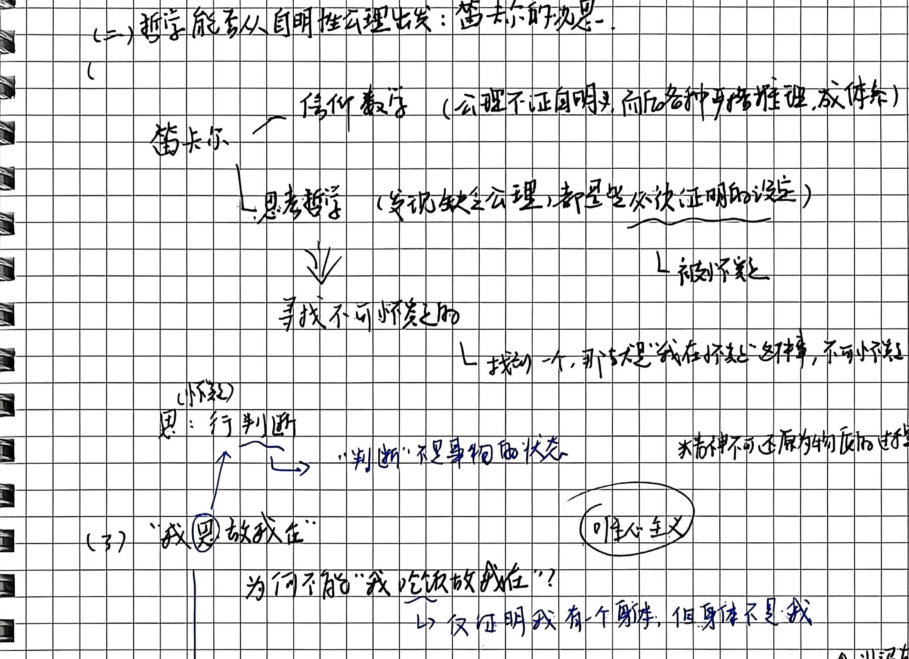
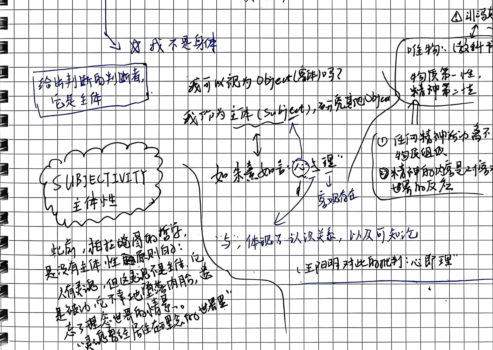
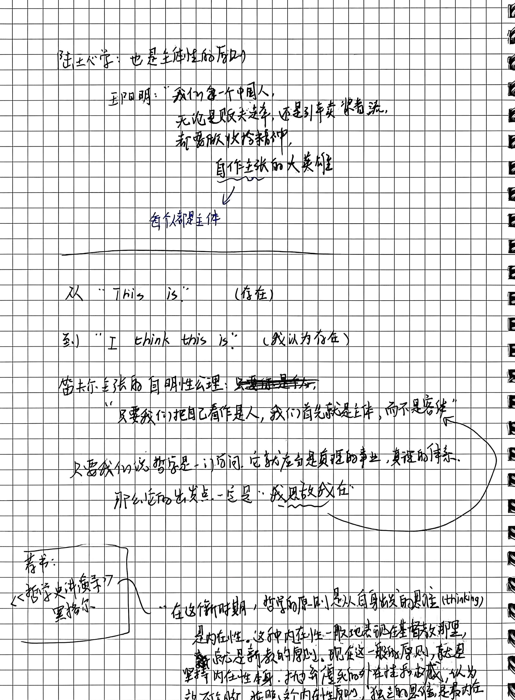
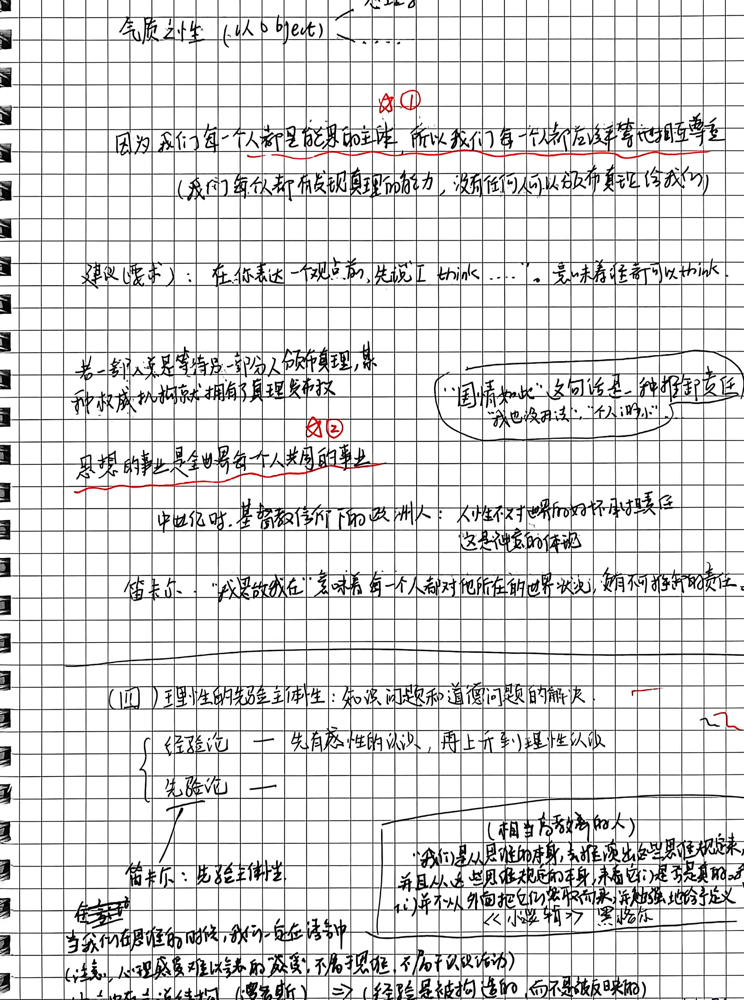
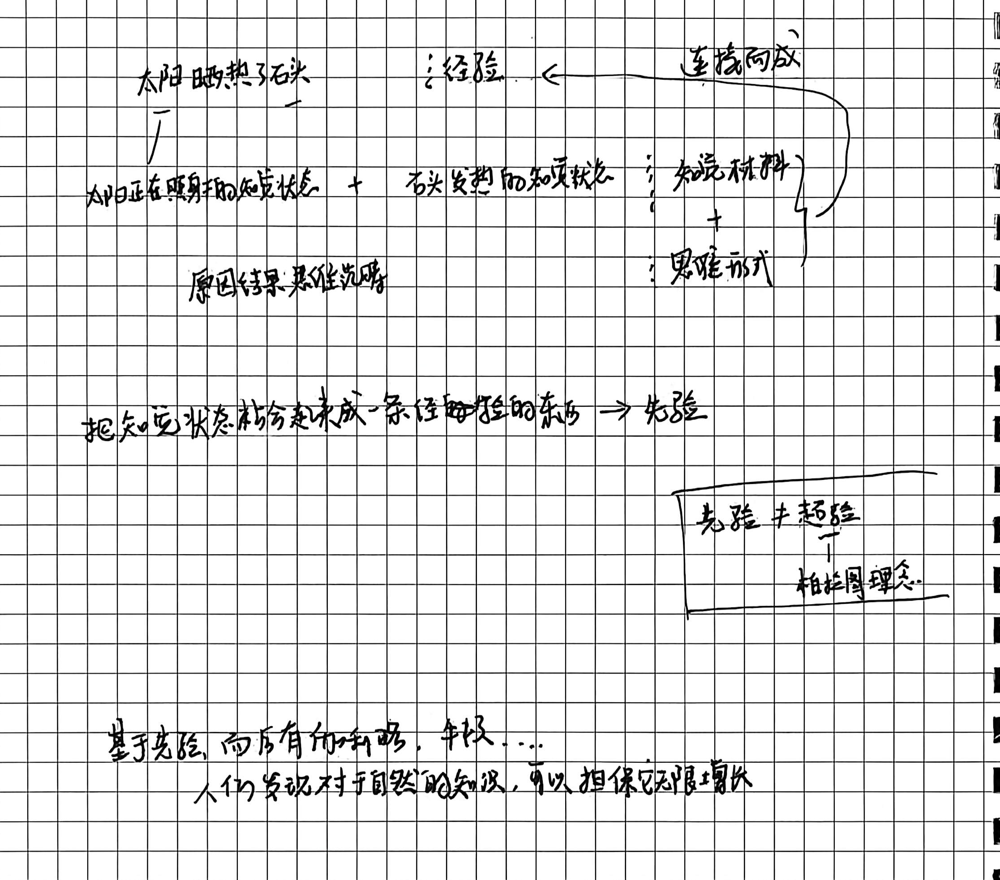
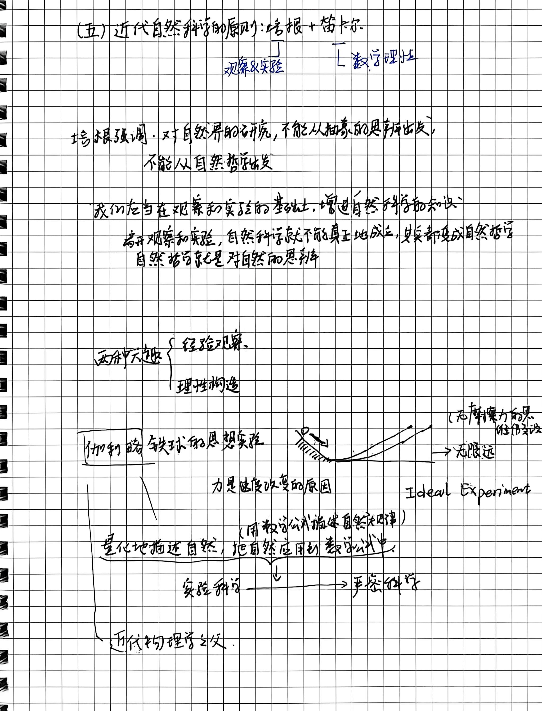
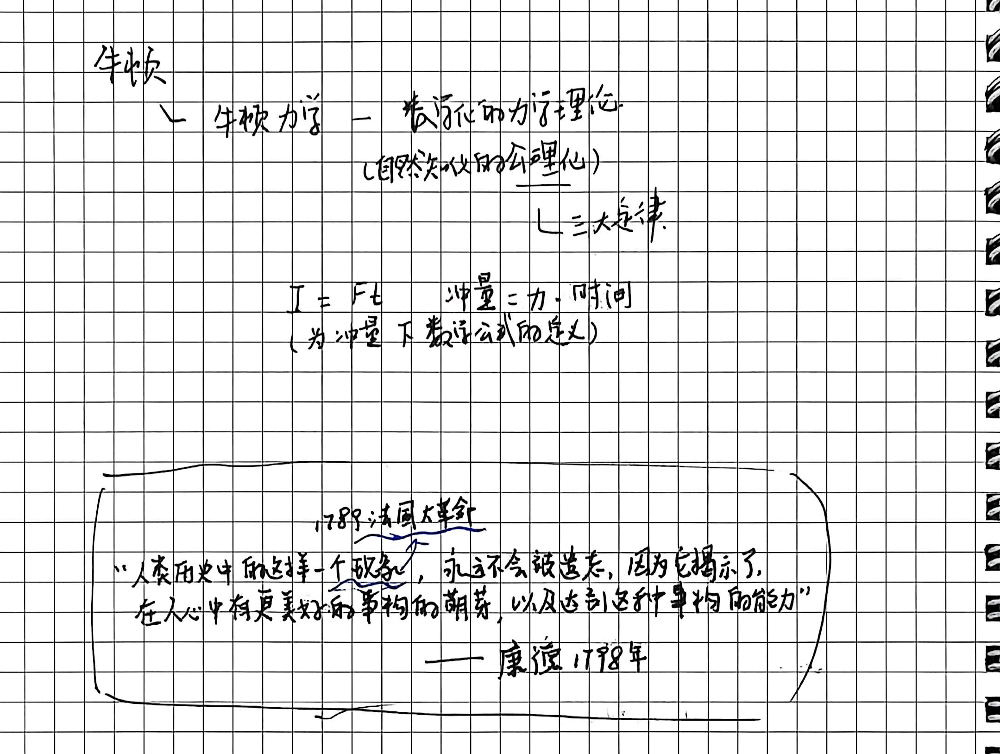
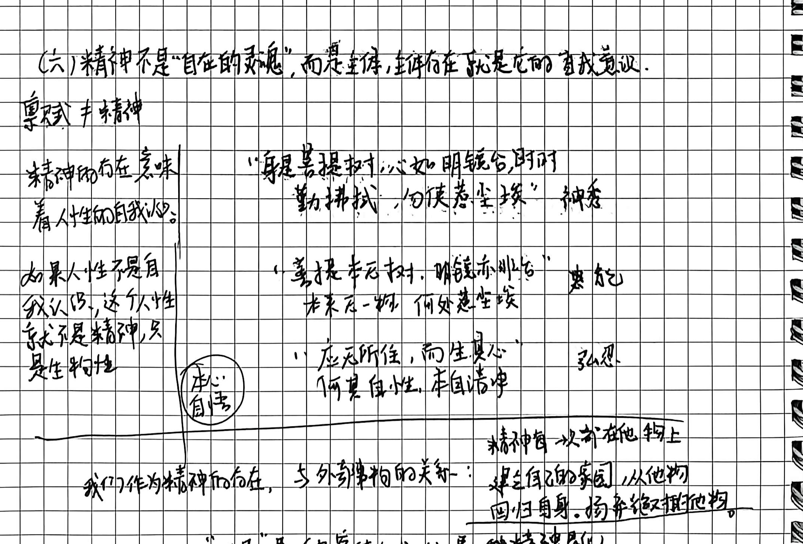

# 第五讲手稿还原：近代理性主义的开端·笛卡尔的主体性原则

> **整理说明**：
> 1. 本文档严格忠实于原手稿的字句、行文顺序、板书结构图式、圈画批注与随感。
> 2. 原文错别字与笔误均在正文保留原样并以括号注出正字（如“神秀”、“惠能”）。
> 3. 手稿中的图解、推演脉络及对应截图标注均严格匹配 `assets/images/第五讲/`。
> 4. 学理辨析与存疑点严格按规范以 `// TODO: [疑问描述]` 予以标注。

---

## 第 1 页：基督教时代欧洲民族文化的萌芽——马丁·路德协议

### 第五讲：近代理性主义的开端·笛卡尔的主体性原则

#### (一) 基督教时代欧洲民族文化生命（双重）的萌芽：马丁·路德协议（宗教改革）

- **中世纪传统**：
  - 人与上帝，人无限渺小，谦卑。
  - 人在回忆理念，而不是改变世界。

- **三等级结构**：
  - **教会僧侣、神职人员**：
    - 充当上帝在人间的代表；
    - 大量敛财（e.g. 罗马教皇出售赎罪券）；
    - 垄断对圣经的精神解释权；
    - 控制大量土地、资源。
  - **世袭贵族**
  - **平民（农奴、手工业劳动者、商人）**

- **宗教改革运动（马丁·路德）**：
  - 基督徒对上帝的信仰，**不需要教会这个中介**；
  - 每个人凭自己真诚的信仰，可以理解基督教教义（**因信称义**）。

- **动摇与瓦解（《新教伦理与资本主义精神》）**：
  - **农奴** $\longrightarrow$ 逃亡；
  - **手工业劳动者** $\longrightarrow$ 解除与师傅或行会的束缚人身依附关系；
  - **商人** $\longrightarrow$ 拥有动产的自由（可以用货币购买土地）。

---

## 第 2 页：哲学能否从自明性公理出发——笛卡尔的我思与主体性

### (二) 哲学能否从自明性公理出发：笛卡尔的我思！

- **笛卡尔的思想进路**：
  - **信仰数学**：（公理不证自明，由此各种严格推理，成体系）
  - **思考哲学**：（学说缺乏公理，都是些必须证明的学说 $\longrightarrow$ 被怀疑）
    - $\Downarrow$
    - **寻找不可怀疑的** $\longrightarrow$ 找到一个，那就是**“我在怀疑这种事，不可怀疑”**。

- **关于“思”的界定**：
  - 思（小概念）：**行判断**。
    - $\longrightarrow$ “判断”不是事物的状态。
    - $\longrightarrow$ **精神不可还原为物质的过程**。

- **(3) “我思故我在”**：
  - **为何不能“我吃饭故我在”？**
    - $\longrightarrow$ 仅证明我有一个身体，但**身体不是我**。
  - **我不是身体**：
    - 给出判断者/判决者，它是**主体**。
  - **我可以视为 Object（客体）吗？**
    - 我作为**主体（Subject）**，研究其他 Object。

- **主客体与哲学路线分野（唯心主义 vs 唯物主义教科书）**：
  - **唯心主义**：
    - 给出判断的主体确立先在性。
  - **唯物（教科书）观点**：
    - 物质第一性，精神第二性。
    - ① 任何精神活动离不开物质组织；
    - ② 精神的内容是对客观世界的反映。

- **主客体认识关系与中西对照**：
  - 我作为主体（Subject） $\longleftrightarrow$ 如朱熹所言：“心与理” $\longrightarrow$ 客观存在。
  - $\swarrow$ 与主体视为认识关系，以及可知论。
  - （王阳明对此的批判：“**心即理**”）。

- **手稿边框核心概念：SUBJECTIVITY 主体性**
  - **此前的柏拉图哲学，是没有主体性原则的**：
    - 人有灵魂，但灵魂不是主体，它是被动的，它不自主地堕落入肉身，遗忘了理念世界的情景。
    - 灵魂曾经居住在“理念的世界里”。

---

## 第 3 页：陆王心学、从 This is 到 I think this is 与黑格尔内在性

- **陆王心学：也是主体性的原则**：
  - **王阳明**：
    > “我们每一个中国人，无论是贩夫走卒，还是引车卖浆者流，都需要做收拾精神、自作主张的大英雄。”
    - $\Downarrow$
    - **每个人都是主体**。

- **认识论语句的革命性位移**：
  - 从 **“This is”**（存在）
  - 到 **“I think this is”**（我认为存在）

- **笛卡尔主张的自明性公理**：
  - ~~只要我是主体~~
  - “只要我们把自己看作是人，我们首先就是主体，而不是客体。”
  - 只要我们说哲学是一门学问，它就应当是真理的事业，真理的体系，那么它的出发点，一定是**“我思故我在”**。

- **引书：黑格尔《哲学史讲演录》**：
  > “在这新时期，哲学的原则是从自身出发的思维（thinking），是内在性。这种内在性一般地表现在基督教那里，断定是新教的原则。现在这一一般的原则，就是坚持内在性本身，抛弃便死的外在性和权威，以为说不在断（不可信任），按照这个内在性原则，独立的主体思维是最内在的东西……”

---

## 第 4 页：认识主体的平等与责任——对“国情如此”的清算与先验主体性

- **气质之性（以 Object） $\longleftrightarrow$ 心理学……**

- **核心论点 ①（红笔圈划重点）**：
  > **因为我们每一个人都是能思的主体，所以我们每一个人都应该平等地相互尊重。** 
  > （我们每人都有发现真理的能力，没有任何人可以颁布真理给我们）
  - **建议（要求）**：在你表达一个观点前，先说“I think ……”，意味着任何人都可以 think。
  - 若一部分人是等待另一部分人颁布真理，某种权威机构就拥有了真理货币权。

- **核心论点 ②（红笔下划线）**：
  > **思想的事业是全世界每个人共同的事业。**

- **主体责任论与对“国情如此”的哲学清算**：
  - **“国情如此”这句话是一种推卸责任**（“我也没办法”、“个人太渺小”）。
  - **中世纪时，基督教信仰下的欧洲人**：人性不对世界的好坏承担责任，这是神意的体现。
  - **笛卡尔：“我思故我在”意味着每一个人都对他所在的世界状况，负有不可推卸的责任。**

- **(四) 理性的先验主体性：认识问题和道德问题的解决**：
  - $\begin{cases} \text{经验论} & \text{—— 先有感性的认识，再上升到理性的认识} \\ \text{先验论} & \text{——} \end{cases}$
  - **笛卡尔：先验主体性**。
  - **引文：黑格尔《小逻辑》（相当考量哲学的人）**：
    > “我们是从思维的本身，去推演出思维规定来，并且从这些思维规定的本身，去看它们是否是真的，而不是并不从外面把它们收取而来，并非勉强地给予定义。”
  - **手稿推演随笔**：
    - ~~在考虑思维~~ 当我们在思维的时候，我们一直在语言中。
    - （注意：心理感受难以表达的感受，不属思维，不属于认识活动）
    - **语言中有“若说（谓语/述词）” $\implies$ （经验是被构造的，而不是被反映的）**
      - $\longleftrightarrow$ **先验的证明** $\bigstar$（**先验性超强**）。

---

## 第 5 页：经验的构成——太阳晒热了石头与先验综合

- **经验构成图解推演**：
  - **“太阳晒热了石头”** $\longleftarrow$ 这是一个 **经验** $\longleftarrow$ 由 **连接而成**。
  - **连接要素剖析**：
    - **认识材料（知觉材料）**：
      - “太阳正在照身的知觉状态” $+$ “石头变热的知觉状态”
    - $+$
    - **思维形式**：
      - **原因结果思维范畴**。
  - **把知觉状态结合起来成一条律则性的东西 $\implies$ 先验**。

- **手稿方框重点概念辨析**：
  $$\begin{array}{|c|}
  \hline
  \text{\textbf{先验}} \neq \text{\textbf{超验}} \\
  \quad\quad\mid \\
  \quad\text{柏拉图理念} \\
  \hline
  \end{array}$$

- **认识论推论**：
  - 基于先验，而后有开辟，手段……
  - **人们告说（确立）对于自然的知识，可以担保它无限增长。**

---

## 第 6 页：近代自然科学的原则——培根与笛卡尔及伽利略思想实验

### (五) 近代自然科学的原则：培根 $+$ 笛卡尔
- **培根** $\longrightarrow$ **观察 & 实验**
- **笛卡尔** $\longrightarrow$ **数学理性**

- **培根的主张**：
  - 培根强调：对自然界的研究，**不能从抽象的思辨出发，不能从自然哲学出发**。
  - 我们应当在观察和实验的基础上，增进自然科学的知识。
  - 离开观察和实验，自然科学就不能真正地成立，其实都变成自然哲学；自然哲学就是对自然的思辨。

- **两种课题**：
  - $\begin{cases} \text{经验观察} \\ \text{理性构造} \end{cases}$

- **伽利略铁球的思想实验（Ideal Experiment）**：
  - **思想实验草图**：小球从斜面滚下，右侧斜面逐步放平直至水平延长 $\longrightarrow$ **至无限远**（无摩擦力的最佳假设）。
  - **核心物理学结论**：**力是速度改变的原因**。
  - **量化与数学化**：
    - 量化地描述自然，把自然应用到数学公式中。（用数学公式描述自然规律）。
    - $\text{实验科学} \xrightarrow{\quad\quad} \text{严密科学}$。
  - $\longrightarrow$ **伽利略：近代物理学之父**。

---

## 第 7 页：牛顿力学公理化、康德论法国大革命与禅宗精神心性

- **牛顿（Newton）**：
  - **牛顿力学** —— **数学化的力学理论**（自然知识的公理化）。
  - **三大定律**。
  - **冲量公式**：
    $$I = F \cdot t \quad (\text{冲量} = \text{力} \cdot \text{时间})$$
    （为冲量下数学公式的定义）。

- **康德 1798 年论 1789 年法国大革命（手稿框选原文）**：
  > “人类历史中的这样一个现象，永远不会被遗忘，因为它揭示了在人心中有更美好的事物构的萌芽，以及达到这种事物构的能力。” 
  > —— **康德 1798年**

- **(六) 精神不是“自在的灵魂”，而是主体，主体的存在就是它的自我意识**：
  - **禀赋 $\neq$ 精神**。
  - **精神的存在意味着人性的自我认识**。
  - **如果人性不是自我认识，这个人性就不是精神，只是生物性**。

- **禅宗心性三偈语板书对照**：
  - **神秀**：
    > “身是菩提树，心如明镜台。 
    > 时时勤拂拭，勿使惹尘埃。”
  - **惠能**：
    > “菩提本无树，明镜亦非台。 
    > 本来无一物，何处惹尘埃。”
  - **弘忍（本心自性）**：
    > “应无所住，而生其心。” 
    > “何期自性，本自清净。”

- **精神与外在事物的关系**：
  - **我们作为精神的存在，与外在事物的关系**：
    - **“精神每一次都在他物上建立自己的家园，从他物回归自身，扬弃统摄他物。”**
  - **“工具”是一种客体（Object），是一种精神化。**

---
// TODO: [学理核查] 手稿第 7 页康德引文中“心中有更美好的事物构的萌芽”手写字迹带有“事物构/事物”之笔触，出自康德 1798 年《学科之争》（Der Streit der Fakultäten）关于法国大革命的历史哲学评价（“人类道德禀赋在历史中的兆示”）。手稿还原忠实保留手写原词。
