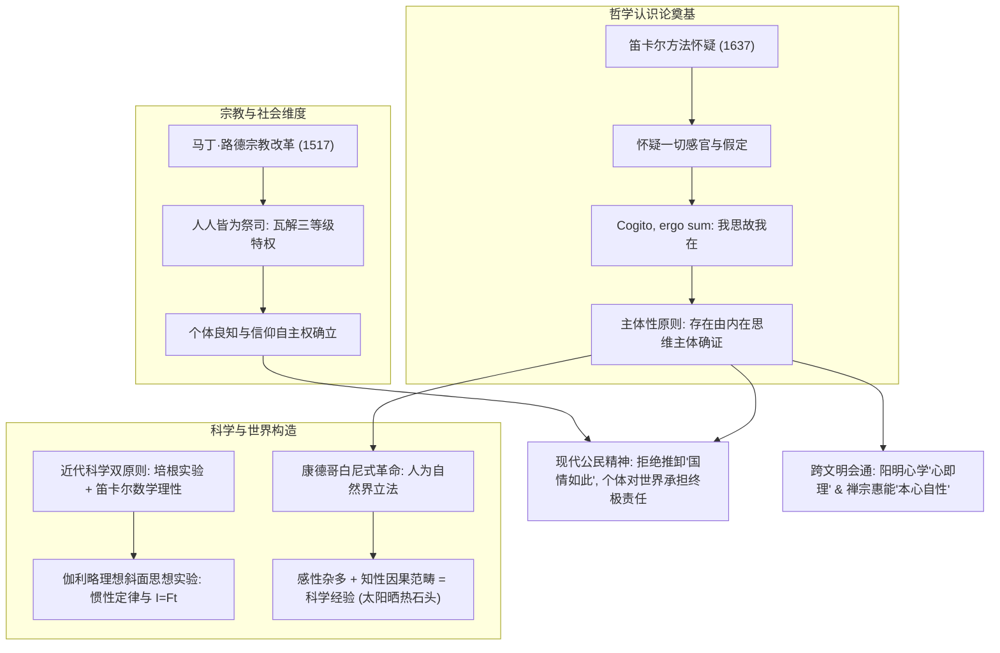
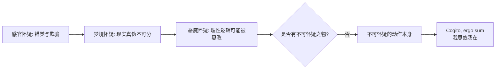
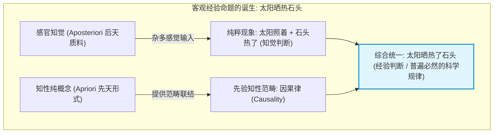

# 第五讲 结构化深度探究：近代理性主义的开端——笛卡尔的主体性原则与现代世界的奠基

---

## 导言：从客体本位到主体立法的现代转向

如果说古希腊哲学是对“自然秩序与实体本质”（客体本体论）的仰望，中世纪哲学是对“超验上帝与救赎恩典”（神学本体论）的臣服，那么欧洲近代哲学的开端，则是**人类自我意识的终极加冕与“主体性原则（Principle of Subjectivity）”的全面确立**。

这场翻天覆地的哥白尼式思想剧变，历经三个层层推进的历史与思想环节：
1. **宗教改革（马丁·路德）**：瓦解了罗马教廷三等级对神圣真理的垄断，确立了个体良知直面终极信仰的宗教主体性；
2. **笛卡尔认识论革命**：以普遍怀疑扫清一切未经批判的偏见与经验，以“我思故我在（Cogito, ergo sum）”为第一原理，将存在确证的根据收摄于内在思维主体；
3. **康德批判哲学与近代科学的诞生**：证明了“人为自然界立法”，将先验主体与经验质料、数学理性与实验操作熔铸为近代自然科学的坚实方法论，并深层激发出东方禅宗心性与阳明心学的跨文明呼应。



---

## 一、 宗教改革与中世纪社会结构的瓦解：主体性的社会破晓

### 1. 中世纪等级制的崩溃与“一切信徒皆为祭司”
中世纪天主教封建秩序依赖一套严格的神圣等级森严制度：
- **第一等级（教士 Clergy）**：唯有他们通晓拉丁文圣经，掌握七项圣事，被视为世俗凡人与上帝之间的不可或缺的“神圣中介”；
- **第二等级（贵族 Nobility）**：凭借刀剑、领地与封建血统垄断世俗军政特权；
- **第三等级（平民/农奴 Commoners）**：在神圣与世俗两重锁链下承担沉重的赋税与赎罪负担。

**马丁·路德（Martin Luther, 1483–1546）**在1517年钉上维滕贝格大教堂门上的《九十五条论纲》，引爆了宗教改革：
- 提出**“因信称义（Sola Fide）”**与**“信徒皆祭司（Universal Priesthood of all Believers）”**；
- 剥夺了教廷出售赎罪券的合法性，宣告每一个普通信徒在良心深处都可以直接与上帝交通；
- 这一举措不仅是一场神学争论，更是**欧洲现代平等主体性的社会发端**：第一等级的神圣垄断被粉碎，个体的良心成为最高审判庭。

---

## 二、 笛卡尔的普遍怀疑与“我思故我在”

### 1. 方法论怀疑（Methodological Doubt）：作为工具的彻底清算
笛卡尔（René Descartes, 1596–1650）敏锐地看到，经院哲学充斥着未经审视的前提和教条。为了给整个人类知识大厦寻找一个绝对稳固、如几何学公理般不可撼动的阿基米德支点，笛卡尔采用了**极端的方法论怀疑**：
1. **怀疑感官经验**：感官常常产生错觉（如远处的方塔看似圆形、筷子插入水中看似弯折），故感官经验绝不可作为真理的第一基石；
2. **怀疑梦境与现实的边界**：我们在梦中感知到的一切无比真切，我们如何证明此刻的清醒状态不是一场逼真的大梦？
3. **怀疑数学公理与“恶魔假说”（Malicious Demon）**：假设存在一个全能狡黠的恶魔，无时无刻不在欺骗我，使我把 $2+3=5$ 的幻象当成真理，那么数学命题是否也可能坍塌？



### 2. “我思故我在”的真正学理意涵
手稿指出：**笛卡尔的主体性是唯心主义的内在原则**。黑格尔在《哲学史讲演录》中称赞笛卡尔让西方哲学在漂泊千载后“终于踏上了陆地”。

必须澄清对 *Cogito, ergo sum* 的常见庸俗误解：
- 它**不是**一个形式逻辑的三段论推论（非“大前提：凡思想者皆存在；小前提：我思；结论：故我在”）；
- 它是一种**直接的、先验的智性直观（Intuition）**：
  > 哪怕我正在被恶魔欺骗，我也必须“正在受骗”；哪怕我所怀疑的一切全是虚幻，“我正在怀疑”这一思想动作本身是无法被怀疑的；而怀疑必然附着于一个能疑的主体。
- **思想（Cogito）不仅指逻辑推导，涵盖了怀疑、领会、肯定、否定、意愿、想象乃至感觉的一切内在精神活动**。
- **哲学转向的实质**：世界万物的真实性，不再依赖外在神学权威或物理实体的现成性，而是**必须经由内在思维主体的反思批判与确证，才能获得进入人类知识殿堂的合法性**。

### 3. 主体性伦理：对“国情如此”与逃避责任的哲学清算
手稿第二页包含了一段极其辛辣而深刻的现代公民伦理剖析：
> **世人常以“社会现实就是这样”、“国情如此，我一介草民能怎样”作为放弃良知、同流合污或逃避责任的托词。**
> **手稿断言：主体性原则彻底粉碎了这种无耻的借口！“国情”绝非一个高悬于空中的客观外物，它恰恰是由千千万万个主体的选择与行为共同塑造成的！**

- **萨特存在主义的共振**：如萨特所言，“人是被判定为自由的，人必须对整个世界承担全部责任”。
- **平庸之恶的解药**：一旦主体放弃批判性思维与道德抉择，退缩为客观环境的被动奴隶，社会便迅速滑向专制与沉沦。笛卡尔主体性原则不仅是认识论的，更是**现代自主公民的人格基石**。

---

## 三、 康德哥白尼革命：先验综合与经验世界的构成

笛卡尔确立了主体性原则，但留下了心物二元论（Mind-Body Dualism）的难题：主体的精神观念如何确保能准确把握外在客观世界？**伊曼努尔·康德（Immanuel Kant, 1724–1804）**对此作出了终极解答。

### 1. 经验认知模式的二元重构：太阳晒热石头
手稿第三页的手绘图揭示了康德认识论的核心奥秘：



- **知觉判断（Judgment of Perception）**：仅具有主观有效性。如“当我摸这块石头时，我觉得它是热的”。这只是感性材料在时空中的伴随；
- **经验判断（Judgment of Experience）**：具有客观必然性。通过知性的**因果范畴（Cause and Effect）**，将“太阳照射”设定为“原因”，将“石头升温”设定为“结果”。
- **形而上学结语**：**“人为自然界立法（Understanding prescribes laws to nature）”**。自然界的普遍必然规律并非客观物体自身散发出来的，而是主体的先验认识架构赋予经验材料的秩序。

---

## 四、 近代科学的双重原则与伽利略思想实验

### 1. 科学诞生的双螺旋：培根实验与笛卡尔数学理性
近代实证科学之所以诞生在西欧，而非经验技术发达的古代东方，关键在于近代科学双重原则的有机结合：
1. **培根原则（经验唯物主义方法）**：强调深入自然、做可控实验、排查假象、收集数据；
2. **笛卡尔原则（理性演绎与数学公理化）**：坚信宇宙的结构是用数学语言写成的，强调普遍公理推导与逻辑明晰。

近代自然科学绝非单纯盲目的“试错实验”，而是**在笛卡尔数学假说的严格指引下所进行的判决性实验**。

### 2. 伽利略斜面思想实验与力学公理化
手稿第四页记录了**伽利略（Galileo Galilei）**著名的斜面思想实验：


- **常识经验的局限**：亚里士多德看到推车停止是因为有摩擦力，误以为“推力消失运动即停止”；
- **理性的先验构造**：现实中根本不存在绝对无摩擦的平面，伽利略依靠纯粹的**理性思想实验（Gedankenexperiment）**，在头脑中排除了偶然的摩擦阻力，直接洞察到了运动的本然本质——**惯性定律（Inertia）**。
- 这有力地证明了：**近代科学不是经验材料的简单总和，而是主体运用理性模型对经验的超越与重塑**。

---

## 五、 中西心性哲学的终极会通：阳明心学与禅宗本心

手稿最后一页以深邃的眼光将西方主体性原则与东方心性学说进行了融会贯通。

### 1. 王阳明心学：“心即理”的主体性突围
- 宋代程朱理学将“理”视为外在客观天理，要求学者“格物穷理”，导致士人穷经皓首、沦为外部条教之附庸；
- 明代王阳明龙场悟道，提出**“心即理”**、**“心外无物，心外无理，心外无事”**；
- 王阳明倡言**“人人皆可成圣贤，人人皆为大英雄”**，将道德真理的立法权从经典训诂中解放出来，彻底交还给人人具足的良知本体，具有极强的精神启蒙特质。

### 2. 禅宗公案：神秀“渐修拭尘” vs 惠能“本心顿悟”
手稿详尽引录了禅宗五祖弘忍传法的公案：

| 偈语作者 | 经典偈语 | 哲学层次与病根 | 归宿 |
| :--- | :--- | :--- | :--- |
| **神秀上座** | 身是菩提树，心如明镜台。<br/>时时勤拂拭，勿使惹尘埃。 | **主客二元对立**：将心性视为客体镜面，将烦恼视为外来尘垢，陷入执相渐修之累。 | 见解第一，未入心性奥义 |
| **惠能行者** | 菩提本无树，明镜亦非台。<br/>本来无一物，何处惹尘埃？ | **当体即空，直指本心**：粉碎对名相实体的妄执，照见自性本自清净、本自具足。 | 弘忍授衣钵，开顿悟宗门 |

- **五祖弘忍讲《金刚经》点化惠能**：
  至“应无所住而生其心”，惠能彻悟自性五重境界：
  1. *何期自性本自清净！*
  2. *何期自性本不生灭！*
  3. *何期自性本自具足！*
  4. *何期自性本无动摇！*
  5. *何期自性能生万法！*

### 3. 西方主体性与东方心性的深层辨析

```mermaid
graph TD
    subgraph 西方认识论主体 (Rational Subiectum)
        W1["笛卡尔 Cogito / 康德 先验统觉"] --> W2["认知结构立法: 主客二分、概念范畴"]
        W2 --> W3["指向: 奠基科学客观性、征服自然、构建现代宪政"]
    end

    subgraph 东方本体论心性 (Buddha-Nature / Liangzhi)
        E1["阳明 良知 / 禅宗 本心自性"] --> E2["生命解脱与道德体认: 消除执相、万物一体"]
        E2 --> E3["指向: 安身立命、化除烦恼、实现德性圆满"]
    end
```

- **相通之处**：二者皆坚决否定真理只存在于外在权威之中，皆确认**精神/心灵具有原发性的终极地位与无限权能**；
- **分歧之处**：
  - 西方主体性始终在**认识论与主客二分（Subject-Object Dichotomy）**的框架中运作，催生了近代自然科学、实证逻辑与工具理性；
  - 东方心性论则属于**存在论与解脱论（Onto-Hermeneutics of Liberation）**，旨在打破主客对待，达到“天人合一”与“生生不息”的生命意境。

---

## 结语：主体性的荣耀与现代性危机

笛卡尔主体性原则为人类带来了现代文明的繁荣：科学技术的一日千里、民主宪政的诞生、人权平等的普世确立。然而，过度膨胀的主体性也带来了严重的现代性危机——人把一切自然存在乃至同类看作肆意征服索取的客体材料，导致生态危机、意义丧失与工具理性狂飙。

重温笛卡尔的主体性奠基，结合东方心性哲学的圆融关怀，才能使现代人在承担起对世界的终极伦理责任的同时，守住内心的精神家园。
