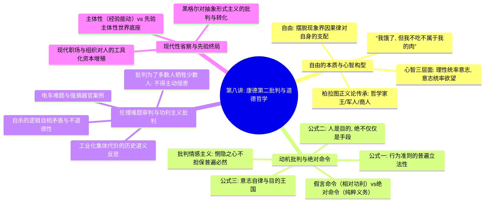

# 第八讲：康德的第二批判——理性主义的道德哲学

> **本讲核心题旨**：全面探究康德实践理性哲学的核心精髓——从自由意志摆脱现象界因果铁律的本体论证明，到“绝对命令（Categorical Imperative）”的三大神圣法则；深刻剖析功利主义（电车难题、强摘器官、为多数人牺牲少数人）的逻辑悖谬与道义论界限，反思现代资本主义职场对人的工具化异化，并在“主体性 vs 先验主体性”的哲学终极对比中，完成对西方近代思想历程的宏伟收官。

---

## 快速导航与知识图谱

| 文档类型 | 入口链接 | 核心内容提要 |
| :--- | :--- | :--- |
| **手稿忠实还原版** | [第八讲_手稿还原.md](./第八讲_手稿还原.md) | 逐页忠实还原 3 页手稿全貌，完整保留饥饿不吃无主肉图示、柏拉图国家正义论、电车难题算计批判与先验主体性终极对比表。 |
| **结构化深度探究版** | [第八讲_结构化深度探究.md](./第八讲_结构化深度探究.md) | 系统阐发自由即自律的本体论证明、绝对命令三公式、恻隐之心动机批判、功利主义电车难题伦理审判、职场资本异化与先验主体性终结。 |
| **学术思辨自测版** | [第八讲_自测20题与解析.md](./第八讲_自测20题与解析.md) | 严格遵循 Python 随机无偏发生器蓝图精编 20 道学术级思辨题，全面考查自由本体论证明、绝对命令三公式、电车难题与功利主义批判、职场异化及先验主体性终局收官，附答案速查与深度解析。 |

---

## 本讲核心哲学命题摘要

1. **“自由：摆脱现象界的规律对自身的支配”**：
   在现象界中，人作为肉身受生物本能与物理因果律奴役；唯有当人出于理性道德律令断然抗拒本能欲望（“我饿了，但我不吃眼前这块不属于我的肉”），自由意志才在本体界真正降临。
2. **“实践 $\neq$ 干活：建立或改变社会关系的活动”**：
   实践绝非单纯的物理性体力劳作或技术操作，而是人类自由主体出于价值选择、能动塑造与重构社会秩序的伦理创造活动。
3. **“出于情感的行为不能担保道德价值”**：
   康德对孟子“恻隐之心”进行了深刻的认识论批判：情感属于变动不居的经验偏好（病理情感），唯有出于纯粹理性责任与对道德律的敬重，道德法则才具备普遍普世的必然性。
4. **绝对命令核心准则：“人是目的，绝不仅仅是手段”**：
   无论在对待自身还是对待他人时，都必须把人格视作最高目的本身；自杀是利用生命消灭生命的逻辑自相矛盾；强迫少数人充当集体繁荣的“消耗性工具”在伦理上绝不具备合法性。
5. **电车难题与功利主义的死穴：“少数人可以得不到利益，但绝不能被伤害”**：
   功利主义将道德降格为冷酷的数字加减（以一死换三活）；道义论确立了不可跨越的正义红线——任何把无辜个体强行作为代罪羔羊的算计，在本质上均属根本之恶。
6. **“主体性”与“先验主体性”的历史终局会通**：
   经验主体性是人在世界之内表现出的认知与能动选择；而先验主体性则是作为“世界得以显现的先决框架”，构成了人类经验自然与道德自律的永恒终极基石。

---

*知识库规范与指引详见：[AGENTS.md](./AGENTS.md)*
