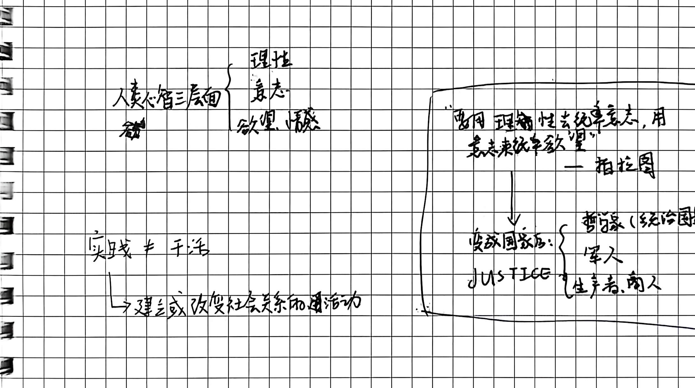
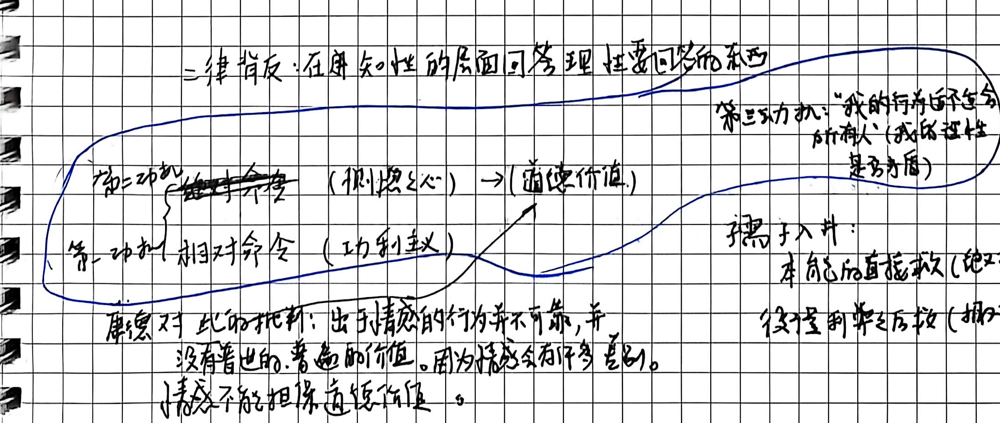
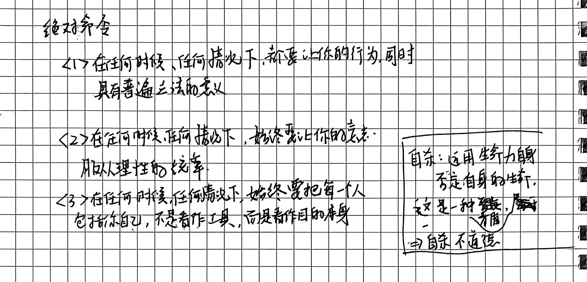
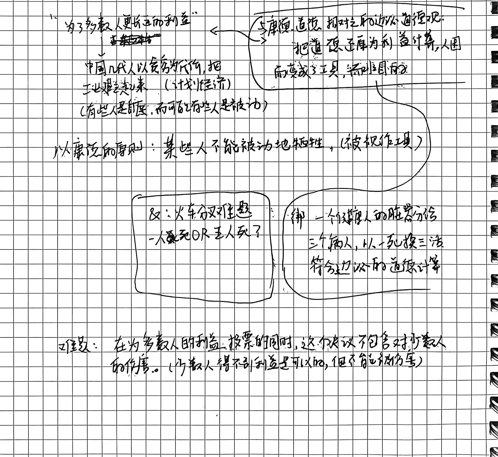
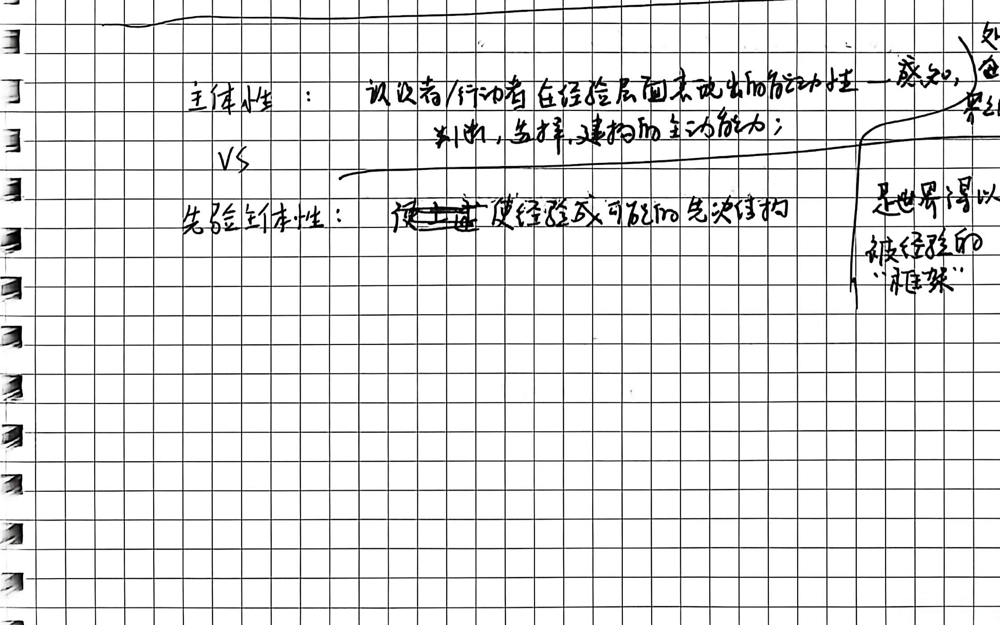

# 第八讲手稿还原：康德的第二批判——理性主义的道德哲学

> **整理说明**：
> 1. 本文档严格忠实于原手稿 3 页笔记的字句顺序、板书结构图式、圈画批注与随感逐字忠实还原。
> 2. 原文笔误均在正文保留原样并以括号注出正字。
> 3. 手稿中的图解、推演脉络及对应截图标注均严格匹配 `assets/images/第八讲/`。
> 4. 学理辨析与存疑点严格按规范以 `// TODO: [疑问描述]` 予以标注。

---

## 第 1 页：自由的本体论界定、人类心智三层面与动机批判

### 第八讲：康德的第二批判：理性主义的道德哲学

- **右上角随笔草图（圆圈中“善”字）**：
  $$\begin{array}{|c|}
  \hline
  \text{“我饿了，但我不吃眼前} \\
  \text{这块不属于我的肉”} \\
  \hline
  \end{array}$$

- **自由的概念界定**：
  - **自由：摆脱现象界的规律对自身的支配。**
  - **根本追问：自由是如何可能的？**
  - **论断**：
    > “如果有自由，且自由是可能的，且能说清楚如何可能，这个世界是可以善的。”

- **人类心智三层面（对应柏拉图国家学说）**：
  - **人类心智三层面**：
    $$\begin{cases} \text{\textbf{理性}} \\ \text{\textbf{意志}} \\ \text{\textbf{欲望、情感}} \end{cases}$$
  - **柏拉图名言与政治构型（板书框）**：
    - **“要用理性去统率意志，用意志来统率欲望” —— 柏拉图**
    - $\downarrow$
    - **变成国家后：JUSTICE（正义）**
      - $\begin{cases} \text{哲学冢（统治国家）} & \text{〔正字：哲学家〕} \\ \text{军人} \\ \text{生产者、商人} \end{cases}$

- **实践的哲学定义**：
  - **实践 $\neq$ 干活**
  - $\longrightarrow$ **建立或改变社会关系的活动。**

- **二律背反（Antinomy）与知性界限**：
  - **二律背反：在感知、知性的层面回答理性要回答的东西。**

- **两种动机与道德价值批判（椭圆框选）**：
  - **第二动机：~~绝对命令~~ （恻隐之心） $\longrightarrow$ （道德价值）**
  - **第一动机：相对命令（功利主义）**
  - **康德对此的批判**：
    > **“出于情感的行为并不靠谱，并没有普世的、普遍的价值。因为情感会有很多差别。情感不能担保道德价值。”**

- **右侧板书补充案例**：
  - **第三以动机：“我的行为符合所有人（我的理性是否矛盾）”**
  - **孺子入井案例辨析**：
    - **本能的直接救（绝对）**
    - **使得利益之后去救（相对）**

---

## 第 2 页：绝对命令三原则、电车难题与功利主义批判

- **绝对命令（Categorical Imperative）三条核心公式**：
  - **$\langle 1 \rangle$ 在任何时候、任何情况下，都要让你的行为，同时具有普遍立法的意义。**
  - **$\langle 2 \rangle$ 在任何时候、任何情况下，始终要让你的意志，服从理性的统率。**
  - **$\langle 3 \rangle$ 在任何时候、任何情况下，始终要把每一个人，包括你自己，不是当作工具，而是当作目的本身。**

- **自杀问题的伦理审判（右侧方框）**：
  - **自杀**：
    - 运用生命力量，否定自身的生命；
    - 这是一种自相矛盾（严重矛盾）；
    - $\implies$ **自杀不道德**。

- **功利主义批判：“为了多数人更长远的利益”**：
  - **功利主义道德观批判**：
    - 把道德还原为利益计算；
    - 人因而变成了工具，而不是目的。
  - **历史案例反思**：
    - 中国几代人以舍身为代价，把工业建立起来（计划经济）。
    - （有些人是自愿，而可能有些人是被动）。
  - **从康德的原则判定**：
    > **“某些人不能被动地牺牲，（被视作工具）。”**

- **当代经典伦理难题辩证**：
  - **火车分叉难题（Trolley Problem）**：
    - 一人死 OR 五人死？
  - **强摘器官案例（绑架与功利计算）**：
    - 绑一个健康人的脏器分给三个病人，以一死换三活，符合功利主义的道德计算。
  - **难题本质（双下划线核心论断）**：
    > **“难题：在为多数人的利益、投票的同时，这个决议包含了对少数人的伤害。（少数人得不到利益是可以的，但不能被伤害）。”**

---

## 第 3 页：普世伦理、黑格尔对绝对命令的批判与先验主体性小结

- **普世伦理双支柱（左上角圆角框）**：
  $$\begin{array}{|l|}
  \hline
  \text{\textbf{普世伦理}}： \\
  \quad\text{① 己所不欲，勿施于人} \\
  \quad\text{② 人是目的} \\
  \hline
  \end{array}$$

- **黑格尔对康德绝对命令的批判**：
  - **三条绝对命令：抽象的应当（空洞）（无现实内容）**。
  - **黑格尔评价的转折**：
    - 但这三条命令仍对**人类普遍性原则的转变**有重要作用。

- **当代资本主义批判（右上角方框）**：
  - **“职场”、“个人不能独挡”、“组织”**
  - **等等是被视为工具的一种体现。**
  - $\longrightarrow$ **最终服务于资本增殖**。

- **小结：康德先验逻辑的历史演进**：
  - **小结**：康德捍卫了理性主义的路线，继续往前走，把笛卡尔的先验哲学加以发扬，提出了**先验逻辑**。
    - $\longrightarrow$ 不是世界多感而形成逻辑；
    - $\longrightarrow$ 而是**人类的思维形式本身如何建构经验**。

- **核心概念终极对比表：主体性 vs 先验主体性**：
  $$\begin{array}{|c|c|l|}
  \hline
  \text{\textbf{主体性}} & \text{：} & \text{认识者/行动者在经验层面表现出的能动性——感知、判断、选择、建构的主动能力；} \\
  \hline
  \text{VS} & & \\
  \hline
  \text{\textbf{先验主体性}} & \text{：} & \text{使经验成为可能的先决结构} \quad \left[ \begin{array}{l} \text{处于世界之外} \\ \text{架构} \\ \text{是世界得以被经验的“框架”} \end{array} \right] \\
  \hline
  \end{array}$$

---
// TODO: [学理核查] 手稿第 2 页对于功利主义“电车难题”与中国工业化历史的随笔，展示了康德道义论（Deontology）在审视现代社会集体主义与功利计算时的强烈批判锋芒。在结构化深度探究中，应将康德“人是目的”与边沁-密尔功利主义最大幸福原则（Utilitarianism）及当代罗尔斯《正义论》“每个人都拥有一种基于正义的不可侵犯性，即使为了全社会福祉也不能践踏”进行学术贯通。
