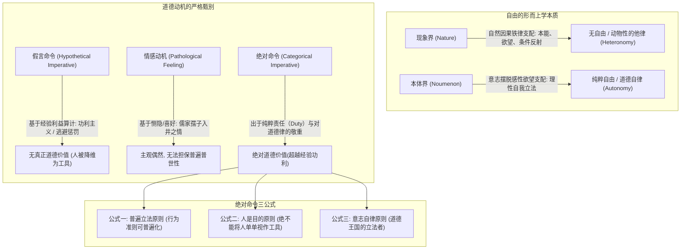
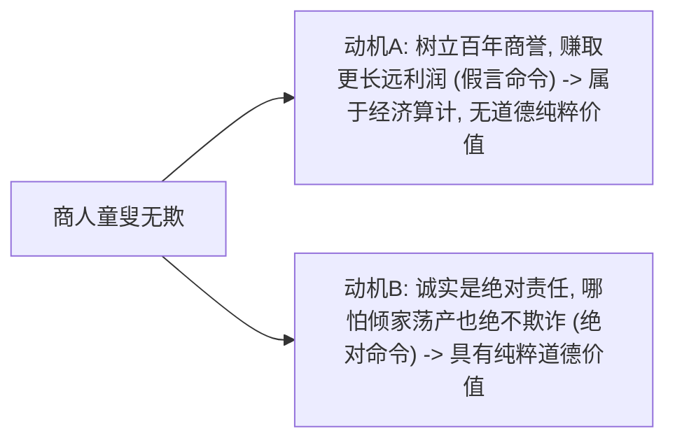
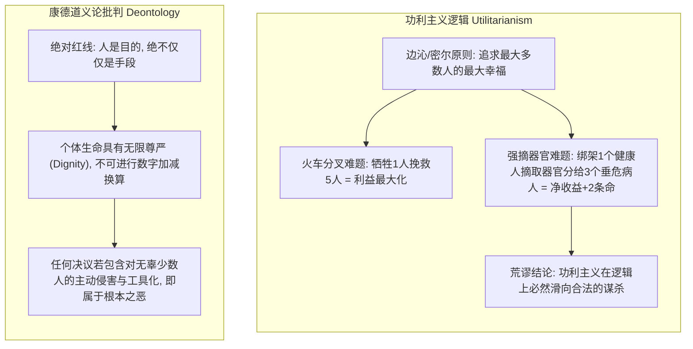
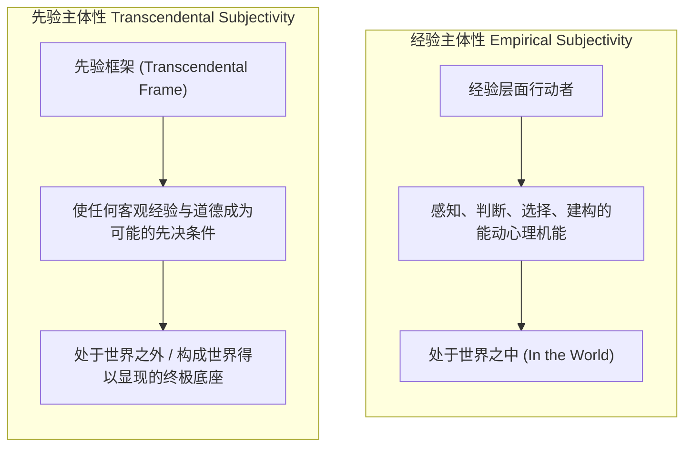

# 第八讲 结构化深度探究：康德的第二批判——理性主义的道德哲学与自由意志的绝对立法

---

## 导言：实践理性的尊严与道义论的终极奠基

在《纯粹理性批判》为人类的认识能力划定边界、将现象界交由自然因果律统辖之后，康德并未止步于不可知论的门槛。他在1788年发表了第二部里程碑巨著《实践理性批判》（*Kritik der praktischen Vernunft*），将目光转向了人类灵魂中最崇高的领域——**道德哲学与自由意志（Free Will）**。

康德墓志铭上镌刻着哲学史上最震撼人心的警句：
> “有两样东西，人们越是经常持久地对之凝神思索，它们就越是使内心充满常新而日增的惊赞和敬畏：**我头顶上的星空和我心中的道德律**。”

如果说第一批判解决了“我能够知道什么”（科学与认识论），那么第二批判则全力回答了“我应当做什么”（伦理与实践哲学）。康德彻底击碎了将道德建立在经验情感（如恻隐之心）或利益计算（如功利主义）之上的传统路径，确立了以**“自由即自律”**与**“绝对命令（Categorical Imperative）”**为核心的纯粹理性主义道义论体系。

---

## 一、 自由是如何可能的？——从现象界的宿命到本体界的自律

### 1. 自由的本体论界定：超越因果决定论
手稿在第一页开宗明义给出了自由的经典定义：
> **“自由：摆脱现象界的规律对自身的支配。”**
> **“如果有自由，且自由是可能的，且能说清楚如何可能，这个世界是可以善的。”**

- **自然必然性的囚徒**：在现象界中，一切事物都受到严格的因果链条支配。正如手稿右上角随笔所写：“我饿了”——饥饿是生理代谢与生物神经冲动的自然因果必然反应；
- **自由的展现**：
  > **“我饿了，但我不吃眼前这块不属于我的肉！”**
  当一个人哪怕处于极度饥饿濒死状态，依然能够出于对“不可偷盗/他人产权”这一理性道德法则的敬畏，断然抗拒生理本能的支配，**那一瞬间，他就打破了物理世界的因果链条，在自身之内开辟出了本体界的自由！**

### 2. 人类心智三层面与柏拉图正义论的历史承继
手稿将人类心智结构同柏拉图《理想国》的国家正义论进行了系统对照：

| 心智结构 | 灵魂美德 | 对应城邦等级 | 理想国正义（Justice）要求 |
| :--- | :--- | :--- | :--- |
| **理性 (Reason)** | 智慧 (Wisdom) | **哲学家王（统治阶层）** | **理性统率意志，意志统率欲望** |
| **意志 (Will)** | 勇敢 (Courage) | **武士/军人（保卫阶层）** | 忠诚执行理性的法令，抵制肉体恐惧与诱惑 |
| **欲望/情感 (Appetite)** | 节制 (Temperance) | **农民、工匠、商人（生产阶层）** | 服从节制，安于本分，不僭越统治权力 |

康德继承了这一洞见并予以升华：**唯有当理性成为行动的最高统帅，而非欲望的仆从时，人才能获得真正的精神正义与自由人格**。

---

## 二、 道德价值的纯粹性：动机批判与功利主义清算

### 1. 假言命令 vs 绝对命令
手稿区分了行为背后的两种根本动机：
- **假言命令（Hypothetical Imperative / 相对命令）**：
  - 形式为：“如果你想达到目的 X，你就必须做 Y”；
  - 比如：“为了维护商业声誉，商人不欺诈顾客”；“为了死后升入天堂，基督徒施舍穷人”；
  - 这里的善行只是换取外在利益或奖赏的**手段**，属于**功利主义算计（Utilitarian Calculation）**。在康德看来，这种行为虽然“合乎责任（in accordance with duty）”，但**毫无真正的纯粹道德价值**。
- **绝对命令（Categorical Imperative）**：
  - 形式为：“你应当如此做，无条件地如此做！”；
  - 行为的动机不是为了外在后果或利益报偿，而是**“出于责任自身（from duty）”**，出于对神圣道德律本身的绝对敬重。

### 2. 对儒家“恻隐之心”与情感主义的深刻商榷
手稿在第一页特别记录了对孟子“孺子入井”公案与情感主义道德观的尖锐批判：
> **“出于情感的行为并不靠谱，并没有普世的、普遍的价值。因为情感会有很多差别，情感不能担保道德价值。”**

- **孟子“孺子入井”**：见孺子将入于井，皆有怵惕恻隐之心，非所以内交于孺子之父母，非所以要誉于乡党朋友；
- **康德哲学的批判性反思**：
  - 恻隐之心本质上依然属于**病理性感受（Pathological Feeling / 经验感性偏好）**；
  - 情感天然具有**狭隘性、偶然性与易变性**：人们往往更容易对容貌可爱的孩子、同种族或近亲产生强烈同情，而对丑陋粗鄙的陌生人产生厌恶冷漠；若一人心情阴郁或心智耗竭，同情心就可能暂时枯竭；
  - **康德的铁血断言**：**不能把道德的客观必然性建立在随时会浮动的人类情感之上**！哪怕一个人天生性情冷漠、缺乏同情之泪，但他仅仅因为意识到“拯救同类是理性的普遍责任”而去施救，这种行为的道德纯洁性与崇高感，远远高于顺从本能同情心所做的举手之劳！

---

## 三、 绝对命令三公式与当代伦理难题审判

手稿第二页记录了康德伦理学的三大绝对命令准则，并运用其深度解剖了功利主义与现代集体主义的致命盲区。

### 1. 绝对命令（Categorical Imperative）的三大经典表述

$$\begin{array}{|l|l|}
\hline
\textbf{公式一：普遍立法公式} & \text{“只按照你同时认为也能成为普遍规律的准则去行动。”} \\
\hline
\textbf{公式二：人是目的公式} & \text{“无论在你自己的人格中还是在他人的人格中，始终要把人看作目的，绝不仅仅当作手段。”} \\
\hline
\textbf{公式三：自律/目的王国公式} & \text{“每一个有理性者的意志，都是颁布普遍规律的自律意志。”} \\
\hline
\end{array}$$

- **自杀的伦理审查**：
  - 一个人若因痛苦绝望而选择自杀，他就是在**利用自身残存的生命机能来消灭生命本身**，将自身的人格降格为逃避痛苦的工具；
  - 若将“感到痛苦即可自杀”普遍化为自然法则，生命体系将自我瓦解，陷入不可调和的逻辑自相矛盾，因此自杀违背了普遍立法原则。

### 2. 电车难题与强摘器官：彻底清算功利主义功利计算
手稿在第二页用大篇幅抨击了现代社会“为了多数人更长远的利益”而牺牲少数人的功利主义暴政：

手稿以石破天惊的笔触写道：
> **“难题：在为多数人的利益投票的同时，这个决议包含了对少数人的伤害。（少数人得不到利益是可以的，但绝对不能被伤害！）”**
> **“中国几代人以舍身为代价把工业建立起来……从康德的原则判定：某些人不能被动地牺牲，被视作纯粹工具。”**

- **罗尔斯《正义论》的先声**：当代正义哲学宗师罗尔斯正是全盘继承了康德的这一原则——“每个人都拥有一种基于正义的不可侵犯性，即使是全社会的福祉也不能凌驾其上”。任何以“大局”、“宏大叙事”或“集体幸福”为借口，强迫个体充当牺牲祭品的行径，都是对人类尊严的彻底背叛。

---

## 四、 现代性批判：职场异化与先验主体性的历史终局

### 1. 黑格尔的批评与辩证转化

手稿第三页提到了黑格尔在《法哲学原理》中对康德道德哲学的批评：
- **黑格尔的诘难**：康德的绝对命令是**“抽象的、形式主义的应当（Formalistic Ought）”**，缺乏具体的历史现实内容与伦理实体（家庭、市民社会与国家）；
- **手稿的深刻辩护**：尽管具有形式化特征，但康德确立的“人类尊严与人是目的”的普遍性原则，**是整个人类文明跳出丛林野蛮、迈向现代法治与人权宪章的决定性思想支柱**！

### 2. 现代资本主义职场异化批判
手稿在第三页右上角精准剖析了当代职场人的生存处境：
- **“职场”、“组织”、“个人不能独挡一面”**：现代企业组织通过流水线分工、KPI考核与企业文化驯化，将原本生动丰富的人，打磨成可以随时替换的标准螺丝钉；
- **资本增殖的工具化本质**：在这里，劳动者不再被视为具有独立灵魂与尊严的目的本身，而沦为了**服务于“资本无休止增殖”的纯粹消耗性工具材料**。

### 3. 全课终局：主体性（Subjectivity） vs 先验主体性（Transcendental Subjectivity）

在第八讲末尾，讲义用一张凝练的对比表格，对整个近代哲学的主体性历程作出了终极收束：

- **康德对笛卡尔的真正超越**：
  笛卡尔发现了“我思”，确立了经验认知的主动性；
  而康德则将“我思”彻底升华至**“先验主体性”**——人类理性不再是被动适应世界的客体，人类的心智结构就是**自然界得以被经验的普遍立法框架**，人类的实践理性就是**道德世界得以存在的自律光源**！
