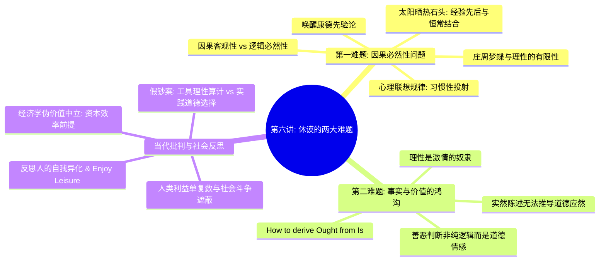

# 第六讲：休谟的两大难题及其当代意义

> **本讲核心题旨**：直面苏格兰经验主义宗师大卫·休谟（David Hume）对西方近代文明根基的颠覆性拷问——从“因果必然性的解构”到“从存在（Is）推不出应当（Ought）”的伦理鸿沟；进而剖析当代西方经济学“价值中立”的技术官僚假象，揭示资本增殖对人类生存的异化，并为康德批判哲学的出场做好问题奠基。

---

## 快速导航与知识图谱

| 文档类型 | 入口链接 | 核心内容提要 |
| :--- | :--- | :--- |
| **手稿忠实还原版** | [第六讲_手稿还原.md](./第六讲_手稿还原.md) | 逐页忠实还原 2 页手稿原貌，完整保留字句笔触、板书框架、假钞案例随笔与中西义理 TODO 标记，链接手写关键切图。 |
| **结构化深度探究版** | [第六讲_结构化深度探究.md](./第六讲_结构化深度探究.md) | 系统阐发休谟因果怀疑论、心理习惯联想机制、休谟断头台（实然与应然）、假钞案与工具理性批判、经济学意识形态揭露。 |

---

## 本讲核心哲学命题摘要

1. **“因”与“果”的经验断裂与因果必然性的消解**：
   感官经验只能提供现象在时空上的先后邻近与恒常结合，却无法捕捉到任何“必然连接纽带”。所谓因果律，本质上是人类心灵因习惯而产生的主观联想法则。
2. **“真理不是静止地处在顶峰”与理性的有限性**：
   理性的边界扎根于人类有限的生存尺度；数学模型与物理规律是人以自身为尺度对外部世界的构造与映射，并不具备超验无限的绝对独立性。
3. **“休谟断头台”：从“存在（Is）”推不出“应当（Ought）”**：
   事实判断（描写客观状态）与价值判断（规范伦理准则）之间存在无法跨越的逻辑鸿沟；纯粹的工具理性只能计算达成目标的手段有效性，根本无法自主确立善恶标准。
4. **揭露社会科学与市场经济学“价值中立”的意识形态伪装**：
   西方主流经济学宣称自身是超越道德偏见的客观量化科学，但其底层早已预设了“资本增殖效率”与“时间即金钱”的单一功利价值选择，以中立话语掩盖了现实社会利益冲突与阶级压迫。
5. **反思人的自我异化与从容享受闲暇（Enjoy Leisure）**：
   在效率至上与资本无休止增殖的现代社会中，人退化为经济机器运转的纯粹客体；唯有反思工具理性的霸权，重获对生命本真自由与闲暇的体认，才能抵抗全面异化。

---

*知识库规范与指引详见：[AGENTS.md](./AGENTS.md)*
