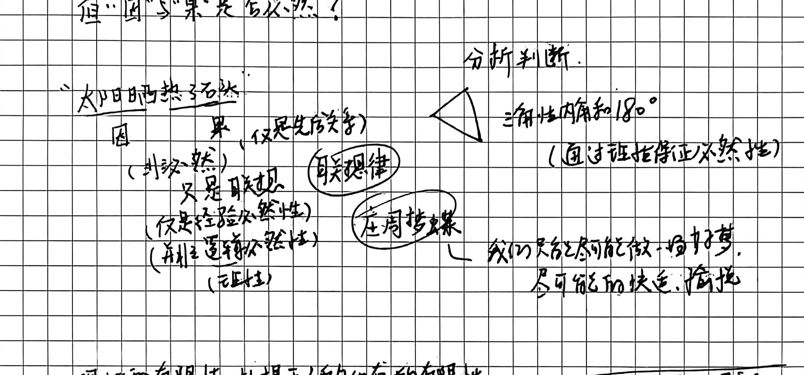
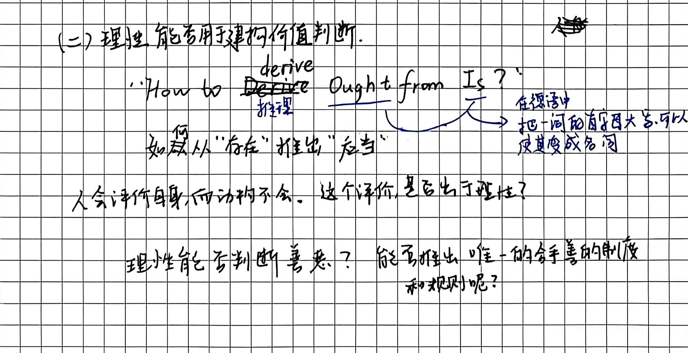
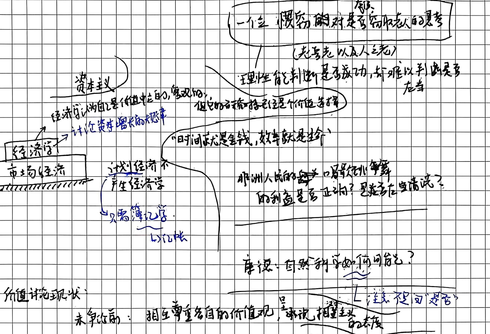

# 第六讲手稿还原：休谟的两大难题及其当代意义

> **整理说明**：
> 1. 本文档严格忠实于原手稿的字句、行文顺序、板书结构图式、圈画批注与随感。
> 2. 原文错别字与笔误均在正文保留原样并以括号注出正字。
> 3. 手稿中的图解、推演脉络及对应截图标注均严格匹配 `assets/images/第六讲/`。
> 4. 学理辨析与存疑点严格按规范以 `// TODO: [疑问描述]` 予以标注。

---

## 第 1 页：因果关系的必然性问题与休谟“从存在推出应当”

# 第六讲：休谟的两大难题及其当代意义

休谟 **David Hume**
$$\begin{array}{|c|}
\hline
\text{\textbf{真理不是静止地处在顶峰}} \\
\text{\textbf{Truth is Process}} \\
\hline
\end{array}$$

---

# (一) 因果关系的必然性问题

- **因果客观性与必然性的质疑**：
  - “因”与“果”是客观的（我们能够观察到），
  - 但“因”与“果”是否必然？

- **板书案例分析：“太阳晒热了石头”**：
  - **因**：太阳晒
  - **果**：石头热
  - （并非必然）
  - **（仅是先后关系）**
  - **只是联想** $\longrightarrow$ **【联想律】**
  - （仅是经验必然性）
  - （并非逻辑必然性 / 理性）
  - $\longrightarrow$ **【庄周梦蝶】** $\longrightarrow$ **我们只能尽可能做个好梦，尽可能的快乐、愉快**。

- **对比：分析判断**：
  - 三角形内角和 $180^\circ$
  - （通过证明保证必然性）

- **理性的有限性与人类生存**：
  - **理性的有限性，扎根于人的生存的有限性。**
  - > “真理并不是无限的：我们对于外部事物的数学的测量，也是以人为中心的，人自己不知道而已。”

---

### (二) 理性能否用于建构价值判断

- **经典公案：从“实然”到“应然”**：
  - **“How to derive Ought from Is ?”**
  - derive - 推理
  - **如何从“存在”推出“应当”？**
  - **批注随笔**：在德语中，把一个词的首字母大写，可以使其变成名词。

- **人与动物的评价分野**：
  - **人会评价自身，而动物不会。这个评价，是否出于理性？**
  - **追问**：理性能否判断善恶？能否推出唯一的合乎善的制度和规则呢？

---

## 第 2 页：经济学“价值中立”批判与人类利益单复数

- **案例思考框：一个使用惯窃对是否窃取老人的思考**：
  - （老吾老以及人之老）
  - 理性能判断是否成功，但难以判断是否应当。

- **经济学与市场经济的价值伪装**：
  - **经济学 $\longleftarrow$ 市场经济**：
    - 讨论资本增长的效率。
    - **资本主义**：
      - 经济学以为自己是价值中立的，客观的，但它的前提恰恰已经是价值选择了。
      - “时间就是金钱，效率就是生命”。
    - **计划经济** $\longrightarrow$ 不产生经济学，只需簿记学（以记账）。
  - **社会现实拷问**：
    - 非洲人民的唱歌跳舞的利益是否正确？是否应当被清洗？

- **休谟引发的康德之问**：
  - **康德：自然科学如何可能？**
    - 注意不是在问 是否。

- **价值论现状与相对主义困境**：
  - **未发生前**：相互尊重各自的价值观 $\longrightarrow$ 呈现相对主义的态度。
  - **发生争论时**：你别把你的价值观强加于我，你不要统一我的思想。

- **社会科学批判核心论断**：
  > **“社会科学拒绝做价值判断，但其实暗藏着价值判断，用经济学的客观和价值中立的范畴，掩盖社会斗争的事实。”**

- **根本追问：人类利益是单数 OR 复数？**：
  - $\begin{cases} \text{单数} & \longrightarrow \text{共同体} \\ \text{复数} & \longrightarrow \text{人与人各有不同} \end{cases}$

- **末尾总结反思**：
  - **反思人的自我异化**
  - **& Enjoy Leisure**
