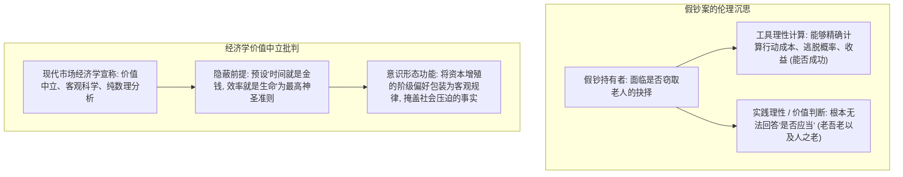

# 第六讲 结构化深度探究：休谟的两大难题及其当代意义——因果必然性的解构与“事实与价值”的鸿沟

---

## 导言：经验主义的极限与近代哲学的“休谟震颤”

在近代认识论由笛卡尔开辟、洛克与贝克莱推进的发展长河中，苏格兰哲学家**大卫·休谟（David Hume, 1711–1776）**扮演了“最激进、最彻底的清道夫”角色。

休谟秉持彻底的经验主义原则——“凡观念皆源于感觉印象（Impressions）”。以此为手术刀，休谟无情剖析了西方形而上学和自然科学赖以立足的基石，最终提出了震动整个哲学界的两大核心难题：
1. **因果关系的必然性难题（The Problem of Induction / Causality）**：因果联系是否具有客观必然性？如果因果律只是主观心理联想与习惯的产物，那么建立在因果必然性上的近代自然科学大厦是否只是一座沙滩上的城堡？
2. **“事实与应当”的价值推导难题（Hume's Guillotine / Is-Ought Problem）**：我们能否从事实命题（Is）逻辑推导或论证出规范价值命题（Ought）？现代社会中科学主义对“价值中立”的标榜，究竟是理性的客观还是对价值强加的掩盖？

这两大难题不仅直接“将康德从独断论的迷梦中唤醒”，更为当代科学哲学、伦理学以及批判社会理论（如法兰克福学派意识形态批判）奠定了根本的问题地平。

```mermaid
flowchart TD
    subgraph 休谟第一难题: 因果必然性批判
        A["经验观察: 太阳晒 (先) + 石头热 (后)"] --> B["感官仅提供: 时空邻近与先后相随"]
        B --> C["无法观察到'因果必然连接纽带'"]
        C --> D["结论: 因果律 = 心理习惯与主观联想法则"]
        D --> E["震动: 自然科学普遍必然性受挫 -> 唤醒康德先验综合"]
    end

    subgraph 休谟第二难题: 事实与价值的鸿沟
        F["事实判断 (Is / 实然): 客观物理与生理状态"] -->|逻辑断裂 (休谟断头台)| G["价值判断 (Ought / 应然): 道德评价与制度选择"]
        G --> H["纯粹工具理性无法推出应当 -> 理性是激情的奴隶"]
        H --> I["当代批判: 揭露经济学'价值中立'假象与资本异化"]
    end
```

---

## 一、 因果关系批判：必然性还是心理联想？

### 1. “因”与“果”的客观性 vs 必然性
手稿开宗明义指出：
> **“‘因’与‘果’是客观的（我们能够观察到），但‘因’与‘果’是否必然？”**

常识和旧唯物主义经验论认为：因果联系是客观世界自身固有的必然规律，人类通过多次观察（“太阳晒了，随后石头热了”）直接反映并获得了客观规律。

休谟对此作出了极其严密的认识论解剖：
- **印象检验法（Test of Impression）**：我们看到了什么？
  1. 现象 A（太阳照晒）；
  2. 现象 B（石头变热）；
  3. A 发生在 B 之前（**时间先后性**）；
  4. A 与 B 在空间上接触（**空间邻近性**）；
  5. 在过去的经验中，A 与 B 总是接连发生（**恒常结合 Constant Conjunction**）。
- **休谟的致命追问**：除了这三者之外，**我们是否在任何一次感觉印象中，看见过名为“必然联系（Necessary Connection）”的实体或红线？**
  - 没有！所谓“必然性”，既非感官所能捕获，亦非形式逻辑必然。
  - 从“过去一万次太阳晒，石头都热了”，在逻辑上绝不能推出“第一万零一次太阳晒，石头必然会热”。明天太阳不再升起的假设，在逻辑上并不包含自相矛盾（不同于“三角形内角和不是 $180^\circ$”的自相矛盾）。

### 2. 联想规律与“庄周梦蝶”：理性的有限性
既然客观经验中不存在必然联系，为什么人类普遍坚信因果律？
- **休谟的心理学还原**：因果观念来源于人类心灵的**“习惯性联想（Habit and Association）”**。多次重复的经验在人脑中形成心理期待和投射，我们将主观的联想习惯错误地投射为客观世界的必然铁律。
- **手稿的哲学随笔——“庄周梦蝶”与理性的有限性**：
  - 手稿在此深邃地联系到道家“庄周梦蝶”：若因果必然性只是一种主观构造与心理习惯，那么人类对现实世界的所谓“确定性掌握”，何尝不是一种逼真的大梦？
  - **“理性的有限性，扎根于人的生存的有限性”**：
    人类是有限的生命体，我们无法站在超验上帝的“绝对全知视角”俯瞰宇宙。人类建立的数学模型与科学法则，本质上是以人的感官尺度和生存需要为中心的有限设定（“真理并不是无限的”）。面对生存的有限性，我们“只能尽可能做个好梦，尽可能的快乐、愉快（Enjoy Leisure）”。


---

## 二、 休谟的第二难题：如何从“存在（Is）”推出“应当（Ought）”？

### 1. “休谟断头台”（Hume's Guillotine）的逻辑断裂
手稿第二部分记录了伦理学史上最著名的公案：
> **“How to derive Ought from Is ? 如何从‘存在’推出‘应当’？”**

- **实然命题（Descriptive / Is）**：陈述事实状态（例如：“吸烟损害肺部”、“人类天生趋乐避苦”、“市场竞争导致优胜劣汰”）；
- **应然命题（Normative / Ought）**：陈述伦理要求、道德法则与制度选择（例如：“我们不应当在公共场所吸烟”、“法律应当保护弱者”、“国家应当追求社会公平”）。

休谟指出：在以往的神学和道德哲学著述中，作者起初都在描述人性的自然状态、生理机制或社会事实（全是 Is），然而不知不觉间，叙述便悄然滑向了“你应当如何做”、“何为至善”（突然变成了 Ought）。
休谟挥起逻辑之剑——**从纯粹的事实陈述中，绝不可能合乎逻辑地直接推导出演绎出任何道德应当！**

### 2. 人与动物的分野：理性能否决断善恶？
手稿提出了两个层层推进的设问：
1. **“人会评价自身，而动物不会。这个评价，是否出于理性？”**
2. **“理性能否判断善恶？能否推出唯一的合乎善的制度和规则呢？”**

休谟的回答惊世骇俗：**“理性是，而且应当只是激情的奴隶（Reason is, and ought only to be the slave of the passions）。”**
- **理性的局限性**：理性只负责两件事——**事实辨认（真/假）**与**因果推导（工具计算）**。
- **善恶不在对象之中，而在主体的内在情感（Moral Sentiment）之中**：
  - 比如杀人罪，你用最精密的显微镜分析凶器、伤口、血液流速，在这些纯粹物理和生理事实中，你看不到名为“恶”的分子或原子；
  - 所谓的“恶”，是你作为人，在目睹这种伤害行为时，内心激发起的一种本能的**痛感、同情与厌恶的情感反应**。

---

## 三、 当代批判：假钞案与经济学“价值中立”的意识形态伪装

手稿第二页针对现代资本主义市场经济展开了极其犀利的批判，直指现代社会科学的伪善核心：



### 1. 假钞案剖析：工具理性的无能
手稿记录了一个经典思想实验：
> **“一个使用假钞的人对是否窃取老人的思考：理性能判断是否成功，所难以判断是否应当。”**

- 工具理性（Instrumental Reason）可以精确规划技术路线：如何调包、如何逃跑、如何规避风险；
- 但如果抽离了“老吾老以及人之老”的人类道德情感与先验敬畏，纯粹的理性计算完全可能得出“欺骗一个丧失辨别能力的老人成本最低、收益最大”的冷血结论！
- 这充分说明：**理性不能为伦理行为提供终极动力与善恶方向**。

### 2. 戳破“价值中立”的谎言：经济学背后的资本意志
手稿指出：
> **“社会科学拒绝做价值判断，但其实暗藏着价值判断，用经济学的客观和价值中立的范畴，掩盖社会斗争的事实。”**

- **资本主义经济学的自我粉饰**：西方主流经济学极力把自己打造成类似于物理学那样的“硬科学”，宣称自己不谈道德，只讨论“资源最优配置与资本增长效率”；
- **深层揭露**：
  - 这种所谓的“客观”，本身就是最彻底的价值偏袒！它把**“资本增殖率最大化”**预设为不容置疑的前提；
  - 面对“非洲饥荒与贫困人民的生存利益是否正当？”这类关乎生命尊严的根本问题，新自由主义经济学要么将其视作外部性（Externality）予以漠视，要么以“市场尚未充分发展”进行冷酷推诿。
- **利益是单数还是复数？**
  - 如果人类利益是**单数（普遍共同体利益）**，那么社会政策应当以保障每一个人的自由全面发展为旨归；
  - 但现实中，统治阶级往往将少数资本持有者的**复数特殊利益**，打扮成全人类的“单数共同利益”，以此消解大众的批判意识。

---

## 四、 思想史的回响：休谟难题与康德哲学的破土

休谟通过两大难题，一方面在认识论上把近代科学逼入了怀疑论的死胡同（经验无法保证因果必然性），另一方面在伦理学上把道德逼入了主观情感主义与相对主义的悬崖。

正是这两记重锤，促使康德在第七讲与第八讲中发起了人类思想史上最宏伟的营救行动：
1. **为了拯救科学**：康德确立了**“先天综合判断”**与**“人为自然界立法”**，指出因果性并非来自外在经验的归纳，而是人类知性先天的纯概念范畴，由此捍卫了科学的客观必然性；
2. **为了拯救道德**：康德提出了**“绝对命令（Categorical Imperative）”**与**“实践理性自主”**，指出道德绝非随情感浮动的经验偏好，而是纯粹理性颁布的无条件先验法则（“人是目的，绝不仅仅是工具”）。

休谟的伟大之处，正在于他以冷峻彻底的怀疑，为人类理性的傲慢划定了界限，从而为更深沉的批判哲学与生命反思开辟了道路。

---

## 五、 实战与现实透镜延伸
- 理论落地范式：[哲学透镜：复杂现实与商业战略的六维解构范式](./哲学透镜/哲学透镜_通用分析范式.md)
- 商业实战推演：[01_诺基亚与移动终端范式革命（休谟归纳难题的商业投射）](./哲学透镜/01_诺基亚与移动终端范式革命.md)

