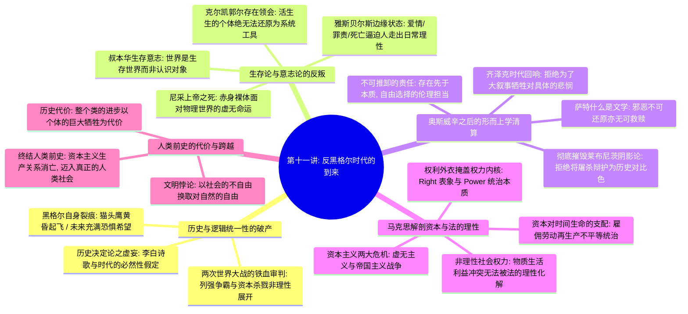

# 第十一讲：反黑格尔时代的到来

> **本讲核心题旨**：深度解构西方近代形而上学的理性终极神话——“反黑格尔时代的到来”。本讲聚焦于黑格尔“历史与逻辑统一性”命题的全面崩塌，揭示现代社会从盲目历史进步乐观主义走向两次世界大战空前劫难的思想史裂变；全面梳理现代反黑格尔思潮的三大重镇：叔本华生存意志论、尼采“上帝之死”的价值荒原、克尔凯郭尔对系统哲学的个体生存反抗，以及雅斯贝尔斯在“爱情、罪责、死亡”边缘状态（*Boundary Situation*）中对理性的超拔；系统研读二战后萨特《什么是文学？》关于“邪恶是无可救赎的”之惊世判词，彻底粉碎将具体个体苦难当作历史“必要阴影代价”的虚伪神义论；最终深入马克思《黑格尔法哲学批判》——剖析资本主义以“权利（*Right*）”的理性外衣掩盖“非理性社会权力（*Power*）”的深层压迫，直面“文明以人与人对抗赢得自然自由、人类以个体的牺牲换取类的进步”的沉重悖论，展望超越资本主义生产关系、终结人类“前史阶段”的本真人类社会。

---

## 快速导航与知识图谱

| 文档类型 | 入口链接 | 核心内容提要 |
| :--- | :--- | :--- |
| **手稿忠实还原版** | [第十一讲_手稿还原.md](./第十一讲_手稿还原.md) | 逐页忠实还原 4 页原手稿全貌，完整保留历史逻辑统一性批判、黑格尔猫头鹰困境、萨特邪恶不可救赎原文抄录、雅斯贝尔斯边缘状态图示、马克思权利外衣与权力内核图解。 |
| **结构化深度探究版** | [第十一讲_结构化深度探究.md](./第十一讲_结构化深度探究.md) | 学术级系统解构：理性全能神话破产、生存论意志论对认识论的颠覆、萨特拒斥莱布尼茨阴影神义论、存在主义绝对自由抉择、马克思对法哲学的唯物主义清算、人类前史终结三维坐标。 |

---

## 本讲核心哲学命题摘要

1. **“历史与逻辑并不统一”——黑格尔理性全能主义的破灭**：
   黑格尔把历史描绘为逻辑必然性的平稳展开，断言现实必定合理。然而两次世界大战的浩劫证明，历史绝非理性的田园诗，而是充斥着偶然、阶级利益撕咬与残酷帝国主义争霸的惨烈战场；历史没有先验保障的必然终局，未来始终取决于现实行动。
2. **“世界不是认识的对象，它是个生存的世界”——生存论转向**：
   从笛卡尔到黑格尔，西方哲学把人预设为高高在上的“认识主体”。叔本华与尼采揭穿了这一假相：人首先被抛入充斥着苦难、侥幸、罪恶与死亡的生存深渊之中。理性和概念不仅无法抚慰存在的焦虑，反而常常掩盖了生命意志的真实搏杀。
3. **“爱情、罪责、死亡”——雅斯贝尔斯边缘状态（*Boundary Situation*）的启示**：
   人无法被还原为理性大厦里的一颗螺丝钉。当人类遭遇刻骨铭心的爱情、撕裂良知的道德罪责以及无法逃避的死亡宿命时，一切现成的逻辑公理与技术算计瞬间瓦解，迫使人不得不走出抽象理性，直接面对本真存在。
4. **“邪恶是无可救赎的！”——萨特对唯心神义论的彻底清算**：
   莱布尼茨曾为恶辩护，称阴影是为了衬托光明的必须存在；黑格尔把苦难当成历史前进的肥料。萨特在二战废墟中斩钉截铁地宣告：奥斯威辛和达豪的惨剧绝不可化简为文明螺旋上升的台阶！邪恶一旦发生便不可救赎，每个人都必须对自己在历史情境中的自由抉择承担逃无可逃的终极责任。
5. **“法的外衣是权利（*Right*），内里的核心是权力（*Power*）”——马克思对法哲学的解构**：
   资产阶级法权宣扬人人平等与契约自由，表面上是以理性协调人与人的物质利益；但在实质上，它只是给资本家垄断生产资料、无偿占有他人生命时间的“非理性社会权力”穿上了一件名为“合法权利”的道德外衣。
6. **人类文明的悲剧悖论与“前史阶段”的终结**：
   迄今为止的文明成果建立在一个残酷的交换法则之上——人类以社会世界的人身依附与不自由，换取了征服自然界的自由；整个“人类类（*Species*）”的进步，以无数个体的惨烈牺牲为代价。唯有当消除阶级对抗、消亡资本主义生产关系时，人类才真正结束了残酷自残的“史前时期（前史）”，开启真正全面自由发展的人类社会纪元。

---

*知识库规范与指引详见：[AGENTS.md](./AGENTS.md)*
