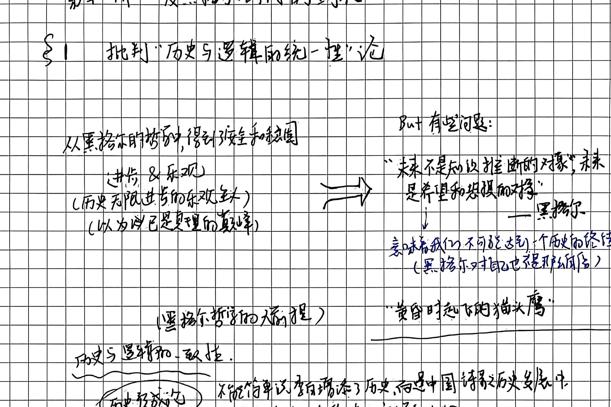
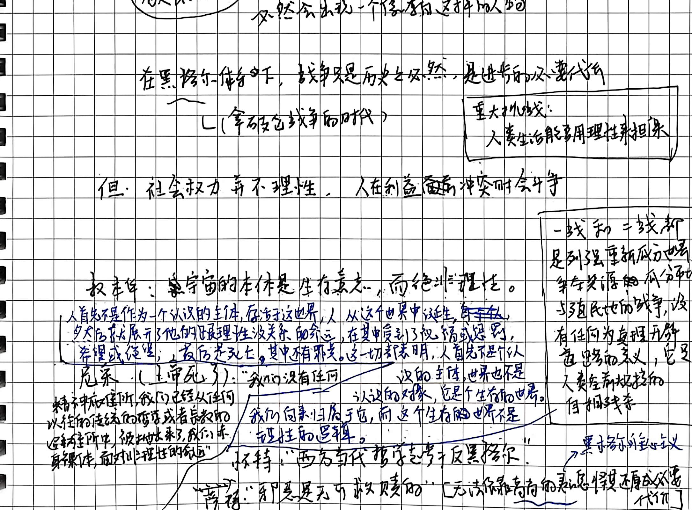
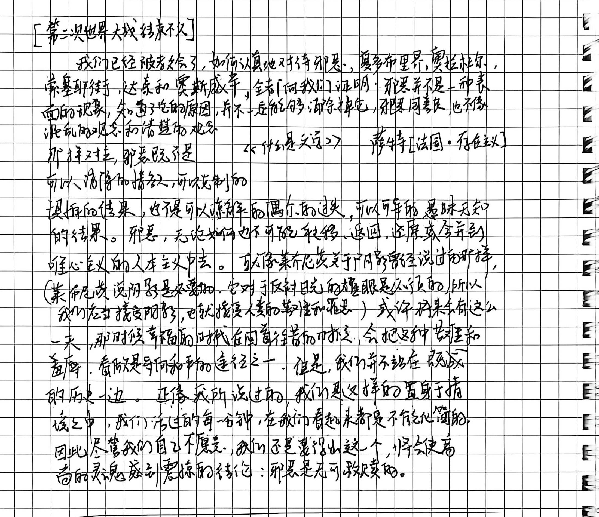
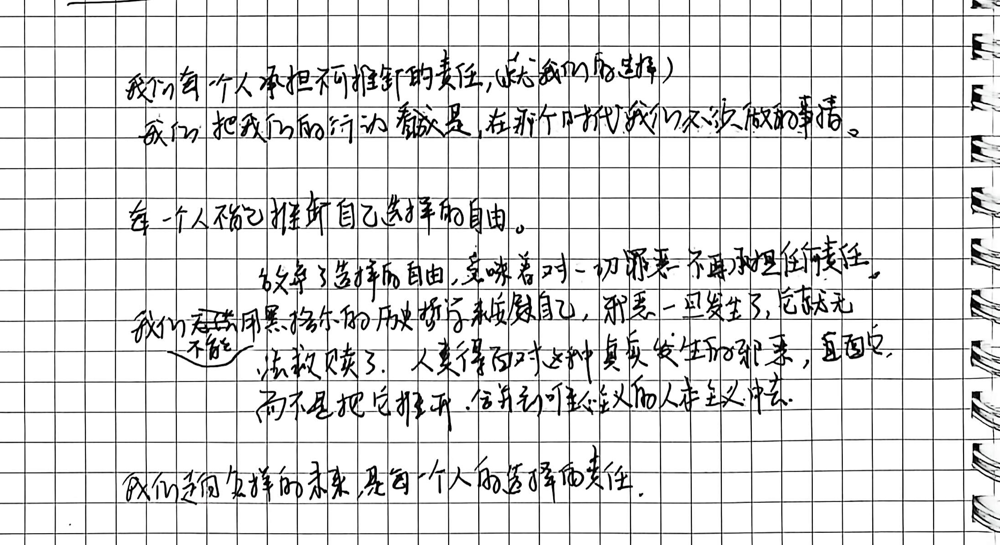
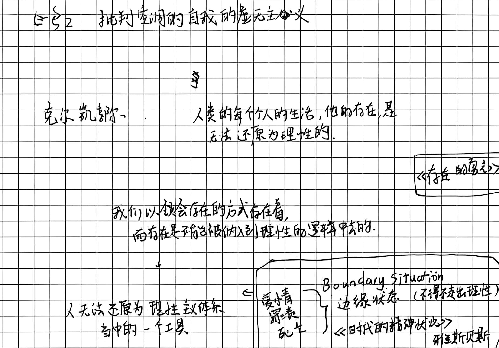
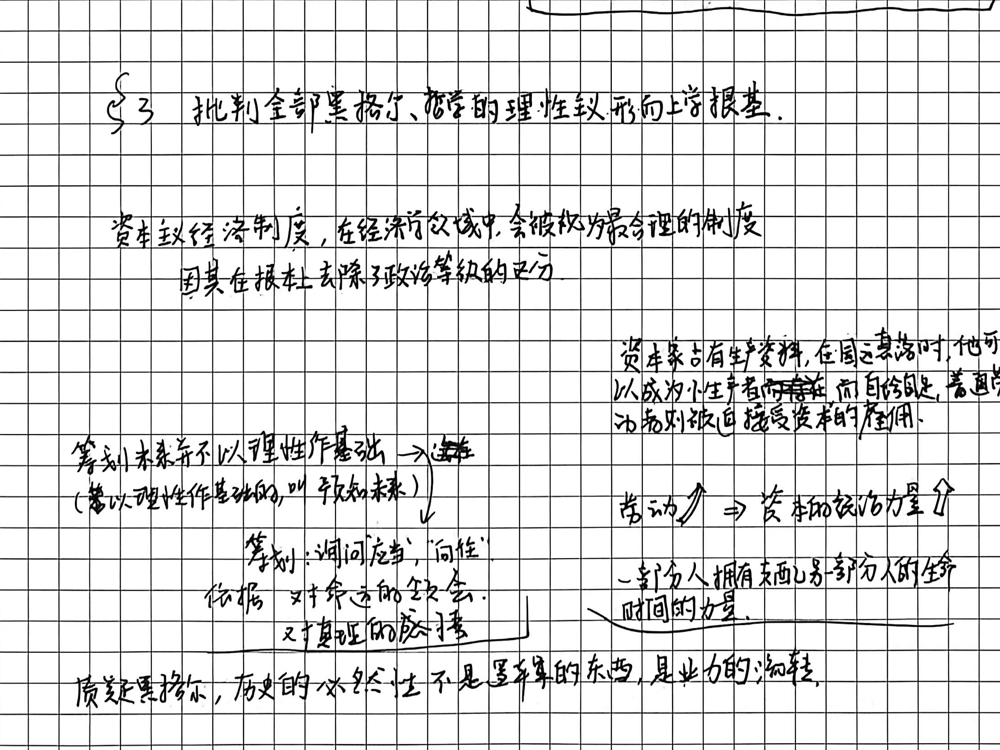
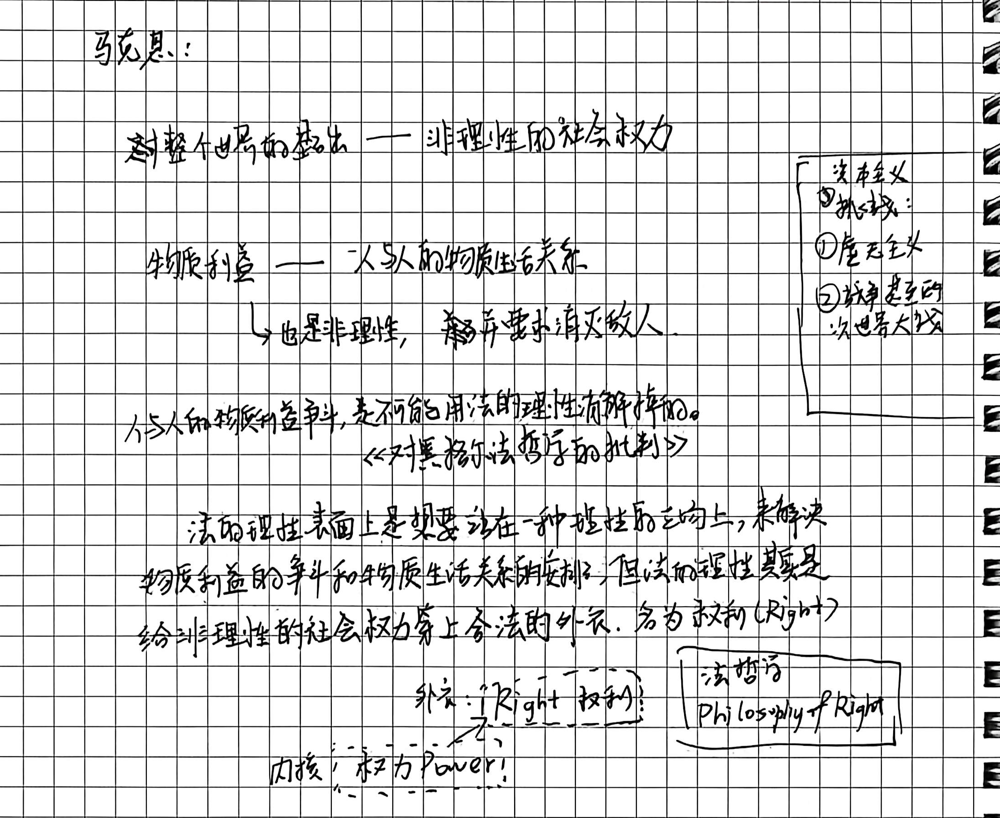
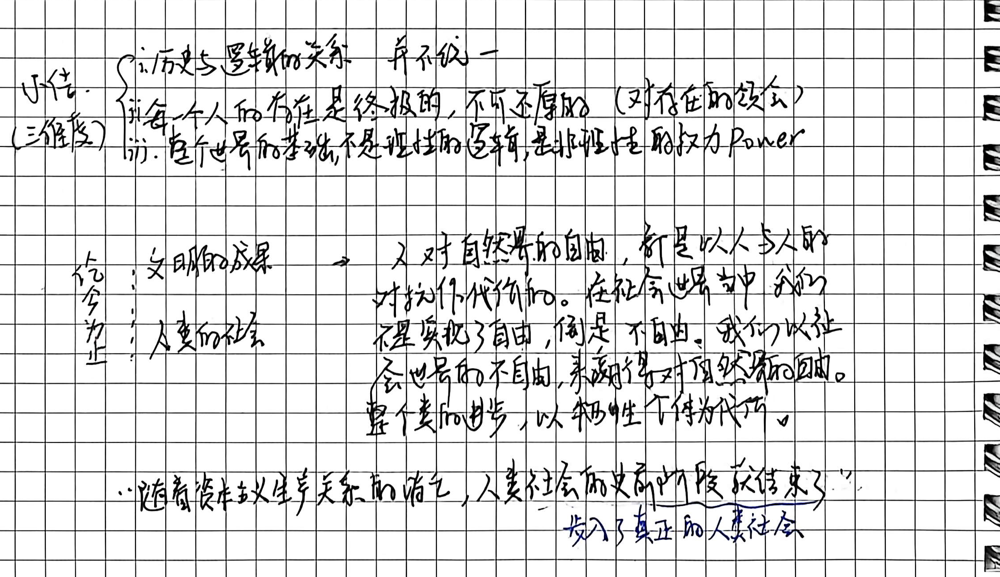

# 第十一讲手稿还原：反黑格尔时代的到来

> **整理说明**：
> 1. 本文档严格忠实于原手稿 4 页笔记的字句顺序、板书结构图式、圈画批注与随感逐字忠实还原。
> 2. 原文错别字与笔误均在正文保留原样并以括号注出正字。
> 3. 手稿中的图解、推演脉络及对应截图标注均严格匹配 `assets/images/第十一讲/`。
> 4. 学理辨析与存疑点严格按规范以 `// TODO: [疑问描述]` 予以标注。

---

## 第 1 页：批判“历史与逻辑统一性”论、黑格尔内在困境与生存论意志反抗

# 第十一讲：反黑格尔时代的到来

# §1 批判“历史与逻辑的统一性”论

- **从黑格尔的哲学中，得到直接的推图（推论/意图）**：
  - **进步 & 乐观**（历史无限进步的乐观主义）
  - （以为自己是真理的巅峰）
  - $\Longrightarrow$ **But 有些问题**：
    - “**未来不是知识推断的对象，未来是希望和恐惧的对象**” —— 黑格尔
    - 这意味着我们不可能达到一个历史的终结（黑格尔对自己也很矛盾）
    - “**黄昏时起飞的猫头鹰**”
    // TODO: 黑格尔《法哲学原理》序言名言：“密涅瓦的猫头鹰要到黄昏到来，才会起飞。”哲学作为思想把握到的时代，总是在现实生命历史成熟之后才作事后的反思理解，因而哲学无法预言或为未来开出教条处方。

- **（黑格尔哲学的大前提）历史与逻辑的一致性**：
  - **历史决定论**：不能简单说李白增添了历史，而是中国诗歌历史发展中，必然会出现一个像李白这样的人物。

- **战争与理性的致命危机**：
  - 在黑格尔体系下，**战争只是历史之必然，是进步的必要代价**。（拿破仑战争的时代）
  - **重大挑战**：人类生活能否用理性来担保？
  - **但：社会权力 并不理性，人在利益冲突时会斗争**。
  - **世界大战的反思**：一战和二战都是列强重新瓜分世界、资本资源的不公平分配与殖民地而战争，没有任何为真理开辟道路的意义，它是人类空前规模的自相残杀。$\Longrightarrow$ **黑格尔历史全能主义破产**。

- **现代反黑格尔思潮的三大先驱与回响**：
  - **叔本华：宇宙的本体是生存意志，而绝非理性**。
    > “人首先不是作为一个认识的主体，存活在这个世界，人从这个世界中诞生，长大后就展示了他的跟理性没关系的命运，在其中受到了祝福或惩罚，苦难或侥幸，最后是死亡，其中有罪恶。这一切都表明，**人首先是个以生存为主体，世界也不是认识的对象，它是个生存的世界**。”
  - **尼采（“上帝死了”）**：
    > “我们没有任何精神的底座（所以我们已经从任何以往的传统的哲学或者宗教的经验所处中被抛出来了，**我们赤身裸体面对物理世界的命运**）”  
    > “我们没有任何归属于它，而**这个生存的世界是不理性的逻辑**。”
  - **怀特**：“**西方当代哲学走向反黑格尔**”
    // TODO: 莫顿·怀特（Morton White）著《反叛形式主义》或当代分析历史哲学对黑格尔绝对唯心论体系的反思。
  - **齐泽克**：“**邪恶是无可救赎的**” `[无法依靠高尚的灵魂(黑格尔唯心主义)将其还原成必要代价]`

---

## 第 2 页：萨特《什么是文学》论邪恶无可救赎与自由选择的不可推卸责任

- **历史背景标记**：`[第二次世界大战结束不久]`
- **萨特引文文献**：《什么是文学？》（*Qu'est-ce que la littérature ?*） 萨特 `[法国·存在主义]`

> “**我们已经被教会了，如何认真地对待邪恶**。夏多布里界、奥拉杜尔、索塞耶街、达豪和奥斯威辛，全向我们证明：**邪恶并不是一种表面的现象**。知道了它的原因，并不一定能够消除它；邪恶同善良，也不像混乱的观念和清楚的观念那样对立，**邪恶既不是可以消除的指责，可以克制的惧怕的结果，也不是可以谅解的偶尔的过失，可以可导的，愚昧无知的结果。邪恶，无论如何也不可能转移、退回、还原或合并到唯心主义的人本主义中去**。  就像莱布尼茨关于阴影曾经说过的那样，（莱布尼茨说明暗是必要的。它对于反衬日光的耀眼是必须的，所以我们应当接受阴影，也就接受人类的苦难和罪恶），或许将来会有这么一天，那时候幸福的时代在回首往昔的时候，会把这种苦难和羞辱，看作是导向和平的途径之一。  **但是，我们并不站在既成的历史一边**。正如我所说过的，**我们这样地置身于情境之中，我们活过的每一分钟，在我们看来都是不能化简的**。因此，尽管我们自己不愿意，我们还是要得出这个将会使高尚的灵魂感到震惊的结论：**邪恶是无可救赎的**。”  
> 
> // TODO: 奥拉杜尔（Oradour-sur-Glane，法国遭纳粹灭村屠杀遗址）、达豪（Dachau）与奥斯威辛（Auschwitz）纳粹集中营；莱布尼茨在《神义论》（Théodicée）中将恶视为全美世界中不可或缺的“阴影/对比”以衬托最高善，萨特坚决批判这种将具体个体的屠杀与苦难宏大叙事化、轻飘化辩护的形而上学恶毒。

---

- **手稿下半部分：存在主义的自由选择与伦理担当**：
  - **我们每个人承担不可推卸的责任（无论我们的选择）**
  - 我们把我们的行动看作是在那个时代我们不决（不得不）做的事情。
  - **每个人不能推卸自己选择的自由**。
  - **放弃了选择的自由，意味着对一切罪恶不再承担任何责任**。
  - **我们不能使用黑格尔的历史哲学来安慰自己，邪恶一旦发生了，它就无法救赎了。人类得面对这种真实发生的邪恶，直面它，而不是把它推开，合并到唯心主义的人本主义中去**。
  - **我们走向怎样的未来，是每一个人的选择的责任**。 // TODO 是 选择和责任 or 选择的责任

---

## 第 3 页：批判空洞自我的虚无主义、雅斯贝尔斯边缘状态与资本主义制度根基

# §2 批判空洞的自我的虚无主义

- **克尔凯郭尔**：

  > “**人类的每个人的生活，他的存在，是无法还原为理性的**。”  
  > “**我们以领会存在的方式存在着，而存在是不能被纳入到理性的逻辑中去的**。”  
  > // TODO: 克尔凯郭尔代表作如《非此即彼》（Enten-Eller）、《恐惧与颤栗》（Frygt og Bæven）、《致死的疾病》等，批判黑格尔把活生生的单个个体的信仰、焦虑与生存激情碾碎在绝对理念的辩证机器之中；海德格尔《存在与时间》亦继承了“人以领会存在的方式存在着”的根本立论。

- **人无法还原为理性主义体系当中的一个工具**。

- 荐书：《存在的勇气》

- **雅斯贝尔斯“边缘状态”**：Boundary Situation （不得不走出理性）《时代的精神状况》

  - 爱情
  - 罪责
  - 死亡
  - ** 雅斯贝尔斯**
  // TODO: 卡尔·雅斯贝尔斯（Karl Jaspers）提出“极限境况/边缘情境（Grenzsituationen）”，人在遭遇痛苦、罪过、斗争和死亡等极限境况时，一切现成的日常理智与技术规划皆告破产，迫使人不得不走出抽象理性，直接面对本真生存与超验存在。

---

# §3 批判全部黑格尔哲学的理性主义形而上学根基

- **资本主义经济制度，在经济学领域中，会被视为最合理的制度，因其在根本上（形式上）去除了政治等级的区分**。

  - 资本家占有生产资料，在国运亨通时，他可以成为小生产者，而自给自足；普通劳动力者则被迫接受资本的雇佣。
  - 劳动 $\nearrow \Longrightarrow$ 资本的**统治力量 $\nearrow$**
  - 一部分人拥有支配另一部分人的生命时间的力量。

- **筹划未来并不以理性作基础 $\longrightarrow$ 选择**

  - （若以理性作基础的，叫预知未来）
  - 筹划：询问应当，“向往”
  - 依据：对命运的领会，对真理的感悟

- > **质疑黑格尔：历史的必然性不是逻辑的东西，是业力的流转**。

---

## 第 4 页：马克思对黑格尔法哲学的批判、法的理性与权力内核及人类前史的终结

- **马克思的核心批判**：
  - 对整个世界的基础 —— 非理性的社会权力
  - 物质利益 —— 人与人的物质生活关系
    - └ 也是非理性，并要求消灭敌人。
  - 人与人的物质利益冲突，是不能用法（法哲学）的理性来解决的。《对黑格尔法哲学的批判》

- **法的理性与权力本质**：
  - 法的理性表面上是要站在一种理性的立场上，来解决物质利益的争斗和物质生活关系的安排，**但法的理性其实是给非理性的社会权力穿上合法的外部外衣，名为权利（Right）**
  - 外衣：Right 权利 $\longleftarrow$ 法哲学 Philosophy of Right
  - 内核：Power 权力

- 资本主义两大挑战：
  - ① 虚无主义
  - ② 战争（两次世界大战）

- **小结（三维度）**：

  - i. 历史与逻辑的关系 并不统一
  - ii. 每一个人的存在是终极的，不可还原的（对存在的领会）
  - iii. 整个世界的基础，不是理性的逻辑，是非理性的权力 Power

- **人类历史进程的沉重代价与前史终结**：
  - $\begin{cases} \text{文明的成果} \\ \text{人类的社会} \end{cases} \longrightarrow$ 人对自然的自由，是以人与人的对抗作代价的。在社会世界中我们不是实现了自由，倒是不自由。我们以社会世界的不自由，来赢得对自然的自由。整个类的进步，以牺牲个体为代价。
  - **底端终极预言**：
    
    > “**随着资本主义生产关系的消亡，人类社会前史阶段就结束了（进入了真正的人类社会）**”
    // TODO: 出自马克思《〈政治经济学批判〉序言》（1859年）：“资产阶级的生产关系是社会生产过程的最后一个对抗形式……人类社会的史前时期（前史）就以这种社会形态而告终。”

