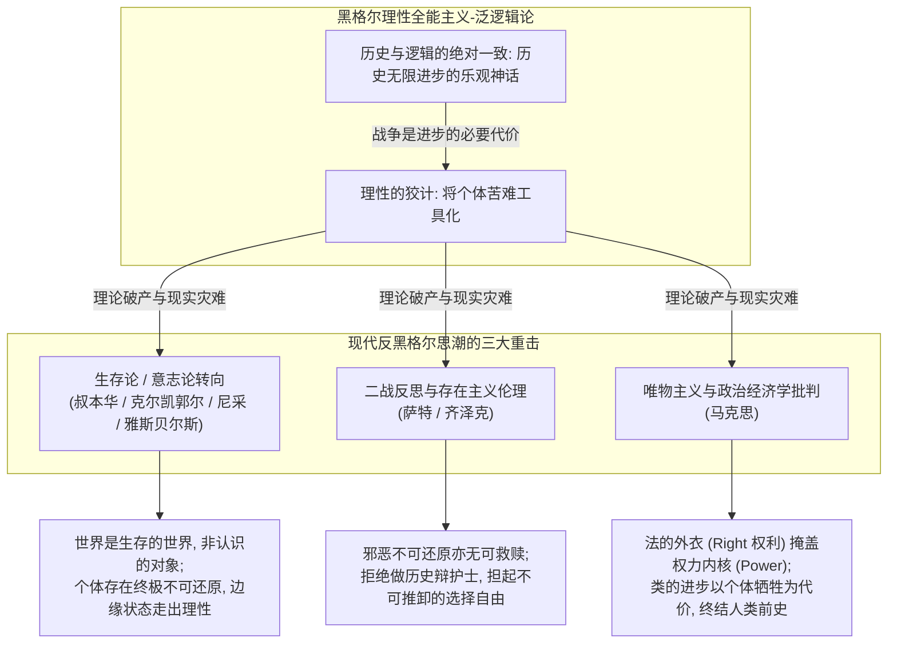
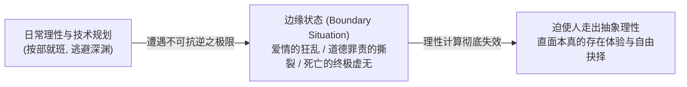
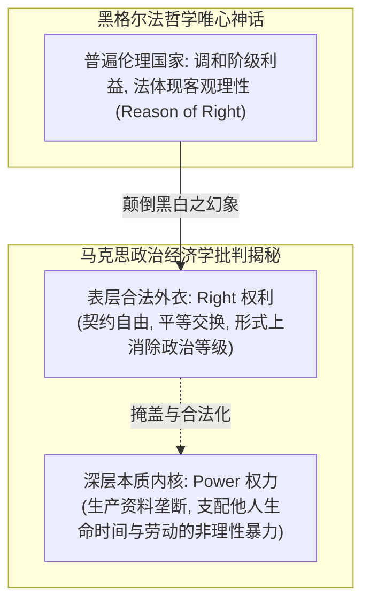

# 第十一讲 结构化深度探究：反黑格尔时代的到来——历史与逻辑的分裂、生存论转向与资本批判的现代启示

---

## 导言：理性神话的坍塌与现代哲学的觉醒

在黑格尔宏大体系的顶峰，西方唯心论确立了一个令全人类陶醉的“理性全能神话”：
> 凡是现实的都是合理的，凡是合理的都是现实的；历史不过是绝对精神自我实现的壮丽长征；战争、苦难与杀戮，皆被轻描淡写地辩护为真理进步所必须支付的“必要代价”。

然而，十九世纪中叶以降直至二十世纪两次世界大战的血腥现实，无情地碾碎了这尊庞大的理性巨石：
1. **生存论与意志论的反叛**：从叔本华、克尔凯郭尔到尼采，哲学家们赫然发现，世界的本体绝非冰冷演算的绝对理性，而是狂暴苦痛的**生存意志**、不可化约的**个体生存恐惧**以及“上帝之死”后的**价值荒原**；
2. **奥斯威辛的终极审判**：萨特在二战瓦砾中发出惊世断语——**“邪恶是无可救赎的！”** 拒绝让具体个体的毁灭消融在形而上学的虚伪神义论阴影之中；
3. **马克思的唯物主义解剖刀**：剥去黑格尔《法哲学原理》中法与国家的“伦理理性外衣”，直击其内核乃是**非理性的阶级权力与物质生活对抗**。

西方当代哲学由此正式走出黑格尔主义的庞大阴影，步入**反黑格尔（Anti-Hegelianism）**的现代思想纪元。

---

## 一、 批判“历史与逻辑的一致性”：理性神话的内在破绽与现实崩塌

### 1. 历史终结论的荒谬与黑格尔自身的自我矛盾

黑格尔体系认定：逻辑的推演就是历史的展开，近代欧洲国家与绝对唯心论体系构成了人类历史与真理的终极顶点。然而，黑格尔本人在晚年也不得不流露出深刻的内在撕裂：
- **“未来不是知识推断的对象，未来是希望和恐惧的对象！”**——若历史与逻辑真的绝对等同，未来理应像几何公理一样能够被先验预知；承认未来充满恐惧与希望，恰恰宣告了历史无法被理性知识彻底封闭；
- **“密涅瓦的猫头鹰要到黄昏才会起飞”**——哲学只能在历史实践完成之后作回溯性的反思与总结，绝无法充当未卜先知的先知，历史永远向着不可预测的深渊开放。

### 2. 两次世界大战对“历史进步乐观主义”的死刑判决
在十九世纪，资产阶级沉醉于工业革命带来的技术繁荣，将黑格尔的乐观主义信条奉为圭臬。黑格尔曾将拿破仑战争视为“公理打破旧秩序的必要阵痛”。

然而，一战与二战的爆发彻底戳穿了这一谎言：
- 帝国主义战争绝非黑格尔所谓的“世界精神为了真理而开辟道路”；
- 它是垄断资本为了重新瓜分殖民地、争夺资源的不公分配而爆发的**人类空前规模的自相残杀**！
- 社会权力的运作根本不是理性的逻辑演进，而是赤裸裸的利益撕咬与霸权扩张。

---

## 二、 生存论与意志论的反叛：不可还原的个体存在

### 1. 叔本华与尼采：从“认识的主体”到“生存的深渊”
手稿第 1 页精准提炼了叔本华对传统西方形而上学的颠覆：
> **“人首先不是作为一个认识的主体存活在这个世界。人从这个世界中诞生，长大后就展示了他跟理性毫无关系的命运：苦难、侥幸、罪恶与死亡。这一切表明，人首先是个以生存为主体，世界也不是认识的对象，它是个生存的世界！”**

- **叔本华**：宇宙本体是盲目冲动的“生存意志（*Wille zum Leben*）”，理性不过是意志为了自我保全而衍生出的工具浮沫；
- **尼采**：“上帝死了！”人类失落了所有的形而上学底座与永恒价值庇护所，被赤身裸体地抛掷到冰冷荒谬的物理宇宙之中。

### 2. 克尔凯郭尔与雅斯贝尔斯：边缘状态与存在的不可还原
- **克尔凯郭尔的抗争**：黑格尔将每一个活生生的个体都当成了绝对精神大厦上的一块砖石；但克尔凯郭尔怒吼道：**每个具体个体的存在与信仰体验，是绝对无法还原为概念逻辑的！** 我们以领会存在的方式存在着，存在拒斥一切理性系统的吞并。
- **雅斯贝尔斯论“边缘状态（*Grenzsituationen*）”**：
  在手稿第 3 页特别框选的图示中，人类的生活绝非顺风顺水的技术规划：
  - **爱情、罪责、死亡**；
  - 当我们遭遇这些不可回避的“边缘状态”时，所有的理性计算、逻辑范畴与科学工具瞬间失灵崩溃，迫使个体不得不走出虚妄的理性幻觉，直面本真存在的深渊。

---

## 三、 奥斯威辛之后的形而上学清算：萨特论“邪恶无可救赎”

### 1. 清算莱布尼茨与黑格尔的“神义论辩护”
在近代唯心论中，最具欺骗性的理论莫过于**莱布尼茨的“阴影论”与黑格尔的“恶是历史发展的动力”**：
- 莱布尼茨在《神义论》中辩称：正如一幅杰出的油画必须有黑暗的阴影才能衬托出光明的耀眼，世间的恶与苦难只是上帝为了实现整体最高善所安排的“对比色”；
- 黑格尔更进一步将屠杀与压迫美化为时代精神前进的“必要消耗品”。

### 2. 萨特《什么是文学？》的划时代断言
手稿第 2 页几乎全文抄录了萨特二战结束不久后的惊世宣言，直指纳粹集中营（奥斯威辛、达豪）与屠村暴行（奥拉杜尔）：

> **“邪恶并不是一种表面的现象。知道了它的原因，并不一定能够消除它……邪恶，无论如何也不可能转移、退回、还原或合并到唯心主义的人本主义中去！”**  
> **“我们并不站在既成的历史一边！我们活过的每一分钟，在我们看来都是不能化简的。因此，尽管我们自己不愿意，我们还是要得出这个将会使高尚的灵魂感到震惊的断语：邪恶是无可救赎的！”**

- **不能化简的痛苦**：集中营中每一个惨遭毒气杀害的犹太儿童、战场上被撕碎的每一个年轻士兵，他们的生命与绝望是绝对不可还原的！任何试图把这种真实血泪合并进“人类文明螺旋上升”大叙事的哲学家，都是对受难者最无耻的二次践踏；
- **自由选择与逃无可逃的责任**：存在先于本质，人没有先天的救赎预案；逃避选择正是放弃责任。面对邪恶，人类只能依靠自身无条件的自由选择与行动，为自己和历史担负全部责任。

---

## 四、 马克思对黑格尔法哲学的解构：法的理性外衣与权力内核

如果说存在主义在微观个体维度炸毁了黑格尔的理性神话，那么卡尔·马克思（Karl Marx）则在社会历史维度给出了致命一击。

### 1. 权利（Right）的外衣与权力（Power）的本质
手稿第 4 页以极其锐利的结构图解剖了近代法治社会的本质：
- **经济学的“理性天国”假象**：资本主义经济制度在表面上是最平等的契约体系——去除了封建人身依附与政治等级，劳动力与资本在自由市场上“按劳取酬”、“公平交换”；
- **马克思在《黑格尔法哲学批判》中的洞穿**：
  - 物质利益是人与人之间最根本的生活关系，绝非依靠形而上学的“法的理性”所能调和；
  - **法的理性只是给非理性的社会权力穿上了一件名为“权利（Right）”的合法外衣**！
  - 当资本家垄断了生产资料，普通劳动者为了生存就不得不出卖劳动力；在自由平等的法权表象之下，**一部分人获得了支配另一部分人生命时间与劳动力的生杀大权（Power）**。

### 2. 资本主义的双重危机与人类“前史”的终结
手稿最后凝练提炼了人类文明迄今为止的悲剧性辩证法：
1. **资本主义的两大终极挑战**：
   - **虚无主义（Nihilism）**：精神信仰的彻底瓦解，人沦为冷酷消费与资本积累的奴隶；
   - **两次世界大战**：生产过剩与资本扩张必然引爆全球性帝国主义争霸灾难。
2. **人类文明的惨痛悖论**：
   > **“人对自然的自由，是以人与人的对抗为代价的。我们在社会世界中确实获得了自由，倒是不自由。我们以社会世界的不自由，来赢得对自然的自由。整个类的进步，以牺牲个体为代价！”**
3. **人类前史阶段的终结**：
   马克思断言，阶级对抗并非人类文明的永恒宿命；资本主义生产关系的消亡，并非文明的终结，而是标志着**“人类社会史前时期（前史）的结束”**，人类由此才真正迈入全面自由发展的本真人类社会！

---

## 五、 小结：反黑格尔时代的三大基石与现实透镜

手稿第 4 页在末尾为整个现代反黑格尔哲学绘制了清晰的三维坐标：

| 批判维度 | 黑格尔理性全能论假定 | 现代反黑格尔批判真理 | 当代现实透镜启示 |
| :--- | :--- | :--- | :--- |
| **维度一：历史与逻辑** | 历史与逻辑绝对统一，历史无限向前螺旋进步 | **历史与逻辑绝不统一**；历史充满偶然、断裂、倒退与业力流转 | 警惕各类“历史终结论”与盲目的技术乌托邦主义；未来取决于人类当下的警醒与行动。 |
| **维度二：个体存在地位** | 个体只是绝对精神展开过程中的消耗性工具 | **每个个体的存在是终极的、不可化约的** | 任何宏大叙事都不能成为漠视个体权利与生命的借口；直面边缘状态中的本真生存。 |
| **维度三：社会现实基础** | 国家与法是理性精神的最高实现形式 | **世界的基础并非理性逻辑，而是非理性的权力（Power）** | 穿透法律与商业契约的形式理性外衣，洞察资本占有、算力垄断与时间支配的深层不平等。 |

---

*知识库协作指引：[AGENTS.md](./AGENTS.md)*  
*手稿逐字还原版参见：[第十一讲_手稿还原.md](./第十一讲_手稿还原.md)*
