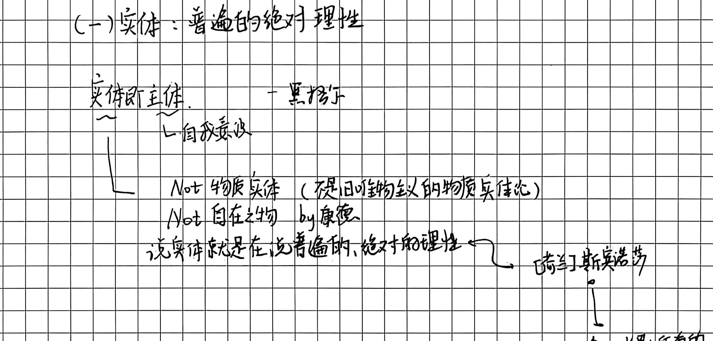
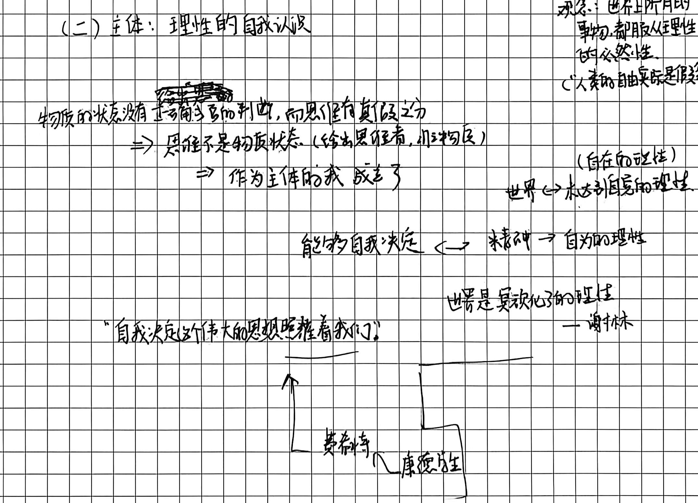
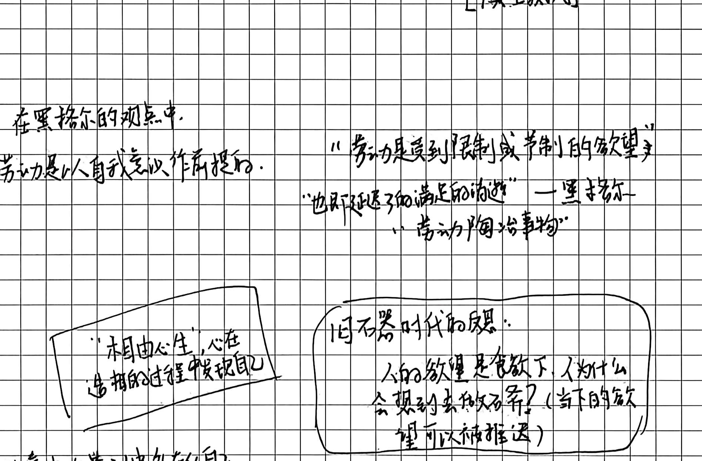
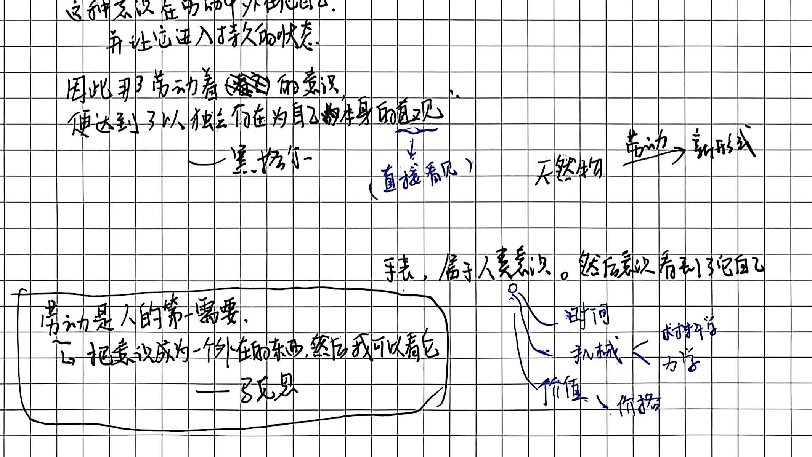
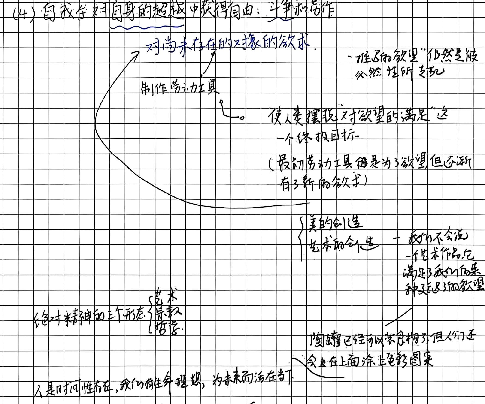
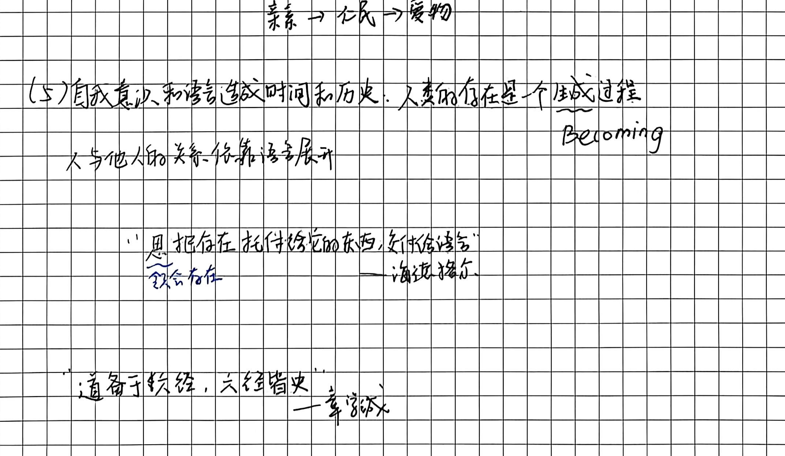
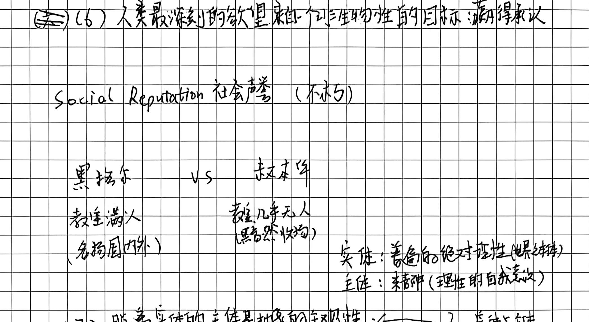
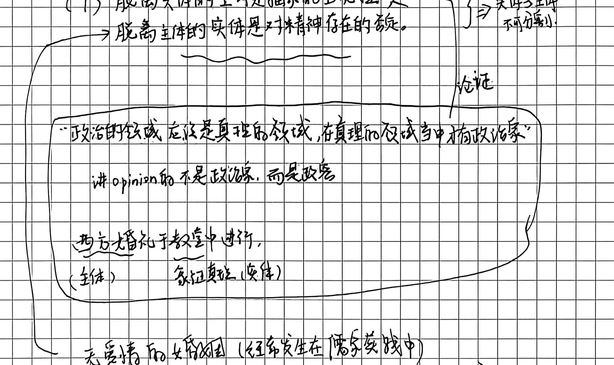

# 第十讲手稿还原：自我意识与实体的关系——真理是主体与实体的统一

> **整理说明**：
>
> 1. 本文档严格忠实于原手稿 4 页笔记的字句顺序、板书结构图式、圈画批注与随感逐字忠实还原。
> 2. 原文错别字与笔误均在正文保留原样并以括号注出正字。
> 3. 手稿中的图解、推演脉络及对应截图标注均严格匹配 `assets/images/第十讲/`。
> 4. 学理辨析与存疑点严格按规范以 `// TODO: [疑问描述]` 予以标注。

# 第十讲·自我意识与实体的关系：真理是主体与实体的统一

## 第 1 页：实体与主体的界定、斯宾诺莎/费希特/谢林脉络与作为主体的我成立

# (一) 实体：普遍的绝对理性

- 核心命题与黑格尔体系：
  - **实体即主体** —— 黑格尔
    - └ 自我意识
  - 实体划分辨析：
    - **Not 物质实体**（不是旧唯物主义的物质实体论）
    - **Not 自在之物** by 康德
    - **说实体就是在说普遍的、绝对的理性** $\longleftarrow$ **斯宾诺莎**
      - $\downarrow$
      - **观念**：世界上所有的事物，都服从理性的必然性。（人类的自由其实是假象）
      // TODO: 斯宾诺莎在《伦理学》中确立“实体即神或自然（Deus sive Natura）”，万物皆为其属性或分殊，受严密的几何学必然律支配；自由是对必然性的认识。黑格尔继承了其客观实体的宏大统一性，但批判其为“无生命的深渊”，缺乏主体的能动自否定运动。

---

# (二) 主体：理性的自我认识

- 物质与思维的本质分野（主体的确立）：
  - 物质的状态没有~~正确与否~~**真与假的判断**，而**思维有真假之分**
  - $\Longrightarrow$ **思维不是物质状态**（给出思维者，非物质）
  - $\Longrightarrow$ **作为主体的我 成立了**
- 理性的层级与能动自我决定：
  - **能为自我决定** $\longleftrightarrow$ **精神** $\longleftrightarrow$ **自为的理性**
  - “**自我决定这个伟大的思想照耀着我们**” -- 费希特（康德学生）
  - **世界** $\longleftrightarrow$ 未达到自意识的理性（自在的理性 / 自在而实体）
  - “**世界是客观化了的理性**” —— 谢林
    // TODO: 德国唯心论演进脉络：康德提出先验统觉的主观综合；费希特以“自我设定自身与非我”确立绝对主观唯心论；谢林通过同一哲学提出“自然是可见的精神，精神是不可见的自然”（世界是客观化了的理性）；黑格尔则在此基础上将其实体化与辩证历史化，达成实体与主体的终极合流。

# (三) “动物说不出一个‘我’字”：自我是对动物性欲望的超越

## 第 2 页：自我是对动物性的超越、劳动陶冶事物与意识对象化外化

- └ 《小逻辑》 黑格尔
- **含义**：“动物的个体对对自己没有自觉意识的，通过生物规律起作用（自保的本能）”
  
  - `[俱生我执]`
  // TODO: “俱生我执”系佛教唯识宗术语，指与生俱来执着于自我存在的无明潜意识；手稿在此用于类比生物本能对肉身存活的盲目抓取，与自觉的“反思性自我意识”形成鲜明对勘。
  
- **黑格尔的劳动观**：
  - 在黑格尔的观点中，**劳动是以自我意识作为前提的**。
  - “**劳动是受到限制或节制的欲望**”
  - “**也是延迟了的满足的消逝**” —— 黑格尔
  - “**劳动陶冶事物**”

- **思维框图随笔**：
  - 【框图 1】：“**相由心生**”，心在造相的过程发现自己
  - 【框图 2】：“**旧石器时代的反思**：人的欲望是食欲下，人为什么会想到去做石斧？（**当下的欲望可以被推迟**）”

- **劳动的对象化与形式赋予**：
  - 天然物 $\xrightarrow{\text{劳动力}}$ 新形式
  - **案例：手表**（属于人意识，然后意识看到它自己）：
    - ├── **时间**
    - ├── **机械** $\begin{cases} \text{材料学} \\ \text{力学} \end{cases}$
    - └── **价值** $\longrightarrow$ 价格

- **黑格尔《精神现象学》经典引文**：
  > “**这种意识在劳动中外化自己，并让它进入持久的状态，因此那劳动着的意识，便达到了以独立存在为自己自身的直观**”  
  > —— 黑格尔（直观：直接看见）

- **马克思关于劳动的回响（底端框图）**：
  > “**劳动是人的第一需要，它把意识成为一个外在的东西，然后我可以看它**”  
  > —— 马克思
  // TODO: 马克思在《1844年经济学哲学手稿》中高度赞扬黑格尔“把劳动看作人的本质，看作人的自我确证的本质”，劳动是人对象化自身本质力量的生命活动；但马克思批评黑格尔将劳动仅仅局限于抽象的精神劳动，未能深入到现实感性物质生产的历史唯物主义维度。

# (四) 自我在对自身的超越中获得自由：斗争和劳作

## 第 3 页：自我超越、审美创造、时间历史与语言作为存在的展开

- （斗争：争取一个更好的未来）
- （自身的超越：对尚未存在的对象的欲求）
- **工具制造与欲望的脱钩**：
  - 对尚未存在的对象的欲求 $\longrightarrow$ 制作劳动工具
    - └─$\circ$ **使人类摆脱“对欲望的满足”这一个终极目标**
    - （最初劳动工具是为了欲望，但逐渐有了新的欲求）
  - 推迟的欲望依然是被必然性所支配

- **美的创造与艺术的超越性**：
  - $\begin{cases} \text{美的创造} \\ \text{艺术的创造} \end{cases}$ —— **我们不会说一件艺术作品它满足了我们后某一种延迟了的欲望**
  - **案例**：陶罐已经可以盛食物了，但人们还会在上面涂上色彩图案。

- **绝对精神的三种形态**：
  - 绝对精神的三个形态：$\begin{cases} \text{艺术} \\ \text{宗教} \\ \text{哲学} \end{cases}$

- **时间性存在与生命理想**：
  - **人是时间性存在，我们有生命理想，为未来而活在当下**。
  - 儒家生命境界展开：**亲亲 $\longrightarrow$ 仁民 $\longrightarrow$ 爱物**

---

# # (五) 自我意识和语言造成时间和历史：人类的存在是个生成过程（Becoming）

- **人与他人的关系，依靠语言展开**。
- **海德格尔引文**：
  
  > “**思把存在托付给它的东西，交付给语言**” （思：领会存在） 
  > —— 海德格尔
  // TODO: 出自海德格尔《关于人道主义的书信》（Brief über den Humanismus, 1946）：“语言是存在的家。在它的寓所里住着人。思者和诗人是这所家的看护者。”思维把存在的昭示通过语言道说出来，存在方才澄明现身。
- **中国史学哲学引申**：
  > “**道备于六经，六经皆史**”  
  > —— 章学诚

---

## 第 4 页：承认的欲望、实体与主体统一的现实论证与个体的终极超越

# (6) 人类最深刻的欲望来自一个非生物性的目标：赢得承认

- **Social Reputation 社会声誉（不朽）**
- **思想史生动对照：黑格尔 vs 叔本华**：
  - 黑格尔：教室满人（名扬国内外）
  - vs
  - 叔本华：教室几乎无人（默然失落）
  // TODO: 1820年叔本华受聘为柏林大学编外讲师，特意将上课时间选在与名声如日中天的黑格尔同一时段，试图一较高下；结果黑格尔讲堂座无虚席、听众甚至挤满走廊，而叔本华讲堂寥寥数人、难以为继，最终愤然辞职。这一史实成为黑格尔“承认的欲望”与世界历史时代精神展开的极佳现实注脚。

- **概念统一架构**：

  - **实体**：普遍的绝对理性（世界精神）
  - **主体**：精神（理性的自我认识）

- **(7) 实体与主体的不可分割性**：
  - $\begin{cases} \text{脱离实体的主体是抽象的主观性} \\ \text{脱离主体的实体是对精神存在的否定} \end{cases} \Longrightarrow$ **实体与主体不可分割！**
  - **现实领域论证 1：政治家 vs 政客**：
    - “**政治的领域应当是真理的领域，在真理的领域当中搞政治家**”
    - **讲 opinion（主观意见）的不是政治家，而是政客**。
  - **现实领域论证 2：西方婚礼与儒家婚姻实践**：
    - 西方婚礼于教堂中进行：`（主体）个人爱情` 与 `家庭真实/神圣（实体）` 相统一。
    - **无爱情的婚姻**（经常发生在儒家实践中：只有伦常实体而缺乏个体内在自觉主体）。

- **(8) 在人类发展最终阶段，个体成为绝对精神的具体实践者**：
  - > “**每个人类个体通过劳作和教化，克服对死亡的恐惧，积极地接受了自身的有限性**”
  - 佛家境界：“**众生成佛**”
  - 崇高生命践履：
    > “**把有限的生命，投入到无限的为人民服务中去吧**”

