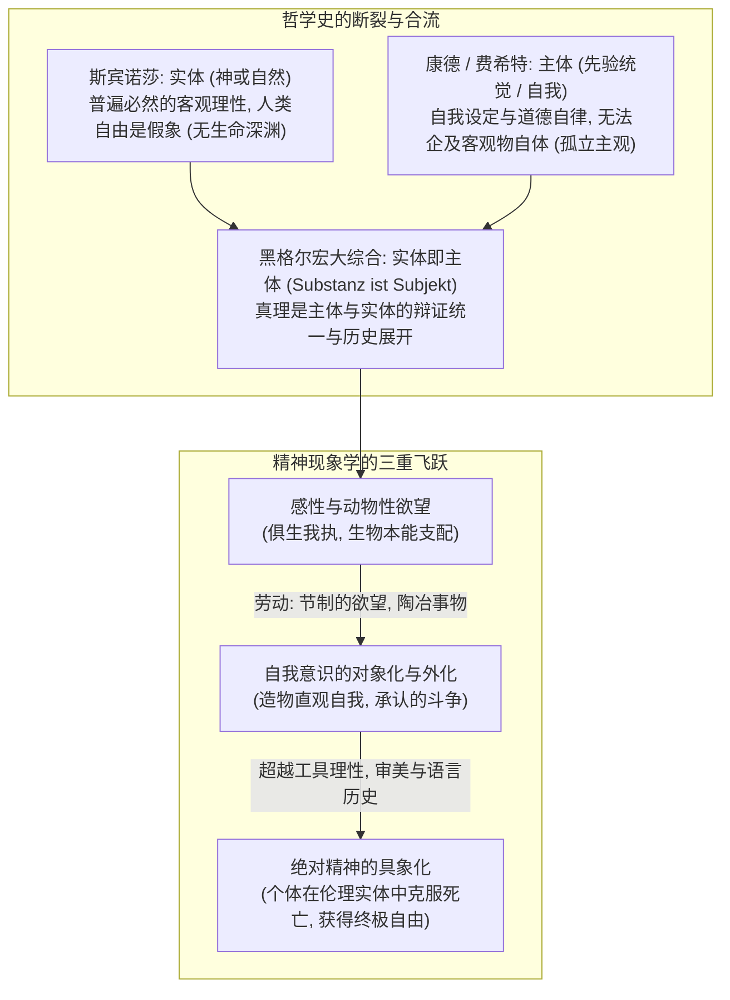
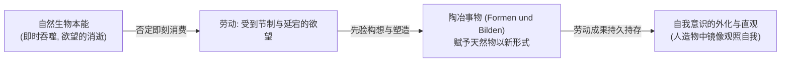
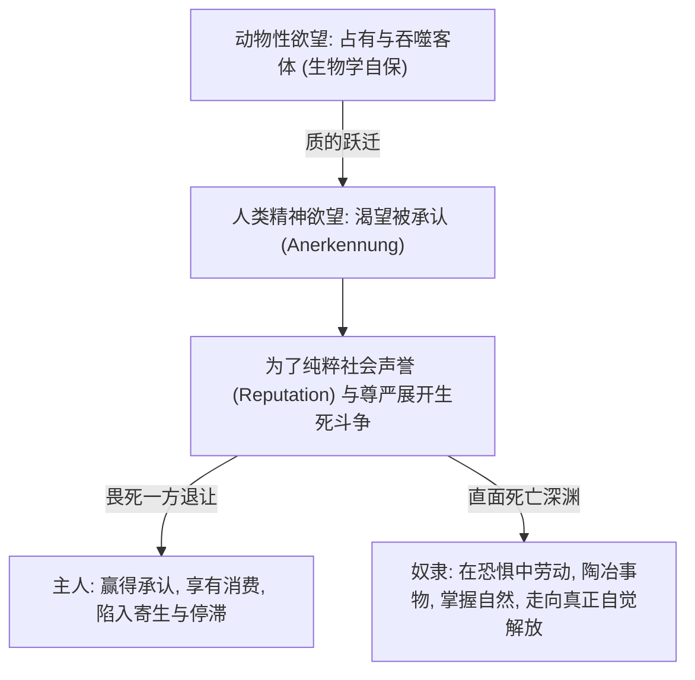

# 第十讲 结构化深度探究：自我意识与实体的关系——真理是主体与实体的统一

---

## 导言：从康德的分裂到黑格尔的“绝对同一”

在德国古典哲学的登峰造极之作《精神现象学》（*Phänomenologie des Geistes*, 1807）序言中，格奥尔格·威廉·弗里德里希·黑格尔（G. W. F. Hegel）提出了震撼整个西方思想史的最高纲领：
> **“照我看来……一切问题的关键在于：不仅把真理理解和表述为‘实体’，而且同样理解和表述为‘主体’。”（*nicht als Substanz, sondern eben so sehr als Subjekt*）**

这一命题标志着西方哲学彻底走出了近代认识论的二元分裂：
1. **终结唯物主义与斯宾诺莎的“冷酷客体”**：实体不再是僵死、盲目、外在于人的客观必然性牢笼；
2. **扬弃康德与费希特的“主观悬空”**：主体不再是龟缩于现象界或无力跨越彼岸物自体的孤立有限自我；
3. **确立真理的过程性与实在性**：真理不是现成摆在那里的固定实体，也不是纯粹内省的主观观念，而是**实体自我分化、自我扬弃、最终在自我意识中达到自觉认识的完整历史演进过程**。

---

## 一、 实体与主体的哲学界定：思维对物理世界的超拔

### 1. 实体的本义：普遍的绝对理性
手稿开篇严格廓清了“实体”的内涵：
- **Not 物质实体**：绝非旧唯物主义朴素反映论中那种原子或机械积木式的物理实存；
- **Not 自在之物**：绝非康德先验哲学中高悬于认知彼岸、不可知、不可思的神秘黑箱；
- **实体即绝对理性**：上承斯宾诺莎的“实体即神或自然（*Deus sive Natura*）”，指支配宇宙、自然与人类历史背后那张具有客观必然性的理性法则之网。

### 2. 主体的诞生：思维有真假与“自为的理性”
主体究竟是如何确立的？手稿记录了极富原创性的认识论推演：
- **物理状态无真假**：一记响雷、一块石头滚落、水分子聚散，作为纯粹物理实在，只有“存在或不存在”、“发生或未发生”的事实，绝无所谓“真”或“假”的认知评判；
- **思维独具真假之分**：唯有人类的主观思维、判断与命题，才具有真理（Truth）与谬误（Falsehood）的区分；
- **“我”作为主体的奠基**：既然物理自然界自身不具备给出真假维度的能力，那么“给出真假判定者”必然不属于纯粹的物理因果区。由此，**能够自我反思、能够自我决定的精神主体正式宣告确立**！

> **“自我决定这个伟大的思想照耀着我们！”**
> 
> 从康德的道德自律，到费希特确立“自我设定自身与非我”，再到谢林断言“**世界是客观化了的理性**”（自然是可见的精神，精神是不可见的自然），德国唯心论将人类从被动的因果客体提升为具有能动创造力的本体之光。

---

## 二、 劳动的现象学：自我是对动物性欲望的超越

### 1. “动物说不出一个‘我’字”
黑格尔在《小逻辑》中深刻指出：动物没有真正的自我意识。动物的个体完全受到物种繁衍与生物生理规律的机械支配（手稿注为“俱生我执”式的生存本能）。当猛兽饥饿时扑杀猎物，它只是本能欲望的奴隶，无法跳出自身肉体来审视“我”的存在。

### 2. 劳动的本质：延迟满足与“陶冶事物”
人类究竟是如何从动物性本能中淬炼出真正的自我意识的？黑格尔给出的答案是——**劳动（*Arbeit*）**。

手稿以令人拍案叫绝的思想实验剖析了这一跨越：
1. **旧石器时代的反思**：当远古人类饥肠辘辘时，生物本能驱动他立即抓取浆果或撕咬生肉；但他为何竟能**克制当下吞咽的冲动**，耗费数小时去敲砸一块坚硬的燧石做成“石斧”？
   - 这表明：**人类学会了推迟即时满足，将当下的肉体欲望节制并悬置起来，转而投射到对一个“尚未存在的未来对象”的构想中**。
2. **“劳动是受到限制或节制的欲望”**：在纯粹的消费中，欲望随着对象的毁灭而一同消逝；而在劳动中，劳动者克制了摧毁欲望对象的冲动，把自己的心智、概念与技能注入到对象之中，**“陶冶（*Bilden*）了事物”**。
3. **对象的镜像直观（手表的分析）**：
   - 一块天然矿石经由劳动加工变成“手表”；
   - 手表不仅是金属，它凝聚了**时间认知**、**机械力学与材料学概念**，以及凝结无差别劳动的**社会价值与价格**；
   - 当工人或主体注视手表时，他直观到的不再是冷冰冰的外部顽石，而是**自身意识的对象化外化（*Entäußerung*）**！

正如马克思在《1844年经济学哲学手稿》中汲取黑格尔精髓所指出的：
> **“劳动是人的第一需要，它把意识变成一个外在的东西，然后我可以看它。”**
> 人在自己创造的世界中双重地直观自身。

---

## 三、 从劳动到审美：绝对精神对必然性的终极突破

### 1. 审美创造的纯粹自由：彩绘陶罐的思想实验
手稿敏锐地追问：制作石斧与手表，虽然推迟了欲望，但其终极目的难道不是依然为了更好地获取食物、测算效率吗？推迟的欲望，在底色上难道没有依然受制于生存的物理必然性吗？

对此，黑格尔哲学展现出了超拔的飞跃：
- **陶罐与色彩**：一个黏土陶罐原本已经完全可以盛装食物与汲水，满足生存的功能需要；然而，远古人类却偏偏要耗费宝贵的生命心力，在陶罐表面精心绘制优美对称的几何条纹与彩色图腾！
- **审美（Art）的非功利性**：**我们绝不能说一幅画、一首交响乐或一件艺术品是为了满足某种“延迟了的生物食欲”**！
- **绝对精神的觉醒**：艺术、宗教与哲学构成了黑格尔“绝对精神”的三大形态。在审美创造中，自我彻底斩断了生物本能的锁链，进入了精神自为表现的纯粹自由王国。

### 2. 语言、时间性与历史的生成（Becoming）
人不是空间中僵死的物质块，而是**时间性的存在（Temporal Being）**：
- 人为未来而活在当下，拥有超越感官现实的崇高生命理想；
- **语言是存在的家园**：海德格尔指出“思把存在托付给它的东西，交付给语言，致会有存在”；人与人之间的社会交往、主体际承认与精神传承，全赖语言得以展开；
- **历史即本体**：章学诚所谓“道备于六经，六经皆史”与黑格尔的历史哲学高度呼应——真理绝非悬空的抽象公式，它必定具象化为在时间历史洪流中不断自我否定、自我升华的生成过程（*Becoming*）。

---

## 四、 承认的斗争：人类最深刻的欲望是非生物性的

在《精神现象学》著名的“主奴辩证法（*Herrschaft und Knechtschaft*）”中，黑格尔揭示了一个根本秘密：
> **人类最深刻、最原初的欲望，并非求生求饱的生物性欲望，而是“渴望被另一个自我意识所承认（*Anerkennung*）的欲望”！**

### 1. 柏林讲堂的传奇公案：黑格尔 vs 叔本华
手稿以极其生动风趣的史实印证了“渴望承认”对哲学家的深层支配：
- 1820年，初出茅庐的叔本华自命不凡，特意将授课时间选定在与黑格尔同一时刻；
- **历史的判决**：黑格尔讲堂万人空巷、座无虚席；叔本华讲堂门可罗雀、寥寥数人，最终惨淡停课。
- 这一公案深刻揭示：哪怕是主张“万物皆是虚妄痛苦、应当禁欲绝弃意志”的叔本华，其内心深处同样无法摆脱对“社会声誉（*Social Reputation*）与历史不朽”这一崇高精神承认的极度渴望！

---

## 五、 实体与主体的统一：政治与伦理生活的具象论证

脱离实体的主体是虚无任性的主观臆造；脱离主体的实体则是吞噬个性的专制铁笼。唯有在实体与主体的互融统一中，普遍必然的客观法则才能焕发活生生的人格尊严。

| 实践领域 | 脱离实体的抽象主观（偏狭主体） | 脱离主体的僵死体制（压迫实体） | 实体与主体的辩证统一（黑格尔真理） |
| :--- | :--- | :--- | :--- |
| **政治实践** | **政客（Demagogue）**：只讲主观迎合与私利 opinions，煽动群体非理性情绪 | **官僚极权**：将国家视为凌驾于个体之上的冷血统治工具，践踏公民权利 | **真正的政治家（Statesman）**：将政治视为追求历史真理的崇高场域，使制度普遍性与人民福祉融为一体 |
| **婚姻伦理** | **纯粹轻浮的浪漫冲动**：完全凭一时肉体快感或任性主观激情，毫无社会责任 | **无爱情的宗法包办**：旧儒家实践中常见的盲婚哑嫁，个体自由意志沦为家族繁衍的冷血附庸 | **现代神圣婚姻**：在教堂或公共仪式下，男女双方自由自主的内在爱情（主体）与伦理契约责任（家庭实体）达成崇高誓约 |
| **个体终极宿命** | **自私渺小的利己主义**：恐惧肉体死亡，沉溺于感官享乐，最终在虚无中湮灭 | **泯灭个体的极权牺牲**：将人视为可以随意碾碎丢弃的消耗性零件 | **克服有限性的崇高跃迁**：“通过劳作与教化克服对死亡的恐惧，把有限生命投入到无限的崇高使命中去” |

---

## 六、 结论：在有限生命中通达无限绝对

黑格尔哲学的终点，绝非让人消融于冰冷庞大的“绝对精神”巨兽之中，而是为芸芸众生指明了一条从有限通往不朽的自我实现之路：
1. **直面死亡的有限性**：人终有一死，肉身皆为尘土；
2. **劳作与教化（*Bildung*）的洗礼**：通过踏踏实实的精神生产与感性劳作，我们把主观的精神力量凝结为造福世间的客观文明硕果；
3. **东方佛理与现世践履的共鸣**：
   - 东方佛家讲“**众生成佛**”，即在凡夫俗子当下的自性觉悟中圆满万德；
   - 现代崇高践履讲“**把有限的生命，投入到无限的为人民服务中去**”——这绝非虚妄的口号，而是黑格尔“有限个体在普遍实体中实现永恒不朽”之历史哲学最掷地有声的现代回响！

---

*知识库协作指引：[AGENTS.md](./AGENTS.md)*  
*手稿逐字还原版参见：[第十讲_手稿还原.md](./第十讲_手稿还原.md)*
