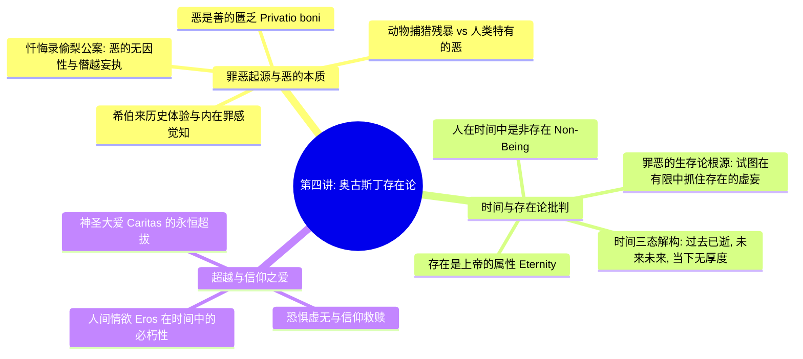

# 第四讲：圣·奥古斯丁的存在论——人与上帝的关系

> **本讲核心题旨**：从中世纪早期教父哲学枢纽——圣·奥古斯丁（Aurelius Augustinus）的经典文本出发，探讨人类罪恶的起源、恶的无因性与本体论地位（Privatio boni）、时间对存在的解构以及神圣信仰之爱（Caritas）对虚无的救赎。

---

## 快速导航与知识图谱

| 文档类型 | 入口链接 | 核心内容提要 |
| :--- | :--- | :--- |
| **手稿忠实还原版** | [第四讲_手稿还原.md](./第四讲_手稿还原.md) | 逐页忠实还原 2 页手稿原貌，保留思考原笔迹、错字校注与学理 TODO 标记，链接手写关键切图。 |
| **结构化深度探究版** | [第四讲_结构化深度探究.md](./第四讲_结构化深度探究.md) | 系统阐发希伯来内在罪感、恶的专属性、《忏悔录》偷梨公案、时间的现象学解构、中西思想深度对照。 |

---

## 本讲核心哲学命题摘要

1. **“恶仅在于人类”与自由意志的下堕**：
   自然界弱肉强食是生物本能与因果律使然，无所谓善恶；人类唯因具备超越本能的自由决断意志，方能在无利害驱使下自觉选择作恶。“恶”不是自然事实，而是存在性的沉沦。
2. **“偷梨公案”与恶的本体论虚无性（Privatio Boni）**：
   奥古斯丁通过偷梨往事证明，恶并非出于饥寒利害的驱动，而是“纯粹为了作恶而作恶”。恶在本体论上不是独立实体，而是对最高善的背离与亏损。
3. **“在时间中的存在是非存在”**：
   过去已不复存在，未来尚未存在，当下流逝无常不可停留。受造物身陷流淌的时间，本质上是流变的“非存在”；唯有超时间的永恒上帝，才是绝对完满的“存在”（Being）。
4. **罪恶的生存论本质是对虚无的执着**：
   罪恶并非头脑认知的偶然偏失，而是有限的人类无法正视自身的必朽与虚无，狂妄地试图将世俗事物（名利、美色、强权）偶像化以求永恒的病态执念。
5. **人间之爱（Eros）与神圣之爱（Caritas）的根本界分**：
   依附于时间之物的人间情爱，注定随时间流逝而衰亡幻灭；唯有将生命扎根于超验信仰的神圣之爱中，灵魂才能穿越虚无，获得不朽的归宿。

---

*知识库规范与指引详见：[AGENTS.md](./AGENTS.md)*
