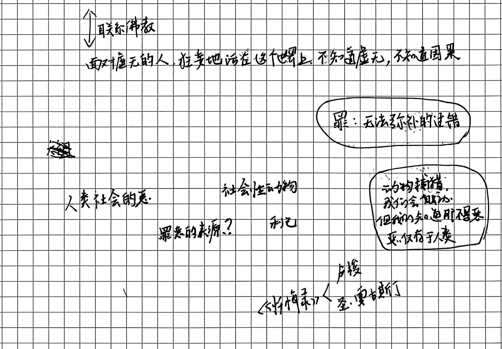
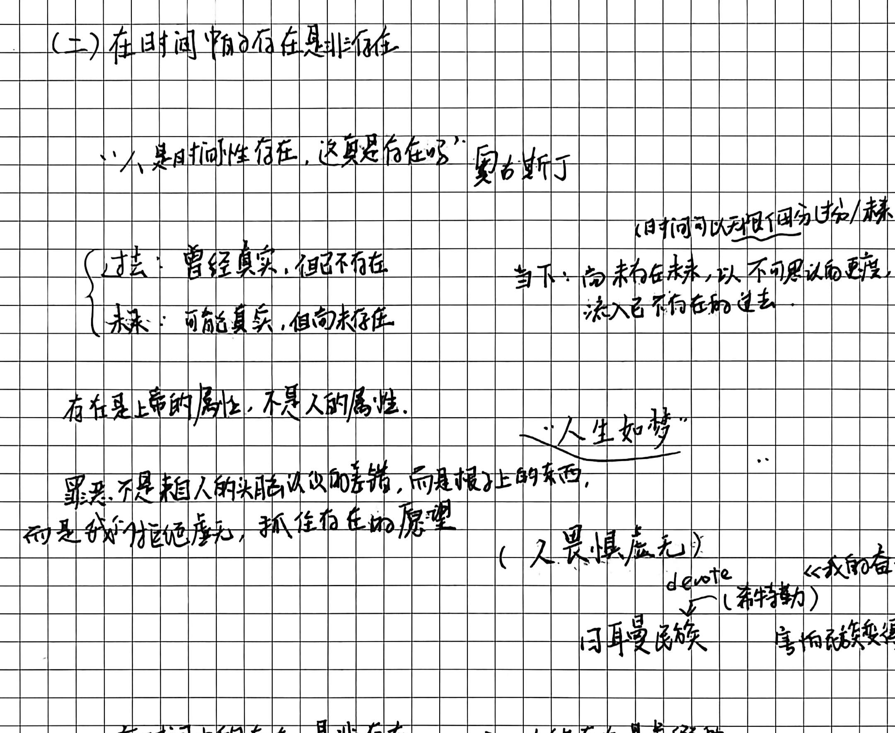
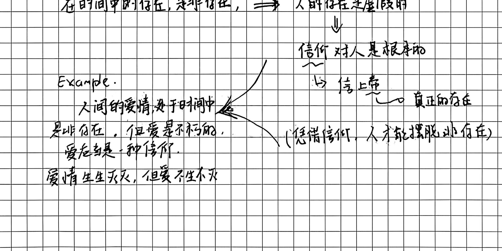

# 第四讲手稿还原：圣·奥古斯丁的存在论（人与上帝的关系）

> **整理说明**：
> 1. 本文档严格依循手稿原始行文逻辑、段落划分与板书笔触逐页忠实整理。
> 2. 原始笔误与错别字以括号注出正字（如“偷梭（梨）”）。
> 3. 学理与事实疑问已按规范注入 `// TODO: [疑问描述]` 批注，供后续审核校验。
> 4. 关键手稿板书切图均保存在 `assets/images/第四讲/` 目录中。

---

## 第 1 页：人类罪恶的起源问题与恶的无因性

### (一) 人类罪恶的起源问题

- **历史渊源与希伯来人的反思**：
  - 以色列犹太民族出埃及，迁往迦南美地（耶路撒冷，希望之乡）。
  - 在这一苦难历程中，犹太人陷入深沉反思：为何颠沛流离、苦难重重而无斩获？异族对他们的屠戮与残暴从何而来？
  - **自我觉知的苏醒**：从盲目承受外部杀戮，到转向内在反思：“我们知道了……”
  - **与东方佛学的对照随感**：
    - 世人狂妄地活在世上，不知虚无，不知因果。
    - 异教徒/凡人“自以为正义”地杀戮与占有，恰恰暴露了人类对于自身生存荒谬性的盲目。

- **关于“罪”与“恶”的学理界定**：
  - **罪（Sin）**：并非简单的世俗过失，而是**无法弥补的过错**。
  - **恶的专属性（恶仅在于人类）**：
    - 自然界中动物捕猎，场面尽管极其血腥残暴，但那**不是恶**，那是自然法则与生存本能。
    - **“恶仅在于人类”**——唯有人类具有自由意志与道德觉知，唯有人类能够在没有自然本能驱动的情形下行恶。

- **奥古斯丁《忏悔录》中的“偷梨公案”**：
  - 少年奥古斯丁与同伴在深夜潜入邻人果园偷梨（手稿作“偷梭（梨）”）。
  - **反常的反思**：
    - 偷梨既不是因为饥饿（家里有更好的梨），也不是为了果腹或换取金钱。
    - 摘下一大堆梨之后，仅仅咬了一两口便全部扔给猪吃。
  - **恶的本体论追问**：
    - 如果人类的一切行为皆有动机（趋乐避苦、利己），那么这次偷盗的动机是什么？
    - 答案是：**没有动机，纯粹为了行恶而行恶**。
    - 这揭示了恶的荒谬性与无因性——**恶并非一种充实的实体（Substance），而是对虚无的狂妄妄执，是善的缺失（Privatio boni）**。

---

## 第 2 页：在时间中的存在是非存在与爱的信仰

### (二) 在时间中的存在是非存在

- **关于时间与存在的根本拷问**：
  - 奥古斯丁命题：“人是时间性存在，这真是存在吗？”
  - 对“时间三态”的解构：
    1. **过去（Past）**：曾经真实过，但现在已经不复存在；
    2. **未来（Future）**：可能成为真实，但现在尚未存在；
    3. **当下/现在（Present）**：如果“现在”是一个可度量的时间段，那么它就能被无限分割；一旦被分割，前半段便落入过去，后半段便属于未来。
    - 因此，“当下”只是一个无延展的瞬刻切片——尚未存在的未来以不可思议、无法驻留的速度飞速流入已经不存在的过去。

- **形而上学结论：人在时间中是非存在**：
  - **“存在是上帝的属性，不是人的属性。”**
  - 上帝处于永恒（Eternity）之中，无过去亦无未来，是完全充盈的“是”（Being）；
  - 人坠入时间（Time）之中，处于流逝、生灭与虚无之中。因此，**在时间中的肉身存在是虚假的、非存在的**。
  - **罪恶的更深层本质**：
    - 罪恶并非头脑认识上的单纯差错，而是**“不能拒绝虚无，试图抓住存在的虚妄愿望”**。
    - 人明知自身如幻影流逝，却狂妄地试图在有限、流变的时间事物（肉体享受、世俗权势、物质占有）中确证永恒，这便是一切狂妄与痛苦的根源。

- **信仰的救赎与神圣之爱**：
  - **人为何必须信仰上帝？**
    - 人内心深处具有对终极虚无的巨大恐惧；唯有信靠真正永恒的存在（上帝），人的灵魂才能脱离流逝之苦，摆脱非存在的虚无。
  - **人间爱情与“爱的信仰”之辨析**：
    - **人间的爱情（Eros / 浪漫爱）**：发生于时间之中，随荷尔蒙、肉身衰老与时间流逝而生灭变化，在本体论上终究是“非存在”；
    - **爱的信仰（Caritas / 圣爱）**：爱本身是不朽的、不生不灭的。超越时间维度的神圣大爱，才是超越虚无、连通绝对存在的唯一通途。

---
// TODO: [学理核查] 手稿第一页中论及以色列人出埃及反思罪恶时，随笔联想到了东方佛学对世人狂妄不知因果的批判。在结构化讲义中，应将奥古斯丁“恶为善之缺失”（Privatio boni）与东方佛学“诸行无常、诸法无我、十二因缘生灭”进行深度视域融合，阐明二者在面对“虚无与苦难”时走向基督教“恩典救赎”与佛家“般若解脱”的不同转向。
