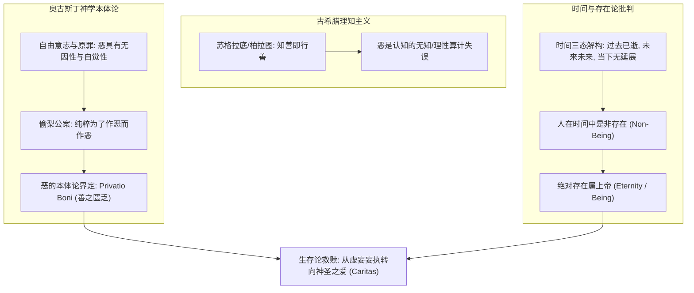
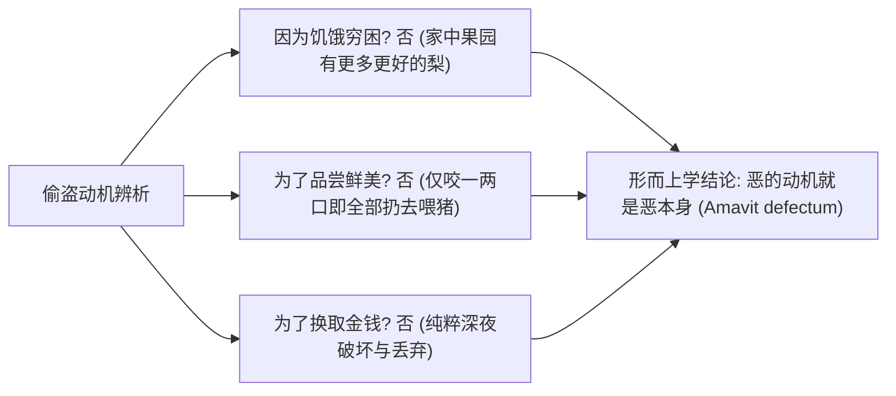
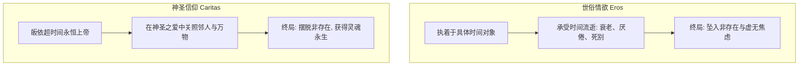

# 第四讲 结构化深度探究：圣·奥古斯丁的存在论——恶的无因性、时间的虚妄与神圣之爱

---

## 导言：从中世纪转向看西方思想史的“心性裂变”

从古希腊的理性宇宙论（古希腊人追求本原 $\text{Arche}$、理念 $\text{Idea}$ 与逻各斯 $\text{Logos}$），跨越到中世纪早期教父哲学（Patristic Philosophy），西方思想发生了一场深刻的“本体论与生存论转向”。这一转向的核心枢纽正是**圣·奥古斯丁（Aurelius Augustinus, 354–430）**。

在古希腊哲学家（如苏格拉底、柏拉图）看来，“无人有意作恶，知善则必能行善”（德性即知识）。然而奥古斯丁彻底击碎了古希腊这一乐观的理知主义神话。通过将希伯来犹太教的苦难反省、原罪意识与新柏拉图主义的本体论深度融合，奥古斯丁确立了基督教哲学的核心支柱：
1. **恶的本质并非实体，而是善的匮乏与自由意志的下堕**；
2. **凡在时间之中的受造物皆是非存在（Non-Being），唯有超时间的永恒上帝才是真正的“是/存在”（Being）**；
3. **世俗的情欲与占有是一场对虚无的狂妄妄执，唯有依靠神圣的信仰与超验之爱（Caritas），人才能超越时间的虚妄吞噬**。

---

## 一、 人类罪恶的起源：希伯来历史体验与恶的专属性

### 1. 希伯来人的流散苦难与内在罪感觉知
手稿开篇指出：**“以色列犹太民族出埃及迁往迦南美地（耶路撒冷，希望之乡），反思为何苦难重重而无斩获？”**

在古代两河流域与地中海世界，异族之间的杀戮掠夺是司空见惯的残酷常态。但希伯来文明与其他征服文明的根本分水岭在于：
- **征服者的神话逻辑**：战败是因为“我们的神力不如对方强”，解决之道是寻找更强大的世俗武装或更大神灵的护佑；
- **希伯来先知的内在罪感反思**：面对巴比伦之囚、波斯统治与罗马帝国的铁蹄，犹太先知没有将苦难归咎于外在异族的强暴，而是走向彻底的**内在性省察——“我们有罪了，我们背弃了与耶和华的圣约”**。

这种由外向内的倒转，使人类第一次不再把世界看作单纯冷酷的物理竞技场，而是赋予了苦难强烈的**道德神学意蕴**：苦难并非无意义的自然淘汰，而是神圣正义对人类狂妄与背离的诫命。

### 2. 恶的专属性：自然界的残暴 vs 人类特有的“恶”
手稿明确提出了一个极具穿透力的哲学命题：
> **“自然界中动物捕猎，场面尽管极其血腥残暴，但那不是恶，那是生存法则与生物本能。恶仅在于人类。”**

- **动物之“暴”**：肉食动物捕杀猎物是自然本能与生态链的必然展开，受盲目的自然因果律（Causality）支配。狼捕食羊没有恶意，亦无善恶反思；它既无法选择不捕杀，亦无需为捕杀承担形而上学或道德责任。
- **人类之“恶”（Moral Evil）**：唯有人类具有脱离直接生物本能的**自由决断意志（Liberum Arbitrium）**。人类可以为了虚荣、权欲、甚至纯粹的破坏欲去折磨同类与毁灭生灵。因此，“恶”不是一种自然事实（Natural Fact），而是**一种存在性的堕落（Existential Perversion）**。

### 3. “罪”的本体论定义：无法弥补的断裂
手稿将“罪”定义为**“无法弥补的过错”**。
在世俗法律中，过错可以通过金钱赔偿、服刑或劳役来在社会层面上“抵消”；但在神学存在论中，“原罪（Peccatum Originale）”标志着人与神圣本体之间绝对关系的彻底断裂。有限的受造物凭借自身哪怕一切微末的善功，都无法填平这一无限的本体论鸿沟。这决定了人类无法完成自我拯救，必须期待超验恩典（Gratia）的白白临照。

---

## 二、 恶的无因性与《忏悔录》“偷梨公案”

### 1. 经典公案还原：超越功利主义的无因之恶
在《忏悔录》（*Confessiones*, 卷二）中，奥古斯丁详细剖析了少年时期的一件往事：他和几个放荡青年在深夜摇落邻居家的一棵梨树（手稿作“偷梭（梨）”）。

奥古斯丁反复拷问：
> “我所爱的不是那梨，我爱的是我的盗窃本身，我爱的是我的罪恶本身……我一无所缺，却去作恶，我偷只是为了偷，只是为了享受破坏禁令的狂妄。”

### 2. 哲学解析：恶作为“善的匮乏”（Privatio Boni）
奥古斯丁早年曾深陷**摩尼教（Manichaeism）**的二元论泥潭。摩尼教认为宇宙中有两个永恒对立的实体：善神（光明）与恶神（黑暗），恶是一个具有独立本体地位的实体。

但奥古斯丁借助新柏拉图主义的启发，彻底摧毁了摩尼教的这一假定，确立了西方正统的神学本体论：
1. **上帝是一切存在的源泉，上帝造的一切皆是善的（All that is, is good）**；
2. **恶绝对不是实体（Malum non est substantia）**。如果恶是实体，那么它要么是上帝所造（这就使上帝成为作恶之源，自相矛盾），要么是与上帝并列的永恒本原（摧毁了一神论的完备性）；
3. **恶乃是善的亏缺、缺损与偏离（Privatio boni）**，犹如黑暗不是一种实体光线，而仅仅是光线的缺席；疾病不是一种实体组织，而仅仅是健康机制的紊乱与瘫痪；
4. **偷梨的心理机制**：人不是爱恶本身（因为恶空无一物），人是在以一种极其扭曲、狂妄、拙劣的方式去**僭越摹仿上帝的无所不能**。受造物妄图挣脱受造的地位，像全能的上帝一样肆意践踏法则，这种向虚无深渊的滑坠，即是自由意志的沉沦。

---

## 三、 时间与存在：在时间中的存在是非存在

手稿第二页触及了奥古斯丁哲学中最震撼人心的形而上学核心：**对时间的现象学解构与人的非存在本质**。

### 1. 对时间三态的终极瓦解
在《忏悔录》卷十一中，奥古斯丁发出了哲学史上最著名的感叹：
> “时间究竟是什么？没有人问我，我倒清楚；有人问我，我想说明，便茫然不解了。”

手稿以极其凝练的逻辑梳理了奥古斯丁对时间的解构：

| 时间维度 | 经验直觉假象 | 严格本体论批判 | 结论 |
| :--- | :--- | :--- | :--- |
| **过去 (Past)** | 仿佛真实积淀在身后 | 曾经真实过，但此刻已彻底化为乌有，不复存在 | **非存在 (Non-Being)** |
| **未来 (Future)** | 仿佛等待在前方展现 | 可能成为真实，但此刻尚未降临，根本没有实体 | **非存在 (Non-Being)** |
| **当下 (Present)** | 似乎是唯一实实在在拥有的瞬间 | “当下”若具有哪怕一微秒的长度，即可被无限分割；一旦被分割，前一部分落入“已逝”，后一部分属于“未来”。因此，当下是一个**没有延展厚度（No Extension）的纯粹数学切片** | **流逝的刹那 / 无法捕捉** |

### 2. 核心命题：存在是上帝的属性，不是人的属性
由此，奥古斯丁得出了石破天惊的本体论判决：
$$\text{Being} = \text{God} \quad (\text{Eternity})$$
$$\text{Human} \in \text{Time} \implies \text{Non-Being} \quad (\text{Vanity})$$

- **神圣永恒（Eternity）**：上帝的“永恒”绝非世俗时间无穷无尽的拉长，而是**彻底超越时间维度（Timelessness）的“永恒当下”（Nunc Stans）**。在上帝那里，没有从潜在向现实的演进，没有消亡，完全充盈、纯粹、自我统一。
- **人的时间性虚妄**：人类作为受造物，被抛掷在川流不息的时间之河中。人从虚无中被创造，在时间的每一秒钟都在滑向消亡。因此，**在时间之中的人的肉身存在与世俗显现，在绝对严格的本体论意义上全都是“非存在”**。

### 3. 罪恶的存在论本质：不能拒绝虚无，试图抓住存在的虚妄愿望
手稿指出：**“罪恶并非头脑认识的差错，而是不能拒绝虚无，试图抓住存在的虚妄愿望。”**

这一洞见极其深刻：
- 人作为有限的时间存在，敏锐地洞察到了自身不可避免的虚无与死亡；
- 但人因狂妄与自恋，**不愿在信仰中坦然承认自身的微末与虚无**；
- 于是，人试图在转瞬即逝的世俗事物（金钱、美色、肉身快感、帝国霸权、知识虚荣）中牢牢抓住“永恒”；
- 这种把相对、流变、必朽的受造物偶像化为绝对实在的妄动，就是**偶像崇拜（Idolatry）与原罪的根本根源**。

---

## 四、 爱的形而上学：从人间情欲（Eros）到神圣信仰（Caritas）

### 1. 人间爱情的悲剧性宿命：时间之网中的泡沫
手稿末尾精辟地剖析了人间爱情与神圣信仰的鸿沟：
- **人间的浪漫爱与情欲（Eros / Amor Vulgaris）**：
  - 必须依附于时间之中的具体对象（青春容颜、迷人肉身、情感共鸣）；
  - 既然它在时间之中，就必然臣服于时间的残酷法则：**容颜老去、荷尔蒙消退、误解丛生、生离死别**；
  - 试图在时间性的有限肉身身上寻求永恒不变的绝对誓言，本质上是把有限之物神圣化，注定必然走向幻灭、焦虑与背叛。

### 2. 爱的信仰（Caritas / 圣爱）：超越虚无的唯一阶梯
- **神圣之爱（Caritas）**：
  - 爱本身并非随时间衰竭的心理情绪，而是**上帝本体的溢出与向超验维度的绝对皈依**；
  - 人不是将爱终结于世俗的肉身，而是**“在上帝之中爱人”**（Loving neighbors in God）；
  - 当我们穿透时间事物的必朽性，把终极的信靠安置在超时间的永恒上帝那里，人才能摆脱被虚无吞噬的绝望恐惧，从而使短暂的人间关爱获得神圣不朽的根基。

---

## 五、 中西视域对照：奥古斯丁原罪论 vs 东方佛学与儒道心性

手稿在第一页特别提及了与东方佛学的随笔对照，在此展开系统学术比较：

| 维度 | 圣·奥古斯丁（基督教存在论） | 东方佛学（佛教大乘般若/华严） | 先秦儒家与宋明理学 |
| :--- | :--- | :--- | :--- |
| **世界与苦难的起源** | 上帝自由意志创世；人类因滥用自由意志违约堕落（原罪） | 无始无明，十二因缘互摄互入，因果业报流转 | 天命之谓性，率性之谓道；因私欲障蔽本心 |
| **恶的本质** | **善的缺失（Privatio boni）**，意志向虚无的偏斜 | **妄想执着**；幻有无自性，当体即空 | **气质之偏与物欲蔽锢**；恶非本然，返本归正 |
| **时间的性质** | 受造物的流动延展（Distentio animi）；在时间中是非存在 | **刹那生灭，过现未三世不可得**；念念不住 | **生生不息（大化流行）**；“逝者如斯夫，不舍昼夜” |
| **救赎与超越之径** | **恩典救赎（Sola Gratia）**：信靠上帝与圣爱（Caritas），依靠他力 | **般若智慧（Prajna）**：照见五蕴皆空，明心见性，了脱生死 | **修己安人，极高明而道中庸**：在日用伦常中体认天理 |

---

## 结语：奥古斯丁对现代人存在的终极追问

奥古斯丁在第四讲中留给人类的不仅是一套神学信条，而是一面直击人类存在虚无本质的心灵透镜：
1. **警惕技术与理性的道德盲目**：人类文明如果只有掌控物质世界的科技工具，却没有对自身内在“恶的无因性”与破坏冲动的清醒自律，越强大的力量越会加速自我毁灭；
2. **直面时间对生存的无情撕碎**：在现代消费主义以碎片化狂欢麻醉当下的时代，奥古斯丁警醒我们：一切将幸福寄托于短暂流变之物的企图，终将在虚无的深渊前碰得头破血流；
3. **唯有超越维度的神圣大爱，才能赋予破碎时间以意义**：唯有当灵魂向某种超越世俗利害的崇高价值敞开，人类才能在荒谬的时间漂流中找到坚实的精神锚桩。
